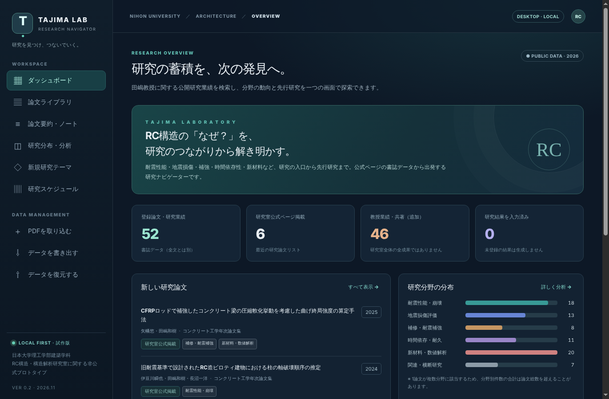

# Tajima Lab Research Navigator（非公式試作版）v0.2

日本大学理工学部建築学科「RC構造・構造解析研究室（田嶋和樹教授）」の公開書誌情報をもとにした、論文閲覧・先行研究探索のデスクトップ試作アプリです。**大学・研究室の公式アプリではありません。**



## できること

| 機能 | 内容 |
|---|---|
| 論文ライブラリ | 公開書誌52件（研究室公式掲載6件＋田嶋教授の共著を含む業績46件を区別）の検索・分野/年度/出典フィルタ。スペース区切りAND検索、同義語辞書（RC＝鉄筋コンクリート、FEM＝有限要素 など） |
| PDF取り込み | 手元のPDFをPC内（`userData/pdfs/`）にコピーして論文に紐づけ、新規資料として登録 |
| 内蔵PDFビューア | PDF.js（同梱・オフライン）でアプリ内表示。ページ移動・拡大縮小・「根拠ページに追加」。日本語PDF（CMap）対応 |
| 本文全文検索 | 取り込んだPDFの本文テキストを端末内で索引化し、一致ページ（p.N）から直接ビューアを開く |
| 書誌候補の抽出 | PDFのメタデータ・1ページ目の最大文字の行・本文の西暦から、タイトル/著者/年の**候補**を根拠付きで提示（自動確定はしない） |
| 要約・ノート | 目的・方法・結果・結論・限界・根拠ページを本文確認しながら記入。AIによる自動生成はしない |
| 分布分析 | 年度別（合計＝登録件数）・分野別（複数分類の重複計数を明示） |
| 先行研究の候補 | 研究テーマを入力すると、分野一致・題名の文字列一致・同義語・取り込んだ本文の一致を理由付きで提示（スコアは検索用の相対値） |
| 研究スケジュール | 開始日から作る**仮の**9工程（研究室の公式日程ではない）。日付・完了状態を自動保存 |
| バックアップ | JSON書き出し・復元（PDF本体は含まない旨を明示）。保存時に1世代前を自動退避し、破損時は自動復旧 |

スクリーンショット：[`docs/screenshots/`](docs/screenshots/)（E2Eテスト実行中に自動撮影）

## すぐに使う

### デスクトップアプリ（開発実行）

Node.js 22以上が必要です。

```bash
cd app
npm ci
npm run check      # 書誌検証＋ユニットテスト
npm start          # アプリ起動
```

### インストーラーを作る

```bash
cd app
npm run dist:win     # Windows: NSISインストーラー + ポータブルexe（Windows上で実行）
npm run dist:mac     # macOS: dmg + zip（arm64/x64, ad-hoc署名）（Mac上で実行）
npm run dist:linux   # Linux: AppImage
npm run check:dist   # 配布物にPDF・個人データが入っていないか検査
```

GitHub Actions（`.github/workflows/build.yml`）が Windows / macOS / Linux それぞれでビルドし、**ビルドした実アプリに対してE2Eテストを実行**してからインストーラーをArtifactとして保存します。2026-11-09 の実行では3OSとも合格（Actions → 該当run → Artifacts の `installer-windows-latest` 等からダウンロード）。

> 未署名のため、Windowsでは SmartScreen の「詳細情報 → 実行」、macOSでは「右クリック → 開く」（またはシステム設定 → プライバシーとセキュリティ → このまま開く）が必要です。正式配布にはコード署名・公証が別途必要です。

### ブラウザだけで試す（依存なし）

```bash
cd app
python -m http.server 8765   # → http://localhost:8765
```

ブラウザ版はデータを `localStorage` に保存します。取り込んだPDF本体は再読み込みで消えます（メモ・本文索引は残ります）。

## テスト

```bash
cd app
npm run check                 # ユニット 30件
xvfb-run -a npm run test:e2e  # 実GUI E2E：Electron 13件 + ブラウザ 5件（Mac/Windowsは xvfb-run 不要）
TAJIMA_ELECTRON_BIN=dist/linux-unpacked/tajima-lab-research-navigator xvfb-run -a npm run test:e2e:electron  # 配布物に対するE2E
```

受け入れテスト（A01〜A14）の対応表：[`research/ACCEPTANCE_TESTS.md`](research/ACCEPTANCE_TESTS.md)

## データと権利についての重要事項

- 研究室の「最近の研究論文」6件 ≠ 研究室の全論文。教授業績46件には共著が含まれます。
- 書誌の存在 ≠ PDFの所持・全文の確認。研究結果・結論は本文を読んだ利用者だけが記入します。
- 分野タグは題名ベースの暫定分類。推薦スコアは学術的な正しさの確率ではありません。
- 論文PDFはアプリに同梱していません（`check:dist` で検査）。PDFは利用者がローカルで取り込みます。外部サーバーへの送信は一切ありません。

詳細：[`START_HERE.md`](START_HERE.md) / [`research/`](research/) / 開発者向け指示 [`CLAUDE.md`](CLAUDE.md)
