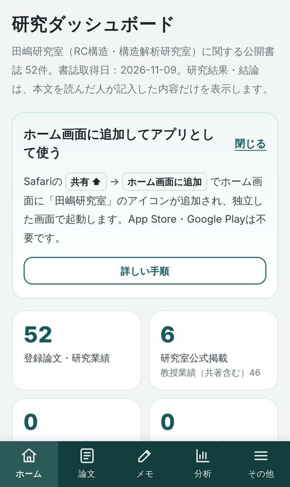
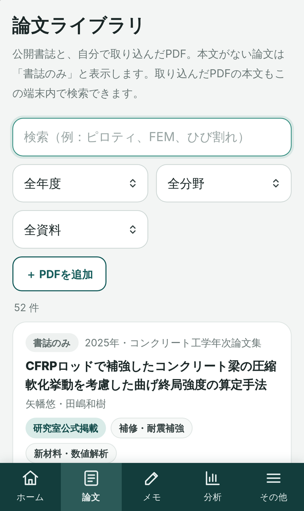
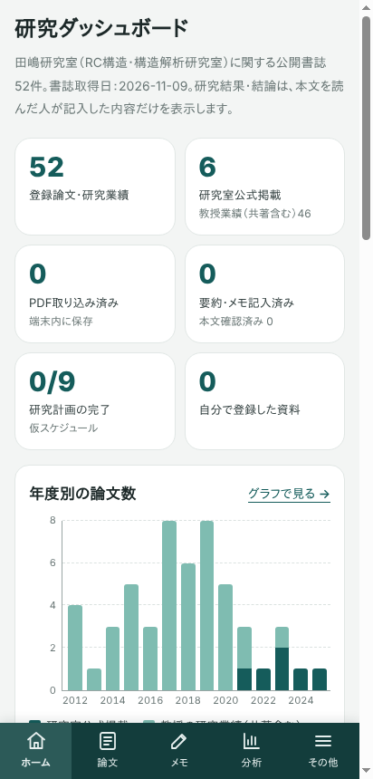

# 田嶋研究室 Research Navigator（非公式試作版）v0.3

日本大学理工学部建築学科「RC構造・構造解析研究室（田嶋和樹教授）」の公開書誌情報をもとにした、論文閲覧・先行研究探索アプリです。**大学・研究室の公式アプリではありません。**

- **スマートフォン（iPhone / Android）**：URLを開いて「ホーム画面に追加」するだけ。App Store・Google Play・Apple Developer Programは不要です。
- **パソコン（Windows / Mac / Linux）**：デスクトップアプリ（インストーラー）またはブラウザで利用できます。

<p>



</p>

## スマートフォンで使う（インストール方法）

**URL：https://tajima-lab.pages.dev**

### iPhone（Safari）

1. **Safari** で https://tajima-lab.pages.dev を開く（LINE・Instagram・Googleアプリ内のブラウザでは追加できません）
2. 画面下（iPadは右上）の **共有ボタン（□に↑）** を押す
3. メニューを下にスクロールして **「ホーム画面に追加」** を選ぶ
4. 名前が **「田嶋研究室」** になっていることを確認して **「追加」**
5. ホーム画面の「田嶋研究室」アイコンを押すと、独立したアプリ画面で起動します

### Android（Chrome）

1. **Chrome** で https://tajima-lab.pages.dev を開く
2. 右上の **︙（メニュー）** を押す
3. **「アプリをインストール」**（表示されない場合は「ホーム画面に追加」→「インストール」）を選ぶ
4. **「インストール」** を押すと、ホーム画面とアプリ一覧に「田嶋研究室」が追加されます
5. アイコンから起動すると、独立したアプリ画面で開きます

> 一度開いたあとは**オフラインでも起動**できます（検索・メモ・PDF閲覧・研究計画）。
> データ（取り込んだPDF・要約メモ・研究計画）は**その端末の中だけ**（IndexedDB）に保存され、外部へ送信されません。アクセス解析・広告もありません。
> iPhoneでは、Safariで開いたページとホーム画面のアプリで保存場所が別です。ホーム画面のアプリで使い続けてください。機種変更に備えて「その他 → バックアップを作成」で定期的に保存してください（PDF本体はバックアップに含まれません）。

## できること（スマートフォン・パソコン共通）

| 機能 | 内容 |
|---|---|
| 論文の閲覧・検索 | 公開書誌52件（研究室公式掲載6件＋田嶋教授の共著を含む業績46件を区別）。スペース区切りAND検索、同義語（RC＝鉄筋コンクリート、FEM＝有限要素など） |
| 絞り込み | 年度・研究分野（暫定分類）・出典 |
| PDFの取り込み・閲覧 | スマートフォンのファイル選択（iCloud Drive・Googleドライブ・ダウンロード等）からPDFを追加。アプリ内ビューア（PDF.js、日本語PDF対応）でページ移動・拡大・「根拠ページに追加」 |
| PDF本文の検索 | 取り込んだPDFの本文を端末内で索引化し、一致したページから直接開く |
| 要約・研究メモ | 目的・方法・結果・結論・限界・根拠ページ＋自由メモ。AIによる自動生成はしない |
| 分布グラフ | 年度別（出典別・読書状況別）と研究分野別。年度別合計＝登録件数、分野別は重複計数を明示 |
| 先行研究の検索 | 新しい研究テーマから、関連しそうな登録論文を理由付きで表示（スコアは検索用の相対値） |
| 研究スケジュール | 開始日から作る**仮の**9工程（研究室の公式日程ではない）。日付・完了を保存 |
| バックアップ・復元 | JSONで保存（スマートフォンは共有シート→「ファイルに保存」）・復元 |

## パソコンで使う

- **インストーラー**：GitHub Actions の Artifacts（`installer-windows-latest` / `installer-macos-latest` / `installer-ubuntu-latest`）。未署名のため、Windowsは SmartScreen の「詳細情報 → 実行」、macOSは「右クリック → 開く」が必要です。
- **ブラウザ**：https://tajima-lab.pages.dev をChrome/Edge/Safariで開く（Chrome/Edgeはアドレスバーのインストールボタンでアプリとして追加可能）。

開発者向け：

```bash
cd app
npm ci
npm run check       # 書誌検証＋ユニットテスト30件
npm start           # デスクトップアプリを起動
npm run dist:win    # / dist:mac / dist:linux  インストーラー作成
```

## Webアプリ（PWA）の公開

```bash
cd app
npm run build:web   # app/dist-web/ に公開用ファイルだけを出力（PDF・個人データ・テストは含まない）
# Cloudflare Pages へ配置（トークンはコードに書かず、環境変数かGitHub Secretsで渡す）
CLOUDFLARE_API_TOKEN=… CLOUDFLARE_ACCOUNT_ID=… npx wrangler@4.151.3 pages deploy dist-web --project-name=tajima-lab --branch=main
```

`main` への push で自動公開したい場合は、リポジトリの Settings → Secrets and variables → Actions に `CLOUDFLARE_API_TOKEN` と `CLOUDFLARE_ACCOUNT_ID` を登録してください（`.github/workflows/pages.yml`）。

## テスト

```bash
cd app
npm run check                                   # ユニット 30件
xvfb-run -a npm run test:e2e                    # 実GUI E2E：デスクトップ(Electron)13件 + ブラウザ5件 + スマホ26件
TAJIMA_URL=https://tajima-lab.pages.dev xvfb-run -a npm run test:e2e:mobile   # 公開中のサイトに対してスマホE2E
```

スマホE2Eは、**Android Chrome相当**（Chromium＋Pixel 7エミュレーション）と**iPhone Safari相当**（WebKit＋iPhone 15エミュレーション）で、初回アクセス・インストール条件・検索・PDF取り込み/閲覧・保存/再起動・オフライン・バックアップ/復元を確認し、さらにChromiumで実際にPWAとしてインストール→独立画面で起動することを確認します。iOSシミュレーターの実際のMobile Safariで「ホーム画面に追加→アイコンから起動」を行う確認は `.github/workflows/ios-safari.yml` です。いずれも**自動テスト・シミュレーターであり、実機確認ではありません**。結果の対応表：[`research/ACCEPTANCE_TESTS.md`](research/ACCEPTANCE_TESTS.md)

## データと権利についての重要事項

- 研究室の「最近の研究論文」6件 ≠ 研究室の全論文。教授業績46件には共著が含まれます。
- 書誌の存在 ≠ PDFの所持・全文の確認。研究結果・結論は本文を読んだ利用者だけが記入します。
- 公開サイト・配布物に含まれるのは公開書誌情報だけです（論文PDF・個人情報・研究室内部資料は含みません。`npm run check:dist` / `build:web` で検査）。
- 公開サイトは検索エンジンに表示されないよう `noindex` を設定しています（共有したURLから利用する前提）。

詳細：[`START_HERE.md`](START_HERE.md) / [`research/`](research/) / 開発者向け指示 [`CLAUDE.md`](CLAUDE.md)
