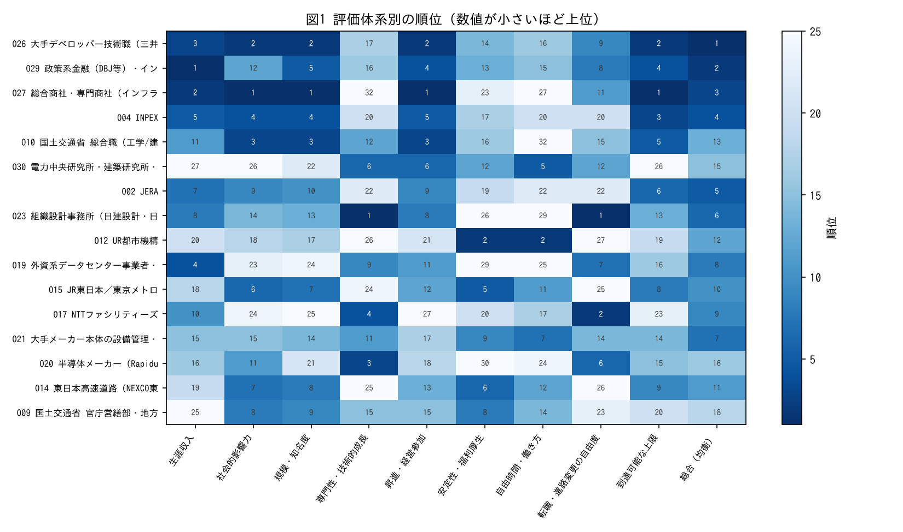
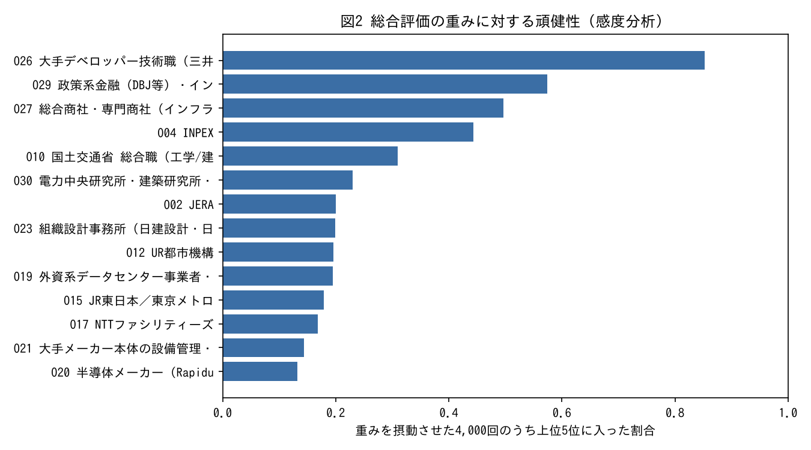

# 要約

- 本書は、建築学科の環境・設備系（空調・熱・空気質・省エネ）を専攻する学部生を想定し、到達し得る企業・職種・公務・進学・独立の選択肢を34件に体系化し、9の評価軸で比較したものである。個人に固有の情報（成績・選考状況・価値観）は含まない。
- 建築環境・設備の専門は、建設業（設計・施工）に限らず、**発注者（電力・ガス・インフラ・不動産・公共）**、**運用者（データセンター・半導体工場・メーカー設備・ビル管理）**、**政策（国・自治体の営繕・建築行政）**の三方向に接続している。一般に知られにくいのは後二者である。
- 9軸の比較で最も頑健に上位となるのは大手デベロッパー・インフラ金融・商社・資源であるが、いずれも到達難度が最も高い。到達難度が中位以下の範囲では、一般的な認知が低いが評価の高い選択肢として、①データセンターの設備（NTTファシリティーズ等）、②半導体工場のファシリティ（クリーンルーム空調）、③国土交通省の官庁営繕・地方整備局の営繕、④国立大学法人等の施設系職員、⑤UR都市機構の団地再生、⑥エネルギーサービス（ESCO）を挙げる。
- 9軸の客観寄りの評価では、単一の選択肢がすべての軸で優位になることはない。生涯収入・規模で上位の選択肢（商社・デベロッパー・資源・金融）は、働き方と到達難度で劣る。安定・働き方で上位の選択肢（公務・国立大学法人・UR）は、収入と転職の自由度で劣る。

# 1. 調査の範囲と方法

## 1.1 範囲

電力・エネルギー・資源、ガス、通信・データセンター、半導体・製造業、設備工事・設計・建設、不動産、商社、コンサルティング、金融、研究、国・自治体・独立行政法人、進学、独立の各領域を対象とした。各領域で、建築学科（環境・設備系）の学部生が新卒または数年以内の転職で応募できる具体的な採用法人・職種を特定した。業界と企業と職種と配属先は区別して記述する（例：「電力業界」「東京電力HD」「技術系・建築」「福島第一の建築部門」）。

## 1.2 方法と情報源

- 一次資料（採用試験の申込状況・結果、企業の有価証券報告書、採用サイトの求人詳細、労使交渉の発表）を優先した。出典は `data/sources.csv` に、取得日・発行日・URL・信頼性・使用箇所とともに記録した。
- 既存研究「電力産業総合研究 第2版」（有価証券報告書10社分と東電の求人96件の分析）を再利用し、平均年収・従業員数・建築部門の人数構成はそこから引用した。
- 給与は「新卒の初任給」と「会社単体の平均年収」を混同しない。後者は年齢・職種構成の影響を受けるため、生涯収入の目安としてのみ使う。
- 評価点（1〜5）は分析者の判断であり、採用確率ではない。評価の再現手順は `tools/strategy_model.py` に示した。

# 2. 選択肢の体系

| 方向 | 主な選択肢 | 建築環境・設備の専門が使われる場面 |
|---|---|---|
| 発注者（民間） | 東京電力HD、JERA、J-POWER、INPEX、東京ガス、NEXCO・首都高、JR東日本・東京メトロ、空港会社、大手デベロッパー | 自社の発電所・駅・ビル等の建築と設備の計画・発注・工事監理・保全 |
| 発注者（公共） | 東京都、特別区、国土交通省（官庁営繕・地方整備局）、防衛省（地方防衛局）、UR都市機構、国立大学法人等 | 公共施設の営繕、建築行政、長期ストックの更新 |
| 運用者 | NTTファシリティーズ・通信事業者、外資系データセンター、半導体メーカー、メーカー本体の設備管理、PM/FM会社 | データセンターの冷却、クリーンルーム空調、工場のユーティリティ、ビル設備の運用と改修 |
| 設計・施工 | 組織設計事務所、設備サブコン、ゼネコン、電力系子会社 | 空調・衛生設備の設計と施工管理 |
| 横断・上位 | 総合商社、コンサル・シンクタンク、インフラ金融、エネルギー×データ（BEMS） | 事業投資・政策提言・データ分析（建築設備の専門は補助的） |
| 研究・独立 | 研究所・大学、設備設計事務所の開業 | 研究開発、独立した設計・コンサル |

選択肢の詳細（採用法人・職種・給与の根拠・採用規模・選考の特徴・成績の扱い・転勤）は `data/options_catalog.csv` の34行に収めた。

# 3. 一般に知られにくい有力な職種

## 3.1 データセンターの設備

生成AIの普及によりデータセンターの電力・冷却需要が増え、建築設備（空調・熱）はデータセンターの性能を決める中核技術になりつつある。NTTファシリティーズは建築設備の設計・監理職を持ち、NTTグループの方針として2026年4月入社の大卒初任給を標準30万円以上（住宅補助込み34万円以上）とした（S-N01）。この水準は2027年卒の全体平均（学部卒234,223円、S-M01）を大きく上回る。設備の実務経験を積めば、外資系データセンター事業者の設備職（職務給で待遇の上限が高い）への転職経路も開ける。弱点は全国異動の可能性である。

## 3.2 半導体工場のファシリティ

先端半導体の工場ではクリーンルームの空気清浄度・温湿度・気流が歩留まりを左右し、空調・排気・純水などのファシリティ技術者が不足している。Rapidusは2nmの量産を2027年度後半に予定し、人材確保を主要課題としている（S-R01）。建築環境の研究（空気清浄度・気流）と直接つながる。弱点は勤務地が地方の工場に限られることである。

## 3.3 国と公的機関の営繕

国土交通省の官庁営繕部と地方整備局は、官庁施設の設計・工事監理・保全指導を担う発注者である。国家一般職（大卒程度）の「建築」区分から採用される（S-K01）。国立大学法人等の施設系職員は、大学キャンパスの営繕・設備保全・省エネを担い、働き方の評価が最も高い部類に入る。UR都市機構は団地の再生（既存ストックの性能向上）を担う。これらの試験は成績（GPA）を使わず筆記と面接で選考するため、学業成績が不利な場合でも到達性が下がりにくい。

## 3.4 エネルギーサービス

東京ガスエンジニアリングソリューションズや、東電100%出資の日本ファシリティ・ソリューションは、需要家の建物に空調・熱源・コージェネレーション等を導入し運用するエネルギーサービス（ESCO）を行う。「同じ快適性をより少ないエネルギーで」という建築設備の目的を事業として行う職種である。

## 3.5 電力会社の建築職の実態（既存研究からの要約）

東京電力の建築部門は確認できた範囲で約265名（送配電 約110、福島第一 約75、柏崎刈羽 約50、原子力設備管理部 約30、再開発 7）で、全部署で30代の層が薄い（S053）。新卒の「建築」は原子力（発電・廃炉・建設）、送配電、小売の各フィールドに置かれる。建築設備の業務は建築部門の職域に含まれる。中途採用の求人96件のうち38%が廃炉・原子力に集中しており（S051）、設備施工管理の経験者を建築職で採る求人も存在する。したがって「設備の実務を経て電力の建築職へ中途で移る」経路は、求人票の上で実在が確認できる。

# 4. 比較研究

## 4.1 評価軸

経済的待遇（pay）、安定性（stability）、働き方（worklife）、仕事の規模（scale）、専門性（expertise）、裁量（autonomy）、社会的評価（prestige）、転職の自由度（mobility）、将来の自由度（freedom）の9軸を独立に評価した。本人適合性・到達可能性・失敗時の損失は個人に依存するため、本書（公開版）では扱わない。

## 4.2 評価体系別の上位

- 生涯収入を重視すると、金融・商社・デベロッパー・資源・外資データセンターが上位になる。いずれも到達難度が高い。
- 安定性・働き方を重視すると、国立大学法人・UR・特別区・東京都が上位になる。
- 専門性を重視すると、データセンターの設備・設計事務所・半導体ファシリティ・設備サブコンが上位になる。
- 9軸を均等に近い重みで評価し、重みを4,000回摂動させると、上位5位への入りやすさは大手デベロッパー技術職（85%）が最も頑健で、インフラ金融・商社・INPEXが続いた。ただし公開版は**到達難度を評価に含めていない**。これらはいずれも一般的な到達難度が最も高い群（5段階で5）であり、「魅力度」と「実現可能性」を区別すべきことを示している。到達難度が中位以下（5段階で3以下）の選択肢に限ると、データセンター設備（NTTファシリティーズ）・メーカー本体の設備管理・半導体ファシリティ・国土交通省の営繕が上位に来る（`data/model_public/sensitivity_balanced.csv`）。

## 4.3 反対仮説

- 到達難度が中位以下の群で「NTTファシリティーズが上位」という結果は、本書の点数づけ（特に専門性5、転職の自由度5）に依存する。同社の業務の多くが設計・工事監理であり、施工管理に近い働き方になる部署もあると仮定すれば、働き方の点数は3から2へ下がり、順位は下がる。部署別の残業時間の一次資料は未確認である。
- 電力会社の安定性を4とした点には反論がある。東電は2026年度中間期にフリーキャッシュフローが△5,139億円で、経営の時間軸が短くなっている（既存研究F5・F12）。雇用の安定と企業財務の安定は区別して扱う必要がある。

# 5. 限界と未確認事項

- JERA・J-POWER・INPEX・NEXCO・JR・UR・空港会社の新卒初任給と建築系の年次採用数は、本版では一次資料で確認できていない（`options_catalog.csv` の「未確認」）。
- 国家一般職「建築」区分の申込者数・合格者数は人事院の実施状況資料で確認する必要がある。
- 点数は分析者の判断であり、異なる判断者が付ければ順位は変わり得る。モデルは重みと点数を入れ替えて再計算できるように公開した。
