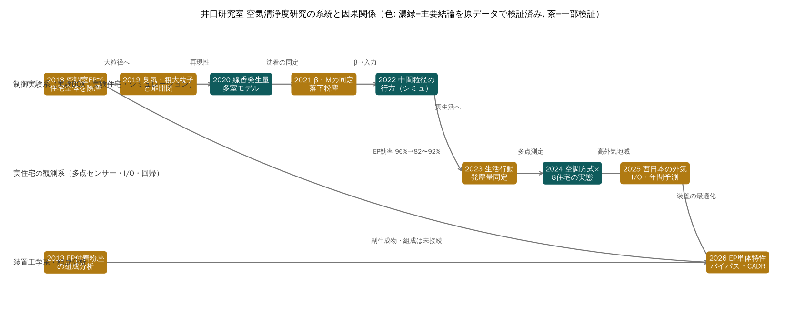

## 本書の目的と使い方

本書は、2027年4月から2028年3月に井口研究室（住宅班・空気清浄度研究）で卒業研究を行う学部生のための基本文献である。2018年度以降の研究を、本論・梗概・発表資料・原データ（Excel）にさかのぼって読み直し、可能な範囲で数値を独立に再計算した結果をまとめた。

本書の記述には次の区分を付ける。区分のない一般的な説明は教科書的事項である。

| 区分 | 意味 |
|---|---|
| 【確認事実】 | 研究室資料に書かれている、または原データで確かめたこと |
| 【当事者の主張】 | 当時の学生・著者の解釈・結論（本書では検証の対象） |
| 【計算結果】 | 本プロジェクトが原データから再計算した値 |
| 【分析】 | 複数の事実を組み合わせた本プロジェクトの評価 |
| 【仮説】 | 検証が必要な説明 |
| 【不明】 | 資料からは判断できないこと |

出典は資料ID（S-…）、知見ID（F-…）、未解決問題ID（Q-…）、研究テーマID（T-…）で示す。資料IDの一覧と Box 上の場所は付録Bと SOURCES.md、知見の全文は FINDINGS.md にある。アプリ（Air Quality Research OS）では、同じIDで資料・知見・知識グラフを相互に参照できる。

**読み方の推奨**: 初めての人は第1章（研究史）→第2章（基礎理論）→第4章（自分が引き継ぐ研究）→第5章（よくある誤り）→第9章（学習順序）の順に読み、実験を計画する段階で第3章（測定）と第8章（データの所在）を読むとよい。

# 第1章 研究室の研究史と研究テーマの変遷


> 区分凡例: 【確認事実】【当事者の主張】【分析】【仮説】【予測】【不明】【計算結果】。出典は資料台帳ID（SOURCES.md）。
> 本報告書は Box 資料（2026-11-02 取得）を本プロジェクトが読解・再計算した結果であり、原文は転載していない。

### 1.1 なぜ空気清浄度研究が始まったのか

【確認事実】2018年度梗概（S-2018-01）は、普及型壁掛けエアコン1台で住宅全体を暖冷房する**床吹出型全館空調方式**を対象に、「住宅内の空気を循環させるため、一室の粉塵や外気粉塵が住宅全体に拡散する」という懸念から出発している。外気取入口の高性能フィルタは一般的だが、**室内発生粉塵への対策がない**ことが問題設定であった。

【当事者の主張】電気集塵機（EP）は圧力損失が小さく大風量システムに適するため、循環経路に設置すれば住宅全体を除塵できる、という作業仮説が置かれた。

【分析】すなわち研究の起点は「全館空調の弱点（拡散）を、全館空調の長所（全量循環）で解決する」という逆転の発想であり、以後9年間の研究はこの仮説の**一般化（粒径・発生源・外気・地域・年間・エネルギー）**として読むことができる。研究室が同方式の実験住宅と共同研究先を継続的に持っていた（F-X-08）ことが、テーマ継続の構造的要因である。

### 1.2 研究年表

| 年度 | 主題 | 中心的な問い | 主な手法・装置 | 次年度への引継ぎ |
|---|---|---|---|---|
| 2018 | 集塵方法 | 空調室EPで住宅全体を除塵できるか | 線香、粉塵計＋KC-52、実住宅2件、回路網計算 | 大粒径・付着の調査 |
| 2019 | 臭気と粉塵 | においと粗大粒子（花粉代替）は循環で拡散するか、EP・消臭は効くか | においセンサー・被験者申告、石松子等の散布、扉開閉×EP | 再現性の確認 |
| 2020 | 拡散再現性 | 再現性とシミュレーション検証 | 6.48 m³ BOX（発生量同定）、実験住宅8回 | 沈着の同定 |
| 2021 | 浮遊／落下 | β・Mの同定、布団発塵 | 同定式 C(t)、8 m³ BOX、階間・床下β | 実生活に近い発塵 |
| 2022 | 中間粒径 | 5〜45 μmは拡散か沈着か | コットンリンター、KC-52(改)、沈着率計算 | 全館空調の実態調査 |
| 2023 | 生活行動 | 発生要因・頻度・基準比較 | 実住宅4件、個数→質量換算 | 多点測定 |
| 2024 | 空調方式比較 | 個別vs全館vs全館+EP | 8住宅×多点ワイヤレスセンサー、行動記録 | 高外気濃度地域 |
| 2025 | 外気・年間予測 | 西日本での装置効果と年間濃度 | 4モデルハウス、条件①②③、回帰×年間外気 | EP設置法・動力 |
| 2026(中間) | バイパス | 開口率と循環風量→CADR・電力 | JIS B 9908-5/B 8330準拠単体試験、並列流路モデル | （進行中） |

### 1.3 研究テーマ系統図（成果継承図）

```
2018 EP設置位置 ──┬─> 2019-2020 再現性・発生量 ──> 2021 沈着係数β ──> 2022 粒径別拡散・沈着率
                  │                                                      │
                  │        (実験室・制御実験の系統)                      ▼
                  │                                          2023 生活行動と粉塵（実住宅）
                  │                                                      ▼
                  │        (実住宅・実態調査の系統)          2024 空調方式×多点測定（I/O比）
                  │                                                      ▼
                  │                                          2025 外気・地域・年間予測（回帰係数）
                  ▼                                                      ▼
            EP性能（仕様値96〜98%）  ─────────(矛盾 F-X-07)──────> 2026 EP単体実測・送風動力・バイパス
                                                (装置工学の系統)
```

【分析】三つの系統が識別できる。
1. **制御実験系統（2018〜2022）**: 線香・布団・コットンリンターを発生源とし、BOXと実験住宅でβとMを同定し、換気回路網シミュレーションの精度を上げる。
2. **実態調査系統（2023〜2025）**: 実住宅・モデルハウスで生活行動と外気の影響を観測し、I/O比と回帰係数で装置効果を要約する。
3. **装置工学系統（2026〜）**: EPと送風機の単体特性から、システムのCADRと電力を導く。

系統1と2の間では、**モデル（回路網）と観測（I/O比）が接続されないまま**移行しており、2025年度の年間予測は物理モデルではなく経験的回帰係数で行われた（F-X-11）。本アプリのシミュレーターはこの断絶を埋めるため、単室マスバランスと2026年度の並列流路モデルを結合した。

### 1.4 技術・測定方法・実験条件の進化

- 【確認事実】測定器: 粉塵計（cpm×K値）＋パーティクルカウンター（2018〜2023）→ワイヤレスPMセンサー多点（2024〜2025）→ダクト内PC＋気密測定器＋電力ロガー（2026）。（F-X-02）
- 【確認事実】発生源: 線香（2018〜2021）→布団（2021）→コットンリンター（2022）→実生活（2023〜2025）。
- 【確認事実】外気データ: 環境省そらまめくん（2023〜2025）。2025年度は全国47都道府県の累積度数から地点選定。
- 【確認事実】準拠規格の明示は2026年度が初（JIS B 9908-5, JIS B 8330）。
- 【分析】反復数: 2020年度は同条件5回・3回、2021年度は各2回、2022年度は7回、2024〜2025年度は住宅1件あたり1期間。**統計的な反復は制御実験系統の方が多く、実態調査系統では住宅と条件が交絡**している（F-2025-09）。

### 1.5 解決された問題と残された問題

**解決（研究室内で一定の根拠あり）**
- 空調室（循環経路）EPによる住宅全体除塵の有効性（2018, 2024, 2025で繰返し確認）
- 線香発生量の再現性（±15%程度）と測定反復の必要性（2020）
- 階間・床下でβが大きいこと（2021）
- 粒径が大きいほど発生室近傍に沈着（2022）
- 0.3〜1 μmは外気追随、1 μm超は生活行動依存（2023）
- 全館空調は室間濃度が均一で浮遊時間が短い（2024）
- 外気フィルタのみでは西日本でWHO年平均値を多くの時間で超過（2025）

**残された問題**（OPEN_QUESTIONS.md）
- EP高風量域の特性（Q-01）、簡易センサー校正（Q-02）、季節依存（Q-03）、条件区分の不整合（Q-04）、保守・劣化（Q-05）、統合評価（Q-06）、発塵率（Q-07）


### 1.6 研究全体の統合分析（系統図と12の問い）


各年度の検証（第9〜11章, verification/）と文献比較（docs/文献レビュー.md）を統合し、研究全体について12の問いに答える。区分は【確認事実】【計算結果】【分析】【仮説】。



#### 問1. 井口研究室の研究は何を解明してきたか
- 【確認事実】空調室（循環経路）の電気集塵機（EP）で住宅全体の微小粒子濃度が下がる。2018年度の線香実験（F-2018-01）に始まり、2024年度住宅GのEP停止で約10倍の上昇（F-V-10）、2025年度住宅Aの稼働時I/O 0.27（F-V-01）で実住宅でも確かめられた。
- 【計算結果】粗大粒子（30–45 μm）は発生室でほぼ沈着し、5–10 μm は循環で広がるが EP で3〜5割が捕集される（2022年度, 全20シートで検証, F-SIM-13）。
- 【計算結果】全館空調・EP付き住宅では室内の上昇イベントが少ない（F-V-17）。
- 【確認事実】EP 単体は風量が増えると効率が下がり（100→750 m³/h で ≥95%→82〜92%）、バイパスで CADR の最適点が生じ得る（F-2026-01/04）。

#### 問2. どの研究が後続研究の基礎になったか
- 2020年度の線香発生量の同定と実測（S-2020-04/06）は、2021年度の同定式、SHASE2021 その40、本アプリの多室モデル検証（F-SIM-01）の基礎になった。
- 2021年度の沈着係数の同定（F-2021-01）と2023年度のβ理論式（F-2023-07）は、2022年度のシミュレーション入力（S-2022-04）と多室モデルの沈着項の基礎。
- 2024年度のワイヤレスセンサー多点測定と校正（F-V-09）は、2025年度の西日本測定の方法をそのまま与えた。

#### 問3. 研究方法はどのように発展したか
【分析】制御実験系（実験BOX・実験住宅, 2018〜2022）→ 実住宅の観測系（2023〜2025, 多点センサー・I/O・回帰）→ 装置工学系（2026, JIS準拠の単体試験と並列流路モデル）へ移った（第1章の系統図）。測定器は粉塵計＋KC-52 から多点ワイヤレスセンサー、ダクト内 KC-52 へ変わった（F-X-02）。一方、制御実験系で得た回路網モデルと観測系の I/O・回帰は接続されないまま移行した（F-X-11）。

#### 問4. 繰り返し現れる問題は何か
【分析】(1) 指標の定義が年度で変わる（I/Oの分母・分子, F-X-18）、(2) 1日分・1住宅の値を代表値にする（F-V-14, F-2025-09）、(3) 条件区分と運転記録の不一致（F-2025-10, F-2025-19）、(4) 表の項目名と集計式の不一致（F-SIM-13/14）、(5) 単位（1/s と 1/h, mg/s と mg/m³）の混在（F-2021-04）、(6) センサー値の絶対値の過信（F-2025-23）。いずれも記録と定義の管理の問題で、第1冊 第5章に一覧化した。

#### 問5. 十分な証拠で支持される結論
- 空調室 EP の住宅全体の除塵効果（複数年度・原データで確認: F-V-01, F-V-10, F-SIM-05。住宅Aは外気濃度帯をそろえても頑健, F-2025-27）。ただし効果の大きさは住宅で大きく異なり、2025年度住宅Cでは統計的に確立していない（F-2025-28）。
- 粒径による沈着と拡散の違い（F-SIM-13, F-2021-05）。
- センサーとKC-52の換算の安定性（F-V-07/09）。
- 2025年度の年間予測の計算そのもの（原データで再現, F-2025-21）。

#### 問6. 再検証が必要な結論
- 2025年度 条件①の回帰係数0.14（住宅Dの原データ未取得, F-V-06, Q-12）。
- 2026年度の最適バイパス開口率（750 m³/h 超の外挿, F-2026-03。CADR最大値は記載のない除外条件に依存する可能性, F-2026-08）。
- 『全館空調は浮遊時間が短い』（F-V-18）、2024年度の E〜H の基準超過率（F-V-16）。
- 『C値とI/O比に相関なし』（F-LIT-02）。
- 年間予測の前提（k 一定・室内発生なし, F-2025-21, F-2024-09 訂正）。期間平均 I/O は外気濃度と交絡する（F-2025-28）。

#### 問7. 他年度と矛盾する結果
- EP 効率: 2018年度の96%は仕様図、2026年度実測は82〜92%（F-X-07, F-X-15）。
- 同じ実験住宅の循環風量: 2021年（その40）弱1205 m³/h、2022・2023年（その42）弱923 m³/h（F-2022-05, F-X-21）。
- I/O比の定義: 2024年度（気積加重・1日）と2025年度（1点・期間平均）で比較できない（F-X-18, F-V-14）。
- 線香の発生量: 0.00695（2020梗概）と0.00720 mg/s（その40）（F-X-12）。

#### 問8. 最も不足している測定
【分析】(1) EP の750 m³/h 超の効率・圧損（Q-01）、(2) 湿度を含むセンサーの並置校正（Q-02, F-LIT-03）、(3) 同一住宅での条件の交互切替（季節別, Q-03）、(4) 室内発生の量と行動の対応（Q-07, F-V-19）、(5) EP のオゾン等の副生成物（F-LIT-04）、(6) 室間風量の CO₂ トレーサ同定（F-X-22）。

#### 問9. 理論と実測の差
- 沈着: 粗大粒子の実測βは重力沈降理論の1/10〜1/100、サブミクロンでは理論の重力項より大きい（F-2023-08, F-X-09）。乱流・拡散沈着（Lai & Nazaroff 2000, F-X-20）が候補。
- 多室モデル: ファン強で実測より過大（NRMSE 0.56）、還気口のピーク時刻が遅れる（F-SIM-02/03）。2022年度の研究室自身のシミュレーションでも還気側ピークが実測より3〜6分遅く、背景濃度を初期条件に入れていない（F-2022-07/08）。完全混合の仮定の限界。
- EP の実効除去率: 文献の in-duct EAC（7.2 1/h）に対し研究室は約0.4 1/h の上乗せ（F-LIT-01）。

#### 問10. 国内外の研究と比べた新規性
【分析】床吹出型全館空調の空調室 EP を、実験住宅・実住宅・西日本の複数地域で継続的に評価し、年間予測まで行った点は、収集した文献の範囲では類例が少ない。ただし文献調査は Crossref・OpenAlex による限定的なもので（J-STAGE・CiNii の全文検索は未実施）、『国内初』『世界初』とは言えない。方法（I/O・侵入係数・CADR・物質収支）自体は既知である（docs/文献レビュー.md）。

#### 問11. 次年度に優先すべきこと
研究方針提案書の評価では T-01（EP 高風量域）、T-03（季節別 k と年間予測）、T-02（センサー校正）が上位である。T-02 は他の全ての測定の品質基盤のため、最初の1か月で並行して行う。

#### 問12. 優先順位の根拠
- T-01: 2026年度の結論（最適開口率）が実測範囲外の外挿に依存しており（F-2026-03）、検証しないと結論が反転し得る。既存装置で実施できる。
- T-03: 年間予測という研究室の主要な社会的成果が、秋季の k を通年に適用する仮定に依存する（F-2025-21, Riley et al. 2002）。
- T-02: センサーの公称精度（±10 μg/m³）と湿度の影響（F-2025-22/23, F-LIT-03）が、WHO 5 μg/m³ との比較の不確かさを決める。
- 評価の重みを変えると順位は入れ替わる（研究計画画面で確認可能）。設備・協力住宅の確認（方針提案書 第11章）次第で T-06（既存データで実施可）に切り替える。


# 第2章 空気環境・粒子・電気集塵の基礎理論

## 2.1 室内粒子濃度の物質収支（単室モデル）

室内を一様に混合した1室とみなすと、粒子の質量（または個数）の収支は次式で表される（Nazaroff 2004 の枠組み）。

$$V\frac{dC}{dt} = P\,Q_{inf}\,C_{out} + (1-\eta_f)\,Q_{oa}\,C_{out} - (Q_{inf}+Q_{oa})\,C - \beta V C - \eta_{EP} Q_{EP} C + G$$

- $C$ 室内濃度 [μg/m³]、$C_{out}$ 外気濃度、$V$ 室容積 [m³]
- $Q_{oa}$ 機械換気の外気量、$Q_{inf}$ 隙間からの侵入 [m³/h]、$P$ 隙間の透過率、$\eta_f$ 外気フィルタ捕集率
- $\beta$ 沈着係数 [1/h]、$\eta_{EP}Q_{EP}$ 空気清浄装置の除去風量（CADR）[m³/h]、$G$ 室内発生 [μg/h]

定常（$dC/dt=0$）かつ室内発生なしのとき、I/O比は
$$\frac{C}{C_{out}} = \frac{P\,Q_{inf}+(1-\eta_f)Q_{oa}}{Q_{inf}+Q_{oa}+\beta V+\eta_{EP}Q_{EP}}$$
となる。分子は「外気がどれだけ入るか」、分母は「室内からどれだけ除かれるか」である。2025年度の回帰係数 $k$（室内=k×外気）はこの比に相当するが、室内発生がある時間帯を含めると $k$ は過大になる（F-V-12）。

**総除去率** $\lambda = (Q_{inf}+Q_{oa}+\eta_{EP}Q_{EP})/V + \beta$ [1/h] は、発生停止後の減衰 $C(t)=C_0 e^{-\lambda t}$ の傾きとして測れる。空気清浄装置の稼働時と停止時の $\lambda$ の差に $V$ を掛けたものが実効CADRであり、JEM1467 や ANSI/AHAM AC-1 の考え方と同じである（第6章）。

井口教授の手書き計算式（S-REF-01, F-REF-01）は、$dC/dt = M/V + (C_{in}-C)Q/V - (U/H)C$ を $dC/dt=aC+b$ と置いて積分し、片対数グラフの傾きから総減衰率 $a$ を求める手順を示している。2021・2023年度の同定式はここから出発している。

## 2.2 沈着（重力沈降・拡散・乱流）

重力沈降による沈着係数は、終末沈降速度 $U$ を室の高さ $H$ で割った $\beta = U/H$ で近似される。Stokes 域では
$$U = \frac{C_c\,d^2(\rho_p-\rho)\,g}{18\mu}$$
（$C_c$ カニンガム補正、$d$ 粒径、$\rho_p$ 粒子密度、$\mu$ 空気の粘度）。本アプリの式は2021年度落下班（F-2021-05）・2023年度β理論式（F-2023-07）・2019年度の石松子（F-X-17）の計算と1%程度で一致する。

ただし実住宅で測ったβは、粗大粒子では理論値の1/10〜1/100、サブミクロン粒子では理論の重力項より大きい（F-2023-08, F-X-09）。サブミクロン粒子ではブラウン拡散、気流のある室では乱流沈着（Lai & Nazaroff 2000）が効く（F-X-20）。**理論βをそのまま住宅に使うと、粗大粒子では沈着を過大に、微小粒子では過小に見積もる可能性がある**。多室モデルの減衰率Dが運転条件で変わる（F-SIM-02）のも、βが物性値ではなく気流に依存する較正係数であることを示している。

## 2.3 電気集塵機（EP）の原理

電気集塵機は、コロナ放電で粒子を帯電させ、電界中で集塵電極に引き寄せて捕集する。理想化した捕集効率は Deutsch の式 $\eta = 1-\exp(-wA/Q)$（$w$ 移動速度、$A$ 集塵面積、$Q$ 風量）で表され、**風量が増えると効率が下がる**。2026年度の単体試験では100 m³/h で95%以上、750 m³/h で82〜92%と、この傾向を確認している（F-2026-01）。圧力損失はフィルタより小さいため大風量の循環に向くが（2018年度の発想, F-2018-01）、放電によりオゾンを生成し得る（F-LIT-04）。研究室はオゾン等の副生成物を測っていない。

## 2.4 送風機・圧力損失・バイパス流路

送風機は静圧が上がると風量が下がる（P-Q特性）。2026年度の DC ファンは70〜90 Pa までほぼ定風量で、電力は3〜5倍に増える（F-2026-02）。EP と並列にバイパス流路を設けると、全体の圧力損失が下がって風量が増える一方、EP を通る割合が減る。このため CADR（＝EP通過風量×効率）には最適なバイパス開口率が生じ得る。フィルタでも「高効率ほど風量が落ちて CADR が下がる」ことが報告されている（F-LIT-05）。**ただし研究室の最適開口率の値は、EP の実測範囲（750 m³/h まで）を超えた外挿（二乗則）に依存する**（F-2026-03）。

## 2.5 多室モデル（換気回路網）

各室を完全混合とし、室間を回路網の風量でつなぐと
$$V_i\frac{dC_i}{dt} = \sum_j Q_{ji}(1-\eta_{ji})C_j - \Big(\sum_k Q_{ik}\Big)C_i - \beta_i V_i C_i + G_i$$
となる。2018・2020・2022年度の簡易シミュレーションと SHASE2021（その40）・2023（その42）はこの式である。本アプリの実装は2020年度実測でファン弱 NRMSE 0.21、強 0.56（F-SIM-01〜04）、2022年度の計算シートを全20件で再現した（F-SIM-13）。限界は、発生源近傍・還気口の時間応答、室間の濃度差、扉開口の双方向流（F-SIM-07）を表せないことである。共同研究（S-REF-20）のように **CO₂トレーサで風量を先に同定し、沈着は別に与える**のが望ましい（F-X-22）。

## 2.6 個数濃度と質量濃度

パーティクルカウンタ（KC-52）は粒径区分ごとの個数を数える。質量への換算は $m = \frac{\pi}{6}d^3\rho N$ で、代表径と密度の仮定に強く依存する（F-2023-02）。ワイヤレスセンサーの「μg/m³」はメーカーの換算値で、方式は公開されていない（F-2025-22）。**個数と質量、センサー表示と公定法の値を混同しないこと**が、研究室で最も繰り返された注意点である。


## 2.7 本アプリに実装したモデルと適用範囲

| モデル | 式 | 根拠 | 適用範囲 |
|---|---|---|---|
| 単室完全混合マスバランス | V·dC/dt = Q_OA(1−η_OA)C_out + Q_inf·P·C_out + G − (Q_OA + Q_inf + η_EP·Q_EP)C − β·V·C | 2018・2020年度梗概の換気式 V·dp=Q(p0−p)dt+k·dt を外気・集塵・沈着項で拡張【分析】 | 住宅全体を1室とみなす瞬時一様拡散。室間濃度差・気流分布は表現しない（2020/2021年度に一様拡散仮定の誤差が報告）。 |
| 電気集塵機∥バイパス 並列流路モデル | N·q_fan(ΔP) = 78.611·ΔP^0.828 + 3600·α·A·√(2ΔP/ρ),  CADR = η(Q_EP)·Q_EP | 2026年度中間梗概 式(2)〜(4)【当事者の主張】を再実装【計算結果】 | 式(2)は Q=100〜750 m³/h・ΔP≈0〜17 Pa の単体実測。送風機の限界超過後特性と η の中間値は読み取り・仮定。 |
| 重力沈降による沈着係数 | β = U/H,  U = 2·Cc·(ρp−ρ)·g·r²/(9μ) | 2021年度(浮遊)梗概 式(2)(4) | 球形粒子・静穏空気。実住宅の階間・床下では BOX 比 2〜11 倍の β が報告（ダクト・表面積効果）。 |
| 発生・減衰の同定式 | C(t) = C0·e^(−βt) + M/(βV)·(1 − e^(−βt)) | 2021年度(浮遊)梗概 式(3) | 閉鎖空間・一様濃度。換気がある場合 β は換気率を含む見かけ値。 |
| 個数→質量濃度換算 | Cm = (4/3)·π·r³·N·ρ | 2023年度梗概 式(1) | 球形・粒径帯代表径・密度仮定（コットンリンター）に強く依存。粒径帯幅の扱いで1桁程度変わり得る。 |
| 多室（換気回路網）モデル | V_i·dC_i/dt = Σ_j Q_ji·C_j·(1−η_ji) − (Σ_k Q_ik)·C_i − β·V_i·C_i + G_i | 空気調和・衛生工学会大会 2021 G-31（その40）の式(4)・表-2・表-3 を一般化【当事者の数値】、実装は本プロジェクト【計算結果】 | 各室は瞬時一様拡散。2020年度実測との比較でファン弱・D=0.0003 /s は平均NRMSE 0.21、同じDのファン強は0.56（過大評価）。最適Dは運転条件で異なり（弱0.000475・強0.00075）、還気口の応答時刻と室間差は再現できない（F-SIM-01〜04）。 |
| 回帰係数による年間室内濃度予測 | C_in(t) = k·C_out(t)  （1時間平均, 原点通過回帰） | 2025年度最終梗概 7・8章 | 室内発塵を無視。測定期間（秋季・数日〜2か月）の k を通年に適用する仮定。 |

# 第3章 測定機器と測定方法

## 3.1 研究室で使われた測定機器

| 機器 | 測るもの | 年度 | 注意点（根拠） |
|---|---|---|---|
| デジタル粉塵計（光散乱, cpm） | 相対濃度 | 2018〜2021 | 質量換算係数K（1.3×10⁻³ mg/m³/cpm）の記載が年度で不統一（F-X-05） |
| パーティクルカウンタ RION KC-52 | 粒径別個数（0.3/0.5/1/2/5 μm 以上, 2.83 L/min） | 2018〜2026 | 1分の個数→濃度換算は流量で割る。改造型（大粒径区分）は2022・2023年度 |
| ワイヤレスPMセンサー（HYPM） | PM1.0/2.5/4.0/10 のメーカー換算 μg/m³, 1分間隔 | 2024・2025 | 精度±10 μg/m³ または±10%、7日ごとのクリーニングで欠測、水蒸気を検出、吸気口は下向き（F-2025-22〜24） |
| そらまめくん（環境省） | 外気 PM2.5 の1時間値（公定法） | 2023〜2025 | 整数値・速報値。住宅との距離で差（F-2024-10） |
| ダストサンプラー・堆積モニタ | 落下粉塵 | 2021 | 計数単位が未定義（F-2021-06） |
| JIS B 9908-5 準拠装置・微差圧計・電力計 | EP 単体の効率・圧損・送風機電力 | 2026 | 実測は750 m³/h まで（F-2026-03） |

## 3.2 センサー校正

KC-52 との並置では、センサー（0.3–1.0 μm）= 4.57×10⁻⁵×個数＋0.049（2025, R²=0.905）、4.54×10⁻⁵×個数−0.031（2024, R²=0.977, 個数1万未満の58行を除外）と、傾きは2年で1%以内で一致した（F-V-07, F-V-09）。一方、外気ではそらまめくんとの相関が低濃度の住宅で弱く（−0.27〜0.36）、岩手の住宅では約1.8〜1.9倍を示した（F-2024-10）。湿度による過大表示の可能性がある（F-2024-11, F-LIT-03）。**測定の前後に全センサーをKC-52と24時間以上並置し、湿度も記録すること**を推奨する。

## 3.3 測定計画の原則（過去研究の反省から）

1. 条件の比較は同じ住宅で数日ずつ交互に（ABAB）行い、住宅と条件の交絡を避ける（F-2025-09）。
2. 運転記録（EP・エアコン・換気・窓・在室）を分単位で残し、条件区分は記録に基づいて決める（F-2025-10, F-2025-19）。
3. I/O比は「全期間」「夜間（室内発生の少ない時間）」「日ごと」の3通りで示し、1日だけの値を代表値にしない（F-V-14, F-V-15）。
4. 測点は同時測定とし、別の日の測定を時間軸でつなげない（F-2022-03）。
5. 生データ・条件ログ・校正係数を CSV で Box に保存し、10 MB を超える場合は月ごとに分割する（取得不能の教訓, 第8章）。


# 第4章 過去の各研究の詳細と再検証

各研究について、年度別の整理（目的・条件・測定・式・結果・結論・限界）と、本プロジェクトの検証状況（13項目）を示す。検証状況の『済』は証拠のある実施、『一部』は一部のみ、『不能』は資料が取得できず実施できないことを表す。

## 4.1 2013年度 EP付着粉塵の化学組成（ICP・イオン, 公設試の成績書）（R-2013-COMP）

**検証の分類**: 原データ確認（完成度 4/12）

| 原資料取得 | 本文読解 | 実験条件確認 | 原データ確認 | 計算再現 | 図表照合 | 結論検証 | 他年度比較 | 国内外比較 | 未解決問題整理 | 継承資料反映 | 方針資料反映 | アプリ反映 |
|---|---|---|---|---|---|---|---|---|---|---|---|---|
| 一部 | 済 | 一部 | 済 | 一部 | 対象外 | 一部 | 未 | 一部 | 済 | 未 | 未 | 済 |

**主な検証結果**

- **F-X-24**【計算結果】2013年の電気集塵機付着粉塵の分析では、水溶性イオンの合計は約154 mg/g（質量の約15%）で、うち硝酸・硫酸・アンモニウムイオンが127 mg/g（約13%）を占めた。当量では陰イオン2.17・陽イオン1.83 meq/g（比0.84）。ICPのNa・Kはイオンクロマトの溶出量と一致した。V・Ni（重油燃焼の指標）、Zn・Pb・Sb（交通・燃焼由来の指標）も検出された。
- **F-X-25**【分析】F-X-24の硝酸・硫酸・アンモニウムは大気中で二次生成する微小粒子の主成分であり、EPが外気由来のPM2.5を捕集していることと整合する。ただし試料の住宅・期間・外気導入条件が不明で、室内発生分との比率は定量できない。T-08では採取条件（期間、外気量、同時の外気PM2.5組成）を記録した上で同じ分析を行えば、外気由来・室内由来の寄与を推定できる【仮説】。

**未確認事項・制約**: XRF・SEM は3 MB超・テキスト化失敗で不能。試料の住宅・期間は不明。イオン収支は再計算済み

## 4.2 2015年度 2015年度 全館空調（YUCACO）卒論（R-2015）

**検証の分類**: 資料所在確認（完成度 1/13）

| 原資料取得 | 本文読解 | 実験条件確認 | 原データ確認 | 計算再現 | 図表照合 | 結論検証 | 他年度比較 | 国内外比較 | 未解決問題整理 | 継承資料反映 | 方針資料反映 | アプリ反映 |
|---|---|---|---|---|---|---|---|---|---|---|---|---|
| 一部 | 未 | 未 | 未 | 未 | 未 | 未 | 未 | 未 | 未 | 未 | 未 | 済 |

**主な検証結果**


**未確認事項・制約**: 21 MB の PDF。清浄度との関係が薄く優先度低（目録のみ）

## 4.3 2018年度 空調室EPによる住宅全体の除塵（R-2018）

#### 2018年度　空調室EPによる住宅全体の除塵（S-2018-01）
- **目的**【確認事実】: 床吹出型全館空調の空調室（循環経路）に電気集塵機（EP）を置けば、住宅全体を除塵できるか。
- **条件・測定方法**【確認事実】: 線香2本で発塵し、粉塵計（cpm）とKC-52で70分測定。実住宅（オープン型）と企業実験棟（個室型）。EP位置（空調室/寝室）と市販清浄機3台を比較。
- **解析式**【確認事実】: 質量濃度 = K×cpm（K=1.3×10⁻³ mg/m³/cpm）。換気回路網の一様拡散シミュレーション。
- **結果・結論**【当事者の主張】: 空調室設置で全室が背景濃度以下に低下。寝室設置・市販清浄機では他室への効果が小さい（F-2018-01）。
- **限界**【分析】: シミュレーションは発生量を20〜25%に下げて実測に合わせており、沈着・不完全混合を区別できない（F-2018-02）。EP効率96%はメーカー仕様図の値で実測ではない（F-X-15）。発生量「約0.0141 mg/s」は2本分の誤記の可能性【仮説】（F-X-06）。

**検証の分類**: 実験条件確認（完成度 5/13）

| 原資料取得 | 本文読解 | 実験条件確認 | 原データ確認 | 計算再現 | 図表照合 | 結論検証 | 他年度比較 | 国内外比較 | 未解決問題整理 | 継承資料反映 | 方針資料反映 | アプリ反映 |
|---|---|---|---|---|---|---|---|---|---|---|---|---|
| 一部 | 済 | 済 | 未 | 一部 | 未 | 一部 | 済 | 一部 | 済 | 未 | 未 | 済 |

**主な検証結果**

- **F-2018-01**【当事者の主張】空調室（循環経路）に電気集塵機を設置すると、一室で発生させた線香粉塵が住宅全体で背景濃度以下まで低下した。寝室設置や各室の市販清浄機では他室への効果が小さかった。
- **F-2018-02**【分析】2018年度の『発生量を20〜25%に調整』は、天井滞留・表面付着・不完全混合を一括して発生量に押し込んでおり、各要因を識別できない。2020年度の25%減衰、2021年度の実住宅βの同定はこの問題を順次分解する試みと位置づけられる。
- **F-X-06**【仮説】2018年度の線香発生量『約0.0141 mg/s』は2020年度の2本分（0.0139 mg/s）とほぼ一致し、2本値を1本値と誤記した可能性がある。
- **F-X-10**【計算結果】2018年度に用いた市販清浄機（強5.1 m³/min, 適用〜23畳=38 m²）は、天井高2.4 m・換気1回/h・1パス効率100%の単室モデルで12%到達時間29分となり、JEM1467の30分基準と整合する。単室モデルの実装妥当性の外部検算となる。
- **F-X-15**【確認事実】SHASE 2019（その31）は、2018年度の実験で用いたEP集塵効率をメーカー仕様図（図-4）から求めたと明記している。2018年度の96%は実測値ではなく、2026年度の単体実測（82〜92%）と直接比較できない（H-01b を支持）。また同論文は、EPを先に運転しておくと発塵室以外の濃度上昇がごくわずかになる『拡散抑制効果』を報告している。

**未確認事項・制約**: 原データ（粉塵計・KC-52）はBoxで未発見。清浄機の30分基準は JEM1467 の式で再現

## 4.4 2019年度 臭気・粗大粒子の拡散とEP（R-2019）

#### 2019年度　臭気・粗大粒子の拡散とEP・消臭（S-2019-01）
- **目的**【確認事実】: においと線香より大きい粒子（花粉代替）の拡散、EP・消臭フィルタの効果。
- **条件・測定方法**【確認事実】: においセンサー・TVOC・被験者申告（各室2〜8人, t検定）。石松子等を玄関で散布し扉開閉×EP ON/OFF。
- **解析式**【確認事実】: Stokes終端速度（石松子 3.839 cm/s, 卒論）。
- **結果・結論**【当事者の主張】: においは循環で速く拡散、消臭効果が有意なのは1条件のみ（p=0.01）。粗大粒子は循環ではほぼ拡散せず、扉開放時の空気交換が主経路（F-2019-01, F-X-16）。
- **限界**【分析】: 12の検定を補正なしで実施（F-2019-02）。【計算結果】石松子35 μmのStokes速度は本アプリでも3.7 cm/sを再現（F-X-17）。

**検証の分類**: 実験条件確認（完成度 6/13）

| 原資料取得 | 本文読解 | 実験条件確認 | 原データ確認 | 計算再現 | 図表照合 | 結論検証 | 他年度比較 | 国内外比較 | 未解決問題整理 | 継承資料反映 | 方針資料反映 | アプリ反映 |
|---|---|---|---|---|---|---|---|---|---|---|---|---|
| 済 | 済 | 済 | 未 | 一部 | 未 | 一部 | 済 | 未 | 済 | 未 | 未 | 済 |

**主な検証結果**

- **F-2019-01**【確認事実】2019年度本論: においは全館空調の循環で拡散が速まり、EP＋消臭フィルタの効果は被験者申告のt検定で洋室(大)の焼肉のみ有意（p=0.01）で、カレー・線香・くさやでは有意差なし。EP単独の消臭効果は僅か。
- **F-2019-02**【分析】2019年度の臭気評価は各室2〜8人・12の検定を補正なしで行っており、唯一の有意結果（p=0.01）も多重比較を考慮すると頑健ではない。『消臭効果は認められない』という結論は検出力不足の可能性を含む。
- **F-2019-03**【確認事実】SHASE2020（その36）の花粉代替粒子実験は、2019年度卒論の第4章と同一の実験である。石松子の終端速度は卒論で3.839 cm/s（密度1.05 g/cm³）、学会論文で約3.6 cm/s と記載され、本アプリの再計算（密度1.0で3.70、1.05で約3.9 cm/s）と整合。
- **F-X-17**【計算結果】石松子（35 μm, 密度1000 kg/m³）の Stokes 沈降速度を本アプリの式で再計算すると 3.7 cm/s となり、SHASE 2020 の約3.6 cm/s と一致。天井高2.4 mでは約65秒で床に達し、循環風で還気口まで運ばれる前に沈降することと整合する【分析】。

**未確認事項・制約**: Stokes沈降速度を再現。臭気の原データは未発見

## 4.5 2020年度 線香発生量の同定と多室シミュレーション（R-2020）

#### 2020年度　線香発生量の同定と多室シミュレーション（S-2020-01〜06）
- **目的**【確認事実】: 粉塵拡散の再現性と、簡易シミュレーションによる予測可能性。
- **条件・測定方法**【確認事実】: 6.48 m³ BOXで線香1本の発生量を13回同定。実験住宅で線香2本、ファン弱5回・強3回。外気導入77.9 m³/h は風速5点×断面×開口率「0.9？」の1回測定（F-2020-06）。
- **解析式**【確認事実】: BOXの収支式から M=K·cpm·V/燃焼時間 系。換気回路網（C値1.77から漏気按分）。
- **結果**【確認事実】: 発生量 平均0.00695 mg/s（最大14.4%のばらつき, F-2020-01）。同条件でも拡散パターンが変わる回がある（F-2020-02）。床下・階間で25%減衰を見込むと実測と合う。
- **限界**【分析】: 原データには本論13試行と別の先行試行群（平均0.01131 mg/s）があり、選別基準が書かれていない（F-2020-05）。シミュレーションは弱・強で同じ風量表を使用（F-2020-03）。
- **本アプリの検証**【計算結果】: 2020年度実測（梗概作成用シート）で多室モデルを検証し、ファン弱でNRMSE 0.21、強で0.56（F-SIM-01〜04, 第11章）。

**検証の分類**: 結論検証済み（完成度 9/13）

| 原資料取得 | 本文読解 | 実験条件確認 | 原データ確認 | 計算再現 | 図表照合 | 結論検証 | 他年度比較 | 国内外比較 | 未解決問題整理 | 継承資料反映 | 方針資料反映 | アプリ反映 |
|---|---|---|---|---|---|---|---|---|---|---|---|---|
| 済 | 済 | 済 | 済 | 済 | 一部 | 済 | 済 | 一部 | 済 | 未 | 未 | 済 |

**主な検証結果**

- **F-2020-01**【確認事実】線香1本の発生量は平均0.00695 mg/s、同一条件で最大±6.4%、測定位置を変えると最大14.4%のばらつき。燃焼量の差は最大2.8%。
- **F-2020-05**【確認事実】2020年度のBOX原データ（S-2020-04）には、本論の13試行（平均0.00674・0.00708 mg/s）とは別に、平均0.01131 mg/s（標準偏差0.00198）の先行試行群と、燃焼時間1200 sで約0.011 mg/s とする計算が残っている。本論は燃焼時間を『燃焼開始から濃度最大まで』と定義しており、定義や採用試行の違いで発生量が約1.6倍変わる。この変更は本論・梗概に記載がない【分析】。2018年度の『約0.0141 mg/s』（F-X-06）との差もこの定義差で説明できる可能性がある【仮説】。
- **F-2020-06**【確認事実】実験住宅の外気導入量77.9 m³/h（SHASE2021回路網の弱0.0216 m³/s）は、空調室での風速5点測定（平均1.67 m/s）×断面積0.0144 m²×開口率『0.9？』から求めた1回の推定値で、開口率に疑問符が付いている。強運転の風速は0.24〜3.22 m/s と大きくばらつき、回路網の強0.042 m³/s の根拠は資料から確認できない【不明】。F-X-13（換気0.19〜0.37回/h）の低さはこの推定に由来する。
- **F-SIM-01**【計算結果】多室モデル（SHASE2021回路網, 線香2本=0.0144 mg/s, 1020 s, LDK発生）を2020年度実測（粉塵計・各条件3回平均）と比較した。ファン弱では減衰率D=0.0003 /s（論文値）で平均NRMSE 0.21・ピーク比（計算/実測）1.10 と論文の主張を再現した。ファン強では同じDで NRMSE 0.56・ピーク比1.62 と過大評価になる。
- **F-SIM-02**【計算結果】Dを0〜0.0008 /s で探索すると、実測に最も合うDはファン弱0.000475・ファン強0.00075 /s（β≈1.7・2.7 /h）と運転条件で異なる。Dは物理定数ではなく、風量に依存する付着・不完全混合・測定点代表性などをまとめて吸収する較正係数であり、運転条件ごとに再較正が必要【分析】。
- **F-SIM-03**【計算結果】実測ではレターン（2階廊下）の濃度が線香燃焼終了時（1020 s）にピークとなるが、計算ではファン弱で1320〜1380 s と遅れる。また実測の各室ピークは0.012〜0.017 mg/m³と室ごとに異なるのに対し、計算は下流の居室がほぼ同一（約0.016）となる。LDK（91 m³）を1室完全混合とする仮定では、吹抜経由で煙塊が直接還気へ向かう輸送と室間差を表現できない【分析】。
- **F-SIM-04**【分析】多室モデルの適用範囲: (1) 発生源近傍・還気口の時間応答には不適（不完全混合）、(2) 住宅全体の上昇量の桁と減衰の傾向は、運転条件ごとに較正したDで±20%程度に再現可能、(3) 較正Dを別の運転条件・別住宅へ外挿すると誤差が大きい（強運転で+62%）、(4) 粒径・外気・EP効率の検証データは未取得。単室モデル（I/O比）とは2025年度データでの定常比較のみ（F-X-11）。
- **F-X-12**【確認事実】線香1本の発生量は学会論文（その40）で平均0.00720 mg/s（13回）、2020年度梗概で0.00695 mg/s（同一条件5回の平均0.00674と条件変化8回の0.00708の扱いが異なる）。同一実験の集計方法の違いと考えられ、差は約4%。
- **F-X-13**【計算結果】その40の回路網では外気導入が弱0.0216 m³/s（78 m³/h）・強0.042 m³/s（151 m³/h）で、回路網全容積406 m³（小屋裏含む）に対し0.19・0.37回/h。外気だけで濃度が平衡に達する時定数は弱で約5.2時間。建築基準法の居室0.5回/hと比べ小さく、回路網が外気経路の一部のみを表すか、実験時の換気量が低かった可能性がある【分析】。
- **F-X-14**【計算結果】減衰率 D をβに換算すると、密閉BOX 0.00015 /s→0.54 /h、実住宅の合わせ込み 0.0003 /s→1.08 /h。2021年度BOXの線香β 1.3×10⁻⁴ /s（0.47 /h）と整合し、実住宅は約2倍の減衰。重力沈降理論（1 μmで0.05 /h）より1桁以上大きい（F-X-09と整合）。

**未確認事項・制約**: 実測時系列で多室モデルを検証。図-9〜11の数値照合は実測ブックで代替

## 4.6 2021年度 浮遊班: βとMの同定・布団発塵（R-2021-FLOAT）

#### 2021年度　沈着係数βと発生量Mの同定（浮遊班）、落下粉塵（落下班）（S-2021-01〜06）
- **目的**【確認事実】: βとMの同定、布団由来粉塵の拡散。落下班は落下粉塵の実態。
- **条件・測定方法**【確認事実】: 8 m³ BOXで布団叩き、実住宅の洋室・階間・床下でβを測定。落下班はダストサンプラー（6点）と粒子堆積モニタ（≥15 μm）。
- **解析式**【確認事実】: C=C₀e^(−βt)+M/(βV)(1−e^(−βt))、β=U/H（Stokes、カニンガム補正）。落下割合 1−e^(−βt)。
- **結果**【確認事実】: 実住宅βはBOX比で洋室1.3倍・階間10.7倍・床下2.3〜2.9倍（F-2021-01）。一様拡散計算は線香で実測の約0.6倍（F-2021-02）。落下班: 30–40 μm区分の累積落下はDp=12 μmの計算に最も近い（F-2021-05）。ダストサンプラーは有人約100・無人約65・清浄機運転約29（F-2021-06）。
- **限界**【分析】: 資料間でBOX寸法・発生量単位が不一致（F-2021-04）。落下班の本論・梗概はBoxで未発見（Q-09）、ダストサンプラーの計数単位が未定義。粒子堆積モニタのデータ（S-2021-06）は条件表のみ確認【不明】。

**検証の分類**: 実験条件確認（完成度 5/13）

| 原資料取得 | 本文読解 | 実験条件確認 | 原データ確認 | 計算再現 | 図表照合 | 結論検証 | 他年度比較 | 国内外比較 | 未解決問題整理 | 継承資料反映 | 方針資料反映 | アプリ反映 |
|---|---|---|---|---|---|---|---|---|---|---|---|---|
| 一部 | 済 | 済 | 未 | 一部 | 未 | 一部 | 済 | 一部 | 済 | 未 | 未 | 済 |

**主な検証結果**

- **F-2021-01**【確認事実】実住宅で同定した線香の沈着係数は実験BOX比で洋室1.3倍、階間10.7倍、床下（ダクト無）2.3倍、床下（ダクト有）2.9倍。
- **F-2021-02**【当事者の主張】沈着係数を反映した一様拡散シミュレーションでも線香の計算値は実測の約0.6倍で、住宅全体に一様拡散していないことが原因と推定。
- **F-2021-03**【計算結果】2021年度本論の布団BOX（H=2 m）の指数近似減衰率を重力沈降理論と比べると、5 μm以上（理論7.5×10⁻⁴）・2–5 μm（1.6×10⁻⁴）では実測 2×10⁻⁴〜1×10⁻³・5×10⁻⁵〜2×10⁻⁴ と同程度だが、0.5–1.0 μm（理論9.4×10⁻⁶）では実測1×10⁻⁵〜8×10⁻⁵ と最大約8倍大きい。粗大粒子は重力沈降で説明でき、微小粒子は他の除去機構（壁面沈着・BOX漏気）を含む（F-X-09 と整合）。
- **F-2021-04**【確認事実】2021年度本論の資料間不整合: (1) 既往BOXの寸法を180×180×180 cm（5.83 m³）と記載するが、2020年度梗概・SHASE2021は1.8×1.8×2.0 m（6.48 m³）。(2) 線香発生量Mを mg/m³ で記載（2020年度・SHASE2021は mg/s）。(3) 減衰の近似図の縦軸名が『発生量(個/s)』。(4) 梗概7条件に対し本論は10条件。

**未確認事項・制約**: 浮遊班の原データExcelはBoxで未特定

## 4.7 2021年度 落下班: ダストサンプラー・落下計算（R-2021-FALL）

**検証の分類**: 原データ確認（完成度 4/13）

| 原資料取得 | 本文読解 | 実験条件確認 | 原データ確認 | 計算再現 | 図表照合 | 結論検証 | 他年度比較 | 国内外比較 | 未解決問題整理 | 継承資料反映 | 方針資料反映 | アプリ反映 |
|---|---|---|---|---|---|---|---|---|---|---|---|---|
| 一部 | 不能 | 一部 | 済 | 済 | 未 | 一部 | 一部 | 未 | 済 | 未 | 未 | 済 |

**主な検証結果**

- **F-2021-05**【計算結果】2021年度落下班の計算式シートでは、30–40 μm区分の実測累積落下割合（300 s 0.56, 600 s 0.81, 900 s 0.94）が Dp=12 μm のStokes計算（0.59, 0.83, 0.93）に最も近い。本アプリの式でも同条件（H=2 m, ρ=1380）でβ=3.03×10⁻³ 1/sと同値を再現した。計数上の粒径と空気力学径が一致しない（約1/3）ことを示す。
- **F-2021-06**【確認事実】2021年度ダストサンプラー計数（同一住宅, 6点平均の1時間値）は有人 約100、無人 約65、空気清浄機運転 約29で、清浄機運転時は有人時の約3割だった。住宅6件の3時間値は約67〜301と約4.5倍の差がある。計数単位と捕集面積は未定義。
- **F-2021-07**【計算結果】2021年度の粒子堆積モニタの原データ（S-2021-06, 3シート）を全件解析した。5分計数（≥15 μm）は0〜100個で、1実験（約1時間）の合計は1〜80個程度。合計 N 個のポアソン相対誤差は1/√N（N=9で33%、N=50で14%）で、EP ON/OFF などの条件差を判定するには計数が不足する。ブロック内の換算列は計数×0.4（千個/m²）で、有効受感面積約25 cm²に相当する【分析】（センサー仕様は未確認）。一方、①〜⑨の計測ブロックの見出し（発生位置・設置位置）と条件表（Sheet2）が一致しないものがあり、各ブロックの時刻『0』の意味（発生開始か終了か）がシートに書かれておらず、多くのブロックで『0』より前に計数のピークがある。Sheet3 の図用系列は Sheet1 の計数から再現できる系列が見つからなかった。したがって条件別の落下量比較は、本論か実験ノートで時刻原点と条件対応を確認するまで保留する【不明】。

**未確認事項・制約**: 本論・梗概がBoxで未発見（Q-09）。粒子堆積モニタは全件解析したが、計数が少なく（1実験1〜80個）、ブロックと条件表の対応・時刻原点が不明のため条件比較は保留（F-2021-07）

## 4.8 2022年度 中間粒径の実測（実住宅4件・実験住宅）（R-2022-MEAS）

#### 2022年度　中間粒径（5〜45 μm）の拡散と沈着（S-2022-01〜05）
- **目的**【確認事実】: 5〜45 μmの粉塵は循環で拡散するか、発生室で沈着するか。
- **条件・測定方法**【確認事実】: 実住宅4件で24 h測定。BOXでコットンリンター0.25 g×7回。実験住宅でファン弱/強×EP ON/OFF。多室シミュレーション（10秒刻み・30分, 風量923/1408 m³/h, 室別β, EP効率90%）。
- **解析式**【確認事実】: 各室の収支式（陽解法）、β=U/H（重力沈降の理論値）。
- **結果**【当事者の計算結果】: 30〜45 μmは約98%が発生室で沈着、5〜10 μmはEP稼働で32〜47%を集塵（F-2022-02）。
- **限界**【分析】: 各測点は同時測定でなく、試行間の発生量のばらつきも大きい（F-2022-03/04）。風量はSHASE2021の同住宅の値と異なる（F-2022-05）。【計算結果】本アプリで再計算するとEP・非居室の割合は1ポイント以内で一致するが、10 μm以上の「その他」0.9〜5.6%は30分後の浮遊残存と初回ステップの数値残差で説明できる（時間刻み依存, F-SIM-10/13）。
- **実住宅4件の原データ**【計算結果】: 最大約6万個/m³（10〜20 μm）は再現したが、24時間の中央値では4件とも5〜10 μmが最多で、『10〜20 μmが最多』は濃度上昇時の記述（F-2022-09）。
- **実測との比較**【計算結果】: 実測・シミュ比較ブック4件を照合すると、実測がシミュレーションの帯（発生量MIN〜MAX）に入る点は0〜32%で、本論の『概ね再現』【当事者の主張】は支持されない。主因は実測の背景濃度（LDKで約2,000〜2,900 個/m³）がシミュレーションの初期値の約10倍あること。還気側の実測ピークはシミュレーションより3〜6分早い（F-2022-07/08, verification/R-2022-MEAS）。

**検証の分類**: 数値再現済み（完成度 10/13）

| 原資料取得 | 本文読解 | 実験条件確認 | 原データ確認 | 計算再現 | 図表照合 | 結論検証 | 他年度比較 | 国内外比較 | 未解決問題整理 | 継承資料反映 | 方針資料反映 | アプリ反映 |
|---|---|---|---|---|---|---|---|---|---|---|---|---|
| 一部 | 済 | 済 | 済 | 済 | 済 | 済 | 済 | 未 | 済 | 済 | 一部 | 済 |

**主な検証結果**

- **F-2022-01**【確認事実】実住宅4件の24時間測定で、5〜45μm帯では10〜20μmの個数濃度が最も高かった（最大約6万個/m³）。
- **F-2022-03**【確認事実】2022年度本論の測定日時一覧によれば、実験住宅の各測点（LDK・レターン・空調室・建築ダクト・階間・洋室中）は同一試行の同時測定ではなく、10/5〜11/30 の別々の試行で測定されている。
- **F-2022-04**【分析】F-2022-03 と、試行間の発生量Mのばらつき（最大11倍, F-2023-03）を合わせると、2022年度の『LDK→レターン→空調室→ダクト→階間→洋室中への拡散順序・到達範囲』は試行間差と交絡しており、室間の濃度比較から拡散の程度を定量的に結論するのは難しい。シミュレーションをM最小・最大の幅で比較した方法はこの不確かさを部分的に扱っている。
- **F-2022-06**【確認事実】2022年度の外部粉塵測定（5–10 μm）は晴・曇で約74〜75個/2.83L、雨で約13個/2.83L と天候で約6倍変化し、シミュレーションの外気条件を天候別に設定している。
- **F-2022-07**【計算結果】2022年度の実測とシミュレーションの比較ブック4件（弱/強×EP OFF/ON, 6測点×41時点）を照合した（verification/R-2022-MEAS）。実測値はすべて1分間の計数×1/2.83 L で、発生後の平均計数は1試料あたり0.2〜19個と少ない。実測がシミュレーションの MIN〜MAX 帯に入る割合は0〜32%（ポアソン±1σを許容して12〜73%）。発生前の LDK の実測背景は約2,000〜2,900 個/m³ で、シミュレーションの初期値190〜330 個/m³ の約10倍あった。レターン・空調室・ダクトの実測ピークは発生後1〜3分（660〜780 s）で、シミュレーションのピーク（880〜1110 s）より3〜6分早い。ピーク比（実測/シミュMAX）は0.65〜26 と条件・測点で大きくばらつく。
- **F-2022-08**【分析】2022年度本論は『実測値は2本の線（発生量Mの最小・最大）の間に位置していることが多く、概ね再現』と述べるが【当事者の主張】、照合したブック（シート名『1-5』）では帯内の点は少数で、主な原因は背景濃度（外気侵入・残留）がシミュレーションの初期条件に入っていないことと、別試行の測定であること（F-2022-03）である。本論自身も外気の隙間侵入を理由に挙げており、背景の不一致と整合する。ピークの到達がシミュレーションより早い点は、本アプリの多室モデル検証での還気口ピークの遅れ（F-SIM-03）と同じ傾向で、完全混合・一方向風量の仮定の限界を示す。再現性の判断には、背景を差し引いた増分での比較と、同一試行の同時多点測定が必要。比較した粒径区分はシート上で特定できず、本論の図との対応は未確認【不明】。
- **F-2022-09**【計算結果】2022年度の実住宅4件の原データ（S-2022-08, 各約24時間の1分値）を再集計した。値は累積計数（個/2.83 L）×353.357 の個数濃度で、ブックの粒径区分値（各住宅66〜272分のみ記入）は再計算と全625分で一致した。最大値『約6万個/m³』は実住宅3の10〜20 μm（59,364 個/m³ = 168個/2.83 L）として再現した。各住宅の最大値では10〜20 μmが5〜45 μm帯で最多だが、24時間の中央値では4件とも5〜10 μmが最多（10〜20 μmの中央値は0〜707 個/m³、すなわち0〜2個/試料）で、24時間平均でも10〜20 μmが最多なのは1件のみ。『10〜20 μmが最も高い』（F-2022-01）は濃度上昇時（最大値・区分値が記入された時間帯）について成り立つ記述で、日常の代表値には当てはまらない【分析】。

**未確認事項・制約**: 実験住宅の実測・シミュ比較ブック4件と実住宅4件の24時間原データを全件照合（verification/R-2022-MEAS）。比較シートの粒径区分と、実態調査の区分値記入時間帯の選び方は未特定

## 4.9 2022年度 中間粒径の多室シミュレーション（粉塵の行方）（R-2022-SIM）

**検証の分類**: 結論検証済み（完成度 10/13）

| 原資料取得 | 本文読解 | 実験条件確認 | 原データ確認 | 計算再現 | 図表照合 | 結論検証 | 他年度比較 | 国内外比較 | 未解決問題整理 | 継承資料反映 | 方針資料反映 | アプリ反映 |
|---|---|---|---|---|---|---|---|---|---|---|---|---|
| 済 | 済 | 済 | 済 | 済 | 済 | 済 | 済 | 一部 | 済 | 未 | 未 | 済 |

**主な検証結果**

- **F-SIM-08**【計算結果】本アプリの多室モデルに2022年度の入力値（風量923/1408 m³/h・室別β・EP効率90%・LDK 10秒発生）を与えて30分間の粉塵の行方を再計算すると、5–10 μmでは2022年度『まとめ』右表と、LDK（吹抜を含む）54.5/51.4/46.6/41.6%（表53.9/51.1/46.4/41.3）、非居室25.0/2.7/32.0/2.9%（22.6/2.5/31.6/2.9）、集塵機0/34.6/0/47.3%（0/32.0/0/47.3）と、いずれも約2.5ポイント以内で一致した。EP・非居室の割合は全粒径で1ポイント以内。
- **F-SIM-09**【確認事実】2022年度『まとめ』の『その他（30分で沈着しなかった量）』は10–45 μmでも0.9〜5.6%とされるが、同じ入力値で再計算すると30分後の浮遊残存は0.05%未満（β≥3.7×10⁻³ 1/sのため）で、差がLDKの割合の差（最大5.5ポイント）になっている。同表の左表はLDKが吹抜を含まない値（45.2%等, 本モデルのLDK単独45.7%と一致）で、粗大粒子の行がずれている。
- **F-SIM-11**【計算結果】2022年度の1秒刻みの再計算シート（30–45 μm, 条件2）では、30分間の累積沈着がLDK 94.15%・吹抜 3.81%・レターン 0.65%（LDK＋吹抜 97.96%で『まとめ』の『LDK 98%』と一致）、合計98.87%で、30分後の浮遊濃度は約10⁻¹⁶個/m³だった。本アプリの再計算（LDK 95.4%・吹抜 3.8%・レターン 0.6%）とも約1ポイントで一致する。『まとめ』のLDKが吹抜を含むこと（F-SIM-08の解釈）はこれで確認された。
- **F-SIM-12**【分析】1秒刻みシートの未計上1.13〜1.24%は、初回ステップで室内に入った量（C₁·V）が発生量Mの98.76%であることで説明できる（F-SIM-13で全シートに一般化）。また集塵機OFFの条件でもシートの集塵機欄に値が計上されている（F-SIM-14）
- **F-SIM-13**【計算結果】2022年度の計算シート全20件（10秒刻み16・1秒刻み4）で粒子収支を検証した。すべてのシートで『室別沈着＋集塵機＋換気＋30分後の浮遊残存＋未計上』が発生量に一致し、未計上は初回ステップで室内に入った量の不足 M·[1−(1−e^(−βΔt))/(βΔt)]（10秒: 0.47・1.84・5.35・11.49%、1秒: 1.24%）とほぼ一致した（5–20 μmの弱運転では他室の積算差が加わり3.0〜3.6%）。『まとめ』の『LDK』は全条件でLDK＋吹抜、『その他』は浮遊残存＋未計上で、30–45 μmの行だけ1秒刻みシートの値が使われている（verification/Y2022_simulation）。
- **F-SIM-14**【確認事実】2022年度の計算シートでは、電気集塵機OFFの条件（2・4）でも集塵機欄に η·Q·C の値が計上されている（5–10 μmで36.2%・40.9%、10–20 μmで6.6%・9.4%等）。濃度計算には効いておらず『まとめ』では大半が0に置き換えられているが、30–45 μm・条件4の行だけ0.3%が残っている。シートを再利用する際の落とし穴である。
- **F-X-21**【確認事実】2023年の学会論文（その42）は2022年度卒論の学会発表版で、粉塵の行方の図（5–10 μm, LDK 53.9%等）は卒論の『まとめ』右表と同値である。本アプリの再計算ではこの値はLDK＋吹抜に相当する（F-SIM-08）。同論文は同じ実験住宅の回路網風量を弱923・強1408 m³/hとし、2021年の学会論文（その40）の弱1205 m³/h（0.3348 m³/s）と異なるが、違いの説明はない。
- **F-2022-05**【確認事実】2022年度は同じ実験住宅の循環風量を弱923・強1408 m³/h と仮定したが、SHASE2021（その40）表-3の同住宅の空調室→建築ダクト風量は弱0.3348 m³/s（1205 m³/h）・強0.6655 m³/s（2396 m³/h）で、年度間で循環風量の設定値が25〜40%異なる。どちらが実測値かは資料から判断できない【不明】。

**未確認事項・制約**: 計算シート20件を全件検証（verification/Y2022_simulation）。出力CSV35件中34件は未読（割合は計算シートで検証済み）

## 4.10 2023年度 実住宅の生活行動と粉塵・発塵量の同定（R-2023）

#### 2023年度　実住宅の生活行動と粉塵（S-2023-01〜04）
- **目的**【確認事実】: 発生場所・要因・粒径・量・頻度の実態と基準比較。
- **条件・測定方法**【確認事実】: KC-52をLDKに設置、4住宅で24 h〜1週間。外気はそらまめくん。I邸のリビングとリターン口で発塵量同定。
- **解析式**【確認事実】: 個数→質量 Cm=4/3·π·r³·N·ρ（コットンリンター密度）。収支式から発塵量M（β=コットンリンター仮定、風量は定格値）。
- **結果**【当事者の主張】: 0.3〜1.0 μmは外気PM2.5に追随、1 μm超は生活行動で3〜5倍（F-2023-01）。
- **限界**【分析】: 質量換算は代表径・密度の仮定に強く依存（F-2023-02）。0.3–5 μmの質量をPM2.5基準と比較（F-2023-04）。同定値は図のみ（F-2023-05）。【確認事実】β理論式シートの実住宅βは理論の1/10〜1/100（F-2023-08）。I邸の同定データ（51 MB）は取得不可【不明】。

**検証の分類**: 原データ確認（完成度 5/13）

| 原資料取得 | 本文読解 | 実験条件確認 | 原データ確認 | 計算再現 | 図表照合 | 結論検証 | 他年度比較 | 国内外比較 | 未解決問題整理 | 継承資料反映 | 方針資料反映 | アプリ反映 |
|---|---|---|---|---|---|---|---|---|---|---|---|---|
| 一部 | 済 | 済 | 一部 | 一部 | 未 | 一部 | 済 | 一部 | 済 | 未 | 未 | 済 |

**主な検証結果**

- **F-2023-01**【当事者の主張】0.3〜1.0μmの室内個数濃度は外気PM2.5と同様の時間変動を示し、1μm以上は生活行動（線香・夕食・入浴）で3〜5倍に上昇して数時間で低下した。
- **F-2023-02**【分析】個数→質量換算の『0.003〜0.005 mg/m³が最頻』は、粒径帯の代表径と密度（コットンリンター）の仮定に依存する。代表径を帯の下限と上限で取ると質量は帯ごとに数倍〜数十倍変わり、基準との比較結論の頑健性は限定的。
- **F-2023-03**【確認事実】2023年度本論の静電気試験で、コットンリンターを篩にかけた前後・BOX内の帯電は−37〜+40 V程度でほぼ発生せず、2022年度に挙げられた『静電気による発生量Mのばらつき』の説明は否定された。Mは30–45 μm帯で9回0.82×10⁶〜9.17×10⁶個（11倍, 変動係数0.86）、1–5 μm帯でも3.3倍のばらつきが残る【計算結果】。
- **F-2023-04**【分析】2023年度の質量換算では全住宅で2.0–5.0 μm帯が最大の寄与を持つ。0.3–5.0 μm の質量をWHOのPM2.5指針と比較しているため、2.5 μm超を含む分だけPM2.5比較としては過大側だが、それでも基準未満という結論は保守側に働く。一方、代表径・密度仮定の不確かさ（F-2023-02）は残る。
- **F-2023-05**【確認事実】2023年度本論第3章は全館空調住宅の居間の収支式から発塵量を同定したが、風量は送風ファン定格値、沈着係数はコットンリンター仮定で、同定値は図のみで本文に数値がない。生活行動別の発塵率G（Q-07）は依然として再利用可能な形で得られていない。
- **F-2023-07**【計算結果】2023年度の沈着係数β理論式シートの重力沈降項は、本アプリのStokes＋カニンガム式と1%程度で一致する（砂10 μm: 2.99×10⁻³ vs 3.02×10⁻³ 1/s）。ただし同シートは0.3 μmでブラウン拡散項2.8×10⁻⁴ 1/s（約1.0 1/h）を加えており、本アプリのモデルにはこの項がない。
- **F-2023-08**【確認事実】同シートの実住宅5件の実測β（1.1×10⁻⁴〜5.7×10⁻⁴ 1/s, 0.4〜2.0 1/h）は、列見出し15〜37.5の区分でもほぼ同じ大きさで、コットンリンターの重力沈降理論値（15 μm 3.9×10⁻³, 37.5 μm 2.4×10⁻² 1/s）より1〜2桁小さい。列見出しの単位・測定法はシートに記載がない。SHASE2021の実住宅合わせ込み値D=3×10⁻⁴ 1/s（F-SIM-01）と同じ大きさである。

**未確認事項・制約**: I邸発塵量同定ブック（51.5 MB）は取得不能。β理論式は再現

## 4.11 2024年度 空調方式別の生活行動と粉塵（8住宅）（R-2024）

#### 2024年度　空調方式別の生活行動と粉塵（S-2024-01〜13）
- **目的**【確認事実】: 個別空調・全館空調・全館＋セントラルEPと粉塵実態の関係。
- **条件・測定方法**【確認事実】: 8住宅（個別4・全館4, うちEP付き2）、各4〜10点のワイヤレスPMセンサー（0.3–1.0 μm）、生活行動アンケート（※内容は個人情報のため本プロジェクトでは扱わない）。
- **解析式**【確認事実】: I/O = 全測点の気積加重平均 ÷ 外気平均（F-X-18）。
- **結果**【確認事実】: I/O 個別0.35〜0.82、全館0.11〜0.43、EP付き0.06〜0.11（F-2024-01, F-2024-07）。5 μg/m³超の時間割合 個別23.9〜77.2%、EP付き10〜11%（F-2024-08。ただし原データの再計算ではE〜Hは0〜2%で再現せず: F-V-16）。住宅GのEP停止で約10倍に上昇（F-V-10）。
- **限界**【分析】: 各住宅の測定は季節・地域・日数が異なる（F-2024-05）。I/Oは各住宅1日分の値で、日ごとに最大2倍以上変わる（F-V-14/15）。センサー値は暫定換算の可能性（F-2025-13）。資料間でE/FのI/Oが入れ替わる記載あり（F-2024-06、算出シートで確定）。

**検証の分類**: 結論検証済み（完成度 9/13）

| 原資料取得 | 本文読解 | 実験条件確認 | 原データ確認 | 計算再現 | 図表照合 | 結論検証 | 他年度比較 | 国内外比較 | 未解決問題整理 | 継承資料反映 | 方針資料反映 | アプリ反映 |
|---|---|---|---|---|---|---|---|---|---|---|---|---|
| 済 | 済 | 済 | 済 | 済 | 一部 | 済 | 済 | 一部 | 済 | 未 | 未 | 済 |

**主な検証結果**

- **F-V-09**【計算結果】2024年度の並置データ（S-2024-09）では、KC-52の個数が1万未満の58行を除くとセンサー=4.54×10⁻⁵×個数−0.031（R²=0.977）。2025年度（4.57×10⁻⁵, F-V-07）と傾きが1%以内で一致し、年度・個体をまたいで換算傾きが安定していることを示す（H-07a を支持）。一方、除外しないとR²=0.019となり、並置データの機器停止区間の扱いで結論が逆転する。センサー1.0–2.5 μm はPCと相関がない。
- **F-V-10**【計算結果】2024年度住宅GのEP停止試験（S-2024-10）を10分値から確認: 稼働中のリビング0.15〜0.44 μg/m³（I/O約0.04）から停止後3.0〜3.6 μg/m³（I/O約0.4）へ約10倍に上昇し、EPのある空調室は停止後に最も高い測点に変わった。梗概の記述（F-2024-03）を数値で裏付ける。
- **F-V-14**【計算結果】2024年度の住宅A〜Hの1分値原データ（8ブック）から全期間の室内単純平均I/Oを再計算すると A0.72・B0.85・C0.33・D0.52・E0.13・F0.45・G0.14・H0.06 で、I/O算出シート（A0.72・B0.82・C0.35・D0.43・E0.11・F0.43・G0.11・H0.06）とDを除き±0.03で一致した。算出シートの外気平均は7住宅で特定の1日の平均と小数第2位まで一致し、2024年度のI/Oは各住宅1日分の値である。
- **F-V-15**【分析】同じ住宅でも日ごとのI/Oは A 0.65〜0.83、D 0.44〜0.73、F 0.33〜0.70、G 0.04〜0.34（EP停止日を含む）と最大2倍以上変わる。2024年度の住宅間比較（例: F 0.43 と E 0.11 の差）は選んだ1日に依存しており、住宅の性能差として読むには複数日の平均と日間変動の提示が必要。
- **F-V-16**【計算結果】発表スライドの『5 μg/m³以上の時間割合』は、I/Oと同じ1日の全測点・全分に対する割合として計算すると住宅A〜Dでおおむね再現する（A 23.3 vs 23.9、B 53.2 vs 56.6、C 19.3 vs 24.2、D 72.4 vs 77.2%）。一方、E・G・Hでは同じ計算で0.1〜1.7%（最大の室でも0.4〜4.2%）、全期間の住宅平均でも0〜1.3%で、スライドの約10%は再現しない（Fは1.6 vs 8.5%）。E〜Hの値の算出方法は資料から特定できない【不明】。
- **F-V-17**【計算結果】2024年度の1分値から室内の上昇イベント（5分移動平均の基線からの上昇3 μg/m³以上）を検出すると、1室1日あたりの発生回数は個別空調A〜Dで0.8〜9.0回（喫煙者のいるBが最多）、全館空調E・Fで0.15〜1.0回、EP付きG・Hで0.3〜0.8回だった。ピークから20%まで下がる時間の中央値は個別10〜67分、全館（EPなし）5〜70分、EP付き16〜26分、減衰率の中央値は1.1〜12 1/hだった（scripts/events_2024.py）。
- **F-V-18**【分析】F-V-17より、全館空調・EP付き住宅では上昇イベント自体が少ない（濃度の均一化・希釈と除去）が、いったん上昇したときの減衰時間は空調方式で明確に分かれない（全館のFは中央値70分と最長）。2024年度の『全館空調は浮遊時間が短い（3〜40分 vs 5分〜2時間50分）』は、スライドが住宅ごとに数件のイベントを示した結果で、全イベントの統計では支持が弱い。検出閾値・基線の取り方、外気変動による上昇の混入、Gの期間にEP停止日を含むことに依存する【分析】。
- **F-V-19**【計算結果】2024年度の上昇イベント（F-V-17）の放出量を、瞬時放出・完全混合の近似（室の気積×ピーク上昇量, 0.3–1.0 μm のセンサー表示値）で見積もると、1イベントの中央値は発生室だけで混合する場合0.07〜0.43 mg（90%値は最大2.5 mg, 喫煙者のいる住宅B）、住宅全体に均一化する場合1.2〜2.3 mg だった。線香1本（約0.0070 mg/s×約1,000 s ≈ 7 mg, F-2020-01）の約1〜30%に相当する。
- **F-2024-07**【確認事実】2024年度のI/O算出シート（S-2024-12）により住宅E・Fの値を確定: F 0.43（外気6.29・室内2.70 μg/m³）、E 0.11（外気17.86・室内2.03）。本論本文が正しく、2025年度中間資料の表（E 0.43・F 0.11）は入れ替わっている。本文に記載のなかったDは0.43、Gは0.11。
- **F-2024-10**【計算結果】2024年度の外気センサーとそらまめくんの比較表（住宅A〜H, 各25時間）を再計算すると、平均比は0.86〜1.94、相関係数は−0.27〜0.87で、相関が0.7を超えたのは住宅C・D・E（そらまめくん平均6.6・15.5・14.2 μg/m³）だけで、平均5〜8 μg/m³の住宅A・B・F・Gでは0.36以下だった。岩手の住宅G・Hではセンサーがそらまめくんの約1.8〜1.9倍を示した。2024年度本論の『そらまめくんとの比較で精度を確認』（F-2024-04）は、低濃度の住宅では数値上支持されない。

**未確認事項・制約**: 8住宅の1分値を全件解析。スライドのE〜Hの超過率は再現せず

## 4.12 2025年度 西日本の外気と空気清浄装置・年間予測（R-2025）

#### 2025年度　西日本の外気と空気清浄装置・年間予測（S-2025-01〜24）
- **目的**【確認事実】: 外気濃度の高い西日本で、外気フィルタ・EPの効果と年間室内濃度を評価。
- **条件・測定方法**【確認事実】: 岩国・下関・直方・周南のモデルハウス（C値0.28〜0.38）、1分間隔多点測定。条件①EP＋外気フィルタ ②外気フィルタのみ ③なし。
- **解析式**【確認事実】: I/O、1時間平均の原点通過回帰 C_in=k·C_out、年間予測 = k×2024年度そらまめくん1時間値。
- **結果**【確認事実/計算結果】: I/O ①0.11〜0.28 ②0.54〜1.10 ③1.22、k ①0.14 ②0.55 ③1.00。原データで住宅A・B・Cの値と年間予測（②33〜38%, ③67〜72%）を再現（F-V-01〜03, F-2025-21）。
- **結論**【当事者の主張】: 空気清浄装置で室内をWHO年平均値5 μg/m³以下に保てる。
- **限界**【分析】: 条件と住宅が交絡（F-2025-09）、住宅Cの条件区分が版で異なる（F-2025-06/10, Q-04）、住宅Bは還気口の値（F-V-02）、住宅別kは約2倍異なる（F-V-05）、住宅Dの運転期間と外気中央値に資料間の矛盾（F-2025-19/20, Q-12）、住宅D原データは取得不可。年間予測は室内発生を含まない（F-2024-09）。

**検証の分類**: 数値再現済み（完成度 7/13）

| 原資料取得 | 本文読解 | 実験条件確認 | 原データ確認 | 計算再現 | 図表照合 | 結論検証 | 他年度比較 | 国内外比較 | 未解決問題整理 | 継承資料反映 | 方針資料反映 | アプリ反映 |
|---|---|---|---|---|---|---|---|---|---|---|---|---|
| 一部 | 済 | 済 | 一部 | 済 | 一部 | 一部 | 済 | 一部 | 済 | 済 | 一部 | 済 |

**主な検証結果**

- **F-V-01**【計算結果】2025年度原データ（S-2025-19）から、住宅Aの外気平均3.73 μg/m³・リビングI/O 条件①0.274・条件②1.095 を再計算し、梗概・本論の3.7・0.28・1.10 と一致した。I/O比は『測定期間の室内平均÷外気平均』で算出されている。
- **F-V-02**【計算結果】住宅B（S-2025-20）はリビング測点がなく、梗概のI/O 0.90 は全熱交換器RA（還気）の0.904で再現され、トイレ0.946・浴室1.166・空調室0.813とは一致しない。住宅間で『室内』の代表点が異なる（A・C=リビング、B=還気）【分析】。
- **F-V-03**【計算結果】住宅C（S-2025-21）: 最終版の区分（9/25〜10/12 10時=条件②）でリビングI/O 0.680、条件③1.226 と梗概値を再現。本論の運転記録（表6）で区分し直すと、EP稼働期間① 0.533、EP停止期間 0.711（中間版の条件②0.71と一致）、EP稼働期間② 0.736、条件③（空調停止中）1.213。誤区分がI/Oに与えた影響は 0.71→0.68 と小さい。
- **F-V-05**【計算結果】1時間平均の原点通過回帰（室内代表点）を住宅別に算出すると、条件②の係数は A 0.887、B 0.937、C 0.493（運転記録区分で0.470）と住宅間で約2倍異なる。梗概のプール値0.55は住宅C・Dの時間数が多いことに強く依存する（住宅Dは原データ未取得で再計算不可）。条件③は1.03（梗概1.00）で再現。
- **F-V-06**【計算結果】住宅A単独の条件①係数は0.278で、梗概のプール値0.14（住宅A+D）の2倍。プール値0.14が成立するには住宅Dの係数が0.1程度以下である必要がある（住宅DのI/O 0.11と整合的）が、住宅Dの原データは取得できず検証できない【不明】。
- **F-V-11**【計算結果】2025年度原データの住宅別回帰係数kに日単位ブロックのブートストラップ95%CIを付けると、住宅A条件② 0.89（0.80〜1.20）、住宅B（還気）0.86（0.81〜0.96）、住宅C条件② 0.49（0.38〜0.70）、住宅C条件③ 1.03（0.97〜1.12）、住宅A条件① 0.28（0.22〜0.31）となり、梗概のプールCI（±0.01）より1桁以上広い。測定日数が4〜18日と少ないため、このCI自体も粗い。
- **F-V-12**【計算結果】夜間0〜5時のみでI/Oを再計算すると、住宅C条件③は1.22→0.97、住宅B（還気）は0.91→0.76、住宅C条件②は0.67→0.57と下がるが、住宅A条件②は1.10→1.32と上がる。夜間の値は外気濃度の時間帯差も含む。
- **F-2025-21**【計算結果】2024年度そらまめくん1時間値（4地点, 各約8,700時間）に k=0.14/0.55/1.00 を乗じると、5 μg/m³超の時間割合は条件①0.2〜0.5%、条件②33〜38%、条件③67〜72%で、梗概の『ほぼ無し・約40%・約70%』を再現した。条件②の年平均は4.6〜4.9 μg/m³でWHO年平均値（5）をわずかに下回る。この予測は室内発生と季節によるkの変化を含まない（F-2024-09, Q-03）。
- **F-2025-25**【確認事実】住宅D原データ（周南測定データ.xlsx）の Sheet1 は、左列『条件①』を2025/10/5 14:00 から、右列『条件②』を9/17 13:52 から始めており、両列とも12/2朝まで続く。12/2の同時刻の値が左右で一致することから、右列は全期間、左列は10/5 14:00以降の抜粋である（ページ画像7枚の目視確認）。
- **F-2025-26**【分析】F-2025-25 より、住宅DのEP稼働開始は原データ上10/5 14:00 であり、スライドのメモ『〜10月5日 EP停止』と整合し、梗概の『12/9 14時〜EP稼働』（測定終了12/2より後）は『10/5』の誤記の可能性が高い【仮説】。ただしその場合、梗概が条件②とする黄砂時（11/25〜27）は条件①の期間に入り、目視した標本時刻の左列のI/O（約0.3〜0.6）は梗概の条件①I/O 0.11 と一致しない。全データの再計算なしには結論できない【不明】。
- **F-2025-27**【計算結果】住宅Aの条件①（EP稼働）と条件②を、外気濃度の三分位（0.6〜1.7 / 1.7〜3.9 / 3.9〜18 μg/m³, 両条件共通の区切り）で揃えて比べると、I/O は稼働時 0.25・0.24・0.28、停止時 1.88・1.44・0.89 で、どの外気濃度帯でも稼働時が大幅に低い。EP の効果は外気濃度の違い（交絡）では説明できない。時刻別切片と外気の1時間遅れを入れた回帰では k の比（稼働/停止）0.15 だが、4日ずつ計8日しかなく日ブロック・ブートストラップの区間は不安定（−0.5〜0.3）で、比の値そのものの精度は低い（scripts/raw_2025.py confound）。
- **F-2025-28**【計算結果】住宅Cの運転記録による ON→OFF→ON（ABA）の各期間の k は 0.43［95%CI 0.39〜0.49］→ 0.47［0.34〜0.79］→ 0.63［0.48〜0.83］で、EP 停止期間が稼働期間より高いとは言えない。外気三分位で揃えた I/O は稼働時が停止時より各帯で低い（0.94 vs 1.23, 0.65 vs 0.95, 0.50 vs 0.58）が差は小さく、回帰の k 比 0.63 の区間は1を含む（−0.24〜1.11）。また I/O は外気が低いほど高く（室内発生か一定成分）、外気平均の異なる期間の I/O をそのまま比べると交絡する（停止期間の外気平均 11.3 μg/m³ は稼働期間 6.2・8.1 より高い）。住宅Cでの EP 効果は住宅Aより小さく、統計的には確立していない【分析】。

**未確認事項・制約**: 住宅Dの全数値は取得不能（ページ画像で構成のみ確認）。条件①係数0.14は未検証。交絡チェック: 住宅AのEP効果は外気濃度帯をそろえても頑健、住宅Cは ABA で効果が統計的に確立しない（F-2025-27/28）

## 4.13 2026年度 EP単体特性・バイパス開口率（中間）（R-2026）

#### 2026年度（中間）　バイパス開口率と循環風量（S-2026-01〜03）
- **目的**【確認事実】: バイパス開口率と循環風量がCADRと送風動力に与える影響。
- **条件・測定方法**【確認事実】: JIS B 9908-5準拠装置でEP単体（100〜750 m³/h）、JIS B 8330準拠で送風機P-Q・電力。
- **解析式**【確認事実】: Q=78.611ΔP^0.828、並列流路の圧力平衡（二分法）。
- **結果**【確認事実】: η 100 m³/hで≥95%、750 m³/hで82〜92%（F-2026-01）。多台数ではバイパス25〜50%でCADR最大。
- **限界**【分析】: 750 m³/h超は実測範囲外で、本文の差圧は式(2)では再現せず二乗則外挿で一致（F-2026-03）。多台数の最大CADR（約730〜770）は、集塵機通過風量を約1000 m³/h 以下に限る記載のない条件を仮定しないと再現しない（F-2026-08, Q-13）。CADRは装置出口の指標で室内濃度ではない（F-2026-05）。

**検証の分類**: 数値再現済み（完成度 7/13）

| 原資料取得 | 本文読解 | 実験条件確認 | 原データ確認 | 計算再現 | 図表照合 | 結論検証 | 他年度比較 | 国内外比較 | 未解決問題整理 | 継承資料反映 | 方針資料反映 | アプリ反映 |
|---|---|---|---|---|---|---|---|---|---|---|---|---|
| 一部 | 済 | 済 | 未 | 済 | 一部 | 済 | 済 | 一部 | 済 | 一部 | 一部 | 済 |

**主な検証結果**

- **F-2026-01**【確認事実】EP単体の集塵効率は通過風量100 m³/hで全粒径95%以上、750 m³/hで82〜92%と風量増加で低下。前後差圧はQ=78.611ΔP^0.828（R²=0.9909）。
- **F-2026-02**【確認事実】風量一定制御送風機は静圧が強70・中80・弱90 Pa程度まで風量を維持し、電力は0 Pa付近2.5〜5 Wから限界付近12〜15 Wへ約3〜5倍に増加。
- **F-2026-03**【分析】式(2)を逆算すると10台（1900 m³/h）で46.8 Pa、20台（3800 m³/h）で108 Paにしかならず、本文の『0%で95〜350 Pa程度』を再現しない。実測上限750 m³/hより上をΔP∝Q²で外挿すると97 Pa・390 Paとなり本文と整合する。試算で用いた抵抗則の明記が必要。
- **F-2026-04**【計算結果】本アプリの再実装で、中×5台・開口0%のCADR 741 m³/h（本文約740）、開口100%の電力約4.2 W/台（本文約4 W）を再現。最適開口率の存在と値はηの750 m³/h超での外挿方法に強く依存（線形外挿ではCADR上限が約1100 m³/hとなり本文の730〜770と一致しない）。
- **F-2026-07**【計算結果】並列流路モデルを60ケース（中×5/10/15/20台 × 開口0/25/50/75/100% × 抵抗則3種）で独立に再計算し、梗概の数値記述8項目と照合した（verification/R-2026/verify_2026.py）。式(2)を全域に適用する方法（本文が明記する方法）は3/8、750 m³/h 超を ΔP∝Q² で外挿する方法は5/8、ΔP∝Q は3/8に一致。『0%で95〜350 Pa』は Q² 外挿でのみ再現（97.8・391 Pa）。『5台・0%で約740 m³/h』は3則とも再現（741）。『25〜50%で13〜47 Pa』は開口50%に限れば式(2)・Q² とも整合（11.8〜44.5 Pa）。『開口100%で約4 W/台』は5台で4.2 W だが、20台では5.9 W（電力曲線は図6の直線近似の仮定）。
- **F-2026-08**【分析】『多台数で最大 CADR 約730〜770 m³/h』はどの抵抗則でも再現しない（線形外挿の η で 10/15/20台の最大は約780〜1170 m³/h）。Q² 外挿では CADR≈750 の点がいずれも集塵機通過風量≈960 m³/h・差圧≈25 Pa にあり、通過風量を約1000 m³/h 以下に限ると3台数とも746〜748 m³/h となって本文と一致する。梗概には記載のない除外条件（集塵機通過風量か差圧の上限）が試算に入っている可能性がある【仮説】。もしそうなら『最適開口率』は送風機の限界ではなくこの除外条件で決まっており、結論の解釈が変わる。2026年度の計算シートか著者への確認で判定できる（Q-13）。
- **F-2026-05**【分析】並列流路モデルのCADRは装置出口の指標であり、バイパス空気が未清浄で循環する効果、外気負荷、室内発塵を含まない。室内濃度で評価するには単室/多室マスバランスとの結合が必要（本アプリのシミュレーターで結合）。
- **F-LIT-05**【分析】文献（2020, Indoor Air, DOI 10.1111/ina.12757, 要旨確認）では高効率フィルタ（H13）が圧力損失で風量を下げ CADR が最低になった。2026年度の『効率と風量のトレードオフで CADR に最適点がある』という考え方をフィルタについて独立に支持する（最適値そのものは F-2026-03 の外挿に依存）。

**未確認事項・制約**: EP試験の原データ・試算シートは中間段階でBoxに未掲載。本文の数値記述8項目を60ケースで照合し、Q²外挿で5/8一致。多台数のCADR最大値は記載のない除外条件を仮定しないと再現しない（Q-13）

## 4.14 2024年度 共同研究（北大）ダクト式全館空調のエアロゾル拡散（R-JOINT-2024）

**検証の分類**: 本文確認（完成度 5/13）

| 原資料取得 | 本文読解 | 実験条件確認 | 原データ確認 | 計算再現 | 図表照合 | 結論検証 | 他年度比較 | 国内外比較 | 未解決問題整理 | 継承資料反映 | 方針資料反映 | アプリ反映 |
|---|---|---|---|---|---|---|---|---|---|---|---|---|
| 済 | 済 | 済 | 未 | 未 | 未 | 一部 | 一部 | 未 | 済 | 未 | 未 | 済 |

**主な検証結果**

- **F-X-22**【分析】2024年の共同研究（第2報）は、CO2トレーサで室間風量を先に同定してからエアロゾルの沈着係数を同定する手順をとり、RMSE 5.6 μg/m³ まで一致させた。ただし沈着係数は収束せず、3室だけが大きな値（最大7.6×10⁻³ 1/s ≈ 27 1/h）を取り、他は理論下限に張り付いた。沈着係数が不完全混合などのモデル誤差を吸収した結果と考えられ、本アプリの検証でDが運転条件で変わる（F-SIM-02）ことと同じ性質である。T-06では、風量の同定（CO2）と沈着の同定を分け、沈着は実験BOXの値を事前分布として与えるのが妥当【分析】。

**未確認事項・制約**: 学会論文のみ。原データは研究室外

# 第5章 過去研究の再検証で分かった注意点（よくある誤り）

本プロジェクトが原データを再計算して見つけた、研究室で繰り返し起きた誤り・あいまいさをまとめる。いずれも当時の学生の能力の問題ではなく、記録と定義の管理の問題である。

| # | 誤り・あいまいさ | 具体例（根拠） | 防ぎ方 |
|---|---|---|---|
| 1 | 指標の定義が年度で変わる | I/O比が2024年度は気積加重平均、2025年度はリビング1点または還気口（F-X-18, F-V-02） | 定義を本文と表に毎回書く |
| 2 | 1日分の値を代表値にする | 2024年度のI/Oは各住宅の特定の1日（F-V-14）。日ごとに最大2倍変わる（F-V-15） | 全期間・日ごとの分布を示す |
| 3 | 表の項目名と中身が違う | 2022年度『まとめ』の『LDK』は吹抜を含み、『その他』は浮遊残存＋数値残差（F-SIM-13） | 集計式をシートに明記 |
| 4 | 時間刻みによる数値誤差 | 10秒刻みで30–45 μm の11.5%が行方不明、1秒刻みで1.2%（F-SIM-13） | 刻みを半分にして結果が変わらないか確認 |
| 5 | 使わない列に値が残る | EP OFF 条件でも集塵機欄に最大41%（F-SIM-14） | 条件で列を切り替える |
| 6 | 単位の取り違え | 沈着係数の 1/s と 1/h、発生量の mg/s と mg/m³（F-2021-04, F-X-05） | 単位を列見出しに書く |
| 7 | 条件区分が版で変わる | 2025年度住宅Cの条件区分が中間版と最終版で異なる（F-2025-06/10）、住宅Dの稼働期間の矛盾（F-2025-19/25） | 運転記録で区分し、変更理由を残す |
| 8 | ファイル名と中身の版が違う | 『発表用』スライドが中間版の数値（F-2025-18） | 最終版にだけ final を付け、日付を入れる |
| 9 | Excel の列ずれ | そらまめくんのPM2.5列に日付シリアル値（S-2025-17） | 読み込み時に値域チェック |
| 10 | センサー値の絶対値を過信 | 公称精度±10 μg/m³（F-2025-22）、湿度で過大（F-LIT-03） | 並置校正と湿度記録 |
| 11 | 少数の住宅で相関の有無を結論 | 3住宅でC値とI/Oに相関なし（F-LIT-02） | 標本数と範囲を明記し結論を限定 |
| 12 | スライドの数値の算出法が不明 | 2024年度E〜Hの5 μg/m³超過率が原データで再現しない（F-V-16） | 図表の算出スクリプトを残す |


# 第6章 国内外の先行研究との比較

> `scripts/literature_notes.py` と `knowledge/literature_raw.json`（Crossref・OpenAlex から取得）から自動生成。
> 確認水準: **要旨確認**＝要旨を取得して読んだ文献、**書誌のみ**＝DOI・題名・誌名だけを確認した文献（内容の数値は主張しない）。全文を精読した文献はまだない。

収録 23 件（要旨確認 14 件・書誌のみ 9 件）。立場: 支持／反証・制約／方法／文脈。

## 6.1 検索方法

- Crossref の書誌検索（英語・日本語のキーワード）と DOI 照会、OpenAlex の要旨（2026-11-03 実施）。J-STAGE・CiNii の全文検索は未実施で、日本語文献の網羅性は低い。
- 日本語の検索（『全館空調 住宅 粉塵 濃度』『住宅 PM2.5 室内外濃度比 実測』等）では該当する学術論文が Crossref 上でほとんど見つからなかった。これは『国内で研究されていない』ことの証拠にはならない（検索範囲の制約）。

## 6.2 主要な比較（研究室の結論への影響）

#### Effect of filter collection efficiency on the clean air delivery rate in an air cleaner（2020）
- Kim, Jin Sik, Lee, Myong‐Hwa. *Indoor Air*. DOI: [10.1111/ina.12757](https://doi.org/10.1111/ina.12757)（要旨確認, EP・CADR, 支持）
- 要旨の要点【確認事実】: 同じ空気清浄機に捕集効率の異なるフィルタ（E11・E12・H13）を入れると、最も高効率の H13 は圧力損失で風量が下がり CADR が最低になった。
- 研究室との比較【分析】: 2026年度の『捕集効率と風量のトレードオフで CADR に最適点がある（バイパス開口率）』という考え方を、フィルタの場合について独立に支持する。ただし研究室の最適開口率の値は750 m³/h 超の外挿に依存する（F-2026-03）。（関連: F-2026-04, R-2026）

#### Whole House Particle Removal and Clean Air Delivery Rates for In-Duct and Portable Ventilation Systems（2008）
- MacIntosh, David L., Myatt, Theodore A., Ludwig, Jerry F. ほか. *Journal of the Air &amp; Waste Management Association*. DOI: [10.3155/1047-3289.58.11.1474](https://doi.org/10.3155/1047-3289.58.11.1474)（要旨確認, EP・CADR, 反証・制約）
- 要旨の要点【確認事実】: 試験住宅で、0.3–0.5 μm の除去率は in-duct 電気式エアクリーナで7.2 1/h（フィルタなしの送風は0 1/h, 5インチ折り込みフィルタ1.5 1/h）。
- 研究室との比較【分析】: 研究室の2025年度住宅Aでは EP 稼働による総除去率の上乗せは約0.4 1/h（F-SIM-05）、回帰係数からの実効CADRは350〜490 m³/h（F-X-11）で、文献の in-duct EAC より1桁小さい。住宅規模・循環風量・EPの風量あたり効率の違いが考えられ、研究室の EP 効果を『小さい』と結論する前に、循環風量と住宅気積を揃えた比較が必要。（関連: F-SIM-05, F-X-11, R-2025）

#### What Is an Effective Portable Air Cleaning Device? A Review（2006）
- Shaughnessy, R. J., Sextro, R. G.. *Journal of Occupational and Environmental Hygiene*. DOI: [10.1080/15459620600580129](https://doi.org/10.1080/15459620600580129)（要旨確認, EP・CADR, 方法）
- 要旨の要点【確認事実】: 携帯型空気清浄機の評価は ANSI/AHAM AC-1 の減衰率法（運転時と停止時の減衰率の差）による CADR が標準。
- 研究室との比較【分析】: JEM1467 の集じん能力（F-X-19）と同じ減衰率に基づく指標。全館空調の EP の CADR も、EP 稼働・停止の減衰率差（F-SIM-05 の方法）で求めるのが国際的な評価法と整合する。（関連: F-X-19）

#### Ozone Generation in an Electrostatic Precipitator With a Heated Corona Wire（1975）
- Awad, M. B., Castle, G. S. P.. *Journal of the Air Pollution Control Association*. DOI: [10.1080/00022470.1975.10470092](https://doi.org/10.1080/00022470.1975.10470092)（要旨確認, EP副生成物, 反証・制約）
- 要旨の要点【確認事実】: 電気集塵機のコロナ放電はオゾンを生成し、放電条件（電線の加熱等）で生成量が変わる。
- 研究室との比較【分析】: 研究室の EP 研究（2018〜2026）はオゾン等の副生成物を測定していない。住宅で常時運転する EP の評価には、粒子除去と並んで副生成物の確認が必要（研究室の結論が扱っていない欠落）。（関連: R-2026, R-2018）

#### Penetration of ambient submicron particles into single-family residences and associations with building characteristics（2012）
- Stephens, B., Siegel, J. A.. *Indoor Air*. DOI: [10.1111/j.1600-0668.2012.00779.x](https://doi.org/10.1111/j.1600-0668.2012.00779.x)（要旨確認, I/O・侵入, 反証・制約）
- 要旨の要点【確認事実】: 自然換気に頼る住宅19件のサブミクロン粒子の侵入係数は平均0.47±0.15（0.17〜0.72）で、ブロワードア試験の漏気量と有意に正相関。
- 研究室との比較【分析】: 2025年度は『C値とI/O比に相関なし』としたが、C値0.28〜0.38の3住宅（範囲が狭く n=3）では相関を検出できない。文献は気密性が侵入に効くことを示しており、研究室の結論は『高気密住宅の狭い範囲では差が見えない』と限定すべき。（関連: F-2025-05）

#### Using Time- and Size-Resolved Particulate Data To Quantify Indoor Penetration and Deposition Behavior（2001）
- Long, Christopher M., Suh, Helen H., Catalano, Paul J. ほか. *Environmental Science &amp; Technology*. DOI: [10.1021/es001477d](https://doi.org/10.1021/es001477d)（要旨確認, I/O・侵入, 方法）
- 要旨の要点【確認事実】: ボストンの非喫煙住宅9件で、夜間の非発生期間のデータから PM2.5 と粒径別の侵入係数を求め、住宅内・住宅間の変動が大きいことを示した。
- 研究室との比較【分析】: 本プロジェクトの夜間0〜5時の再計算（F-V-12）は同じ考え方。2024年度の日ごとのI/Oの変動（F-V-15）も文献の『住宅内変動が大きい』と整合する。研究室の I/O を室内発生の少ない時間帯で評価する方法の根拠になる。（関連: F-V-12, F-V-15）

#### Development and application of a United States-wide correction for PM
                    <sub>2.5</sub>
                    data collected with the PurpleAir sensor（2021）
- Barkjohn, Karoline K., Gantt, Brett, Clements, Andrea L.. *Atmospheric Measurement Techniques*. DOI: [10.5194/amt-14-4617-2021](https://doi.org/10.5194/amt-14-4617-2021)（要旨確認, センサー, 方法）
- 要旨の要点【確認事実】: 米国の約12,000組の24時間値（低価格センサーと規制測定）から、相対湿度を含む全国一律の補正式を作った。
- 研究室との比較【分析】: 研究室のセンサー校正（KC-52並置, F-V-07/09）は個数との比例関係のみで湿度を含まない。T-02 では湿度項を含む補正式の形を参考にできる。（関連: T-02）

#### The influence of humidity on the performance of a low-cost air particle mass sensor and the effect of atmospheric fog（2018）
- Jayaratne, Rohan, Liu, Xiaoting, Thai, Phong ほか. *Atmospheric Measurement Techniques*. DOI: [10.5194/amt-11-4883-2018](https://doi.org/10.5194/amt-11-4883-2018)（要旨確認, センサー, 支持）
- 要旨の要点【確認事実】: 乾燥器のない低価格光散乱センサー（Plantower PMS1003）は相対湿度約75%以上で個数・質量が大きく増え、霧の間 PM10 を基準器より46%高く示した。
- 研究室との比較【分析】: 2024年度住宅G・Hの外気センサーが測定局の約1.8〜1.9倍を示したこと（F-2024-10）と、説明書の『水蒸気を粒子として検出』（F-2025-22）を、湿度による過大表示として説明する仮説（F-2024-11）を支持する。研究室センサーは別機種のため、湿度ステップ試験（T-02）で確認が必要。（関連: F-2024-11, F-2025-22）

#### Response of consumer and research grade indoor air quality monitors to residential sources of fine particles（2018）
- Singer, B. C., Delp, W. W.. *Indoor Air*. DOI: [10.1111/ina.12463](https://doi.org/10.1111/ina.12463)（要旨確認, センサー, 方法）
- 要旨の要点【確認事実】: 120 m³ の実験室でろうそく・たばこ・線香・調理・加湿器・粉じん等の住宅発生源を発生させ、民生用モニタ7機種と研究用機器を比較した。
- 研究室との比較【分析】: 研究室センサーの発生源別応答（調理・加湿・線香）を確かめる試験設計の参考になる（T-02・T-05）。（関連: T-02, T-05）

#### Fine and ultrafine particle removal efficiency of new residential HVAC filters（2019）
- Fazli, Torkan, Zeng, Yicheng, Stephens, Brent. *Indoor Air*. DOI: [10.1111/ina.12566](https://doi.org/10.1111/ina.12566)（要旨確認, フィルタ, 文脈）
- 要旨の要点【確認事実】: 新品の住宅用 HVAC フィルタ50種の粒径別除去率を測定し、201の室内粒径分布を仮定して PM2.5・超微粒子の除去率を推定した。
- 研究室との比較【分析】: フィルタの PM2.5 除去率は想定する粒径分布で変わる。研究室のセンサーは0.3–1.0 μmのみを測るため、PM2.5 全体の除去率とは一致しない点に注意。（関連: R-2025）

#### Ultrafine particle removal by residential heating, ventilating, and air-conditioning filters（2013）
- Stephens, B., Siegel, J. A.. *Indoor Air*. DOI: [10.1111/ina.12045](https://doi.org/10.1111/ina.12045)（要旨確認, フィルタ, 文脈）
- 要旨の要点【確認事実】: 循環式 HVAC に設置した新品フィルタの超微粒子除去率は、MERV 4・6 で0〜10%、MERV 16 で60〜80%と等級で大きく異なる。
- 研究室との比較【分析】: 2025年度の外気フィルタ（中性能）の実効透過率 k=0.55（捕集約45%）は、フィルタ等級と粒径分布に強く依存する値で、一般化はできない。（関連: R-2025）

#### Indoor particle dynamics（2004）
- Nazaroff, W. W.. *Indoor Air*. DOI: [10.1111/j.1600-0668.2004.00286.x](https://doi.org/10.1111/j.1600-0668.2004.00286.x)（要旨確認, モデル, 方法）
- 要旨の要点【確認事実】: 室内粒子濃度は、室内発生・外気供給・ろ過・表面沈着・換気除去の物質収支で表される。粒子は超微粒子・蓄積・粗大の3モードで発生源と挙動が異なる。
- 研究室との比較【分析】: 本アプリの単室・多室モデルはこの物質収支の枠組みと同じ。研究室の回帰係数 k は粒径を区別しない点が限界（0.3–1.0 μm の蓄積モード中心）。（関連: MODEL）

#### Indoor Particulate Matter of Outdoor Origin:  Importance of Size-Dependent Removal Mechanisms（2001）
- Riley, William J., McKone, Thomas E., Lai, Alvin C. K. ほか. *Environmental Science &amp; Technology*. DOI: [10.1021/es010723y](https://doi.org/10.1021/es010723y)（要旨確認, モデル, 反証・制約）
- 要旨の要点【確認事実】: 住宅・事務所の外気由来の室内粒子の割合（IPOP）は、外気の粒径分布、侵入係数、沈着、フィルタ効率に強く依存する。
- 研究室との比較【分析】: 2025年度の年間予測（室内=k×外気）は k を通年一定とするが、外気の粒径分布（季節・黄砂）で k は変わり得る（T-03 の根拠）。（関連: F-2025-21）

#### SURVEY ON INDOOR AIRBORNE PARTICLE AND PM2.5 IN OFFICE BUILDINGS（2012）
- KAGI, Naoki, NISHIMURA, Naoya, YANAGI, U. *AIJ Journal of Technology and Design*. DOI: [10.3130/aijt.18.613](https://doi.org/10.3130/aijt.18.613)（要旨確認, 国内実測, 文脈）
- 要旨の要点【確認事実】: 中央式空調の大規模事務所15棟で、質量濃度分布は約0.2–0.3 μmと4 μmの二峰、PM2.5/SPM は約0.8。サブミクロン粒子は空調フィルタを通過して外気から侵入している可能性。
- 研究室との比較【分析】: 研究室が0.3–1.0 μm を主対象とする根拠と整合。ただし非住宅（事務所）のため係数は住宅へ外挿しない。（関連: R-2024, S-REF-11）

## 6.3 書誌のみ確認した文献

| 年 | 題名 | 誌名 | DOI | 関連 |
|---|---|---|---|---|
| 2016 | Evaluation of clean air delivery rates and operating cost effectiveness for room air cleaner and ventilation system in a small lecture room | Energy and Buildings | [10.1016/j.enbuild.2016.03.027](https://doi.org/10.1016/j.enbuild.2016.03.027) | 室内用空気清浄機の CADR と運転費用の評価（書誌のみ確認）。T-04（CADR と電力の統合評価）の比較対象。 |
| 2008 | Ultrafine particle removal and generation by portable air cleaners | Atmospheric Environment | [10.1016/j.atmosenv.2008.02.011](https://doi.org/10.1016/j.atmosenv.2008.02.011) | 携帯型空気清浄機による超微粒子の除去と生成を扱う（書誌のみ確認, 内容の数値は未確認）。 |
| 2011 | Review of relationship between indoor and outdoor particles: I/O ratio, infiltration factor and penetration factor | Atmospheric Environment | [10.1016/j.atmosenv.2010.09.048](https://doi.org/10.1016/j.atmosenv.2010.09.048) | I/O比・侵入係数・浸透係数の関係を整理した総説（書誌のみ確認）。I/O比は室内発生を含むため侵入の指標としては不十分という区別の参照先。 |
| 2014 | Impact of HVAC filter on indoor air quality in terms of ozone removal and carbonyls generation | Atmospheric Environment | [10.1016/j.atmosenv.2014.02.020](https://doi.org/10.1016/j.atmosenv.2014.02.020) | HVAC フィルタによるオゾン除去とカルボニル生成を扱う（書誌のみ確認）。 |
| 2013 | HVAC filtration for controlling infectious airborne disease transmission in indoor environments: Predicting risk reductions and operational costs | Building and Environment | [10.1016/j.buildenv.2013.08.025](https://doi.org/10.1016/j.buildenv.2013.08.025) | HVAC ろ過による室内の感染性粒子対策を扱う（書誌のみ確認）。 |
| 2004 | Contribution from indoor sources to particle number and mass concentrations in residential houses | Atmospheric Environment | [10.1016/j.atmosenv.2004.03.027](https://doi.org/10.1016/j.atmosenv.2004.03.027) | 住宅の室内発生源の個数・質量濃度への寄与を扱う（書誌のみ確認）。S-REF-11 でも引用。 |
| 2003 | Deposition rates of fine and course particles in residential buildings: |  | [10.6028/nist.ir.7068](https://doi.org/10.6028/nist.ir.7068) | 住宅の微小・粗大粒子の沈着速度の実測報告（書誌のみ確認）。 |
| 2000 | MODELING INDOOR PARTICLE DEPOSITION FROM TURBULENT FLOW ONTO SMOOTH SURFACES | Journal of Aerosol Science | [10.1016/s0021-8502(99)00536-4](https://doi.org/10.1016/s0021-8502(99)00536-4) | 壁・床・天井別の沈着速度を摩擦速度で与えるモデル（S-REF-09 で紹介）。研究室の理論βと実測βの乖離（F-2023-08）を説明し得る（F-X-20）。 |
| 1995 | Deposition, resuspension, and penetration of particles within a residence | Atmospheric Environment | [10.1016/1352-2310(95)00016-r](https://doi.org/10.1016/1352-2310(95)00016-r) | 住宅内の粒子の沈着・再飛散・侵入を扱った実測研究（書誌のみ確認）。 |

## 6.4 研究室の研究の位置づけ【分析】

1. **既知のこと**: 住宅の室内粒子は外気侵入・室内発生・ろ過・沈着・換気の収支で決まり（Nazaroff 2004）、侵入係数は住宅の気密性と強く関係する（Stephens & Siegel 2012）。in-duct の電気式エアクリーナは試験住宅で高い除去率を示す（MacIntosh et al. 2008）。高効率フィルタは圧力損失で CADR を下げ得る（2020, Indoor Air）。
2. **研究室の独自性の候補**: 床吹出型全館空調（空調室に EP を置く循環型）を、実験住宅・実住宅・西日本の複数地域で継続測定し、EP 稼働・停止の比較と年間予測まで行った点。ただし文献検索が限定的なため『新規』とは断定しない。
3. **反証・制約となる知見**: (a) 研究室の EP の実効除去率は文献の in-duct EAC より1桁小さい → 循環風量・気積を揃えた比較が必要。(b) 『C値とI/O無相関』は狭い範囲・少数住宅による可能性。(c) 外気の粒径分布で k は変わる（年間予測の前提）。(d) EP のオゾン等の副生成物を研究室は測っていない。(e) 低価格センサーは高湿度で過大表示し得る。
4. **次年度への示唆**: T-02（湿度を含むセンサー校正）、T-03（季節別 k）、T-01/T-04（EP の CADR と電力・副生成物）を優先する根拠になる。


# 第7章 研究室の未解決問題

| ID | 優先 | 問題 | 状態 |
|---|---|---|---|
| Q-01 | 高 | EPの750〜2000 m³/h域での差圧・粒径別効率（試算の外挿域の実測） | 未着手 |
| Q-02 | 高 | 簡易PMセンサー（Watty）とKC-52・公定法の並置校正、湿度補正 | 資料あり・未検証 |
| Q-03 | 高 | 春季（黄砂・越境PM2.5）・夏季の回帰係数kとI/O | 未着手 |
| Q-04 | 高 | 2025年度住宅Cの条件区分: 本論の運転記録（表6）ではEP稼働期間があるのに最終版は条件②に一括。原データを運転記録で再区分して係数を再計算する必要 | 本論読了で矛盾を確認・再計算未 |
| Q-05 | 中 | 外気フィルタの経年劣化と交換周期（圧力損失・捕集率） | 未着手 |
| Q-06 | 中 | バイパス空気を含めた室内濃度・年間エネルギーの統合評価 | 本アプリでモデル化済・実測未 |
| Q-07 | 中 | 生活行動別の発塵率G（μg/h）の定量化（調理・布団・入浴・線香） | 定性的知見のみ |
| Q-11 | 高 | 簡易センサーの換算（raw/65535×1000）がメーカー換算式と同じか。→ 説明書の仕様表で同一と確認（F-2025-22）。残る課題は公称精度±10 μg/m³ に対する個体校正 | 解決 |
| Q-08 | 低 | 清浄度-計算式_by井口.pdf の内容 → ページ画像で読解（単室収支式の積分, F-REF-01） | 解決 |
| Q-09 | 低 | 2021年度落下班の本論・梗概（Boxで未発見）。2019年度本論は読了済み、落下班のExcelは計算式・ダストサンプラーを確認（S-2021-04/05） | 一部解決 |
| Q-12 | 中 | 2025年度住宅D（周南）のEP稼働期間。原データSheet1は10/5 14:00から条件①を抜粋（F-2025-25）しスライドのメモと整合、梗概の12/9は誤記の可能性。条件①I/O 0.11 の再計算は全データ取得が必要 | 一部解決 |
| Q-13 | 高 | 2026年度バイパス試算のCADR最大値（約730〜770 m³/h）を与えた計算条件。式(2)の750 m³/h超の扱いと、集塵機通過風量・差圧の除外条件の有無を計算シートで確認する | 未着手 |
| Q-10 | 中 | 粒子組成（ICP/SEM/XRF）による外気由来・室内由来の判別。ICP・イオン分析は読解済み（F-X-24/25, 試料の採取条件は不明）、XRF・SEMは未取得 | 一部解決 |

## 7.1 競合仮説

### H-01 EP効率の年度間差（96% vs 82〜92%）の原因（未検証）

| 競合仮説 | 内容 | 判別方法 |
|---|---|---|
| H-01a 機種差 | 2018年度の仕様値は別型式（EPBAH32系）で、2026年度の全館空気清浄ユニットとは性能が異なる | 型式・製造年の確認、同一機での比較試験 |
| H-01b 仕様値と実測の差 | メーカー図は新品・規格粉体条件で、0.3μm帯の実測は低く出る | JIS B 9908-5に従い規格粉体と大気塵で比較 |
| H-01c 経年劣化・汚れ | 電極汚れ・放電性能低下で効率が低下 | 洗浄前後の効率測定、運転時間記録 |
| H-01d 試験装置要因 | ビニール接続部の漏れ・サンプリング損失で下流濃度が過大 | EP OFF時の上下流比（=1になるか）を確認 |

### H-02 条件②（外気フィルタのみ）でI/O比が0.54〜1.10とばらつく原因（部分検証（計算））

| 競合仮説 | 内容 | 判別方法 |
|---|---|---|
| H-02e 条件区分の誤り | 住宅Cの条件②期間にEP稼働期間が混入（F-2025-10） | 運転記録（表6）で再区分して再計算 |
| H-02a フィルタ保守状態 | フィルタの目詰まり・破損・施工隙間（バイパス漏れ） | フィルタ前後の同時測定、差圧 |
| H-02b 室内発塵 | 居住・生活行動による室内発生がI/Oを押し上げる | 夜間・不在時のみでI/Oを再計算 |
| H-02c センサー個体差 | 簡易センサーの個体差・湿度影響 | 測定前後の並置校正（S-2025-18） |
| H-02d 換気経路 | 全熱交換器の漏れや非フィルタ経路の外気侵入 | 全熱交換器RA/SA同時測定、CO₂トレーサー |

### H-03 最適バイパス開口率の存在（部分検証（計算））

| 競合仮説 | 内容 | 判別方法 |
|---|---|---|
| H-03a 送風機限界仮説（著者） | 高風量で0%開口は送風機の定風量限界を超えるため、25〜50%で CADR 最大 | 750 m³/h超でのEP差圧・効率の実測 |
| H-03b 外挿依存仮説 | 最適値は750 m³/h超の抵抗則・η外挿に依存し、実測次第で0%（バイパス不要）または別の値になる | 同上＋本アプリでの感度分析 |

### H-04 回帰係数kの通年一定性（未検証）

| 競合仮説 | 内容 | 判別方法 |
|---|---|---|
| H-04a 一定 | kは住宅・装置で決まり季節に依らない（著者の年間予測の前提） | 春（黄砂・越境PM2.5期）・夏の再測定 |
| H-04b 粒径分布依存 | 黄砂（粗大）と燃焼由来（微小）でフィルタ透過率が異なりkが変動 | 粒径別（PC）I/O |
| H-04c 湿度依存 | 簡易センサーの吸湿成長と換気量の季節変化でkが変動 | 相対湿度別の層別回帰 |

### H-05 一様拡散シミュレーションの過小/過大評価の原因（部分検証）

| 競合仮説 | 内容 | 判別方法 |
|---|---|---|
| H-05a 不完全混合 | 煙塊の移動・成層で測定点濃度が平均と乖離 | トレーサーガスでの局所空気齢測定、CFD |
| H-05b 沈着過小評価 | ダクト・床下・階間の表面沈着がBOX値より大 | 区間別β（2021年度手法）の追加測定 |
| H-05c 発生量の不確かさ | 線香煙の上昇・天井滞留で実効発生量が小 | 高さ別測定 |

### H-06 高気密域でC値とI/Oが無相関である理由（未検証）

| 競合仮説 | 内容 | 判別方法 |
|---|---|---|
| H-06a ろ過支配 | C値<0.4では隙間侵入が小さく、機械換気経路のろ過がI/Oを支配 | C値1〜5の住宅を含めた比較 |
| H-06b 範囲制約・標本不足 | C値の範囲が狭くn=3〜4では相関を検出できない | 検出力計算と標本追加 |

### H-07 簡易PMセンサーの質量濃度の系統誤差（未検証）

| 競合仮説 | 内容 | 判別方法 |
|---|---|---|
| H-07a 線形・小誤差 | PCと線形で係数補正のみで十分（2024年度の主張） | S-2025-18 の数値検証 |
| H-07b 粒子種・湿度依存 | 黄砂・調理煙・高湿時に感度が変化 | イベント別・湿度別の校正係数 |
| H-07c 暫定換算 | 記録値は raw/65535×1000 の暫定換算で、μg/m³ の絶対値として意味を持たない（比のみ有効） | 説明書の換算式確認、公定法局隣接での並置 |

### H-08 バイパス制御の年間省エネ効果（予測）

| 競合仮説 | 内容 | 判別方法 |
|---|---|---|
| H-08a 有意な削減 | 多台数系で送風電力を数十〜100 W削減でき、年間数百kWh規模 | 電力ロガーによる実住宅年間計測 |
| H-08b 室内濃度悪化で相殺 | CADR低下で室内濃度が上がり、運転延長や他対策が必要 | ゾーンモデル＋実測 |

# 第8章 研究データの所在とアクセス手順

- 研究室資料は Box（読み取りで利用）。資料IDと Box のファイルID・フォルダは付録Bと SOURCES.md に記載し、アプリ『資料ライブラリ』から Box のリンクを開ける。
- 原データ（Excel/CSV）と個人情報を含む資料は公開リポジトリに置かない。解析時は `private_data/`（Git 管理外）に置き、再計算スクリプトは集計値だけを `knowledge/*.json` に出力する。
- 大容量ファイル（10 MB 超）や画像PDFの取得方法と失敗例は `docs/資料取得の技術的検討.md`。今後の測定データは月ごとの CSV（UTF-8）で保存すること。
- 再計算スクリプト: `scripts/raw_2024.py`（2024年度8住宅）、`scripts/events_2024.py`（上昇イベント）、`scripts/raw_2025.py`（2025年度）、`scripts/annual_2024.py`（年間予測）、`scripts/validate_multizone.py`（2020年度）、`verification/Y2022_simulation/verify_2022_sim.py`（2022年度）。

## 8.1 資料の調査状態（集計）

| 状態 | 件数 |
|---|---|
| 読了 | 50 |
| 数値検証済み | 25 |
| 目録確認 | 15 |
| 未確認 | 2 |

# 第9章 初学者のための学習順序


| 段階 | 内容 | 読むもの | 目安 |
|---|---|---|---|
| 1 | 研究室の全体像 | 本書 第1章、アプリ『ダッシュボード』『知識グラフ』 | 4月第1週 |
| 2 | 室内空気環境の基礎 | 本書 2.1、Nazaroff (2004) | 4月 |
| 3 | 粒子・エアロゾルの基礎 | 本書 2.2・2.6、S-REF-11 | 4月 |
| 4 | 換気・空調 | 本書 2.4・2.5、SHASE その40（S-REF-15） | 4〜5月 |
| 5 | 電気集塵機 | 本書 2.3、2026年度中間梗概（S-2026-01） | 5月 |
| 6 | 測定技術 | 本書 第3章、センサー説明書（S-2025-13）、JEM1467（S-REF-04） | 5月 |
| 7 | データ解析 | 本書 第5章、アプリ『データ解析』で2025年度データの再現例 | 5〜6月 |
| 8 | 過去研究の理解 | 本書 第4章、各年度の本論 | 5〜6月 |
| 9 | 研究テーマの選択 | 方針提案書（第2冊）、アプリ『研究計画』 | 6月 |
| 10 | 実験計画 | 方針提案書 第7章、本書 3.3 | 6〜7月 |
| 11 | 実験実施 | 校正→本測定→運転記録 | 7〜11月 |
| 12 | 解析と検証 | 再計算スクリプト（scripts/, verification/） | 10〜12月 |
| 13 | 卒業論文作成 | 本書 第5章の誤り一覧で自己点検 | 12〜2月 |


# 付録A 用語集

| 用語 | 説明 |
|---|---|
| I/O比 | 室内濃度÷外気濃度。室内発生を含むため、侵入の指標としては夜間など発生の少ない時間で評価する |
| 侵入係数（P） | 隙間を通る外気粒子のうち室内に入る割合 |
| 回帰係数 k | 1時間平均の室内濃度を外気濃度に原点通過で回帰した傾き（2025年度） |
| CADR | Clean Air Delivery Rate。清浄空気供給量。稼働・停止時の減衰率の差×容積 |
| 沈着係数 β | 表面への沈着による濃度減少率 [1/h]。研究室資料では 1/s のことがある（×3600） |
| 減衰率 D | SHASE その40 の C(t)=C₀(1−D)^t の D [1/s]。β=−ln(1−D)×3600 |
| EP | 電気集塵機（Electrostatic Precipitator）。ここでは空調室に置くセントラル型 |
| バイパス開口率 | EP と並列の流路の開口割合。風量と効率のトレードオフを調整する |
| 全館空調（床吹出型） | 空調室の空気を床下チャンバーから各室に吹き出し、住宅全体を循環させる方式 |
| KC-52 | RION のパーティクルカウンタ。粒径区分ごとの個数を測る |
| そらまめくん | 環境省大気汚染物質広域監視システム。外気の公定法データ |
| WHO AQG | WHO 大気質ガイドライン2021。PM2.5 年平均5、24時間平均15 μg/m³。室内にも適用可能とされる |
| JEM1467 | 日本電機工業会の家庭用空気清浄機の規格。適用床面積と清浄時間の式を定める |
| NRMSE | 平均二乗誤差の平方根をピーク値で割った値。シミュレーションと実測の一致度 |
| ブロックブートストラップ | 自己相関のある時系列で、日などのまとまりごとに再標本化して信頼区間を求める方法 |

# 付録B 資料一覧（研究室資料）

| ID | 年度 | 資料 | 状態 |
|---|---|---|---|
| S-2026-01 | 2026 | 06_バイパス開口率および循環風量の変化が電気集塵式空気清浄システムの特性に及ぼす影響.pdf | 数値検証済み |
| S-2026-02 | 2026 | 05_全館空調住宅における建具開口を介した室間相互換気に関する研究.pdf | 読了 |
| S-2026-03 | 2026 | 03_全館空調システムの評価に関する研究.pdf | 読了 |
| S-2025-01 | 2025 | 清浄度 最終梗概.pdf | 読了 |
| S-2025-02 | 2025 | 06_外気粉塵濃度の異なる地域における住宅性能が室内粉塵濃度に及ぼす影響.pdf | 読了 |
| S-2025-03 | 2025 | 季節別 粉塵濃度.xlsx | 読了 |
| S-2025-04 | 2025 | 測定地点 表.xlsx | 読了 |
| S-2025-05 | 2025 | 本論 .pdf（2025年度） | 読了 |
| S-2025-06 | 2025 | 本論 清浄度.docx | 目録確認 |
| S-2025-07 | 2025 | 清浄度 最終パワポ.pdf | 読了 |
| S-2025-08 | 2025 | 清浄度 発表用.pptx | 読了 |
| S-2025-09 | 2025 | 清浄度 最終梗概.docx | 読了 |
| S-2025-10 | 2025 | 中間パワポなど.pdf | 読了 |
| S-2025-11 | 2025 | CFDの使い方.txt | 読了 |
| S-2025-12 | 2025 | Watty プログラム.docx | 読了 |
| S-2025-13 | 2025 | watty_説明書.pdf（HYPM ワイヤレスPMセンサ 取扱説明書, 2020/4版） | 読了 |
| S-2025-14 | 2025 | wattyチャンネル表 (1).pdf | 読了 |
| S-2025-15 | 2025 | yucako ８月２７日.pdf | 読了 |
| S-2025-16 | 2025 | 累積度数曲線 都道府県別.xlsx | 数値検証済み |
| S-2025-17 | 2025 | 2024そらまめくん.xlsx | 数値検証済み |
| S-2025-18 | 2025 | パーティクルカウンタとWatty.xlsx | 数値検証済み |
| S-2025-19 | 2025 | 岩国測定データ.xlsx | 数値検証済み |
| S-2025-20 | 2025 | 下関測定データ.xlsx | 数値検証済み |
| S-2025-21 | 2025 | 直方測定データ.xlsx | 数値検証済み |
| S-2025-22 | 2025 | 周南測定データ.xlsx | 目録確認 |
| S-2025-23 | 2025 | 周南 黄砂時.xlsb | 未確認 |
| S-2025-24 | 2025 | 測定データ等.xlsx | 未確認 |
| S-2024-01 | 2024 | 梗概.docx（2024年度 清浄度班） | 読了 |
| S-2024-02 | 2024 | 測定概要.xlsx（2024年度） | 読了 |
| S-2024-03 | 2024 | 本論 .pdf（2024年度） | 読了 |
| S-2024-04 | 2024 | 清浄度発表スライド.pptx | 読了 |
| S-2024-05 | 2024 | wattyについて（フォルダ） | 読了 |
| S-2024-06 | 2024 | 外気フィルタについて（フォルダ） | 目録確認 |
| S-2024-07 | 2024 | 分析（IO比/グラフ/全測定/外気について） | 目録確認 |
| S-2024-15 | 2024 | 全測定（2024年度 住宅A〜Hの1分値原データ, 8ブック） | 数値検証済み |
| S-2024-14 | 2024 | 外気そらまめ比較.xlsm（2024年度 分析/外気について） | 数値検証済み |
| S-2024-08 | 2024 | 生活行動アンケート（フォルダ） | 目録確認 |
| S-2024-09 | 2024 | wattyとリオンの比較 (1).xlsm | 数値検証済み |
| S-2024-10 | 2024 | 電気式集塵フィルタ.xlsm | 数値検証済み |
| S-2024-11 | 2024 | 外気フィルタ比較.xlsx | 読了 |
| S-2024-12 | 2024 | IO.xlsx（2024年度 分析/IO比） | 読了 |
| S-2024-13 | 2024 | 気積.xlsx（2024年度 分析/IO比） | 読了 |
| S-2023-01 | 2023 | 梗概.pdf（2023年度 清浄度班） | 読了 |
| S-2023-02 | 2023 | 本論.pdf（2023年度） | 読了 |
| S-2023-03 | 2023 | 発塵量の同定（フォルダ） | 目録確認 |
| S-2023-04 | 2023 | 沈着係数β理論式.xlsx | 数値検証済み |
| S-2022-01 | 2022 | 03-住宅班-清浄度-梗概.pdf | 読了 |
| S-2022-02 | 2022 | 本論 清浄度班.pdf（2022年度） | 読了 |
| S-2022-03 | 2022 | 05 沈着計算（フォルダ） | 目録確認 |
| S-2022-04 | 2022 | 00 シミュレーション入力値.xlsx | 数値検証済み |
| S-2022-05 | 2022 | 01 沈着計算＆まとめ.xlsx | 数値検証済み |
| S-2022-06 | 2022 | シミュ元データ（フォルダ, 2022年度 多室シミュレーションの出力CSV 35件） | 目録確認 |
| S-2022-07 | 2022 | 04 実測シミュ比較（フォルダ: 1-弱OFF/2-弱ON/3-強OFF/4-強ON まとめ.xlsx ほか） | 数値検証済み |
| S-2022-08 | 2022 | 01 実態調査データ(梗概に使用).xlsx | 数値検証済み |
| S-2021-01 | 2021 | 清浄度班(浮遊) 梗概.pdf | 読了 |
| S-2021-02 | 2021 | 清浄度班(落下)（フォルダ） | 目録確認 |
| S-2021-04 | 2021 | 計算式.xlsx（落下班） | 数値検証済み |
| S-2021-05 | 2021 | ダストサンプラー.xlsx | 読了 |
| S-2021-06 | 2021 | 全館空調住宅・梗概作成用データ.xlsx | 読了 |
| S-2021-03 | 2021 | 清浄度班(浮遊) 本論.pdf | 読了 |
| S-2020-01 | 2020 | 2020年度 清浄度班 梗概.pdf | 読了 |
| S-2020-02 | 2020 | 20210226清浄度本論.pdf | 読了 |
| S-2020-03 | 2020 | シミュレーション-iguchi.xlsx | 読了 |
| S-2020-04 | 2020 | 6.48㎥ BOX実験.xlsx | 数値検証済み |
| S-2020-05 | 2020 | 20201210浦和実測パーティクルカウンター+風量.xlsx | 読了 |
| S-2020-06 | 2020 | 20201210浦和実測 粉塵計.xlsx | 数値検証済み |
| S-2019-01 | 2019 | 20200217本論清浄度.docx | 読了 |
| S-2018-01 | 2018 | 住宅向け床吹出型全館空調方式における集塵方法に関する研究.pdf | 読了 |
| S-REF-15 | 2021 | 2021.7_125.pdf（空気調和・衛生工学会大会 2021 G-31 床チャンバー空調 その40 粉塵拡散の実測と簡易シミュレーションの比較） | 数値検証済み |
| S-REF-16 | 2019 | 2019.7_125.pdf（空気調和・衛生工学会大会 2019 G-69 床チャンバー空調 その31 電気集塵機の粉塵除去および拡散防止効果） | 読了 |
| S-REF-17 | 2020 | 2020.7_17.pdf（空気調和・衛生工学会大会 2020 G-4 床チャンバー空調 その36 様々な粒径の粉塵の拡散実験と電気集塵機の集塵効果の検証） | 数値検証済み |
| S-REF-18 | 2023 | 2023.07_25.pdf（空気調和・衛生工学会大会 2023 E-6 床チャンバー空調 その42 5〜45 μm粉塵の実測とシミュレーション） | 数値検証済み |
| S-REF-19 | 2024 | 空衛2024（第1報）ダクト式全館空調システム住宅のエアロゾル感染対策に関する研究 エアロゾル感染リスクの試算 | 読了 |
| S-REF-20 | 2024 | 空衛2024（第2報）ダクト式全館空調システム住宅のエアロゾル感染対策に関する研究 室内濃度シミュレーションモデルの構築 | 読了 |
| S-REF-21 | 2022 | 220909 空気清浄機に関する調査結果.pdf（市場調査報告, 2022年6月, メーカー提供） | 読了 |
| S-REF-22 | 2013 | ICP分析.pdf（電気集塵機に付着した粉塵の元素分析, 公設試験研究機関の成績証明書, 2013年） | 数値検証済み |
| S-REF-23 | 2013 | イオンクロマトグラフ試験.pdf（電気集塵機に付着した粉塵の水溶性イオン, 2013年） | 数値検証済み |
| S-2015-01 | 2015 | （2015年度）高気密・高断熱住宅における全館空調に関する研究 ―YUCACOシステムを用いた住宅の室内環境実測調査―.pdf | 目録確認 |
| S-REF-01 | — | 清浄度-計算式_by井口.pdf | 読了 |
| S-REF-02 | 2021 | 9789240034228-eng.pdf（WHO global air quality guidelines 2021） | 目録確認 |
| S-REF-03 | — | 9789241550376-eng.pdf（WHO, ISBN 978-92-4-155037-6） | 目録確認 |
| S-REF-04 | 2015 | JEM1467(2015)家庭用空気清浄機.pdf（日本電機工業会規格, 2015年改正） | 数値検証済み |
| S-REF-05 | 2023 | 許容濃度等の勧告2023.pdf | 目録確認 |
| S-REF-06 | — | 住宅環境における室内粉塵濃度の実態調査.pdf（SHASE学術講演会, 1989年度測定） | 読了 |
| S-REF-07 | 2000 | 室内環境と空気汚染物質の挙動.pdf（アレルギー 49(12), 2000, 総説） | 読了 |
| S-REF-08 | 2002 | 寝具からの発塵による空中浮遊菌およびダニアレルゲンの実態調査.pdf（SHASE学術講演会, 2002） | 読了 |
| S-REF-09 | 2024 | 20240831_Airsympo.pdf（日本建築学会 第33回空気シンポジウム『室内環境を対象とした粒子状物質の実験法とCFD解析』資料集） | 読了 |
| S-REF-10 | 2024 | 240221_受領資料（ICP・SEM・XRF・イオンクロマト・空気清浄機調査） | 目録確認 |
| S-REF-11 | 2024 | 浮遊粒子状物質の粒径別個数濃度分布の実測.pdf（SHASE論文集 No.254, 2018） | 読了 |
| S-REF-12 | — | shase（2019〜2024 空気調和・衛生工学会大会資料） | 読了 |
| S-REF-13 | 2023 | WHOと諸外国の取り組み.pdf（厚労省シックハウス検討会 資料, 2023-09） | 読了 |
| S-REF-14 | 2024 | 米EPA 粒子状物質の大気質基準を強化（EICネット）.pdf | 目録確認 |

# 付録C 参考文献（国内外）

1. Awad, M. B., Castle, G. S. P. (1975). Ozone Generation in an Electrostatic Precipitator With a Heated Corona Wire. *Journal of the Air Pollution Control Association*. https://doi.org/10.1080/00022470.1975.10470092（要旨確認）
2. Azimi, Parham, Stephens, Brent (2013). HVAC filtration for controlling infectious airborne disease transmission in indoor environments: Predicting risk reductions and operational costs. *Building and Environment*. https://doi.org/10.1016/j.buildenv.2013.08.025（書誌のみ）
3. Barkjohn, Karoline K., Gantt, Brett, Clements, Andrea L. (2021). Development and application of a United States-wide correction for PM
                    <sub>2.5</sub>
                    data collected with the PurpleAir sensor. *Atmospheric Measurement Techniques*. https://doi.org/10.5194/amt-14-4617-2021（要旨確認）
4. Chen, Chun, Zhao, Bin (2011). Review of relationship between indoor and outdoor particles: I/O ratio, infiltration factor and penetration factor. *Atmospheric Environment*. https://doi.org/10.1016/j.atmosenv.2010.09.048（書誌のみ）
5. Fazli, Torkan, Zeng, Yicheng, Stephens, Brent (2019). Fine and ultrafine particle removal efficiency of new residential HVAC filters. *Indoor Air*. https://doi.org/10.1111/ina.12566（要旨確認）
6. HE, C (2004). Contribution from indoor sources to particle number and mass concentrations in residential houses. *Atmospheric Environment*. https://doi.org/10.1016/j.atmosenv.2004.03.027（書誌のみ）
7. Howard-Reed, Cynthia, Wallace, Lance, Emmerich, Steven J (2003). Deposition rates of fine and course particles in residential buildings:. **. https://doi.org/10.6028/nist.ir.7068（書誌のみ）
8. Jayaratne, Rohan, Liu, Xiaoting, Thai, Phong et al. (2018). The influence of humidity on the performance of a low-cost air particle mass sensor and the effect of atmospheric fog. *Atmospheric Measurement Techniques*. https://doi.org/10.5194/amt-11-4883-2018（要旨確認）
9. K. Lai, Alvin C., Nazaroff, William W. (2000). MODELING INDOOR PARTICLE DEPOSITION FROM TURBULENT FLOW ONTO SMOOTH SURFACES. *Journal of Aerosol Science*. https://doi.org/10.1016/s0021-8502(99)00536-4（書誌のみ）
10. KAGI, Naoki, NISHIMURA, Naoya, YANAGI, U (2012). SURVEY ON INDOOR AIRBORNE PARTICLE AND PM2.5 IN OFFICE BUILDINGS. *AIJ Journal of Technology and Design*. https://doi.org/10.3130/aijt.18.613（要旨確認）
11. Kim, Jin Sik, Lee, Myong‐Hwa (2020). Effect of filter collection efficiency on the clean air delivery rate in an air cleaner. *Indoor Air*. https://doi.org/10.1111/ina.12757（要旨確認）
12. Lin, Chi-Chi, Chen, Hsuan-Yu (2014). Impact of HVAC filter on indoor air quality in terms of ozone removal and carbonyls generation. *Atmospheric Environment*. https://doi.org/10.1016/j.atmosenv.2014.02.020（書誌のみ）
13. Long, Christopher M., Suh, Helen H., Catalano, Paul J. et al. (2001). Using Time- and Size-Resolved Particulate Data To Quantify Indoor Penetration and Deposition Behavior. *Environmental Science &amp; Technology*. https://doi.org/10.1021/es001477d（要旨確認）
14. MacIntosh, David L., Myatt, Theodore A., Ludwig, Jerry F. et al. (2008). Whole House Particle Removal and Clean Air Delivery Rates for In-Duct and Portable Ventilation Systems. *Journal of the Air &amp; Waste Management Association*. https://doi.org/10.3155/1047-3289.58.11.1474（要旨確認）
15. Nazaroff, W. W. (2004). Indoor particle dynamics. *Indoor Air*. https://doi.org/10.1111/j.1600-0668.2004.00286.x（要旨確認）
16. Noh, Kwang-Chul, Yook, Se-Jin (2016). Evaluation of clean air delivery rates and operating cost effectiveness for room air cleaner and ventilation system in a small lecture room. *Energy and Buildings*. https://doi.org/10.1016/j.enbuild.2016.03.027（書誌のみ）
17. Riley, William J., McKone, Thomas E., Lai, Alvin C. K. et al. (2001). Indoor Particulate Matter of Outdoor Origin:  Importance of Size-Dependent Removal Mechanisms. *Environmental Science &amp; Technology*. https://doi.org/10.1021/es010723y（要旨確認）
18. Shaughnessy, R. J., Sextro, R. G. (2006). What Is an Effective Portable Air Cleaning Device? A Review. *Journal of Occupational and Environmental Hygiene*. https://doi.org/10.1080/15459620600580129（要旨確認）
19. Singer, B. C., Delp, W. W. (2018). Response of consumer and research grade indoor air quality monitors to residential sources of fine particles. *Indoor Air*. https://doi.org/10.1111/ina.12463（要旨確認）
20. Stephens, B., Siegel, J. A. (2012). Penetration of ambient submicron particles into single-family residences and associations with building characteristics. *Indoor Air*. https://doi.org/10.1111/j.1600-0668.2012.00779.x（要旨確認）
21. Stephens, B., Siegel, J. A. (2013). Ultrafine particle removal by residential heating, ventilating, and air-conditioning filters. *Indoor Air*. https://doi.org/10.1111/ina.12045（要旨確認）
22. Thatcher, T (1995). Deposition, resuspension, and penetration of particles within a residence. *Atmospheric Environment*. https://doi.org/10.1016/1352-2310(95)00016-r（書誌のみ）
23. Waring, Michael S., Siegel, Jeffrey A., Corsi, Richard L. (2008). Ultrafine particle removal and generation by portable air cleaners. *Atmospheric Environment*. https://doi.org/10.1016/j.atmosenv.2008.02.011（書誌のみ）

# 付録D 索引（主要語と章）

| 語 | 主な章 |
|---|---|
| I/O比 | 2.1, 3.3, 4（2024・2025）, 5 |
| CADR | 2.1, 2.4, 6 |
| 沈着係数β | 2.2, 4（2021・2023）, 5 |
| 電気集塵機 | 2.3, 4（2018・2026）, 6 |
| バイパス開口率 | 2.4, 4（2026） |
| 多室モデル | 2.5, 4（2020・2022） |
| センサー校正 | 3.2, 5 |
| 時間刻み | 4（2022）, 5 |
| 年間予測 | 4（2025）, 6 |
