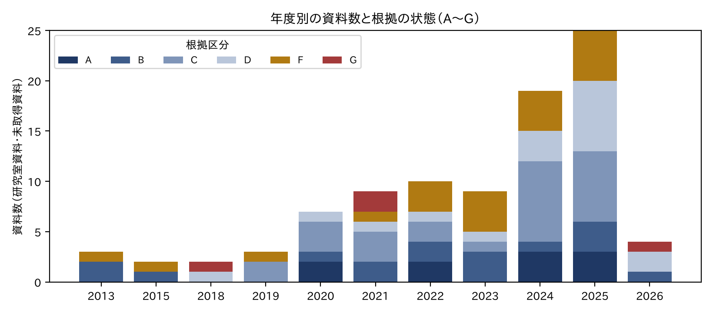
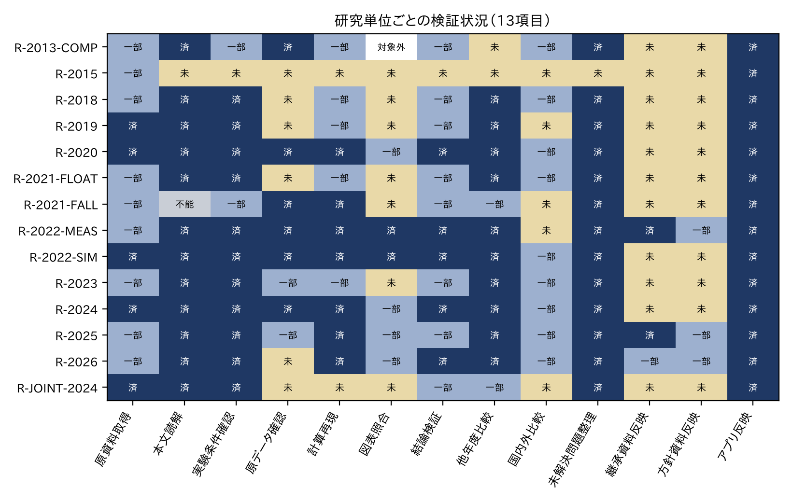
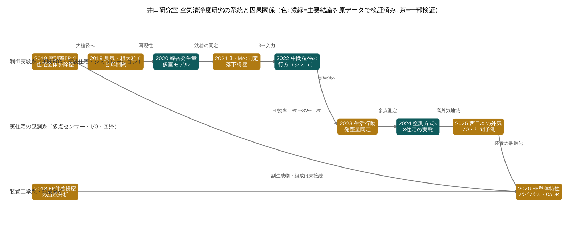
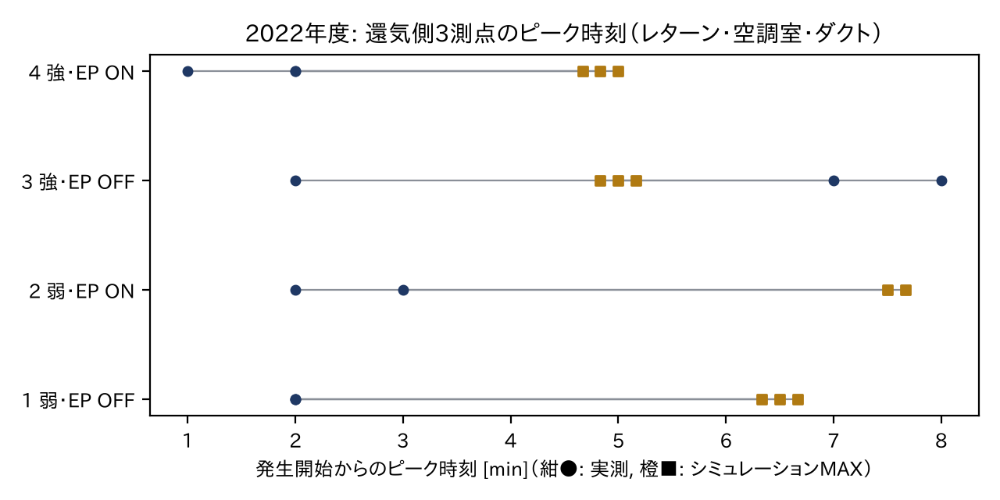
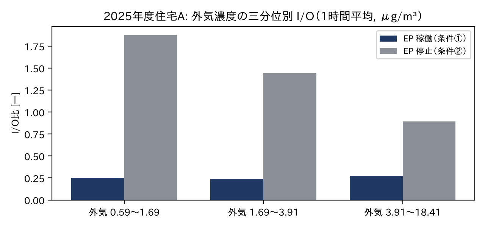
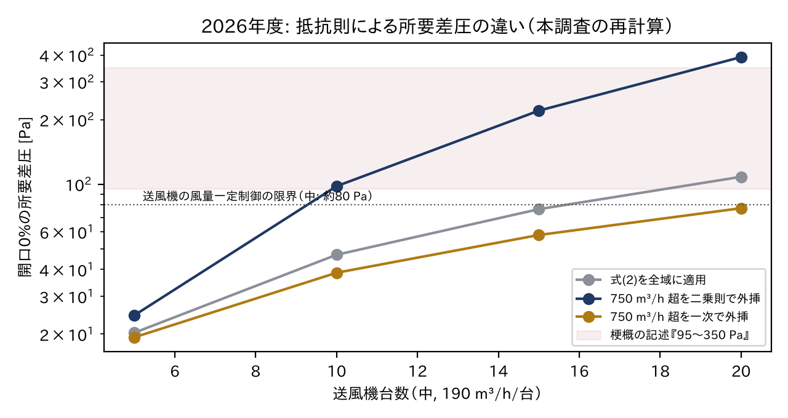
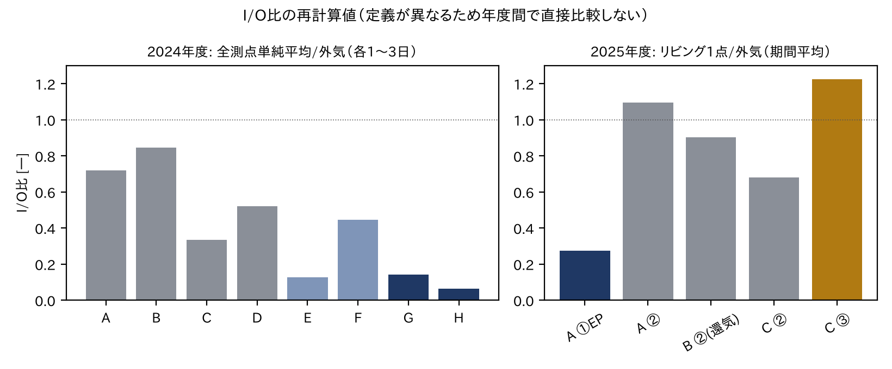
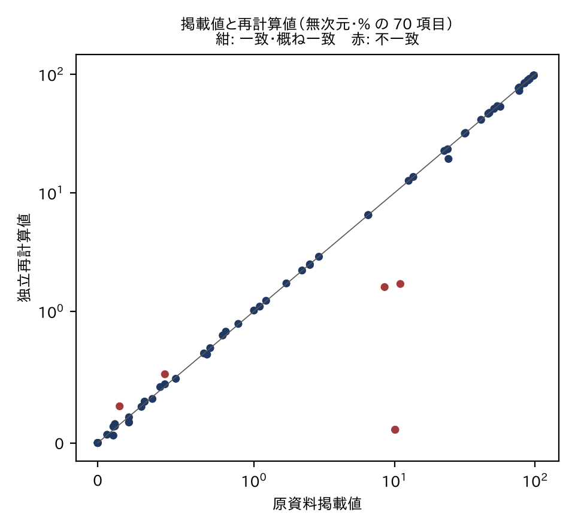

```{=openxml}
<w:p><w:r><w:br w:type="page"/></w:r></w:p>
```


# 作成情報・報告書の位置づけ


| 項目 | 内容 |
|---|---|
| 報告書の種類 | 中間統合技術調査報告書（2026年11月版, 版番号 1.0） |
| 作成 | AQ Research OS（研究資料の整理・検証用アプリ）上での自主調査。作成支援に AI（Claude）を使用 |
| 対象 | 井口研究室 住宅班の空気清浄度関連研究（2013〜2026年度の取得済み資料）と、その検証に用いた国内外文献 |
| 位置づけ | 研究室の公式見解・公認成果物ではない。研究室内資料の読解と独立再計算に基づく調査であり、第三者査読は受けていない |
| 資料の取得日 | Box 資料は 2026年11月1日〜4日に読み取り専用で取得（詳細は付録A・SOURCE_INVENTORY.csv） |
| 再現方法 | 数値は `scripts/` と `verification/` の再計算コードで再生成できる（付録L）。原データは公開リポジトリに含めない |


## 利用した資料の範囲


研究室資料 95件（うち外部資料の登録 9件）、国内外文献 23件、外部基準・統計 7件、未取得資料 9件を台帳に登録した。根拠区分の内訳は A 10件、B 16件、C 28件、D 17件、E 39件、F 20件、G 4件である（第5章、SOURCE_INVENTORY.csv）。

## 免責・確認事項

1. 本報告書は、研究室の Box に保存された資料のうち、本調査の時点で取得・読解できたものに基づく。取得できなかった資料の内容は推測で補っていない（付録H）。
2. 記述には区分を付けた。**FACT**（原資料確認事項）、**CALC**（独立再計算）、**ANALYSIS**（本報告書の分析）、**HYPOTHESIS**（仮説）、**UNRESOLVED**（未解決）、**NOT VERIFIED**（未確認）。原著者の主張は FACT のうち「当事者の主張」として区別した（第5章）。
3. 重要な主張には Claim ID（例: F-V-01）を付けた。ID は EVIDENCE_LEDGER.csv の行に対応し、そこから原資料（Box ID・ページ）と検証記録に戻れる。
4. 学生・居住者の氏名、住宅の詳細住所、アンケート内容、外部サーバーの接続情報は記載しない。住宅は研究室資料の記号（A〜H）または本報告書で付けた匿名記号で示す。市名は外気測定局の所在として資料に記載されている範囲で用いる。
5. 「独立再計算」は、原資料の式・条件・データを用いて本調査で計算し直したことを意味する。第三者による追試ではない。
6. 研究の評価と、本調査で利用できた資料の完全性は別の問題である。資料が不足していることは、その研究の品質が低いことを意味しない。


```{=openxml}
<w:p><w:r><w:br w:type="page"/></w:r></w:p>
```


# 要旨


井口研究室（住宅班）は2018年度以降、床吹出型全館空調住宅の空気循環経路に電気集塵機（EP）を置き、住宅全体の浮遊粒子を減らす方式を、実験住宅での制御実験、実住宅での多点観測、装置単体の性能試験へと段階的に検討してきた。本報告書は、研究室の Box に保存された資料95件と国内外文献23件を対象に、資料台帳・根拠台帳を整備し、取得できた原データと計算シートから主要な数値を独立に再計算して、研究全体を一つの体系として整理したものである。

独立再計算の結果、次の成果は原データ・計算シートで裏付けられた。(1) 2025年度住宅Aのリビングの室内外濃度比（I/O比）は EP 稼働時0.274、停止時1.095で、梗概の0.28・1.10と一致し、外気濃度の帯をそろえて比べても稼働時が大幅に低い（F-V-01, F-2025-27）。(2) 2024年度住宅Gでは EP 停止によりリビング濃度が約10倍に上昇した（F-V-10）。(3) 2022年度の多数室計算シート20件はすべて粒子収支が閉じ、室別の沈着割合の掲載値を再現する（F-SIM-13）。(4) 2026年度の並列流路モデルは、5台運転・開口0%の CADR 約740 m³/h を再現する（F-2026-04, F-2026-07）。

一方、次の事項は再計算と一致しないか、条件付きでしか支持されない。(1) 2026年度の多台数運転時の差圧（95〜350 Pa）は、本文が明記する式(2)からは再現せず、実測範囲（≤750 m³/h）を超える部分を二乗則で外挿したときだけ再現する。最大 CADR（約730〜770 m³/h）は、記載のない除外条件を仮定しない限り再現しない（F-2026-03, F-2026-08）。(2) 2022年度の実測値がシミュレーションの帯に入る割合は0〜32%で、主因は背景濃度が初期条件に含まれていないことである（F-2022-07/08）。(3) 2025年度住宅Cでは、EP の稼働・停止・稼働の順の比較で効果が統計的に確立しない（F-2025-28）。(4) I/O比の定義は年度で異なり、2024年度と2025年度の値は直接比較できない（F-X-18）。

研究全体に共通する課題は、指標の定義と運転記録の管理、1日・1住宅の値の代表性、簡易センサーの絶対値の不確かさ、実測範囲外への外挿である。今後は、EP の高風量域の実測（抵抗則と効率）、季節を含む同一住宅での条件交互比較、センサーの湿度を含む並置校正を優先すべきである。2018・2019年度の原データなど未取得の資料は付録Hに整理し、それらに依存する結論の制約を明示した。


# Executive Summary

::: {lang="en-US"}

Since FY2018 the housing group of the Iguchi Laboratory has studied a whole-house approach to indoor particle control: an electrostatic precipitator (EP) placed in the air-handling room of floor-supply central air-conditioning, so that the recirculating air of the whole dwelling is cleaned. The work progressed from controlled tests in an experimental house (2018–2022), to multi-point field monitoring in occupied houses (2023–2025), to bench testing of the EP and fan (2026). This interim report audits 95 laboratory sources and 23 external references, builds a source inventory and an evidence ledger, and independently recomputes the key numbers from the raw data and calculation sheets that could be retrieved.

Confirmed by recomputation: the indoor/outdoor ratio of House A (FY2025) is 0.274 with the EP on and 1.095 with it off (reported 0.28 / 1.10), and the difference persists when outdoor concentration is stratified; switching the EP off in House G (FY2024) raised living-room concentration about tenfold; all 20 multi-zone calculation sheets of FY2022 close their particle balance and reproduce the published deposition shares; the FY2026 parallel-path model reproduces the clean-air delivery rate of about 740 m³/h for five fans with the bypass closed.

Not reproduced or only conditionally supported: the FY2026 pressure drops for many fans (95–350 Pa) follow only if the measured resistance law (valid to 750 m³/h) is extrapolated quadratically, and the stated CADR maximum of 730–770 m³/h requires an undocumented exclusion rule; FY2022 measurements fall inside the simulated band in only 0–32 % of points, mainly because background concentration is not in the initial condition; in House C (FY2025) an on–off–on comparison does not establish an EP effect; and the I/O definitions of FY2024 and FY2025 differ, so their values are not directly comparable.

Priorities for the next phase are measurement of EP efficiency and pressure drop above 750 m³/h, season-resolved alternating-condition tests in the same house, and humidity-aware co-location calibration of the low-cost sensors. Materials not yet retrieved (e.g. raw data of FY2018–2019) are listed in Appendix H together with the conclusions they limit.

:::


# 主要な結論

1. 空調室（循環経路）の EP による住宅全体の粒子低減は、制御実験（2018・2022年度）と実住宅の原データ（2024年度住宅G、2025年度住宅A）の双方で確認された。ただし効果の大きさは住宅によって大きく異なり、2025年度住宅Cでは確立していない。（根拠: F-2018-01, F-V-10, F-V-01, F-2025-27, F-2025-28）
2. 粗大粒子（30〜45 μm）は発生室でほぼ沈着し、5〜10 μm は循環で他室へ広がるが EP で3〜5割が捕集される、という2022年度の計算結果は、計算シート20件の独立検証で再現された（計算上の結果であり実測ではない）。（根拠: F-2022-02, F-SIM-13）
3. 2026年度の『最適バイパス開口率』は、EP の実測範囲（100〜750 m³/h）を超える抵抗則と効率の外挿、および梗概に記載のない除外条件に依存しており、現時点では仮説の段階にある。（根拠: F-2026-03, F-2026-07, F-2026-08）
4. I/O比・回帰係数・超過時間割合は、年度ごとに定義（測点、平均化、期間）が異なる。年度間で数値を並べる場合は、定義を揃えた再計算が前提となる。（根拠: F-X-18, F-V-14, F-V-16）
5. 簡易センサーの記録値はメーカー仕様どおりの換算値であるが、公称精度（±10 μg/m³ または ±10%）と湿度の影響を考えると、室内1〜5 μg/m³ 程度の絶対値と WHO 指針値の比較には大きな不確かさがある。（根拠: F-2025-22, F-2025-23, F-LIT-03）
6. 2018・2019年度の原データ、2025年度住宅Dの全数値、2023年度の大容量ブックなどは未取得であり、それらに依存する結論（2025年度条件①の回帰係数0.14 など）は未検証のまま残る。（根拠: F-V-06, Q-12）

## 重要な数値結果（独立再計算）


**表 S-1　主要な数値の照合（抜粋）**

| 計算ID | 項目 | 掲載値 | 再計算値 | 判定 | 根拠 |
|---|---|---|---|---|---|
| N-002 | 2025 住宅A I/O 条件①（EP稼働） | 0.28 | 0.2742 | 概ね一致 | F-V-01 |
| N-003 | 2025 住宅A I/O 条件② | 1.1 | 1.0951 | 一致 | F-V-01 |
| N-004 | 2025 住宅B I/O 条件② | 0.9 | 0.9039 | 一致 | F-V-02 |
| N-005 | 2025 住宅C I/O 条件②（最終版区分） | 0.68 | 0.6798 | 一致 | F-V-03 |
| N-006 | 2025 住宅C I/O 条件③ | 1.22 | 1.226 | 一致 | F-V-03 |
| N-076 | 2022 実住宅 10〜20 μm の最大個数濃度 | 60000.0 | 59364.0 | 概ね一致 | F-2022-09 |
| N-077 | 2026 C1（式(2)全域） | 95〜350 | 46.8, 108.2 | 不一致 | F-2026-07, F-2026-08 |
| N-078 | 2026 C1（750超を二乗則） | 95〜350 | 97.8, 391.3 | 一致 | F-2026-07, F-2026-08 |
| N-083 | 2026 C3（式(2)全域） | 約740 | 741.0 | 一致 | F-2026-07, F-2026-08 |
| N-084 | 2026 C3（750超を二乗則） | 約740 | 741.0 | 一致 | F-2026-07, F-2026-08 |
| N-085 | 2026 C4（式(2)全域） | 約730〜770 | 778.0, 1059.0, 1174.0 | 不一致 | F-2026-07, F-2026-08 |
| N-086 | 2026 C4（750超を二乗則） | 約730〜770 | 746.0, 981.0, 1124.0 | 不一致 | F-2026-07, F-2026-08 |
| N-093 | JEM1467 清浄時間（23畳, 5.1 m³/min） | 30.0 | 29.2 | 概ね一致 | F-X-19 |

<small>注: 全件は第18章と NUMERICAL_AUDIT.csv。2026 C1〜C4 は差圧・CADR の記述の照合（単位は Pa または m³/h）。</small>

## 主な未解決課題


- **Q-01**: EPの750〜2000 m³/h域での差圧・粒径別効率（試算の外挿域の実測）（未着手）
- **Q-02**: 簡易PMセンサー（Watty）とKC-52・公定法の並置校正、湿度補正（資料あり・未検証）
- **Q-03**: 春季（黄砂・越境PM2.5）・夏季の回帰係数kとI/O（未着手）
- **Q-04**: 2025年度住宅Cの条件区分: 本論の運転記録（表6）ではEP稼働期間があるのに最終版は条件②に一括。原データを運転記録で再区分して係数を再計算する必要（本論読了で矛盾を確認・再計算未）
- **Q-13**: 2026年度バイパス試算のCADR最大値（約730〜770 m³/h）を与えた計算条件。式(2)の750 m³/h超の扱いと、集塵機通過風量・差圧の除外条件の有無を計算シートで確認する（未着手）


```{=openxml}
<w:p><w:r><w:br w:type="page"/></w:r></w:p>
```

# 目次

```{=openxml}
<w:p><w:r><w:fldChar w:fldCharType="begin" w:dirty="true"/><w:instrText xml:space="preserve"> TOC \o "1-2" \h \z \u </w:instrText><w:fldChar w:fldCharType="separate"/><w:t>（目次: Word では右クリック→フィールド更新）</w:t><w:fldChar w:fldCharType="end"/></w:r></w:p>
```


# 図一覧

- 図 3-1　年度別の資料数と根拠の状態
- 図 5-1　研究単位ごとの検証状況
- 図 6-1　研究の系統と因果関係（2018〜2026年度）
- 図 8-1　還気側測点のピーク時刻（実測とシミュレーション）
- 図 10-1　2025年度住宅Aの外気濃度帯別 I/O
- 図 11-1　開口率0%の所要差圧と抵抗則
- 図 17-1　I/O比の再計算値（2024年度と2025年度）
- 図 18-1　原資料掲載値と独立再計算値

# 表一覧

- 表 S-1　主要な数値の照合（抜粋）
- 表 2-1　研究室資料と本アプリで扱った物理モデル
- 表 3-1　研究単位の一覧
- 表 5-1　所見（Claim）の区分別件数
- 表 5-2　資料の根拠区分別件数
- 表 6-1　研究年表
- 表 7-1　R-2013-COMP の統一フォーマット（27項目）
- 表 7-2　R-2015 の統一フォーマット（27項目）
- 表 7-3　R-2018 の統一フォーマット（27項目）
- 表 7-4　R-2019 の統一フォーマット（27項目）
- 表 7-5　R-2020 の統一フォーマット（27項目）
- 表 7-6　R-2021-FLOAT の統一フォーマット（27項目）
- 表 7-7　R-2021-FALL の統一フォーマット（27項目）
- 表 8-1　R-2022-MEAS の統一フォーマット（27項目）
- 表 8-2　R-2022-SIM の統一フォーマット（27項目）
- 表 9-1　R-2023 の統一フォーマット（27項目）
- 表 9-2　R-2024 の統一フォーマット（27項目）
- 表 10-1　R-2025 の統一フォーマット（27項目）
- 表 11-1　R-2026 の統一フォーマット（27項目）
- 表 12-1　R-JOINT-2024 の統一フォーマット（27項目）
- 表 13-1　研究方法の比較
- 表 13-2　年度間比較の可能性
- 表 14-1　評価指標の定義と注意点
- 表 18-1　独立再計算の結果（2022年度計算シート以外）
- 表 19-1　未解決問題
- 表 19-2　競合仮説（下位の競合仮説と検証方法を含む）
- 表 24-1　T-01 の研究計画の要素
- 表 24-2　T-02 の研究計画の要素
- 表 24-3　T-03 の研究計画の要素
- 表 24-4　T-04 の研究計画の要素
- 表 24-5　T-05 の研究計画の要素
- 表 24-6　T-06 の研究計画の要素
- 表 24-7　T-07 の研究計画の要素
- 表 24-8　T-08 の研究計画の要素
- 表 24-9　T-09 の研究計画の要素
- 表 A-1　研究資料一覧（研究室資料）
- 表 B-1　原資料の参照ページ
- 表 D-1　数式と単位
- 表 E-1　独立再計算の入力値と出力値（全件）
- 表 F-1　研究単位の検証項目（13項目）
- 表 H-1　未取得資料と分析上の影響
- 表 K-1　保存場所
- 表 L-1　解析コード


# 略語・専門用語一覧

| 用語 | 説明 |
|---|---|
| I/O比 | 室内濃度÷外気濃度。室内発生を含むため、侵入の指標としては夜間など発生の少ない時間で評価する |
| 侵入係数（P） | 隙間を通る外気粒子のうち室内に入る割合 |
| 回帰係数 k | 1時間平均の室内濃度を外気濃度に原点通過で回帰した傾き（2025年度） |
| CADR | Clean Air Delivery Rate。清浄空気供給量。稼働・停止時の減衰率の差×容積 |
| 沈着係数 β | 表面への沈着による濃度減少率 [1/h]。研究室資料では 1/s のことがある（×3600） |
| 減衰率 D | SHASE その40 の C(t)=C₀(1−D)^t の D [1/s]。β=−ln(1−D)×3600 |
| EP | 電気集塵機（Electrostatic Precipitator）。ここでは空調室に置くセントラル型 |
| バイパス開口率 | EP と並列の流路の開口割合。風量と効率のトレードオフを調整する |
| 全館空調（床吹出型） | 空調室の空気を床下チャンバーから各室に吹き出し、住宅全体を循環させる方式 |
| KC-52 | RION のパーティクルカウンタ。粒径区分ごとの個数を測る |
| そらまめくん | 環境省大気汚染物質広域監視システム。外気の公定法データ |
| WHO AQG | WHO 大気質ガイドライン2021。PM2.5 年平均5、24時間平均15 μg/m³。室内にも適用可能とされる |
| JEM1467 | 日本電機工業会の家庭用空気清浄機の規格。適用床面積と清浄時間の式を定める |
| NRMSE | 平均二乗誤差の平方根をピーク値で割った値。シミュレーションと実測の一致度 |
| ブロックブートストラップ | 自己相関のある時系列で、日などのまとまりごとに再標本化して信頼区間を求める方法 |


# 第I部　研究背景と調査方法


# 第1章　調査の背景と目的


### 1.1 背景

住宅の室内空気中の粒子は、外気からの侵入（隙間・換気口・開口）と室内での発生（調理・燃焼・布団の取扱い・人の動作）によって生じ、換気・沈着・ろ過によって除かれる。粒子濃度は、こうした流入・発生・除去の収支で決まる（第2章）。高気密化と機械換気が進んだ住宅では、外気由来の粒子は外気フィルタで、室内発生の粒子は換気と空気清浄で制御することになる。

床吹出型の全館空調では、住宅全体の空気を空調室に集め、床下を経由して各室へ送り返す循環流がある。この循環経路に EP を置けば、各室に空気清浄機を置かなくても住宅全体の空気を清浄化できる。井口研究室の研究はこの着想から始まった【FACT: F-2018-01】。

### 1.2 本報告書の目的

本報告書の目的は次の四つである。

1. 2013〜2026年度の関連研究を同じ形式で整理し、何が明らかになり、何が未解決かを示す。
2. 主要な数値を原資料と照合し、取得できた原データと計算シートから独立に再計算する。
3. 年度をまたいで比較できる事項とできない事項を区別し、研究全体の技術的な展開を分析する。
4. 後続の学生が、何を引き継ぎ、何を新たに検証すべきかを判断できる材料を示す。

### 1.3 本報告書が扱わないこと

健康影響の評価、研究室外の住宅への一般化、非住宅建築（学校・病院・産業施設）への適用は扱わない。研究室の資料は住宅を対象としており、得られた係数を非住宅へ外挿する根拠がないためである【ANALYSIS】。


# 第2章　室内空気質・空気清浄技術の基礎

本章は、後の章で用いる物理モデルと用語を示す。研究室の資料で採用されたモデルと、基礎技術の一般的な説明を区別するため、研究室で採用されたモデルは表で別に示した。


## 2.1 室内粒子濃度の物質収支（単室モデル）

室内を一様に混合した1室とみなすと、粒子の質量（または個数）の収支は次式で表される（Nazaroff 2004 の枠組み）。

$$V\frac{dC}{dt} = P\,Q_{inf}\,C_{out} + (1-\eta_f)\,Q_{oa}\,C_{out} - (Q_{inf}+Q_{oa})\,C - \beta V C - \eta_{EP} Q_{EP} C + G$$

- $C$ 室内濃度 [μg/m³]、$C_{out}$ 外気濃度、$V$ 室容積 [m³]
- $Q_{oa}$ 機械換気の外気量、$Q_{inf}$ 隙間からの侵入 [m³/h]、$P$ 隙間の透過率、$\eta_f$ 外気フィルタ捕集率
- $\beta$ 沈着係数 [1/h]、$\eta_{EP}Q_{EP}$ 空気清浄装置の除去風量（CADR）[m³/h]、$G$ 室内発生 [μg/h]

定常（$dC/dt=0$）かつ室内発生なしのとき、I/O比は
$$\frac{C}{C_{out}} = \frac{P\,Q_{inf}+(1-\eta_f)Q_{oa}}{Q_{inf}+Q_{oa}+\beta V+\eta_{EP}Q_{EP}}$$
となる。分子は「外気がどれだけ入るか」、分母は「室内からどれだけ除かれるか」である。2025年度の回帰係数 $k$（室内=k×外気）はこの比に相当するが、室内発生がある時間帯を含めると $k$ は過大になる（F-V-12）。

**総除去率** $\lambda = (Q_{inf}+Q_{oa}+\eta_{EP}Q_{EP})/V + \beta$ [1/h] は、発生停止後の減衰 $C(t)=C_0 e^{-\lambda t}$ の傾きとして測れる。空気清浄装置の稼働時と停止時の $\lambda$ の差に $V$ を掛けたものが実効CADRであり、JEM1467 や ANSI/AHAM AC-1 の考え方と同じである（第6章）。

井口教授の手書き計算式（S-REF-01, F-REF-01）は、$dC/dt = M/V + (C_{in}-C)Q/V - (U/H)C$ を $dC/dt=aC+b$ と置いて積分し、片対数グラフの傾きから総減衰率 $a$ を求める手順を示している。2021・2023年度の同定式はここから出発している。

## 2.2 沈着（重力沈降・拡散・乱流）

重力沈降による沈着係数は、終末沈降速度 $U$ を室の高さ $H$ で割った $\beta = U/H$ で近似される。Stokes 域では
$$U = \frac{C_c\,d^2(\rho_p-\rho)\,g}{18\mu}$$
（$C_c$ カニンガム補正、$d$ 粒径、$\rho_p$ 粒子密度、$\mu$ 空気の粘度）。本アプリの式は2021年度落下班（F-2021-05）・2023年度β理論式（F-2023-07）・2019年度の石松子（F-X-17）の計算と1%程度で一致する。

ただし実住宅で測ったβは、粗大粒子では理論値の1/10〜1/100、サブミクロン粒子では理論の重力項より大きい（F-2023-08, F-X-09）。サブミクロン粒子ではブラウン拡散、気流のある室では乱流沈着（Lai & Nazaroff 2000）が効く（F-X-20）。**理論βをそのまま住宅に使うと、粗大粒子では沈着を過大に、微小粒子では過小に見積もる可能性がある**。多室モデルの減衰率Dが運転条件で変わる（F-SIM-02）のも、βが物性値ではなく気流に依存する較正係数であることを示している。

## 2.3 電気集塵機（EP）の原理

電気集塵機は、コロナ放電で粒子を帯電させ、電界中で集塵電極に引き寄せて捕集する。理想化した捕集効率は Deutsch の式 $\eta = 1-\exp(-wA/Q)$（$w$ 移動速度、$A$ 集塵面積、$Q$ 風量）で表され、**風量が増えると効率が下がる**。2026年度の単体試験では100 m³/h で95%以上、750 m³/h で82〜92%と、この傾向を確認している（F-2026-01）。圧力損失はフィルタより小さいため大風量の循環に向くが（2018年度の発想, F-2018-01）、放電によりオゾンを生成し得る（F-LIT-04）。研究室はオゾン等の副生成物を測っていない。

## 2.4 送風機・圧力損失・バイパス流路

送風機は静圧が上がると風量が下がる（P-Q特性）。2026年度の DC ファンは70〜90 Pa までほぼ定風量で、電力は3〜5倍に増える（F-2026-02）。EP と並列にバイパス流路を設けると、全体の圧力損失が下がって風量が増える一方、EP を通る割合が減る。このため CADR（＝EP通過風量×効率）には最適なバイパス開口率が生じ得る。フィルタでも「高効率ほど風量が落ちて CADR が下がる」ことが報告されている（F-LIT-05）。**ただし研究室の最適開口率の値は、EP の実測範囲（750 m³/h まで）を超えた外挿（二乗則）に依存する**（F-2026-03）。

## 2.5 多室モデル（換気回路網）

各室を完全混合とし、室間を回路網の風量でつなぐと
$$V_i\frac{dC_i}{dt} = \sum_j Q_{ji}(1-\eta_{ji})C_j - \Big(\sum_k Q_{ik}\Big)C_i - \beta_i V_i C_i + G_i$$
となる。2018・2020・2022年度の簡易シミュレーションと SHASE2021（その40）・2023（その42）はこの式である。本アプリの実装は2020年度実測でファン弱 NRMSE 0.21、強 0.56（F-SIM-01〜04）、2022年度の計算シートを全20件で再現した（F-SIM-13）。限界は、発生源近傍・還気口の時間応答、室間の濃度差、扉開口の双方向流（F-SIM-07）を表せないことである。共同研究（S-REF-20）のように **CO₂トレーサで風量を先に同定し、沈着は別に与える**のが望ましい（F-X-22）。

## 2.6 個数濃度と質量濃度

パーティクルカウンタ（KC-52）は粒径区分ごとの個数を数える。質量への換算は $m = \frac{\pi}{6}d^3\rho N$ で、代表径と密度の仮定に強く依存する（F-2023-02）。ワイヤレスセンサーの「μg/m³」はメーカーの換算値で、方式は公開されていない（F-2025-22）。**個数と質量、センサー表示と公定法の値を混同しないこと**が、研究室で最も繰り返された注意点である。


**表 2-1　研究室資料と本アプリで扱った物理モデル**

| モデル | 式 | 単位 | 根拠 | 適用範囲 |
|---|---|---|---|---|
| 単室完全混合マスバランス | V·dC/dt = Q_OA(1−η_OA)C_out + Q_inf·P·C_out + G − (Q_OA + Q_inf + η_EP·Q_EP)C − β·V·C | V[m³], Q[m³/h], C[μg/m³], G[μg/h], β[1/h] | 1516271027930, 1516272435953 | 住宅全体を1室とみなす瞬時一様拡散。室間濃度差・気流分布は表現しない（2020/2021年度に一様拡散仮定の誤差が報告）。 |
| 電気集塵機∥バイパス 並列流路モデル | N·q_fan(ΔP) = 78.611·ΔP^0.828 + 3600·α·A·√(2ΔP/ρ),  CADR = η(Q_EP)·Q_EP | Q[m³/h], ΔP[Pa], A[m²], ρ[kg/m³] | 2525808527679 | 式(2)は Q=100〜750 m³/h・ΔP≈0〜17 Pa の単体実測。送風機の限界超過後特性と η の中間値は読み取り・仮定。 |
| 重力沈降による沈着係数 | β = U/H,  U = 2·Cc·(ρp−ρ)·g·r²/(9μ) | β[1/s], U[m/s], H[m], r[m] | 1516299546149 | 球形粒子・静穏空気。実住宅の階間・床下では BOX 比 2〜11 倍の β が報告（ダクト・表面積効果）。 |
| 発生・減衰の同定式 | C(t) = C0·e^(−βt) + M/(βV)·(1 − e^(−βt)) | C[個/m³ or mg/m³], M[個/s or mg/s], V[m³] | 1516299546149 | 閉鎖空間・一様濃度。換気がある場合 β は換気率を含む見かけ値。 |
| 個数→質量濃度換算 | Cm = (4/3)·π·r³·N·ρ | Cm[mg/m³], N[個/m³], r[m], ρ[mg/m³] | 1516369441999 | 球形・粒径帯代表径・密度仮定（コットンリンター）に強く依存。粒径帯幅の扱いで1桁程度変わり得る。 |
| 多室（換気回路網）モデル | V_i·dC_i/dt = Σ_j Q_ji·C_j·(1−η_ji) − (Σ_k Q_ik)·C_i − β·V_i·C_i + G_i | V[m³], Q[m³/h], C[mg/m³], G[mg/h], β[1/h]（β = −ln(1−D)·3600, D[1/s]） | S-REF-15, S-2020-01, S-2018-01 | 各室は瞬時一様拡散。2020年度実測との比較でファン弱・D=0.0003 /s は平均NRMSE 0.21、同じDのファン強は0.56（過大評価）。最適Dは運転条件で異なり（弱0.000475・強0.00075）、還気口の応答時刻と室間差は再現できない（F-SIM-01〜04）。 |
| 回帰係数による年間室内濃度予測 | C_in(t) = k·C_out(t)  （1時間平均, 原点通過回帰） | C[μg/m³] | 2166150611661 | 室内発塵を無視。測定期間（秋季・数日〜2か月）の k を通年に適用する仮定。 |


# 第3章　対象研究と資料構成

対象とした研究単位（年度×班）は14件である。研究単位は、同じ研究の複数の版（中間・最終、卒論・学会論文）を一つにまとめたもので、同一研究を重複して数えないようにした（例: 2022年度卒論と2023年の学会論文その42は同一研究, F-X-21）。

**表 3-1　研究単位の一覧**

| ID | 年度 | 研究 | 資料数 | 分類（第4章の監査） |
|---|---|---|---|---|
| R-2013-COMP | 2013 | EP付着粉塵の化学組成（ICP・イオン, 公設試の成績書） | 3 | 原データ確認 |
| R-2015 | 2015 | 2015年度 全館空調（YUCACO）卒論 | 1 | 資料所在確認 |
| R-2018 | 2018 | 空調室EPによる住宅全体の除塵 | 2 | 実験条件確認 |
| R-2019 | 2019 | 臭気・粗大粒子の拡散とEP | 2 | 実験条件確認 |
| R-2020 | 2020 | 線香発生量の同定と多室シミュレーション | 6 | 結論検証済み |
| R-2021-FLOAT | 2021 | 浮遊班: βとMの同定・布団発塵 | 2 | 実験条件確認 |
| R-2021-FALL | 2021 | 落下班: ダストサンプラー・落下計算 | 4 | 原データ確認 |
| R-2022-MEAS | 2022 | 中間粒径の実測（実住宅4件・実験住宅） | 4 | 数値再現済み |
| R-2022-SIM | 2022 | 中間粒径の多室シミュレーション（粉塵の行方） | 4 | 結論検証済み |
| R-2023 | 2023 | 実住宅の生活行動と粉塵・発塵量の同定 | 5 | 原データ確認 |
| R-2024 | 2024 | 空調方式別の生活行動と粉塵（8住宅） | 8 | 結論検証済み |
| R-2025 | 2025 | 西日本の外気と空気清浄装置・年間予測 | 9 | 数値再現済み |
| R-2026 | 2026 | EP単体特性・バイパス開口率（中間） | 3 | 数値再現済み |
| R-JOINT-2024 | 2024 | 共同研究（北大）ダクト式全館空調のエアロゾル拡散 | 2 | 本文確認 |

## 2018・2019年度の原データの扱い

2018・2019年度の研究は、梗概・本論・学会論文（SHASE 2019 その31、2020 その36）として取得・読解できている。一方、それらの基になった計測データ（粉塵計・パーティクルカウンタの時系列）は、Box の当該年度フォルダで見つかっていない【FACT: S-2018-01, S-2019-01 の notes】。

本報告書では、これを「現時点で取得・確認できていない資料」として扱い、次の方針をとった。

- 資料が存在しない、あるいは管理されていない、とは判断しない。保存場所が別である可能性、別の名称で保存されている可能性、研究室外に保存されている可能性を排除できないためである【UNRESOLVED】。
- 原論文に掲載された結果（図表・本文の数値）の読解・比較と、原データからの完全な再解析を区別する。2018・2019年度については前者のみを行った。
- 原データがなくても検証できる事項は検証した。例えば、2018年度の市販清浄機の清浄時間は JEM1467 の式で再現し（F-X-10, F-X-19）、2019年度の石松子の終端速度は Stokes 式で再現した（F-X-17）。
- 原データの未取得により制約される結論を明示した（第19章、付録H）。

2025年度住宅Dの測定データ（27 MB）、2023年度の発塵量同定ブック（51.5 MB）と実態調査まとめ（14.2 MB）も、Box 連携の応答上限を超えるため取得できていない。これらは保存場所が分かっており、10 MB 以下の CSV に分割すれば取得できる見込みである（付録H）。


{width=95%}

<small>研究室資料（S-）と未取得資料（M-）を年度別に集計。SOURCE_INVENTORY.csv の『根拠区分』列に基づき本報告書で作成。年度不明の資料は除く。</small>


# 第4章　資料収集・原本確認・数値検証の方法


### 4.1 資料の収集

研究室の Box（住宅班フォルダ）を年度・班ごとに走査し、清浄度に関係する資料を台帳に登録した。Box は読み取り専用で扱い、アップロード・移動・削除・メタデータ書込みは行っていない。資料は次の方法で取得した。

| 方法 | 用途 | 制約 |
|---|---|---|
| テキスト抽出（get_file_content） | PDF・docx・xlsx・pptx の本文と数値 | 約14 MB 超で接続が切断される |
| PDF 原本の取得（リソース取得） | 画像のみの PDF | 約3 MB 以下 |
| ページ画像（プレビュー） | スキャン資料、大容量 Excel の構成確認 | 目視の読取りのみ。全数値の取得には使えない |

取得できなかった資料と試した方法は `docs/資料取得の技術的検討.md` に記録した。

### 4.2 原本確認

各資料の調査状態を、未確認 → 目録確認（存在と構成を確認）→ 読了（本文を通読）→ 数値検証済み（数値を照合または再計算）の4段階で管理した。読んでいない資料を読了とはしていない。

### 4.3 独立再計算

原データまたは計算シートが取得できた研究について、本調査で Python のコードを書いて再計算した（付録L）。手順は、(1) 原資料の式と条件を確認する、(2) 原データを読み込み、原資料と同じ定義で値を計算する、(3) 掲載値と比較する、(4) 一致しない場合は定義・単位・期間・時間刻みなどの違いを調べる、である。再計算の入力値・出力値・差は NUMERICAL_AUDIT.csv に記録した。

一致の判定は次の基準とした。

| 判定 | 基準 |
|---|---|
| 一致 | 掲載値の表示桁で一致する（丸めの範囲内） |
| 概ね一致 | 相対差5%以内、または図からの読取りの精度内 |
| 不一致 | 上記を超える差があり、定義をそろえても解消しない |
| 判定不能 | 掲載値の定義・条件が特定できない、または原データが不足する |

### 4.4 文献照合

国内外の文献は Crossref・OpenAlex の書誌データベースで検索し、DOI のある23件について書誌と要旨を確認した。全文を確認したものはなく、確認水準（要旨確認・書誌のみ）を文献ごとに記録した（第12章、REFERENCES.md）。J-STAGE・CiNii の全文検索は実施していない。


# 第5章　証拠の分類と信頼性評価


### 5.1 主張の区分

本報告書の所見（Claim）は、研究室のナレッジベース（`scripts/knowledge_data.py`）の所見に対応する。所見の区分は、指示された区分に次のように対応させた。

| ナレッジベースの区分 | 本報告書の区分 | 意味 |
|---|---|---|
| 確認事実 | FACT | 原資料に明記された内容 |
| 当事者の主張 | FACT（原著者の主張） | 原資料の著者の解釈・結論。本報告書は支持も否定もしていない |
| 計算結果 | CALC | 本調査の独立再計算の結果 |
| 計算結果（当事者） | FACT（原著者の計算） | 原資料に掲載された計算結果 |
| 予測（当事者） | FACT（原著者の予測） | 原資料に掲載された予測 |
| 分析 | ANALYSIS | 確認事実と計算結果から本報告書が導いた考察 |
| 仮説 | HYPOTHESIS | 今後の検証を要する推論 |
| 未解決問題（Q-xx） | UNRESOLVED | 資料間の不一致、根拠不足 |
| 不明・未取得 | NOT VERIFIED | 確認作業ができていない事項 |

### 5.2 根拠の状態（A〜G）

資料ごとの根拠の状態を、指示に従い A〜G に分類した。この分類は研究の学術的な品質ではなく、本報告書の執筆時点で利用できた根拠の状態を表す。

| 区分 | 定義 | 本調査での判定方法 |
|---|---|---|
| A | 原本と生データを確認済み | 原データ（測定値の Excel 等）を取得し数値検証した |
| B | 原本と一部の計算結果を確認済み | 計算シート・解析ブック・規格・分析成績書の数値を照合した |
| C | 原本または論文本文のみ確認済み | 本論・学会論文・計算ブックを読了したが数値の再計算はしていない |
| D | 研究概要・発表要旨のみ確認済み | 梗概・中間梗概・発表資料のみ読了 |
| E | 二次資料のみ確認済み | 外部文献の要旨・書誌、外部記事 |
| F | 存在が示唆されるが資料未取得 | 目録で存在を確認したが内容を取得・読解していない |
| G | 存在自体を確認できていない | 他資料から存在が示唆されるが Box で見つかっていない |


**表 5-1　所見（Claim）の区分別件数**

| 区分 | 件数 |
|---|---|
| FACT | 45 |
| ANALYSIS | 44 |
| CALC | 41 |
| FACT（原著者の主張） | 8 |
| HYPOTHESIS | 4 |
| FACT（原著者の予測） | 2 |
| FACT（原著者の計算） | 1 |

<small>注: EVIDENCE_LEDGER.csv には所見に加えて未解決問題（UNRESOLVED）と未取得資料（NOT VERIFIED）を登録した。</small>

**表 5-2　資料の根拠区分別件数**

| 区分 | 件数 |
|---|---|
| A | 10 |
| B | 16 |
| C | 28 |
| D | 17 |
| E | 39 |
| F | 20 |
| G | 4 |

{width=95%}

<small>audit_data.py の13項目（済・一部・未・不能・対象外）を本報告書で図化。原資料取得〜アプリ反映の各段階の実施状況を示す。</small>


# 第II部　年度別研究の技術分析


# 第6章　関連研究の年代別整理

**表 6-1　研究年表**

| 年度 | 研究 | 問い | 方法 | 主な結果（原資料） | 後続への引継ぎ |
|---------|------------------------|------------------------|------------------------------------|------------------------------------|------------------------|
| 2018 | 住宅向け床吹出型全館空調方式における集塵方法に関する研究 | 空調室（空気循環経路）に電気集塵機を置けば住宅全体を除塵できるか | 線香2本で発塵、粉塵計(KANOMAX 3442, cpm)とパーティクルカウンタ(RION KC-52)で70分測定。実住宅(オープン型)と企業実験棟(個室型)。集塵機位置(空調室/寝室)と市販清浄機3台を比較。換気回路網の一様拡散シミュレーション。 | 空調室設置で全室が背景濃度以下に低下。寝室設置・各室の市販清浄機では他室に効果が及びにくい。シミュレーションは発生量を20〜25%に調整して実測に合致。 | より大きな粒子での確認、線香煙の天井滞留・付着の調査 |
| 2019 | 全館空調方式における臭気と粉塵の拡散および消臭・集塵に関する研究 | においの拡散とEP・消臭フィルタの効果、線香より大きい粒子（花粉代替）の拡散とEP効果 | においセンサー・TVOCセンサー・被験者申告（強度5段階・受容度4段階, 各室2〜8人, t検定）。花粉代替（石松子・粉砕ベビーパウダー・コーンスターチ）を玄関で散布し扉開閉×EP ON/OFF。線香2本・4本・蚊取線香を各室で発生させEPで集塵 | においは循環で速く拡散し、EP＋消臭フィルタの効果は焼肉の洋室(大)のみ有意（p=0.01）。粗大粒子は循環ではほぼ拡散せず扉開放時の空気交換が主経路。線香・蚊取線香（≤5 μm）は発生場所・量によらずEPで集塵 | 発生量・濃度の再現性確認（→2020） |
| 2020 | 床吹出型全館空調方式における粉塵拡散実験及びシミュレーションに関する研究 | 粉塵拡散の再現性と簡易シミュレーションでの予測可能性 | 6.48 m³ 実験BOXで線香1本の発生量を13回同定。実験住宅で線香2本・ファン弱5回/強3回。換気回路網シミュレーション(C値1.77から漏気を按分)。 | 発生量 平均0.00695 mg/s（ばらつき最大14.4%）。同条件でも気流で拡散パターンが変わる回がある。床下・階間で25%の濃度減衰を見込むと実測と合う。 | 沈着・付着の物理的同定（→2021） |
| 2021 | 全館空調住宅を対象とした粉塵の挙動に関する基礎的実験と分析（浮遊）／落下粉塵班 | 沈着係数βと発生量Mの同定、布団由来粉塵の拡散 | C=C0e^(−βt)+M/(βV)(1−e^(−βt)) による同定。8 m³ BOX（帯電防止フィルム）で布団叩き。実住宅で洋室・階間・床下のβ測定。落下班はダストサンプラー（本論未読）。 | βは理論値に近い（BOX）。実住宅βはBOX比 洋室1.3倍、階間10.7倍、床下2.3〜2.9倍。一様拡散計算は線香で実測の約0.6倍。 | 実生活に近い発塵での実験（→2022 中間粒径・2023 生活行動） |
| 2022 | 全館空調方式の空気循環による粉塵の他居室への拡散に関する実験（中間粒径5〜45μm） | 5〜45μmの粉塵は循環で拡散するか、すぐ沈着するか | 実住宅4件で24h実測、BOXでコットンリンター0.25g（45μm篩）×7回、実験住宅で風量弱/強×集塵機ON/OFFの5条件。粒径別沈着率をシミュレーション。 | 実住宅では10〜20μmが最多。5〜10μmは住宅全体へ、10〜45μmはレターン〜ダクトまで。30〜45μmは約98%が発生室に沈着。EP稼働で5〜10μmの32〜47%を集塵。 | 全館空調の実住宅での実態調査 |
| 2023 | 実住宅における生活行動と粉塵に関する研究 | 発生場所・要因・粒径・量・頻度の実態と基準比較 | KC-52 を LDK に設置、4住宅で24h〜1週間。外気はそらまめくん参照。個数→質量換算（コットンリンター密度）。 | 0.3〜1.0μmは外気PM2.5に追随、1μm超は生活行動（線香・夕食・入浴）で3〜5倍に上昇し数時間で低下。換算質量は0.003〜0.005 mg/m³が最頻で基準未満。 | 1住宅あたり測定点を増やす（→2024 多点無線センサ） |
| 2024 | 全館空調住宅と個別空調住宅における生活行動による粉塵濃度の実態調査 | 空調方式（個別/全館/全館+セントラル清浄）と粉塵実態の関係 | 8住宅（個別4・全館4、うち2件セントラル型EP）、各4〜10点のワイヤレスPMセンサ（0.3〜1.0μm, μg/m³）、生活行動アンケート。 | 全館空調は室間濃度が均一、浮遊時間が短く(3〜40分)、5μg/m³超過時間が短い。セントラルEP付きはI/O最小。EP停止で<1→2〜6μg/m³。 | 外気濃度の高い地域での検証（→2025 西日本） |
| 2025 | 全館空調住宅における空気清浄装置が室内粉塵濃度に及ぼす影響と年間予測 | 外気濃度の高い西日本で、外気フィルタ・EPの効果と年間室内濃度はどうなるか | そらまめくん2024年度データで地点選定。岩国・下関・直方・周南の4モデルハウス（C値0.28〜0.38）で1分間隔多点測定（9/17〜12/9）。条件①EP+外気フィルタ ②外気フィルタのみ ③なし。1時間平均の原点通過回帰係数を年間外気データに乗じて予測。 | I/O: 条件①0.11〜0.28、②0.54〜1.10、③1.22。回帰係数 ①0.14 ②0.55 ③1.00。年間で5μg/m³超過は①ほぼ無し、②約40%、③約70%。黄砂時も外気由来粒子が流入。 | EPの設置方法（バイパス）と送風動力（→2026） |
| 2026 | バイパス開口率および循環風量の変化が電気集塵式空気清浄システムの特性に及ぼす影響（中間発表） | バイパス開口率と循環風量が CADR と送風動力に与える影響 | JIS B 9908-5 準拠の装置でEP単体（100〜750 m³/h, 8段階）、JIS B 8330 準拠で送風機P-Q・電力。並列流路モデル（二分法）。 | η: 100 m³/hで≥95%、750 m³/hで82〜92%。Q=78.611ΔP^0.828。送風機は70〜90Paまで定風量、電力は3〜5倍に増加。多台数ではバイパス25〜50%でCADR最大（約730〜770 m³/h）。 | （中間段階）高風量域の検証、室内濃度・年間エネルギーへの接続 |

{width=95%}

<small>研究単位を系統（制御実験・観測・装置工学）と年度で配置し、資料に明記された引用・入力値の利用を矢印で示した（本報告書で作成, scripts/make_synthesis_fig.py）。矢印はテーマの連続性を示し、データの直接継承を意味しない。</small>


# 第7章　初期研究と空気清浄技術の基礎的検討（2013〜2021年度）

## 7.1 2013年度 EP付着粉塵の化学組成（ICP・イオン, 公設試の成績書）（R-2013-COMP）

**表 7-1　R-2013-COMP の統一フォーマット（27項目）**

| No | 項目 | 内容（取得資料の範囲） |
|------|---------------------|------------------------------------------------------------------------------------------|
| 1 | 研究の正式名称 | ICP分析.pdf（電気集塵機に付着した粉塵の元素分析, 公設試験研究機関の成績証明書, 2013年）；イオンクロマトグラフ試験.pdf（電気集塵機に付着した粉塵の水溶性イオン, 2013年）；240221_受領資料（ICP・SEM・XRF・イオンクロマト・空気清浄機調査） |
| 2 | 実施・発表年度 | 2013年度 |
| 3 | 著者・所属 | 研究室所属の学生（氏名は記載しない）／日本大学理工学部 井口研究室（住宅班） |
| 4 | 研究背景 | 記載なし（取得資料に明記なし） |
| 5 | 研究目的 | EP付着粉塵の化学組成（ICP・イオン, 公設試の成績書） |
| 6 | 技術的課題 | 原資料の限界の記載: どの住宅・設置期間のEPかは成績書に記載がない【不明】。測定元素は依頼項目に限られる；同上（試料の由来不明） |
| 7 | 対象建築物 | 記載なし |
| 8 | 対象設備 | 空調室EP・全館空調（取得資料の範囲） |
| 9 | 対象粒子・汚染物質 | 記載なし |
| 10 | 計測対象 | 記載なし |
| 11 | 計測機器 | 記載なし |
| 12 | 測定条件 | 記載なし |
| 13 | データ取得方法 | 原データを取得（付録A） |
| 14 | 実験・計算方法 | 記載なし |
| 15 | 使用した数式 | 記載なし |
| 16 | 使用パラメータ | 未確認 |
| 17 | シミュレーション条件 | 該当なし／記載なし |
| 18 | 評価指標 | 第14章の定義に対応（I/O・沈着割合・CADR 等） |
| 19 | 主要な数値結果 | mg/g: Na 9.2, Ca 5.7, Fe 5.8, K 4.5, Zn 0.81, Pb 0.32, Cr 0.25, V 0.13, Ni 0.10, As 0.059, Sb 0.027, Cs 0.004, Sc <0.001；mg/g: NO₃⁻ 65, SO₄²⁻ 43, NH₄⁺ 19, Na⁺ 9.2, Cl⁻ 8.0, K⁺ 4.6, Ca²⁺ 4.0, Mg²⁺ 0.70（F⁻・NO₂⁻・Br⁻・PO₄³⁻・Li⁺は定量下限未満） |
| 20 | 原著者の結論 | 記載なし |
| 21 | 本報告書による独立検証 | F-X-24 |
| 22 | 原資料と再計算の一致状況 | 所見で記述（数値照合表なし） |
| 23 | 実験・計算上の制約 | どの住宅・設置期間のEPかは成績書に記載がない【不明】。測定元素は依頼項目に限られる；同上（試料の由来不明） |
| 24 | 他研究との関連 | 第20章を参照 |
| 25 | 技術的意義 | 第20・25章で評価 |
| 26 | 未確認事項 | XRF・SEM は3 MB超・テキスト化失敗で不能。試料の住宅・期間は不明。イオン収支は再計算済み |
| 27 | 今後の検証課題 | Q-10 |

<small>注: 『記載なし』は取得した資料に記載がないこと、『未取得』は資料を取得できていないこと、『未確認』は本調査で確認作業をしていないことを示す。</small>

**所見（根拠付き）**


- **F-X-24**〔CALC〕2013年の電気集塵機付着粉塵の分析では、水溶性イオンの合計は約154 mg/g（質量の約15%）で、うち硝酸・硫酸・アンモニウムイオンが127 mg/g（約13%）を占めた。当量では陰イオン2.17・陽イオン1.83 meq/g（比0.84）。ICPのNa・Kはイオンクロマトの溶出量と一致した。V・Ni（重油燃焼の指標）、Zn・Pb・Sb（交通・燃焼由来の指標）も検出された。
- **F-X-25**〔ANALYSIS〕F-X-24の硝酸・硫酸・アンモニウムは大気中で二次生成する微小粒子の主成分であり、EPが外気由来のPM2.5を捕集していることと整合する。ただし試料の住宅・期間・外気導入条件が不明で、室内発生分との比率は定量できない。T-08では採取条件（期間、外気量、同時の外気PM2.5組成）を記録した上で同じ分析を行えば、外気由来・室内由来の寄与を推定できる【仮説】。

## 7.2 2015年度 2015年度 全館空調（YUCACO）卒論（R-2015）

**表 7-2　R-2015 の統一フォーマット（27項目）**

| No | 項目 | 内容（取得資料の範囲） |
|------|---------------------|------------------------------------------------------------------------------------------|
| 1 | 研究の正式名称 | （2015年度）高気密・高断熱住宅における全館空調に関する研究 ―YUCACOシステムを用いた住宅の室内環境実測調査―.pdf |
| 2 | 実施・発表年度 | 2015年度 |
| 3 | 著者・所属 | 研究室所属の学生（氏名は記載しない）／日本大学理工学部 井口研究室（住宅班） |
| 4 | 研究背景 | 記載なし（取得資料に明記なし） |
| 5 | 研究目的 | 2015年度 全館空調（YUCACO）卒論 |
| 6 | 技術的課題 | 記載なし |
| 7 | 対象建築物 | 記載なし |
| 8 | 対象設備 | 記載なし |
| 9 | 対象粒子・汚染物質 | 記載なし |
| 10 | 計測対象 | 記載なし |
| 11 | 計測機器 | 記載なし |
| 12 | 測定条件 | 記載なし |
| 13 | データ取得方法 | 原データ未取得（付録H） |
| 14 | 実験・計算方法 | 記載なし |
| 15 | 使用した数式 | 記載なし |
| 16 | 使用パラメータ | 未確認 |
| 17 | シミュレーション条件 | 該当なし／記載なし |
| 18 | 評価指標 | 第14章の定義に対応（I/O・沈着割合・CADR 等） |
| 19 | 主要な数値結果 | 記載なし |
| 20 | 原著者の結論 | 記載なし |
| 21 | 本報告書による独立検証 | 未実施（原データ・計算シート未取得） |
| 22 | 原資料と再計算の一致状況 | 判定不能 |
| 23 | 実験・計算上の制約 | 記載なし |
| 24 | 他研究との関連 | 第20章を参照 |
| 25 | 技術的意義 | 第20・25章で評価 |
| 26 | 未確認事項 | 21 MB の PDF。清浄度との関係が薄く優先度低（目録のみ） |
| 27 | 今後の検証課題 | 第24章を参照 |

<small>注: 『記載なし』は取得した資料に記載がないこと、『未取得』は資料を取得できていないこと、『未確認』は本調査で確認作業をしていないことを示す。</small>

**所見（根拠付き）**


## 7.3 2018年度 空調室EPによる住宅全体の除塵（R-2018）

**表 7-3　R-2018 の統一フォーマット（27項目）**

| No | 項目 | 内容（取得資料の範囲） |
|------|---------------------|------------------------------------------------------------------------------------------|
| 1 | 研究の正式名称 | 住宅向け床吹出型全館空調方式における集塵方法に関する研究.pdf；2019.7_125.pdf（空気調和・衛生工学会大会 2019 G-69 床チャンバー空調 その31 電気集塵機の粉塵除去および拡散防止効果） |
| 2 | 実施・発表年度 | 2018年度 |
| 3 | 著者・所属 | 研究室所属の学生（氏名は記載しない）／日本大学理工学部 井口研究室（住宅班） |
| 4 | 研究背景 | 空気循環経路のEPで住宅全体の除塵が可能かの検証；循環経路のEPで住宅全体の浮遊粉塵の除去と拡散抑制ができるかの検証 |
| 5 | 研究目的 | 空調室EPによる住宅全体の除塵 |
| 6 | 技術的課題 | 原資料の限界の記載: 各条件1回。EP効率は実測でなくメーカー図。発生量調整で沈着・成層・付着が区別されない；各条件1回。EP効率は仕様図からの読み取りで実測ではない（表-4の数値はテキスト抽出できず） |
| 7 | 対象建築物 | オープン型実住宅・個室型実験棟、線香2本、70分（背景10分→発塵→拡散10分→集塵）；オープン型実住宅・個室型実験施設、線香2本、24時間換気運転。除去効果（発塵後にEP運転）と拡散抑制効果（EPを先に運転してから発塵）の2種 |
| 8 | 対象設備 | 空調室EP・全館空調（取得資料の範囲） |
| 9 | 対象粒子・汚染物質 | 記載なし |
| 10 | 計測対象 | 記載なし |
| 11 | 計測機器 | 粉塵計 KANOMAX 3442（K=1.3×10⁻³ mg/m³/CPM）、PC RION KC-52、EP（メーカー仕様 集塵効率約98%、26W）、市販清浄機（強5.1 m³/min）；粉塵計 KANOMAX 3442、パーティクルカウンタ KC-52（>0.3 μm）、線香煙の粒径分布測定（図-3） |
| 12 | 測定条件 | オープン型実住宅・個室型実験棟、線香2本、70分（背景10分→発塵→拡散10分→集塵）；オープン型実住宅・個室型実験施設、線香2本、24時間換気運転。除去効果（発塵後にEP運転）と拡散抑制効果（EPを先に運転してから発塵）の2種 |
| 13 | データ取得方法 | 原データ未取得（付録H） |
| 14 | 実験・計算方法 | 記載なし |
| 15 | 使用した数式 | 記載なし |
| 16 | 使用パラメータ | 付録Eの入力値を参照 |
| 17 | シミュレーション条件 | 該当なし／記載なし |
| 18 | 評価指標 | 第14章の定義に対応（I/O・沈着割合・CADR 等） |
| 19 | 主要な数値結果 | 空調室EPで全室低下。寝室EP・市販清浄機（計918 m³/h）では他室に効果小。EP効率（仕様図から）96%@1560〜1600 m³/h。計算は発生量を20〜25%に調整で一致；線香煙はほとんどが微小粒子。空調室建築ダクトのEPで集塵開始20〜30分で全室が背景濃度以下。EPを先に運転すると発塵室以外の濃度上昇はごくわずか。EP効率は表-4でメーカー仕様図（図-4）から読み取り |
| 20 | 原著者の結論 | 空調室の全循環空気が通る位置のEPで住宅全体の除去と拡散抑制が可能；F-2018-01 |
| 21 | 本報告書による独立検証 | F-X-10 |
| 22 | 原資料と再計算の一致状況 | 概ね一致 1件（NUMERICAL_AUDIT.csv） |
| 23 | 実験・計算上の制約 | 各条件1回。EP効率は実測でなくメーカー図。発生量調整で沈着・成層・付着が区別されない；各条件1回。EP効率は仕様図からの読み取りで実測ではない（表-4の数値はテキスト抽出できず） |
| 24 | 他研究との関連 | S-2018-01（同一実験の卒論版）, S-2026-01（EP単体実測） |
| 25 | 技術的意義 | 第20・25章で評価 |
| 26 | 未確認事項 | 原データ（粉塵計・KC-52）はBoxで未発見。清浄機の30分基準は JEM1467 の式で再現 |
| 27 | 今後の検証課題 | 第24章を参照 |

<small>注: 『記載なし』は取得した資料に記載がないこと、『未取得』は資料を取得できていないこと、『未確認』は本調査で確認作業をしていないことを示す。</small>

**所見（根拠付き）**


- **F-2018-01**〔FACT（原著者の主張）〕空調室（循環経路）に電気集塵機を設置すると、一室で発生させた線香粉塵が住宅全体で背景濃度以下まで低下した。寝室設置や各室の市販清浄機では他室への効果が小さかった。
- **F-2018-02**〔ANALYSIS〕2018年度の『発生量を20〜25%に調整』は、天井滞留・表面付着・不完全混合を一括して発生量に押し込んでおり、各要因を識別できない。2020年度の25%減衰、2021年度の実住宅βの同定はこの問題を順次分解する試みと位置づけられる。
- **F-X-06**〔HYPOTHESIS〕2018年度の線香発生量『約0.0141 mg/s』は2020年度の2本分（0.0139 mg/s）とほぼ一致し、2本値を1本値と誤記した可能性がある。
- **F-X-10**〔CALC〕2018年度に用いた市販清浄機（強5.1 m³/min, 適用〜23畳=38 m²）は、天井高2.4 m・換気1回/h・1パス効率100%の単室モデルで12%到達時間29分となり、JEM1467の30分基準と整合する。単室モデルの実装妥当性の外部検算となる。
- **F-X-15**〔FACT〕SHASE 2019（その31）は、2018年度の実験で用いたEP集塵効率をメーカー仕様図（図-4）から求めたと明記している。2018年度の96%は実測値ではなく、2026年度の単体実測（82〜92%）と直接比較できない（H-01b を支持）。また同論文は、EPを先に運転しておくと発塵室以外の濃度上昇がごくわずかになる『拡散抑制効果』を報告している。

## 7.4 2019年度 臭気・粗大粒子の拡散とEP（R-2019）

**表 7-4　R-2019 の統一フォーマット（27項目）**

| No | 項目 | 内容（取得資料の範囲） |
|------|---------------------|------------------------------------------------------------------------------------------|
| 1 | 研究の正式名称 | 20200217本論清浄度.docx；2020.7_17.pdf（空気調和・衛生工学会大会 2020 G-4 床チャンバー空調 その36 様々な粒径の粉塵の拡散実験と電気集塵機の集塵効果の検証） |
| 2 | 実施・発表年度 | 2019年度 |
| 3 | 著者・所属 | 研究室所属の学生（氏名は記載しない）／日本大学理工学部 井口研究室（住宅班） |
| 4 | 研究背景 | においの拡散とEP・消臭フィルタの消臭効果、花粉代替粒子と線香の拡散・EP集塵効果の検証；花粉（約30 μm）・花粉塵の代替粉体で、扉開口部からの拡散とEPの効果を検証 |
| 5 | 研究目的 | 臭気・粗大粒子の拡散とEP |
| 6 | 技術的課題 | 原資料の限界の記載: 被験者数が少なく（2〜8人）、多重比較の補正なし。においセンサーは測定値が不安定で一部欠測。粉塵実験は各条件1回；各条件1回。洋室(大)のEP ON（コーンスターチ）は機材不調で欠測。発生量は振り落としで再現性未評価 |
| 7 | 対象建築物 | 消臭: 焼肉・焼きサバ・カレー・線香を装置内で発生（EP×消臭フィルタの4条件）、実験住宅で焼肉・カレー・線香・くさや（被験者2〜8人/室）。粉塵: 玄関散布（扉開閉×EP）、線香2本・4本・蚊取線香を4室で発生；試料: 石松子（約35 μm）、乳鉢粉砕したベビーパウダー・コーンスターチ、線香。玄関で発生、EP ON/OFF × 扉 開/閉 の4条件、1分間隔50分 |
| 8 | 対象設備 | 空調室EP・全館空調（取得資料の範囲） |
| 9 | 対象粒子・汚染物質 | 記載なし |
| 10 | 計測対象 | 記載なし |
| 11 | 計測機器 | においセンサー XP-329ⅢR、TVOCセンサー、粉塵計、パーティクルカウンター；パーティクルカウンタ KC-52（玄関・2階洋室(大)） |
| 12 | 測定条件 | 消臭: 焼肉・焼きサバ・カレー・線香を装置内で発生（EP×消臭フィルタの4条件）、実験住宅で焼肉・カレー・線香・くさや（被験者2〜8人/室）。粉塵: 玄関散布（扉開閉×EP）、線香2本・4本・蚊取線香を4室で発生；試料: 石松子（約35 μm）、乳鉢粉砕したベビーパウダー・コーンスターチ、線香。玄関で発生、EP ON/OFF × 扉 開/閉 の4条件、1分間隔50分 |
| 13 | データ取得方法 | 原データ未取得（付録H） |
| 14 | 実験・計算方法 | においの上昇率・最大値・減衰率・最小値、申告値の両側t検定（有意水準5%）、Stokes式による終端速度 |
| 15 | 使用した数式 | 付録D・第14章を参照 |
| 16 | 使用パラメータ | 付録Eの入力値を参照 |
| 17 | シミュレーション条件 | 該当なし／記載なし |
| 18 | 評価指標 | 第14章の定義に対応（I/O・沈着割合・CADR 等） |
| 19 | 主要な数値結果 | EPの消臭効果は僅かで消臭フィルタの方が大きい。t検定で有意差は洋室(大)の焼肉のみ（p=0.01）。石松子の終端速度3.839 cm/s（密度1.05）。線香は2 μm以上をほぼ発生せず、蚊取線香は0.5〜5 μmで線香の約2倍；>5 μm は全館空調の循環ではほとんど2階へ拡散せず、扉開放時の空気交換が主経路。線香（微小粒子）は循環と扉開放の両方で拡散。EP ONで全粒径の濃度が速やかに低下。>5 μm の減衰速度は 石松子>コーンスターチ>ベビーパウダー、石松子の沈降速度は約3.6 cm/s（Stokes） |
| 20 | 原著者の結論 | においは循環で拡散しEP＋消臭フィルタでは有効性は認められない。住宅内で発生する粉塵にはEPが有効；花粉のような粗大粒子は還気部まで届きにくくEPの効果が出にくいが、破裂した花粉塵（アレルゲンは1.1 μm以下に多い）にはEPが有効。空気清浄の観点では扉を閉じた運用が拡散防止に有効 |
| 21 | 本報告書による独立検証 | F-X-17 |
| 22 | 原資料と再計算の一致状況 | 概ね一致 1件（NUMERICAL_AUDIT.csv） |
| 23 | 実験・計算上の制約 | 被験者数が少なく（2〜8人）、多重比較の補正なし。においセンサーは測定値が不安定で一部欠測。粉塵実験は各条件1回；各条件1回。洋室(大)のEP ON（コーンスターチ）は機材不調で欠測。発生量は振り落としで再現性未評価 |
| 24 | 他研究との関連 | S-REF-17（花粉代替実験の学会発表版）, S-2018-01；S-2022-01（中間粒径 5〜45 μm）, S-REF-16 |
| 25 | 技術的意義 | 第20・25章で評価 |
| 26 | 未確認事項 | Stokes沈降速度を再現。臭気の原データは未発見 |
| 27 | 今後の検証課題 | 第24章を参照 |

<small>注: 『記載なし』は取得した資料に記載がないこと、『未取得』は資料を取得できていないこと、『未確認』は本調査で確認作業をしていないことを示す。</small>

**所見（根拠付き）**


- **F-2019-01**〔FACT〕2019年度本論: においは全館空調の循環で拡散が速まり、EP＋消臭フィルタの効果は被験者申告のt検定で洋室(大)の焼肉のみ有意（p=0.01）で、カレー・線香・くさやでは有意差なし。EP単独の消臭効果は僅か。
- **F-2019-02**〔ANALYSIS〕2019年度の臭気評価は各室2〜8人・12の検定を補正なしで行っており、唯一の有意結果（p=0.01）も多重比較を考慮すると頑健ではない。『消臭効果は認められない』という結論は検出力不足の可能性を含む。
- **F-2019-03**〔FACT〕SHASE2020（その36）の花粉代替粒子実験は、2019年度卒論の第4章と同一の実験である。石松子の終端速度は卒論で3.839 cm/s（密度1.05 g/cm³）、学会論文で約3.6 cm/s と記載され、本アプリの再計算（密度1.0で3.70、1.05で約3.9 cm/s）と整合。
- **F-X-17**〔CALC〕石松子（35 μm, 密度1000 kg/m³）の Stokes 沈降速度を本アプリの式で再計算すると 3.7 cm/s となり、SHASE 2020 の約3.6 cm/s と一致。天井高2.4 mでは約65秒で床に達し、循環風で還気口まで運ばれる前に沈降することと整合する【分析】。

## 7.5 2020年度 線香発生量の同定と多室シミュレーション（R-2020）

**表 7-5　R-2020 の統一フォーマット（27項目）**

| No | 項目 | 内容（取得資料の範囲） |
|------|---------------------|------------------------------------------------------------------------------------------|
| 1 | 研究の正式名称 | 2020年度 清浄度班 梗概.pdf；シミュレーション-iguchi.xlsx；6.48㎥ BOX実験.xlsx |
| 2 | 実施・発表年度 | 2020年度 |
| 3 | 著者・所属 | 研究室所属の学生（氏名は記載しない）／日本大学理工学部 井口研究室（住宅班） |
| 4 | 研究背景 | 粉塵拡散の再現性確認とシミュレーション検証；実住宅（床吹出型全館空調）での粉塵拡散とEP効果を簡易シミュレーションで予測できるかの検証、付着・落下による減衰率の定量化 |
| 5 | 研究目的 | 線香発生量の同定と多室シミュレーション |
| 6 | 技術的課題 | 原資料の限界の記載: 1回の測定では信頼性不足（拡散パターン変動）。K値の単位表記が2018年度と不一致；各条件の比較は平均値。D は全室一律 |
| 7 | 対象建築物 | BOX 6.48 m³ 線香1本×13回、実験住宅（C値1.77）線香2本 ファン弱×5・強×3；2020-12-10 実施。ファン弱（3回採用）・強（3回）、5測点（玄関・洗面所・レターン・洋室中・洋室大）、K=1.3、−600〜3000 s |
| 8 | 対象設備 | 空調室EP・全館空調（取得資料の範囲） |
| 9 | 対象粒子・汚染物質 | 記載なし |
| 10 | 計測対象 | 記載なし |
| 11 | 計測機器 | 粉塵計（cpm, K=1.3）、BOX；粉塵計（mg/m³） |
| 12 | 測定条件 | BOX 6.48 m³ 線香1本×13回、実験住宅（C値1.77）線香2本 ファン弱×5・強×3；2020-12-10 実施。ファン弱（3回採用）・強（3回）、5測点（玄関・洗面所・レターン・洋室中・洋室大）、K=1.3、−600〜3000 s |
| 13 | データ取得方法 | 原データを取得（付録A） |
| 14 | 実験・計算方法 | シート『浦和１』等: 室容積・初期濃度・発生量k=0.00705 mg/s・dt=10 s、室間風量行列（m³/s）と『粉塵濃度＝元の濃度＋（流入濃度×風量…）×10/容積』の陽解法。換気0.5回/h・0.2回/h の比較、三鷹邸、屋根裏込み、ファン強、逆流考慮中のシートあり；K=Cv·V、減衰率 C(t)=C0(1−D)^t、各室の収支式 V·dC=Q(Ci−Co)dt+K·dt、漏気36.8 m³/hを容積按分 |
| 15 | 使用した数式 | 付録D・第14章を参照 |
| 16 | 使用パラメータ | 未確認 |
| 17 | シミュレーション条件 | 該当なし／記載なし |
| 18 | 評価指標 | 第14章の定義に対応（I/O・沈着割合・CADR 等） |
| 19 | 主要な数値結果 | 発生量平均0.00695 mg/s（同一条件±6.4%、条件変化±14.4%）。床下・階間25%減衰で一致；浦和の初期版では容積（LDK 135.56・洋室大 59.62 m³ 等）が2020年度本論・SHASE2021の値（LDK 91.3・洋室大 39.75 m³）と異なる版が併存 |
| 20 | 原著者の結論 | 実住宅は内装・壁面・通風路断熱材への付着でBOXより減衰が大きい |
| 21 | 本報告書による独立検証 | F-SIM-01；F-SIM-02；F-SIM-03；F-X-13；F-X-14 |
| 22 | 原資料と再計算の一致状況 | 所見で記述（数値照合表なし） |
| 23 | 実験・計算上の制約 | 1回の測定では信頼性不足（拡散パターン変動）。K値の単位表記が2018年度と不一致；各条件の比較は平均値。D は全室一律 |
| 24 | 他研究との関連 | Y2020（同じ実験の卒論版）, Y2021 |
| 25 | 技術的意義 | 第20・25章で評価 |
| 26 | 未確認事項 | 実測時系列で多室モデルを検証。図-9〜11の数値照合は実測ブックで代替 |
| 27 | 今後の検証課題 | 第24章を参照 |

<small>注: 『記載なし』は取得した資料に記載がないこと、『未取得』は資料を取得できていないこと、『未確認』は本調査で確認作業をしていないことを示す。</small>

**所見（根拠付き）**


- **F-2020-01**〔FACT〕線香1本の発生量は平均0.00695 mg/s、同一条件で最大±6.4%、測定位置を変えると最大14.4%のばらつき。燃焼量の差は最大2.8%。
- **F-2020-05**〔FACT〕2020年度のBOX原データ（S-2020-04）には、本論の13試行（平均0.00674・0.00708 mg/s）とは別に、平均0.01131 mg/s（標準偏差0.00198）の先行試行群と、燃焼時間1200 sで約0.011 mg/s とする計算が残っている。本論は燃焼時間を『燃焼開始から濃度最大まで』と定義しており、定義や採用試行の違いで発生量が約1.6倍変わる。この変更は本論・梗概に記載がない【分析】。2018年度の『約0.0141 mg/s』（F-X-06）との差もこの定義差で説明できる可能性がある【仮説】。
- **F-2020-06**〔FACT〕実験住宅の外気導入量77.9 m³/h（SHASE2021回路網の弱0.0216 m³/s）は、空調室での風速5点測定（平均1.67 m/s）×断面積0.0144 m²×開口率『0.9？』から求めた1回の推定値で、開口率に疑問符が付いている。強運転の風速は0.24〜3.22 m/s と大きくばらつき、回路網の強0.042 m³/s の根拠は資料から確認できない【不明】。F-X-13（換気0.19〜0.37回/h）の低さはこの推定に由来する。
- **F-SIM-01**〔CALC〕多室モデル（SHASE2021回路網, 線香2本=0.0144 mg/s, 1020 s, LDK発生）を2020年度実測（粉塵計・各条件3回平均）と比較した。ファン弱では減衰率D=0.0003 /s（論文値）で平均NRMSE 0.21・ピーク比（計算/実測）1.10 と論文の主張を再現した。ファン強では同じDで NRMSE 0.56・ピーク比1.62 と過大評価になる。
- **F-SIM-02**〔CALC〕Dを0〜0.0008 /s で探索すると、実測に最も合うDはファン弱0.000475・ファン強0.00075 /s（β≈1.7・2.7 /h）と運転条件で異なる。Dは物理定数ではなく、風量に依存する付着・不完全混合・測定点代表性などをまとめて吸収する較正係数であり、運転条件ごとに再較正が必要【分析】。
- **F-SIM-03**〔CALC〕実測ではレターン（2階廊下）の濃度が線香燃焼終了時（1020 s）にピークとなるが、計算ではファン弱で1320〜1380 s と遅れる。また実測の各室ピークは0.012〜0.017 mg/m³と室ごとに異なるのに対し、計算は下流の居室がほぼ同一（約0.016）となる。LDK（91 m³）を1室完全混合とする仮定では、吹抜経由で煙塊が直接還気へ向かう輸送と室間差を表現できない【分析】。
- **F-SIM-04**〔ANALYSIS〕多室モデルの適用範囲: (1) 発生源近傍・還気口の時間応答には不適（不完全混合）、(2) 住宅全体の上昇量の桁と減衰の傾向は、運転条件ごとに較正したDで±20%程度に再現可能、(3) 較正Dを別の運転条件・別住宅へ外挿すると誤差が大きい（強運転で+62%）、(4) 粒径・外気・EP効率の検証データは未取得。単室モデル（I/O比）とは2025年度データでの定常比較のみ（F-X-11）。
- **F-X-12**〔FACT〕線香1本の発生量は学会論文（その40）で平均0.00720 mg/s（13回）、2020年度梗概で0.00695 mg/s（同一条件5回の平均0.00674と条件変化8回の0.00708の扱いが異なる）。同一実験の集計方法の違いと考えられ、差は約4%。
- **F-X-13**〔CALC〕その40の回路網では外気導入が弱0.0216 m³/s（78 m³/h）・強0.042 m³/s（151 m³/h）で、回路網全容積406 m³（小屋裏含む）に対し0.19・0.37回/h。外気だけで濃度が平衡に達する時定数は弱で約5.2時間。建築基準法の居室0.5回/hと比べ小さく、回路網が外気経路の一部のみを表すか、実験時の換気量が低かった可能性がある【分析】。
- **F-X-14**〔CALC〕減衰率 D をβに換算すると、密閉BOX 0.00015 /s→0.54 /h、実住宅の合わせ込み 0.0003 /s→1.08 /h。2021年度BOXの線香β 1.3×10⁻⁴ /s（0.47 /h）と整合し、実住宅は約2倍の減衰。重力沈降理論（1 μmで0.05 /h）より1桁以上大きい（F-X-09と整合）。

## 7.6 2021年度 浮遊班: βとMの同定・布団発塵（R-2021-FLOAT）

**表 7-6　R-2021-FLOAT の統一フォーマット（27項目）**

| No | 項目 | 内容（取得資料の範囲） |
|------|---------------------|------------------------------------------------------------------------------------------|
| 1 | 研究の正式名称 | 清浄度班(浮遊) 梗概.pdf；清浄度班(浮遊) 本論.pdf |
| 2 | 実施・発表年度 | 2021年度 |
| 3 | 著者・所属 | 研究室所属の学生（氏名は記載しない）／日本大学理工学部 井口研究室（住宅班） |
| 4 | 研究背景 | 線香・布団を発塵源としたβとMの同定、濃度減衰を見込んだシミュレーション；梗概（S-2021-01）と同じ |
| 5 | 研究目的 | 浮遊班: βとMの同定・布団発塵 |
| 6 | 技術的課題 | 原資料の限界の記載: 布団の発塵の再現性が低い。各条件2回のみ。0.3〜0.5μmは外気影響で除外；線香の再分析で既往BOXを180×180×180 cm と記載（2020年度・SHASE2021は1.8×1.8×2.0 m=6.48 m³）。線香の発生量Mを mg/m³ 単位で記載（2020年度は mg/s）。図Ⅲ-2-3・2-4 の縦軸名が『発生量(個/s)』だが近似しているのは濃度の減衰。同一条件2回で大きな差が出ることがあると記載 |
| 7 | 対象建築物 | BOX 4×2×2m（布団叩き1分×4・10分×3）、実住宅で洋室・階間・床下の線香β、布団拡散7条件×2回；布団BOX 4×2×2 m（16 m³）。実住宅の布団拡散は梗概の7条件に洋室(大)発生の3条件を加えた10条件×2回 |
| 8 | 対象設備 | 空調室EP・全館空調（取得資料の範囲） |
| 9 | 対象粒子・汚染物質 | 記載なし |
| 10 | 計測対象 | 記載なし |
| 11 | 計測機器 | パーティクルカウンター KC-52、粉塵計 KANOMAX 3442 |
| 12 | 測定条件 | BOX 4×2×2m（布団叩き1分×4・10分×3）、実住宅で洋室・階間・床下の線香β、布団拡散7条件×2回；布団BOX 4×2×2 m（16 m³）。実住宅の布団拡散は梗概の7条件に洋室(大)発生の3条件を加えた10条件×2回 |
| 13 | データ取得方法 | 原データ未取得（付録H） |
| 14 | 実験・計算方法 | 式(1)〜(4)。図Ⅲ-2-3・2-4 に各試行の指数近似式（例: 5 μm以上 y=165.61e^(−3×10⁻⁴t)） |
| 15 | 使用した数式 | 付録D・第14章を参照 |
| 16 | 使用パラメータ | 未確認 |
| 17 | シミュレーション条件 | 該当なし／記載なし |
| 18 | 評価指標 | 第14章の定義に対応（I/O・沈着割合・CADR 等） |
| 19 | 主要な数値結果 | 線香β(BOX)平均1.3×10⁻⁴ 1/s。実住宅β: 洋室1.3倍、階間10.7倍、床下2.3〜2.9倍。線香計算値は実測の約0.6倍。布団: EP ONで拡散抑制、ファン停止で拡散経路が変化；指数近似の減衰率: 0.5–1.0 μm 1×10⁻⁵〜8×10⁻⁵、1.0–2.0 μm 2×10⁻⁵〜1×10⁻⁴、2.0–5.0 μm 5×10⁻⁵〜2×10⁻⁴、5 μm以上 2×10⁻⁴〜1×10⁻³ 1/s。シミュレーション入力は線香β: 一般室1.8×10⁻⁴、階間14.7×10⁻⁴、床下4.0×10⁻⁴ 1/s、布団（5 μm）5.7×10⁻⁴ 1/s |
| 20 | 原著者の結論 | 梗概と同じ；F-2021-02 |
| 21 | 本報告書による独立検証 | F-2021-03 |
| 22 | 原資料と再計算の一致状況 | 所見で記述（数値照合表なし） |
| 23 | 実験・計算上の制約 | 布団の発塵の再現性が低い。各条件2回のみ。0.3〜0.5μmは外気影響で除外；線香の再分析で既往BOXを180×180×180 cm と記載（2020年度・SHASE2021は1.8×1.8×2.0 m=6.48 m³）。線香の発生量Mを mg/m³ 単位で記載（2020年度は mg/s）。図Ⅲ-2-3・2-4 の縦軸名が『発生量(個/s)』だが近似しているのは濃度の減衰。同一条件2回で大きな差が出ることがあると記載 |
| 24 | 他研究との関連 | 第20章を参照 |
| 25 | 技術的意義 | 第20・25章で評価 |
| 26 | 未確認事項 | 浮遊班の原データExcelはBoxで未特定 |
| 27 | 今後の検証課題 | 第24章を参照 |

<small>注: 『記載なし』は取得した資料に記載がないこと、『未取得』は資料を取得できていないこと、『未確認』は本調査で確認作業をしていないことを示す。</small>

**所見（根拠付き）**


- **F-2021-01**〔FACT〕実住宅で同定した線香の沈着係数は実験BOX比で洋室1.3倍、階間10.7倍、床下（ダクト無）2.3倍、床下（ダクト有）2.9倍。
- **F-2021-02**〔FACT（原著者の主張）〕沈着係数を反映した一様拡散シミュレーションでも線香の計算値は実測の約0.6倍で、住宅全体に一様拡散していないことが原因と推定。
- **F-2021-03**〔CALC〕2021年度本論の布団BOX（H=2 m）の指数近似減衰率を重力沈降理論と比べると、5 μm以上（理論7.5×10⁻⁴）・2–5 μm（1.6×10⁻⁴）では実測 2×10⁻⁴〜1×10⁻³・5×10⁻⁵〜2×10⁻⁴ と同程度だが、0.5–1.0 μm（理論9.4×10⁻⁶）では実測1×10⁻⁵〜8×10⁻⁵ と最大約8倍大きい。粗大粒子は重力沈降で説明でき、微小粒子は他の除去機構（壁面沈着・BOX漏気）を含む（F-X-09 と整合）。
- **F-2021-04**〔FACT〕2021年度本論の資料間不整合: (1) 既往BOXの寸法を180×180×180 cm（5.83 m³）と記載するが、2020年度梗概・SHASE2021は1.8×1.8×2.0 m（6.48 m³）。(2) 線香発生量Mを mg/m³ で記載（2020年度・SHASE2021は mg/s）。(3) 減衰の近似図の縦軸名が『発生量(個/s)』。(4) 梗概7条件に対し本論は10条件。

## 7.7 2021年度 落下班: ダストサンプラー・落下計算（R-2021-FALL）

**表 7-7　R-2021-FALL の統一フォーマット（27項目）**

| No | 項目 | 内容（取得資料の範囲） |
|------|---------------------|------------------------------------------------------------------------------------------|
| 1 | 研究の正式名称 | 清浄度班(落下)（フォルダ）；計算式.xlsx（落下班）；ダストサンプラー.xlsx |
| 2 | 実施・発表年度 | 2021年度 |
| 3 | 著者・所属 | 研究室所属の学生（氏名は記載しない）／日本大学理工学部 井口研究室（住宅班） |
| 4 | 研究背景 | 記載なし（取得資料に明記なし） |
| 5 | 研究目的 | 落下班: ダストサンプラー・落下計算 |
| 6 | 技術的課題 | 原資料の限界の記載: 計数の単位（n=画像上の面積区分か粒径か）と捕集面積がシート上で未定義。有人/無人の比較は日が異なり外気・換気条件が揃わない。シート名に居住者姓を含むため記号のみ記載；5分あたりの計数が0〜30個程度と少なく、条件間比較には計数誤差（ポアソン）の評価が必要【分析】。条件ごとの集計は未実施 |
| 7 | 対象建築物 | 記載なし |
| 8 | 対象設備 | 空調室EP・全館空調（取得資料の範囲） |
| 9 | 対象粒子・汚染物質 | 記載なし |
| 10 | 計測対象 | 記載なし |
| 11 | 計測機器 | 記載なし |
| 12 | 測定条件 | 記載なし |
| 13 | データ取得方法 | 原データを取得（付録A） |
| 14 | 実験・計算方法 | 記載なし |
| 15 | 使用した数式 | 記載なし |
| 16 | 使用パラメータ | 未確認 |
| 17 | シミュレーション条件 | 該当なし／記載なし |
| 18 | 評価指標 | 第14章の定義に対応（I/O・沈着割合・CADR 等） |
| 19 | 主要な数値結果 | 30–40 μm区分の実測累積割合 0.56（300 s）, 0.81（600 s）, 0.94（900 s）は Dp=12 μm（β=2.99×10⁻³ 1/s）の計算 0.59, 0.83, 0.93 に最も近い。綿21 μmでは速すぎ、5 μmでは遅すぎる。布団の発生量（個/s, 7回）も同シートにあり 0.3–0.5 μmで5.6万〜19.5万；1時間あたり落下粉塵数の6点平均: 有人 約100、無人 約65、空気清浄機運転 約29（いずれも同一住宅, 2021年3月）。住宅別3時間値は約67〜301で住宅差約4.5倍 |
| 20 | 原著者の結論 | 記載なし |
| 21 | 本報告書による独立検証 | F-2021-05；F-2021-07 |
| 22 | 原資料と再計算の一致状況 | 所見で記述（数値照合表なし） |
| 23 | 実験・計算上の制約 | 計数の単位（n=画像上の面積区分か粒径か）と捕集面積がシート上で未定義。有人/無人の比較は日が異なり外気・換気条件が揃わない。シート名に居住者姓を含むため記号のみ記載；5分あたりの計数が0〜30個程度と少なく、条件間比較には計数誤差（ポアソン）の評価が必要【分析】。条件ごとの集計は未実施 |
| 24 | 他研究との関連 | 第20章を参照 |
| 25 | 技術的意義 | 第20・25章で評価 |
| 26 | 未確認事項 | 本論・梗概がBoxで未発見（Q-09）。粒子堆積モニタは全件解析したが、計数が少なく（1実験1〜80個）、ブロックと条件表の対応・時刻原点が不明のため条件比較は保留（F-2021-07） |
| 27 | 今後の検証課題 | Q-09 |

<small>注: 『記載なし』は取得した資料に記載がないこと、『未取得』は資料を取得できていないこと、『未確認』は本調査で確認作業をしていないことを示す。</small>

**所見（根拠付き）**


- **F-2021-05**〔CALC〕2021年度落下班の計算式シートでは、30–40 μm区分の実測累積落下割合（300 s 0.56, 600 s 0.81, 900 s 0.94）が Dp=12 μm のStokes計算（0.59, 0.83, 0.93）に最も近い。本アプリの式でも同条件（H=2 m, ρ=1380）でβ=3.03×10⁻³ 1/sと同値を再現した。計数上の粒径と空気力学径が一致しない（約1/3）ことを示す。
- **F-2021-06**〔FACT〕2021年度ダストサンプラー計数（同一住宅, 6点平均の1時間値）は有人 約100、無人 約65、空気清浄機運転 約29で、清浄機運転時は有人時の約3割だった。住宅6件の3時間値は約67〜301と約4.5倍の差がある。計数単位と捕集面積は未定義。
- **F-2021-07**〔CALC〕2021年度の粒子堆積モニタの原データ（S-2021-06, 3シート）を全件解析した。5分計数（≥15 μm）は0〜100個で、1実験（約1時間）の合計は1〜80個程度。合計 N 個のポアソン相対誤差は1/√N（N=9で33%、N=50で14%）で、EP ON/OFF などの条件差を判定するには計数が不足する。ブロック内の換算列は計数×0.4（千個/m²）で、有効受感面積約25 cm²に相当する【分析】（センサー仕様は未確認）。一方、①〜⑨の計測ブロックの見出し（発生位置・設置位置）と条件表（Sheet2）が一致しないものがあり、各ブロックの時刻『0』の意味（発生開始か終了か）がシートに書かれておらず、多くのブロックで『0』より前に計数のピークがある。Sheet3 の図用系列は Sheet1 の計数から再現できる系列が見つからなかった。したがって条件別の落下量比較は、本論か実験ノートで時刻原点と条件対応を確認するまで保留する【不明】。


# 第8章　2022年度の数値解析（多数室計算）と実測

## 8.1 2022年度の解析は CFD ではない

指示では2022年度の解析を「CFD・数値解析」として検証することが求められた。資料を確認した結果、2022年度の数値解析は **CFD（数値流体力学）ではなく、換気回路網に基づく多数室の物質収支計算**（各室完全混合、室間を一方向の風量で接続、10秒または1秒刻みの陽解法）である【FACT: S-2022-02 p.10〜14, S-2022-05】。メッシュ・乱流モデル・壁境界条件といった CFD の要素は含まれない。したがって本章では、多数室計算の入力（容積・風量・沈着係数・EP 効率・発生量）、粒子収支、時間刻み、評価指標の定義を検証対象とした。

研究室資料に現れる CFD は次の2件である。いずれも本報告書では検証対象外とし、記載内容の整理にとどめる。

| 資料 | 内容 | 状態 |
|---|---|---|
| 2025年度 中間資料（S-2025-10） | OpenFOAM のチュートリアル（10×5×10 m, 4000セル）に独自の粒子輸送を加えた試行。2.5 μm はほとんど沈降せず、100 μm はすぐ沈着 | 試行のみ。最終版に結果の記載なし【FACT】 |
| 2026年度 中間梗概（S-2026-02） | 建具開口を介した室間相互換気。buoyantBoussinesqSimpleFoam, k-ε, 約4.2万セル。流向の反転と鉛直分布の傾向を再現 | 実測との定性的な比較のみ。数値の照合は未実施【NOT VERIFIED】 |

2022年度の計算シートの検証範囲は次のとおりである。計算シート（Excel）20件（10秒刻み16件、1秒刻み4件）はすべて取得して全件の粒子収支を検証した。一方、シミュレーションの出力 CSV 35件のうち内容を確認したのは1件であり、残り34件は同形式と判断したものの読んでいない【FACT: S-2022-06 notes】。計算シートの検証で掲載値はすべて説明できたため、CSV の未読は結論に影響しないと判断したが、これは本報告書の分析である【ANALYSIS】。


## 8.2 2022年度 中間粒径の実測（実住宅4件・実験住宅）（R-2022-MEAS）

**表 8-1　R-2022-MEAS の統一フォーマット（27項目）**

| No | 項目 | 内容（取得資料の範囲） |
|------|---------------------|------------------------------------------------------------------------------------------|
| 1 | 研究の正式名称 | 03-住宅班-清浄度-梗概.pdf；本論 清浄度班.pdf（2022年度）；04 実測シミュ比較（フォルダ: 1-弱OFF/2-弱ON/3-強OFF/4-強ON まとめ.xlsx ほか） |
| 2 | 実施・発表年度 | 2022年度 |
| 3 | 著者・所属 | 研究室所属の学生（氏名は記載しない）／日本大学理工学部 井口研究室（住宅班） |
| 4 | 研究背景 | 5〜45μm粉塵の挙動（循環拡散か即沈着か）；梗概（S-2022-01）と同じ。本論は解析式（重力沈降＋ブラウン拡散の沈着係数, カニンガム補正）、シミュレーション入力表（容積・β・M・初期濃度・チェンバ高さ）、実験住宅の測定日時一覧、外部粉塵の天候別測定を含む |
| 5 | 研究目的 | 中間粒径の実測（実住宅4件・実験住宅） |
| 6 | 技術的課題 | 原資料の限界の記載: 発生量Mのばらつき大（静電気）。一様拡散仮定。実測値が計算上限を上回る粒径帯あり；測点ごとに別試行のデータを組み合わせて拡散過程を描いており、試行間の発生量M（最大11倍のばらつき）が室間比較に交絡する。循環風量の仮定はSHASE2021その40の同住宅の値（弱1205・強2396 m³/h）と異なる |
| 7 | 対象建築物 | 実住宅4件 24h（床上90cm）、BOX: コットンリンター0.25g ×7回 30分、実験住宅: 風量弱/強×EP ON/OFF 5条件；実験住宅で条件1〜5（送風OFF/弱/強×EP ON/OFF）。測定日時一覧では各測点（LDK・レターン・空調室・建築ダクト・階間・洋室中）が別々の日時（10/5〜11/30）の試行で測定されている |
| 8 | 対象設備 | 空調室EP・全館空調（取得資料の範囲） |
| 9 | 対象粒子・汚染物質 | 粒径別個数濃度[個/m³] |
| 10 | 計測対象 | 粒径別個数濃度[個/m³] |
| 11 | 計測機器 | パーティクルカウンター KC-52(改) 1.0/5/10/20/30μm以上 |
| 12 | 測定条件 | 実住宅4件 24h（床上90cm）、BOX: コットンリンター0.25g ×7回 30分、実験住宅: 風量弱/強×EP ON/OFF 5条件；実験住宅で条件1〜5（送風OFF/弱/強×EP ON/OFF）。測定日時一覧では各測点（LDK・レターン・空調室・建築ダクト・階間・洋室中）が別々の日時（10/5〜11/30）の試行で測定されている |
| 13 | データ取得方法 | 原データを取得（付録A） |
| 14 | 実験・計算方法 | β=U/H＋D'S/V…（BOX）、住宅は重力沈降のみの理論β。Python で10秒刻みの回路網計算、発生量Mは BOX の最小・最大値を入力。EP効率90% |
| 15 | 使用した数式 | 付録D・第14章を参照 |
| 16 | 使用パラメータ | 付録Eの入力値を参照 |
| 17 | シミュレーション条件 | β=U/H＋D'S/V…（BOX）、住宅は重力沈降のみの理論β。Python で10秒刻みの回路網計算、発生量Mは BOX の最小・最大値を入力。EP効率90% |
| 18 | 評価指標 | 第14章の定義に対応（I/O・沈着割合・CADR 等） |
| 19 | 主要な数値結果 | 実住宅で10〜20μmが最多（最大約6万個/m³）。10〜20μmのβ実測は理論の0.20〜0.45倍。5〜10μmは全体へ拡散。沈着率: 5〜10μmでLDK41〜54%、EP集塵32〜47%、30〜45μmは約98%がLDK；梗概と同じ。外部粉塵（5–10 μm）は晴・曇で約74個/2.83L、雨で約13個/2.83L と天候で大きく変化。仮定した循環風量は弱923・強1408 m³/h |
| 20 | 原著者の結論 | シミュレーションで中間粒径の挙動・沈着状況を予想可能 |
| 21 | 本報告書による独立検証 | F-2022-07；F-2022-09 |
| 22 | 原資料と再計算の一致状況 | 概ね一致 1件（NUMERICAL_AUDIT.csv） |
| 23 | 実験・計算上の制約 | 発生量Mのばらつき大（静電気）。一様拡散仮定。実測値が計算上限を上回る粒径帯あり；測点ごとに別試行のデータを組み合わせて拡散過程を描いており、試行間の発生量M（最大11倍のばらつき）が室間比較に交絡する。循環風量の仮定はSHASE2021その40の同住宅の値（弱1205・強2396 m³/h）と異なる |
| 24 | 他研究との関連 | S-2023-02（Mのばらつき原因の検証）, S-REF-15 |
| 25 | 技術的意義 | 第20・25章で評価 |
| 26 | 未確認事項 | 実験住宅の実測・シミュ比較ブック4件と実住宅4件の24時間原データを全件照合（verification/R-2022-MEAS）。比較シートの粒径区分と、実態調査の区分値記入時間帯の選び方は未特定 |
| 27 | 今後の検証課題 | 第24章を参照 |

<small>注: 『記載なし』は取得した資料に記載がないこと、『未取得』は資料を取得できていないこと、『未確認』は本調査で確認作業をしていないことを示す。</small>

**所見（根拠付き）**


- **F-2022-01**〔FACT〕実住宅4件の24時間測定で、5〜45μm帯では10〜20μmの個数濃度が最も高かった（最大約6万個/m³）。
- **F-2022-03**〔FACT〕2022年度本論の測定日時一覧によれば、実験住宅の各測点（LDK・レターン・空調室・建築ダクト・階間・洋室中）は同一試行の同時測定ではなく、10/5〜11/30 の別々の試行で測定されている。
- **F-2022-04**〔ANALYSIS〕F-2022-03 と、試行間の発生量Mのばらつき（最大11倍, F-2023-03）を合わせると、2022年度の『LDK→レターン→空調室→ダクト→階間→洋室中への拡散順序・到達範囲』は試行間差と交絡しており、室間の濃度比較から拡散の程度を定量的に結論するのは難しい。シミュレーションをM最小・最大の幅で比較した方法はこの不確かさを部分的に扱っている。
- **F-2022-06**〔FACT〕2022年度の外部粉塵測定（5–10 μm）は晴・曇で約74〜75個/2.83L、雨で約13個/2.83L と天候で約6倍変化し、シミュレーションの外気条件を天候別に設定している。
- **F-2022-07**〔CALC〕2022年度の実測とシミュレーションの比較ブック4件（弱/強×EP OFF/ON, 6測点×41時点）を照合した（verification/R-2022-MEAS）。実測値はすべて1分間の計数×1/2.83 L で、発生後の平均計数は1試料あたり0.2〜19個と少ない。実測がシミュレーションの MIN〜MAX 帯に入る割合は0〜32%（ポアソン±1σを許容して12〜73%）。発生前の LDK の実測背景は約2,000〜2,900 個/m³ で、シミュレーションの初期値190〜330 個/m³ の約10倍あった。レターン・空調室・ダクトの実測ピークは発生後1〜3分（660〜780 s）で、シミュレーションのピーク（880〜1110 s）より3〜6分早い。ピーク比（実測/シミュMAX）は0.65〜26 と条件・測点で大きくばらつく。
- **F-2022-08**〔ANALYSIS〕2022年度本論は『実測値は2本の線（発生量Mの最小・最大）の間に位置していることが多く、概ね再現』と述べるが【当事者の主張】、照合したブック（シート名『1-5』）では帯内の点は少数で、主な原因は背景濃度（外気侵入・残留）がシミュレーションの初期条件に入っていないことと、別試行の測定であること（F-2022-03）である。本論自身も外気の隙間侵入を理由に挙げており、背景の不一致と整合する。ピークの到達がシミュレーションより早い点は、本アプリの多室モデル検証での還気口ピークの遅れ（F-SIM-03）と同じ傾向で、完全混合・一方向風量の仮定の限界を示す。再現性の判断には、背景を差し引いた増分での比較と、同一試行の同時多点測定が必要。比較した粒径区分はシート上で特定できず、本論の図との対応は未確認【不明】。
- **F-2022-09**〔CALC〕2022年度の実住宅4件の原データ（S-2022-08, 各約24時間の1分値）を再集計した。値は累積計数（個/2.83 L）×353.357 の個数濃度で、ブックの粒径区分値（各住宅66〜272分のみ記入）は再計算と全625分で一致した。最大値『約6万個/m³』は実住宅3の10〜20 μm（59,364 個/m³ = 168個/2.83 L）として再現した。各住宅の最大値では10〜20 μmが5〜45 μm帯で最多だが、24時間の中央値では4件とも5〜10 μmが最多（10〜20 μmの中央値は0〜707 個/m³、すなわち0〜2個/試料）で、24時間平均でも10〜20 μmが最多なのは1件のみ。『10〜20 μmが最も高い』（F-2022-01）は濃度上昇時（最大値・区分値が記入された時間帯）について成り立つ記述で、日常の代表値には当てはまらない【分析】。

{width=95%}

<small>verification/R-2022-MEAS/results.json（比較ブック4件, シート名『1-5』）から本報告書で作成。シミュレーションは発生量MAXの系列。粒径区分はシートに記載なし。</small>

## 8.3 2022年度 中間粒径の多室シミュレーション（粉塵の行方）（R-2022-SIM）

**表 8-2　R-2022-SIM の統一フォーマット（27項目）**

| No | 項目 | 内容（取得資料の範囲） |
|------|---------------------|------------------------------------------------------------------------------------------|
| 1 | 研究の正式名称 | 00 シミュレーション入力値.xlsx；01 沈着計算＆まとめ.xlsx；シミュ元データ（フォルダ, 2022年度 多室シミュレーションの出力CSV 35件） |
| 2 | 実施・発表年度 | 2022年度 |
| 3 | 著者・所属 | 研究室所属の学生（氏名は記載しない）／日本大学理工学部 井口研究室（住宅班） |
| 4 | 研究背景 | 記載なし（取得資料に明記なし） |
| 5 | 研究目的 | 中間粒径の多室シミュレーション（粉塵の行方） |
| 6 | 技術的課題 | 原資料の限界の記載: 左表は右表とLDKの値が異なり（45.2 vs 53.9）、20–30・30–45 μmの『その他』行がずれている；住宅の測点は同時測定でない（F-2022-03）。図7の『LDK』の値は本アプリの再計算ではLDK＋吹抜に相当 |
| 7 | 対象建築物 | 記載なし |
| 8 | 対象設備 | 空調室EP・全館空調（取得資料の範囲） |
| 9 | 対象粒子・汚染物質 | 記載なし |
| 10 | 計測対象 | 記載なし |
| 11 | 計測機器 | 記載なし |
| 12 | 測定条件 | 記載なし |
| 13 | データ取得方法 | 原データを取得（付録A） |
| 14 | 実験・計算方法 | 記載なし |
| 15 | 使用した数式 | 記載なし |
| 16 | 使用パラメータ | 付録Eの入力値を参照 |
| 17 | シミュレーション条件 | 該当なし／記載なし |
| 18 | 評価指標 | 第14章の定義に対応（I/O・沈着割合・CADR 等） |
| 19 | 主要な数値結果 | 風量 弱/強: 空調室→建築ダクト923/1408、外気20/20 m³/h ほか20経路。室別沈着係数β（1/s, 4粒径区分, 重力沈降の理論値; 階間・床下は高さが小さく約6倍）。初期濃度0、LDKで10秒発生；『まとめ』シートに左右2つの割合表。右表（各条件の合計が100%）: 5–10 μm のLDK 53.9/51.1/46.4/41.3%、非居室22.6/2.5/31.6/2.9%、集塵機0/32.0/0/47.3% |
| 20 | 原著者の結論 | 記載なし |
| 21 | 本報告書による独立検証 | F-SIM-08；F-SIM-11；F-SIM-13 |
| 22 | 原資料と再計算の一致状況 | 一致 48件（NUMERICAL_AUDIT.csv） |
| 23 | 実験・計算上の制約 | 左表は右表とLDKの値が異なり（45.2 vs 53.9）、20–30・30–45 μmの『その他』行がずれている；住宅の測点は同時測定でない（F-2022-03）。図7の『LDK』の値は本アプリの再計算ではLDK＋吹抜に相当 |
| 24 | 他研究との関連 | 第20章を参照 |
| 25 | 技術的意義 | 第20・25章で評価 |
| 26 | 未確認事項 | 計算シート20件を全件検証（verification/Y2022_simulation）。出力CSV35件中34件は未読（割合は計算シートで検証済み） |
| 27 | 今後の検証課題 | 第24章を参照 |

<small>注: 『記載なし』は取得した資料に記載がないこと、『未取得』は資料を取得できていないこと、『未確認』は本調査で確認作業をしていないことを示す。</small>

**所見（根拠付き）**


- **F-SIM-08**〔CALC〕本アプリの多室モデルに2022年度の入力値（風量923/1408 m³/h・室別β・EP効率90%・LDK 10秒発生）を与えて30分間の粉塵の行方を再計算すると、5–10 μmでは2022年度『まとめ』右表と、LDK（吹抜を含む）54.5/51.4/46.6/41.6%（表53.9/51.1/46.4/41.3）、非居室25.0/2.7/32.0/2.9%（22.6/2.5/31.6/2.9）、集塵機0/34.6/0/47.3%（0/32.0/0/47.3）と、いずれも約2.5ポイント以内で一致した。EP・非居室の割合は全粒径で1ポイント以内。
- **F-SIM-09**〔FACT〕2022年度『まとめ』の『その他（30分で沈着しなかった量）』は10–45 μmでも0.9〜5.6%とされるが、同じ入力値で再計算すると30分後の浮遊残存は0.05%未満（β≥3.7×10⁻³ 1/sのため）で、差がLDKの割合の差（最大5.5ポイント）になっている。同表の左表はLDKが吹抜を含まない値（45.2%等, 本モデルのLDK単独45.7%と一致）で、粗大粒子の行がずれている。
- **F-SIM-11**〔CALC〕2022年度の1秒刻みの再計算シート（30–45 μm, 条件2）では、30分間の累積沈着がLDK 94.15%・吹抜 3.81%・レターン 0.65%（LDK＋吹抜 97.96%で『まとめ』の『LDK 98%』と一致）、合計98.87%で、30分後の浮遊濃度は約10⁻¹⁶個/m³だった。本アプリの再計算（LDK 95.4%・吹抜 3.8%・レターン 0.6%）とも約1ポイントで一致する。『まとめ』のLDKが吹抜を含むこと（F-SIM-08の解釈）はこれで確認された。
- **F-SIM-12**〔ANALYSIS〕1秒刻みシートの未計上1.13〜1.24%は、初回ステップで室内に入った量（C₁·V）が発生量Mの98.76%であることで説明できる（F-SIM-13で全シートに一般化）。また集塵機OFFの条件でもシートの集塵機欄に値が計上されている（F-SIM-14）
- **F-SIM-13**〔CALC〕2022年度の計算シート全20件（10秒刻み16・1秒刻み4）で粒子収支を検証した。すべてのシートで『室別沈着＋集塵機＋換気＋30分後の浮遊残存＋未計上』が発生量に一致し、未計上は初回ステップで室内に入った量の不足 M·[1−(1−e^(−βΔt))/(βΔt)]（10秒: 0.47・1.84・5.35・11.49%、1秒: 1.24%）とほぼ一致した（5–20 μmの弱運転では他室の積算差が加わり3.0〜3.6%）。『まとめ』の『LDK』は全条件でLDK＋吹抜、『その他』は浮遊残存＋未計上で、30–45 μmの行だけ1秒刻みシートの値が使われている（verification/Y2022_simulation）。
- **F-SIM-14**〔FACT〕2022年度の計算シートでは、電気集塵機OFFの条件（2・4）でも集塵機欄に η·Q·C の値が計上されている（5–10 μmで36.2%・40.9%、10–20 μmで6.6%・9.4%等）。濃度計算には効いておらず『まとめ』では大半が0に置き換えられているが、30–45 μm・条件4の行だけ0.3%が残っている。シートを再利用する際の落とし穴である。
- **F-X-21**〔FACT〕2023年の学会論文（その42）は2022年度卒論の学会発表版で、粉塵の行方の図（5–10 μm, LDK 53.9%等）は卒論の『まとめ』右表と同値である。本アプリの再計算ではこの値はLDK＋吹抜に相当する（F-SIM-08）。同論文は同じ実験住宅の回路網風量を弱923・強1408 m³/hとし、2021年の学会論文（その40）の弱1205 m³/h（0.3348 m³/s）と異なるが、違いの説明はない。
- **F-2022-05**〔FACT〕2022年度は同じ実験住宅の循環風量を弱923・強1408 m³/h と仮定したが、SHASE2021（その40）表-3の同住宅の空調室→建築ダクト風量は弱0.3348 m³/s（1205 m³/h）・強0.6655 m³/s（2396 m³/h）で、年度間で循環風量の設定値が25〜40%異なる。どちらが実測値かは資料から判断できない【不明】。


# 第9章　2023〜2024年度の実住宅研究

## 9.1 2023年度 実住宅の生活行動と粉塵・発塵量の同定（R-2023）

**表 9-1　R-2023 の統一フォーマット（27項目）**

| No | 項目 | 内容（取得資料の範囲） |
|------|---------------------|------------------------------------------------------------------------------------------|
| 1 | 研究の正式名称 | 梗概.pdf（2023年度 清浄度班）；本論.pdf（2023年度）；沈着係数β理論式.xlsx |
| 2 | 実施・発表年度 | 2023年度 |
| 3 | 著者・所属 | 研究室所属の学生（氏名は記載しない）／日本大学理工学部 井口研究室（住宅班） |
| 4 | 研究背景 | 粉塵の発生場所・要因・粒径・量・頻度の調査と基準比較；梗概（S-2023-01）に加え、全館空調住宅での発塵量同定（第3章）と、2022年度BOX実験の発生量Mのばらつき原因（静電気）の検証（第4章） |
| 5 | 研究目的 | 実住宅の生活行動と粉塵・発塵量の同定 |
| 6 | 技術的課題 | 原資料の限界の記載: 測定点は1住宅1点。換算は代表径・密度に強く依存。外気と室内の単位が異なり定量比較不可；同定に用いた風量は定格値・βは仮定値。発塵量の数値が本文に記載されず再利用できない。図7の日付（11/11-17）と本文（11/16-22）が不一致 |
| 7 | 対象建築物 | 4住宅（全館2・個別2）LDK、24時間〜1週間、5月〜11月；実住宅4件（住宅23-1〜23-4, LDK, 24h〜1週間）。第3章: 全館空調住宅の居間とリターン口で1週間。第4章: 帯電防止フィルムBOX・コットンリンター0.25g・45 μm篩・静電気測定器・イオナイザー |
| 8 | 対象設備 | 空調室EP・全館空調（取得資料の範囲） |
| 9 | 対象粒子・汚染物質 | 粒径別個数濃度[個/m³]、外気はSPM・PM2.5[mg/m³]（公開データ） |
| 10 | 計測対象 | 粒径別個数濃度[個/m³]、外気はSPM・PM2.5[mg/m³]（公開データ） |
| 11 | 計測機器 | パーティクルカウンター KC-52（0.3〜5.0μm）；パーティクルカウンター KC-52（2.83 L/min, 0.3/0.5/1.0/2.0/5.0 μm以上）、静電気測定器、イオナイザー |
| 12 | 測定条件 | 4住宅（全館2・個別2）LDK、24時間〜1週間、5月〜11月；実住宅4件（住宅23-1〜23-4, LDK, 24h〜1週間）。第3章: 全館空調住宅の居間とリターン口で1週間。第4章: 帯電防止フィルムBOX・コットンリンター0.25g・45 μm篩・静電気測定器・イオナイザー |
| 13 | データ取得方法 | 原データを取得（付録A） |
| 14 | 実験・計算方法 | 式(1) Cm=4/3πr³Nρ（コットンリンター密度）で質量換算、頻度分布；式(1) 個数→質量（コットンリンター密度）、式(2)(3) 居間の収支式から発塵量Mを同定（風量は送風ファン定格値、βはコットンリンター仮定） |
| 15 | 使用した数式 | 付録D・第14章を参照 |
| 16 | 使用パラメータ | 付録Eの入力値を参照 |
| 17 | シミュレーション条件 | 該当なし／記載なし |
| 18 | 評価指標 | 第14章の定義に対応（I/O・沈着割合・CADR 等） |
| 19 | 主要な数値結果 | 0.3〜0.5(1.0)μmは外気に追随、それ以上は生活行動依存。夕食で3.5倍、入浴で5倍。換算質量0.003〜0.005 mg/m³が最頻、0.03超は稀；住宅23-2（全館・空気清浄機あり）は外気に追随せず、夕食で0.3–0.5 μmが50倍に上昇。質量換算では全住宅で2.0–5.0 μm帯が最大。静電気は篩前後で−37〜+40 V程度でほぼ発生せず、Mのばらつきは静電気によらない。BOXの発生量M（30–45 μm）は9回で0.82×10⁶〜9.17×10⁶個（11倍, CV 0.86） |
| 20 | 原著者の結論 | 発塵量を同定できた（数値は図13のみで本文記載なし）。Mのばらつきは静電気によるものではない；F-2023-01 |
| 21 | 本報告書による独立検証 | F-2023-07 |
| 22 | 原資料と再計算の一致状況 | 概ね一致 1件（NUMERICAL_AUDIT.csv） |
| 23 | 実験・計算上の制約 | 測定点は1住宅1点。換算は代表径・密度に強く依存。外気と室内の単位が異なり定量比較不可；同定に用いた風量は定格値・βは仮定値。発塵量の数値が本文に記載されず再利用できない。図7の日付（11/11-17）と本文（11/16-22）が不一致 |
| 24 | 他研究との関連 | S-2022-01（Mのばらつき問題の継承）, S-2024-01 |
| 25 | 技術的意義 | 第20・25章で評価 |
| 26 | 未確認事項 | 発塵量同定ブック（51.5 MB）と実態調査まとめ（14.2 MB）は Box 連携の応答上限で取得不能（blocked: 分割CSVが必要）。β理論式は再現。静電気試験の原データ（実験BOX 2件）は本論の範囲と一致 |
| 27 | 今後の検証課題 | Q-07 |

<small>注: 『記載なし』は取得した資料に記載がないこと、『未取得』は資料を取得できていないこと、『未確認』は本調査で確認作業をしていないことを示す。</small>

**所見（根拠付き）**


- **F-2023-01**〔FACT（原著者の主張）〕0.3〜1.0μmの室内個数濃度は外気PM2.5と同様の時間変動を示し、1μm以上は生活行動（線香・夕食・入浴）で3〜5倍に上昇して数時間で低下した。
- **F-2023-02**〔ANALYSIS〕個数→質量換算の『0.003〜0.005 mg/m³が最頻』は、粒径帯の代表径と密度（コットンリンター）の仮定に依存する。代表径を帯の下限と上限で取ると質量は帯ごとに数倍〜数十倍変わり、基準との比較結論の頑健性は限定的。
- **F-2023-03**〔FACT〕2023年度本論の静電気試験で、コットンリンターを篩にかけた前後・BOX内の帯電は−37〜+40 V程度でほぼ発生せず、2022年度に挙げられた『静電気による発生量Mのばらつき』の説明は否定された。Mは30–45 μm帯で9回0.82×10⁶〜9.17×10⁶個（11倍, 変動係数0.86）、1–5 μm帯でも3.3倍のばらつきが残る【計算結果】。
- **F-2023-04**〔ANALYSIS〕2023年度の質量換算では全住宅で2.0–5.0 μm帯が最大の寄与を持つ。0.3–5.0 μm の質量をWHOのPM2.5指針と比較しているため、2.5 μm超を含む分だけPM2.5比較としては過大側だが、それでも基準未満という結論は保守側に働く。一方、代表径・密度仮定の不確かさ（F-2023-02）は残る。
- **F-2023-05**〔FACT〕2023年度本論第3章は全館空調住宅の居間の収支式から発塵量を同定したが、風量は送風ファン定格値、沈着係数はコットンリンター仮定で、同定値は図のみで本文に数値がない。生活行動別の発塵率G（Q-07）は依然として再利用可能な形で得られていない。
- **F-2023-07**〔CALC〕2023年度の沈着係数β理論式シートの重力沈降項は、本アプリのStokes＋カニンガム式と1%程度で一致する（砂10 μm: 2.99×10⁻³ vs 3.02×10⁻³ 1/s）。ただし同シートは0.3 μmでブラウン拡散項2.8×10⁻⁴ 1/s（約1.0 1/h）を加えており、本アプリのモデルにはこの項がない。
- **F-2023-08**〔FACT〕同シートの実住宅5件の実測β（1.1×10⁻⁴〜5.7×10⁻⁴ 1/s, 0.4〜2.0 1/h）は、列見出し15〜37.5の区分でもほぼ同じ大きさで、コットンリンターの重力沈降理論値（15 μm 3.9×10⁻³, 37.5 μm 2.4×10⁻² 1/s）より1〜2桁小さい。列見出しの単位・測定法はシートに記載がない。SHASE2021の実住宅合わせ込み値D=3×10⁻⁴ 1/s（F-SIM-01）と同じ大きさである。

## 9.2 2024年度 空調方式別の生活行動と粉塵（8住宅）（R-2024）

**表 9-2　R-2024 の統一フォーマット（27項目）**

| No | 項目 | 内容（取得資料の範囲） |
|------|---------------------|------------------------------------------------------------------------------------------|
| 1 | 研究の正式名称 | 梗概.docx（2024年度 清浄度班）；本論 .pdf（2024年度）；清浄度発表スライド.pptx |
| 2 | 実施・発表年度 | 2024年度 |
| 3 | 著者・所属 | 研究室所属の学生（氏名は記載しない）／日本大学理工学部 井口研究室（住宅班） |
| 4 | 研究背景 | 個別空調・全館空調の実住宅で生活行動に伴う粉塵の回数・継続時間と空調方式の関係；梗概（S-2024-01）と同じ。本論は住宅別の3〜5日時系列、外気フィルタ・給気口の型式、生活行動アンケート、個別空調住宅Cの空気清浄機停止試験を含む |
| 5 | 研究目的 | 空調方式別の生活行動と粉塵（8住宅） |
| 6 | 技術的課題 | 原資料の限界の記載: 各住宅1日分を抜粋して提示。季節・地域・居住者がバラバラで空調方式と交絡。0.3〜1.0μmのみ。センサー校正係数の記載なし；各住宅1日分を抜粋して評価。超過時間率は1日の値。図51のI/O数値ラベルの並びは本文（F 0.43, E 0.11）と対応が取れない（梗概と同じ図）。健康リスクは測定していない |
| 7 | 対象建築物 | 8住宅（千葉・東京・岩手）、各2〜5日、9〜1月。個別4（第1種/第3種換気）、全館4（第1種）、うち2件セントラル型EP |
| 8 | 対象設備 | 空調室EP・全館空調（取得資料の範囲） |
| 9 | 対象粒子・汚染物質 | 0.3〜1.0μm 粉塵濃度[μg/m³], 1分間隔→10分平均 |
| 10 | 計測対象 | 0.3〜1.0μm 粉塵濃度[μg/m³], 1分間隔→10分平均 |
| 11 | 計測機器 | ワイヤレス粒子状物質センサー（KC系PCと線形性確認、そらまめくんと比較と記載）；ワイヤレス粒子状物質センサー（PCと比較: 0.3–1.0 μm は線形、1.0–2.5 μm は精度未確認のため不使用。そらまめくんPM2.5とも比較） |
| 12 | 測定条件 | 8住宅（千葉・東京・岩手）、各2〜5日、9〜1月。個別4（第1種/第3種換気）、全館4（第1種）、うち2件セントラル型EP |
| 13 | データ取得方法 | あり（実測結果フォルダ 307445872013） |
| 14 | 実験・計算方法 | 各住宅シートで室ごとの平均濃度を気積で重み付けし全室合計を求め、外気平均で除してI/Oを算出 |
| 15 | 使用した数式 | 付録D・第14章を参照 |
| 16 | 使用パラメータ | 付録Eの入力値を参照 |
| 17 | シミュレーション条件 | 該当なし／記載なし |
| 18 | 評価指標 | 第14章の定義に対応（I/O・沈着割合・CADR 等） |
| 19 | 主要な数値結果 | I/O 個別: B0.82 A0.72 C0.35、全館: F0.43 E0.11、EP付G・Hが最小。5μg/m³超過: 個別23.9〜77.2%、全館8.5〜11%。浮遊時間 個別5分〜2h50m、全館3〜40分。住宅GでEP停止 <1→2〜6μg/m³；梗概と同じ数値（I/O、超過時間率、浮遊時間）。住宅Cの空気清浄機停止でリビング 約0〜6→約1〜6 μg/m³（稼働2日・停止1日）。住宅Fの高いI/Oは郊外の低外気濃度と6人居住による室内発生と説明。住宅Eの外気フィルタは年1回交換 |
| 20 | 原著者の結論 | 全館空調は濃度が均一で浮遊時間が短い。セントラル清浄で住宅全体を低減。個別空調は外気フィルタ＋空気清浄機の併用が有効；梗概に加え『全館空調住宅は健康リスクが低い可能性』と記述 |
| 21 | 本報告書による独立検証 | F-V-09；F-V-10；F-V-14；F-V-16；F-V-17；F-V-19；F-2024-10 |
| 22 | 原資料と再計算の一致状況 | 一致 7件, 不一致 1件（NUMERICAL_AUDIT.csv） |
| 23 | 実験・計算上の制約 | 各住宅1日分を抜粋して提示。季節・地域・居住者がバラバラで空調方式と交絡。0.3〜1.0μmのみ。センサー校正係数の記載なし；各住宅1日分を抜粋して評価。超過時間率は1日の値。図51のI/O数値ラベルの並びは本文（F 0.43, E 0.11）と対応が取れない（梗概と同じ図）。健康リスクは測定していない |
| 24 | 他研究との関連 | Y2023, Y2025 |
| 25 | 技術的意義 | 第20・25章で評価 |
| 26 | 未確認事項 | 8住宅の1分値を全件解析。スライドのE〜Hの超過率は再現せず |
| 27 | 今後の検証課題 | 第24章を参照 |

<small>注: 『記載なし』は取得した資料に記載がないこと、『未取得』は資料を取得できていないこと、『未確認』は本調査で確認作業をしていないことを示す。</small>

**所見（根拠付き）**


- **F-V-09**〔CALC〕2024年度の並置データ（S-2024-09）では、KC-52の個数が1万未満の58行を除くとセンサー=4.54×10⁻⁵×個数−0.031（R²=0.977）。2025年度（4.57×10⁻⁵, F-V-07）と傾きが1%以内で一致し、年度・個体をまたいで換算傾きが安定していることを示す（H-07a を支持）。一方、除外しないとR²=0.019となり、並置データの機器停止区間の扱いで結論が逆転する。センサー1.0–2.5 μm はPCと相関がない。
- **F-V-10**〔CALC〕2024年度住宅GのEP停止試験（S-2024-10）を10分値から確認: 稼働中のリビング0.15〜0.44 μg/m³（I/O約0.04）から停止後3.0〜3.6 μg/m³（I/O約0.4）へ約10倍に上昇し、EPのある空調室は停止後に最も高い測点に変わった。梗概の記述（F-2024-03）を数値で裏付ける。
- **F-V-14**〔CALC〕2024年度の住宅A〜Hの1分値原データ（8ブック）から全期間の室内単純平均I/Oを再計算すると A0.72・B0.85・C0.33・D0.52・E0.13・F0.45・G0.14・H0.06 で、I/O算出シート（A0.72・B0.82・C0.35・D0.43・E0.11・F0.43・G0.11・H0.06）とDを除き±0.03で一致した。算出シートの外気平均は7住宅で特定の1日の平均と小数第2位まで一致し、2024年度のI/Oは各住宅1日分の値である。
- **F-V-15**〔ANALYSIS〕同じ住宅でも日ごとのI/Oは A 0.65〜0.83、D 0.44〜0.73、F 0.33〜0.70、G 0.04〜0.34（EP停止日を含む）と最大2倍以上変わる。2024年度の住宅間比較（例: F 0.43 と E 0.11 の差）は選んだ1日に依存しており、住宅の性能差として読むには複数日の平均と日間変動の提示が必要。
- **F-V-16**〔CALC〕発表スライドの『5 μg/m³以上の時間割合』は、I/Oと同じ1日の全測点・全分に対する割合として計算すると住宅A〜Dでおおむね再現する（A 23.3 vs 23.9、B 53.2 vs 56.6、C 19.3 vs 24.2、D 72.4 vs 77.2%）。一方、E・G・Hでは同じ計算で0.1〜1.7%（最大の室でも0.4〜4.2%）、全期間の住宅平均でも0〜1.3%で、スライドの約10%は再現しない（Fは1.6 vs 8.5%）。E〜Hの値の算出方法は資料から特定できない【不明】。
- **F-V-17**〔CALC〕2024年度の1分値から室内の上昇イベント（5分移動平均の基線からの上昇3 μg/m³以上）を検出すると、1室1日あたりの発生回数は個別空調A〜Dで0.8〜9.0回（喫煙者のいるBが最多）、全館空調E・Fで0.15〜1.0回、EP付きG・Hで0.3〜0.8回だった。ピークから20%まで下がる時間の中央値は個別10〜67分、全館（EPなし）5〜70分、EP付き16〜26分、減衰率の中央値は1.1〜12 1/hだった（scripts/events_2024.py）。
- **F-V-18**〔ANALYSIS〕F-V-17より、全館空調・EP付き住宅では上昇イベント自体が少ない（濃度の均一化・希釈と除去）が、いったん上昇したときの減衰時間は空調方式で明確に分かれない（全館のFは中央値70分と最長）。2024年度の『全館空調は浮遊時間が短い（3〜40分 vs 5分〜2時間50分）』は、スライドが住宅ごとに数件のイベントを示した結果で、全イベントの統計では支持が弱い。検出閾値・基線の取り方、外気変動による上昇の混入、Gの期間にEP停止日を含むことに依存する【分析】。
- **F-V-19**〔CALC〕2024年度の上昇イベント（F-V-17）の放出量を、瞬時放出・完全混合の近似（室の気積×ピーク上昇量, 0.3–1.0 μm のセンサー表示値）で見積もると、1イベントの中央値は発生室だけで混合する場合0.07〜0.43 mg（90%値は最大2.5 mg, 喫煙者のいる住宅B）、住宅全体に均一化する場合1.2〜2.3 mg だった。線香1本（約0.0070 mg/s×約1,000 s ≈ 7 mg, F-2020-01）の約1〜30%に相当する。
- **F-2024-07**〔FACT〕2024年度のI/O算出シート（S-2024-12）により住宅E・Fの値を確定: F 0.43（外気6.29・室内2.70 μg/m³）、E 0.11（外気17.86・室内2.03）。本論本文が正しく、2025年度中間資料の表（E 0.43・F 0.11）は入れ替わっている。本文に記載のなかったDは0.43、Gは0.11。
- **F-2024-10**〔CALC〕2024年度の外気センサーとそらまめくんの比較表（住宅A〜H, 各25時間）を再計算すると、平均比は0.86〜1.94、相関係数は−0.27〜0.87で、相関が0.7を超えたのは住宅C・D・E（そらまめくん平均6.6・15.5・14.2 μg/m³）だけで、平均5〜8 μg/m³の住宅A・B・F・Gでは0.36以下だった。岩手の住宅G・Hではセンサーがそらまめくんの約1.8〜1.9倍を示した。2024年度本論の『そらまめくんとの比較で精度を確認』（F-2024-04）は、低濃度の住宅では数値上支持されない。


# 第10章　2025年度の実測・室内空気質研究

## 10.1 2025年度 西日本の外気と空気清浄装置・年間予測（R-2025）

**表 10-1　R-2025 の統一フォーマット（27項目）**

| No | 項目 | 内容（取得資料の範囲） |
|------|---------------------|------------------------------------------------------------------------------------------|
| 1 | 研究の正式名称 | 清浄度 最終梗概.pdf；本論 .pdf（2025年度）；清浄度 最終梗概.docx |
| 2 | 実施・発表年度 | 2025年度 |
| 3 | 著者・所属 | 研究室所属の学生（氏名は記載しない）／日本大学理工学部 井口研究室（住宅班） |
| 4 | 研究背景 | 外気濃度の高い地域で外気フィルタ・EPが室内粉塵濃度に及ぼす効果を見積もり、年間予測する；梗概（S-2025-01）と同じ。本論は地点選定のヒートマップ、センサー比較、住宅別システム図、住宅Cの運転記録表、付録（発表資料・データ転送プログラム）を含む |
| 5 | 研究目的 | 西日本の外気と空気清浄装置・年間予測 |
| 6 | 技術的課題 | 原資料の限界の記載: 秋〜初冬のみ・各住宅1〜2か月未満。条件が住宅で交絡（住宅=条件）。センサー校正記載なし。回帰は室内発塵を誤差扱い。1時間値の自己相関によりCIが過小の可能性；表5は住宅Cの9/25〜10/11を全て条件②とするが、表6の運転記録ではその間に約10日のEP稼働期間がある（F-2025-10）。条件③期間はエアコン（循環）停止と重なる（F-2025-11）。転送プログラムの換算は『仮の正規化』（F-2025-12）。付録に外部サーバーの接続情報が平文で記載（本アプリには転載しない） |
| 7 | 対象建築物 | 住宅A岩国(9/17〜24) B下関(9/24〜10/2) C直方(9/25〜10/16) D周南(9/17〜12/9)。C値0.28〜0.38、全て中性能外気フィルタ。条件①EP稼働+外気フィルタ ②外気フィルタのみ ③どちらもなし；表5（測定条件）は梗概と同一。表6に住宅Cの日別運転記録（EP・外気PM2.5フィルタ・エアコン・換気風量設定） |
| 8 | 対象設備 | 空調室EP・全館空調（取得資料の範囲） |
| 9 | 対象粒子・汚染物質 | PM質量濃度[μg/m³]（各住宅5〜7点）；分析は0.3–1.0 μmチャンネルのみ使用（PM10チャンネルはPCとの相関が負の傾き） |
| 10 | 計測対象 | PM質量濃度[μg/m³]（各住宅5〜7点）；分析は0.3–1.0 μmチャンネルのみ使用（PM10チャンネルはPCとの相関が負の傾き） |
| 11 | 計測機器 | ワイヤレス粒子状物質センサー（0.3〜10μm, 1分間隔, μg/m³）、外気はセンサー＋環境省そらまめくん；ワイヤレス粒子状物質センサー（EnOcean受信, 0.3–1.0/2.5/4.0/10 μmの4チャンネル）、パーティクルカウンタ（比較用） |
| 12 | 測定条件 | 住宅A岩国(9/17〜24) B下関(9/24〜10/2) C直方(9/25〜10/16) D周南(9/17〜12/9)。C値0.28〜0.38、全て中性能外気フィルタ。条件①EP稼働+外気フィルタ ②外気フィルタのみ ③どちらもなし；表5（測定条件）は梗概と同一。表6に住宅Cの日別運転記録（EP・外気PM2.5フィルタ・エアコン・換気風量設定） |
| 13 | データ取得方法 | あり（測定データフォルダ 371276966151: 岩国・下関・周南・直方の xlsx）；あり（S-2025-19〜24） |
| 14 | 実験・計算方法 | I/O比、1時間平均の原点通過回帰（係数・R²・95%CI）、2024年度そらまめくんPM2.5×係数で年間予測（累積度数・ヒストグラム）；センサー比較: 図5 PM1.0 y=5×10⁻⁵x+0.0492、図6 PM10 y=−0.0012x+0.2101（R²記載なし）。年間予測の中央値 ①約1 ②約4 ③7 μg/m³以上（付録発表資料） |
| 15 | 使用した数式 | 付録D・第14章を参照 |
| 16 | 使用パラメータ | 付録Eの入力値を参照 |
| 17 | シミュレーション条件 | 該当なし／記載なし |
| 18 | 評価指標 | 第14章の定義に対応（I/O・沈着割合・CADR 等） |
| 19 | 主要な数値結果 | I/O ①A0.28 D0.11 ②0.54〜1.10 ③C1.22。係数 ①0.14(0.13〜0.15,R²0.78) ②0.55(0.54〜0.56,R²0.81) ③1.00(0.93〜1.07,R²0.88)。5μg/m³超過 ①ほぼ無 ②約40% ③約70%。黄砂時(11/25〜27)外気25で室内13〜20；梗概と同じ数値。住宅Cの運転記録ではEP稼働 9/25〜9/29 18時・10/6 6:30〜10/11、停止 9/30〜10/5、10/12 10時にEP停止＋外気フィルタ撤去＋エアコン停止（10/20 9時エアコン再開）、10/22測定終了 |
| 20 | 原著者の結論 | 空気清浄装置でWHO年平均5μg/m³以下を保てる；空気清浄装置でWHO年平均5 μg/m³以下を保てる（梗概と同じ） |
| 21 | 本報告書による独立検証 | F-V-01；F-V-02；F-V-03；F-V-05；F-V-06；F-V-11；F-V-12；F-2025-21；F-2025-27；F-2025-28 |
| 22 | 原資料と再計算の一致状況 | 一致 7件, 概ね一致 4件, 判定不能 1件（NUMERICAL_AUDIT.csv） |
| 23 | 実験・計算上の制約 | 秋〜初冬のみ・各住宅1〜2か月未満。条件が住宅で交絡（住宅=条件）。センサー校正記載なし。回帰は室内発塵を誤差扱い。1時間値の自己相関によりCIが過小の可能性；表5は住宅Cの9/25〜10/11を全て条件②とするが、表6の運転記録ではその間に約10日のEP稼働期間がある（F-2025-10）。条件③期間はエアコン（循環）停止と重なる（F-2025-11）。転送プログラムの換算は『仮の正規化』（F-2025-12）。付録に外部サーバーの接続情報が平文で記載（本アプリには転載しない） |
| 24 | 他研究との関連 | S-2025-02（中間版と住宅Cの条件・I/Oが不一致）, Y2024；S-2025-01, S-2025-02, S-2025-12, S-2025-14 |
| 25 | 技術的意義 | 第20・25章で評価 |
| 26 | 未確認事項 | 住宅Dの全数値は取得不能（ページ画像で構成のみ確認）。条件①係数0.14は未検証。交絡チェック: 住宅AのEP効果は外気濃度帯をそろえても頑健、住宅Cは ABA で効果が統計的に確立しない（F-2025-27/28） |
| 27 | 今後の検証課題 | Q-02；Q-12 |

<small>注: 『記載なし』は取得した資料に記載がないこと、『未取得』は資料を取得できていないこと、『未確認』は本調査で確認作業をしていないことを示す。</small>

**所見（根拠付き）**


- **F-V-01**〔CALC〕2025年度原データ（S-2025-19）から、住宅Aの外気平均3.73 μg/m³・リビングI/O 条件①0.274・条件②1.095 を再計算し、梗概・本論の3.7・0.28・1.10 と一致した。I/O比は『測定期間の室内平均÷外気平均』で算出されている。
- **F-V-02**〔CALC〕住宅B（S-2025-20）はリビング測点がなく、梗概のI/O 0.90 は全熱交換器RA（還気）の0.904で再現され、トイレ0.946・浴室1.166・空調室0.813とは一致しない。住宅間で『室内』の代表点が異なる（A・C=リビング、B=還気）【分析】。
- **F-V-03**〔CALC〕住宅C（S-2025-21）: 最終版の区分（9/25〜10/12 10時=条件②）でリビングI/O 0.680、条件③1.226 と梗概値を再現。本論の運転記録（表6）で区分し直すと、EP稼働期間① 0.533、EP停止期間 0.711（中間版の条件②0.71と一致）、EP稼働期間② 0.736、条件③（空調停止中）1.213。誤区分がI/Oに与えた影響は 0.71→0.68 と小さい。
- **F-V-05**〔CALC〕1時間平均の原点通過回帰（室内代表点）を住宅別に算出すると、条件②の係数は A 0.887、B 0.937、C 0.493（運転記録区分で0.470）と住宅間で約2倍異なる。梗概のプール値0.55は住宅C・Dの時間数が多いことに強く依存する（住宅Dは原データ未取得で再計算不可）。条件③は1.03（梗概1.00）で再現。
- **F-V-06**〔CALC〕住宅A単独の条件①係数は0.278で、梗概のプール値0.14（住宅A+D）の2倍。プール値0.14が成立するには住宅Dの係数が0.1程度以下である必要がある（住宅DのI/O 0.11と整合的）が、住宅Dの原データは取得できず検証できない【不明】。
- **F-V-11**〔CALC〕2025年度原データの住宅別回帰係数kに日単位ブロックのブートストラップ95%CIを付けると、住宅A条件② 0.89（0.80〜1.20）、住宅B（還気）0.86（0.81〜0.96）、住宅C条件② 0.49（0.38〜0.70）、住宅C条件③ 1.03（0.97〜1.12）、住宅A条件① 0.28（0.22〜0.31）となり、梗概のプールCI（±0.01）より1桁以上広い。測定日数が4〜18日と少ないため、このCI自体も粗い。
- **F-V-12**〔CALC〕夜間0〜5時のみでI/Oを再計算すると、住宅C条件③は1.22→0.97、住宅B（還気）は0.91→0.76、住宅C条件②は0.67→0.57と下がるが、住宅A条件②は1.10→1.32と上がる。夜間の値は外気濃度の時間帯差も含む。
- **F-2025-21**〔CALC〕2024年度そらまめくん1時間値（4地点, 各約8,700時間）に k=0.14/0.55/1.00 を乗じると、5 μg/m³超の時間割合は条件①0.2〜0.5%、条件②33〜38%、条件③67〜72%で、梗概の『ほぼ無し・約40%・約70%』を再現した。条件②の年平均は4.6〜4.9 μg/m³でWHO年平均値（5）をわずかに下回る。この予測は室内発生と季節によるkの変化を含まない（F-2024-09, Q-03）。
- **F-2025-25**〔FACT〕住宅D原データ（周南測定データ.xlsx）の Sheet1 は、左列『条件①』を2025/10/5 14:00 から、右列『条件②』を9/17 13:52 から始めており、両列とも12/2朝まで続く。12/2の同時刻の値が左右で一致することから、右列は全期間、左列は10/5 14:00以降の抜粋である（ページ画像7枚の目視確認）。
- **F-2025-26**〔ANALYSIS〕F-2025-25 より、住宅DのEP稼働開始は原データ上10/5 14:00 であり、スライドのメモ『〜10月5日 EP停止』と整合し、梗概の『12/9 14時〜EP稼働』（測定終了12/2より後）は『10/5』の誤記の可能性が高い【仮説】。ただしその場合、梗概が条件②とする黄砂時（11/25〜27）は条件①の期間に入り、目視した標本時刻の左列のI/O（約0.3〜0.6）は梗概の条件①I/O 0.11 と一致しない。全データの再計算なしには結論できない【不明】。
- **F-2025-27**〔CALC〕住宅Aの条件①（EP稼働）と条件②を、外気濃度の三分位（0.6〜1.7 / 1.7〜3.9 / 3.9〜18 μg/m³, 両条件共通の区切り）で揃えて比べると、I/O は稼働時 0.25・0.24・0.28、停止時 1.88・1.44・0.89 で、どの外気濃度帯でも稼働時が大幅に低い。EP の効果は外気濃度の違い（交絡）では説明できない。時刻別切片と外気の1時間遅れを入れた回帰では k の比（稼働/停止）0.15 だが、4日ずつ計8日しかなく日ブロック・ブートストラップの区間は不安定（−0.5〜0.3）で、比の値そのものの精度は低い（scripts/raw_2025.py confound）。
- **F-2025-28**〔CALC〕住宅Cの運転記録による ON→OFF→ON（ABA）の各期間の k は 0.43［95%CI 0.39〜0.49］→ 0.47［0.34〜0.79］→ 0.63［0.48〜0.83］で、EP 停止期間が稼働期間より高いとは言えない。外気三分位で揃えた I/O は稼働時が停止時より各帯で低い（0.94 vs 1.23, 0.65 vs 0.95, 0.50 vs 0.58）が差は小さく、回帰の k 比 0.63 の区間は1を含む（−0.24〜1.11）。また I/O は外気が低いほど高く（室内発生か一定成分）、外気平均の異なる期間の I/O をそのまま比べると交絡する（停止期間の外気平均 11.3 μg/m³ は稼働期間 6.2・8.1 より高い）。住宅Cでの EP 効果は住宅Aより小さく、統計的には確立していない【分析】。

{width=95%}

<small>scripts/raw_2025.py confound の結果から作成（1時間平均, 区切りは両条件共通の三分位）。</small>


# 第11章　2026年度のモデル解析・装置評価

## 11.1 2026年度 EP単体特性・バイパス開口率（中間）（R-2026）

**表 11-1　R-2026 の統一フォーマット（27項目）**

| No | 項目 | 内容（取得資料の範囲） |
|------|---------------------|------------------------------------------------------------------------------------------|
| 1 | 研究の正式名称 | 06_バイパス開口率および循環風量の変化が電気集塵式空気清浄システムの特性に及ぼす影響.pdf；05_全館空調住宅における建具開口を介した室間相互換気に関する研究.pdf；03_全館空調システムの評価に関する研究.pdf |
| 2 | 実施・発表年度 | 2026年度 |
| 3 | 著者・所属 | 研究室所属の学生（氏名は記載しない）／日本大学理工学部 井口研究室（住宅班） |
| 4 | 研究背景 | 全館空調の循環経路に設置するEPのバイパス開口率・循環風量がCADRと送風動力に及ぼす影響の解明 |
| 5 | 研究目的 | EP単体特性・バイパス開口率（中間） |
| 6 | 技術的課題 | 原資料の限界の記載: EP単体試験の上限750 m³/hに対し試算は最大3800 m³/h（外挿）。式(2)の再計算では本文の差圧(95〜350Pa)が再現されない（F-2026-03）。バイパス空気は未清浄で室内濃度への影響は未評価；各条件10分・1住宅・1開口 |
| 7 | 対象建築物 | EP単体: 通過風量100〜750 m³/h 8段階×各1分、EP ON/OFF。送風機: 弱・中・強、ダンパーで静圧調整。試算: 中×5〜20台、開口率0〜100%；実住宅（UA値0.33）の2階寝室−ホール開口（全開）。床吹出ファン弱（約130 m³/h）・強（約300 m³/h）×寝室ヒーターON/OFF の4条件×10分。熱電対・指向性風速計で鉛直分布。OpenFOAM v2512（buoyantBoussinesqSimpleFoam, k-ε, 約4.2万セル） |
| 8 | 対象設備 | 空調室EP・全館空調（取得資料の範囲） |
| 9 | 対象粒子・汚染物質 | 粒径別個数濃度[個/L], 風量Q[m³/h], 差圧ΔP[Pa], 静圧[Pa], 消費電力[W] |
| 10 | 計測対象 | 粒径別個数濃度[個/L], 風量Q[m³/h], 差圧ΔP[Pa], 静圧[Pa], 消費電力[W] |
| 11 | 計測機器 | パーティクルカウンター(KC-52), 住宅用気密測定器, ピトー管, デジタル微差圧計(GC32), 小型風量計(TAB master mini 6750), クランプオンパワーロガー |
| 12 | 測定条件 | EP単体: 通過風量100〜750 m³/h 8段階×各1分、EP ON/OFF。送風機: 弱・中・強、ダンパーで静圧調整。試算: 中×5〜20台、開口率0〜100%；実住宅（UA値0.33）の2階寝室−ホール開口（全開）。床吹出ファン弱（約130 m³/h）・強（約300 m³/h）×寝室ヒーターON/OFF の4条件×10分。熱電対・指向性風速計で鉛直分布。OpenFOAM v2512（buoyantBoussinesqSimpleFoam, k-ε, 約4.2万セル） |
| 13 | データ取得方法 | Box上では未確認（梗概のみ） |
| 14 | 実験・計算方法 | 式(1) η=(1−下流/上流)×100、式(2) 累乗近似、式(3)(4) 並列流路（α=0.65, A=0.25 m², ρ=1.2）を二分法で収束；不具合データを種類別に集計し、日本冷凍空調工業会の主要部品保全周期と、24時間運転を仮定した稼働時間とを比較 |
| 15 | 使用した数式 | 付録D・第14章を参照 |
| 16 | 使用パラメータ | 付録Eの入力値を参照 |
| 17 | シミュレーション条件 | 該当なし／記載なし |
| 18 | 評価指標 | 第14章の定義に対応（I/O・沈着割合・CADR 等） |
| 19 | 主要な数値結果 | η@100=≥95%, η@750=82〜92%。Q=78.611ΔP^0.828 (R²=0.9909)。定風量限界 強70/中80/弱90 Pa。電力 2.5〜5W→12〜15W。100%開口で約4W/台。5台:0%でCADR約740。多台数:25〜50%で最大約730〜770；ヒーターOFFでは床上0〜1.5 mが寝室→ホール、1.5〜2.0 mが逆流。ヒーターON（室温差約1.3℃）で流向が上下反転。CFDは流向反転と鉛直分布の傾向を再現 |
| 20 | 原著者の結論 | 風量規模に応じた最適バイパス開口率が存在し、送風動力削減と清浄性能を両立させるバイパス制御が重要；室間の空気流動は床吹出風量と温度差による浮力の双方の影響を受ける |
| 21 | 本報告書による独立検証 | F-2026-04；F-2026-07 |
| 22 | 原資料と再計算の一致状況 | 不一致 6件, 一致 8件, 判定不能 2件（NUMERICAL_AUDIT.csv） |
| 23 | 実験・計算上の制約 | EP単体試験の上限750 m³/hに対し試算は最大3800 m³/h（外挿）。式(2)の再計算では本文の差圧(95〜350Pa)が再現されない（F-2026-03）。バイパス空気は未清浄で室内濃度への影響は未評価；各条件10分・1住宅・1開口 |
| 24 | 他研究との関連 | Y2018(EP効率96〜98%の仕様値), Y2025(条件①の高除塵), 05_室間相互換気；本アプリの多室モデルは室間を一方向の風量で表すため、開口部の双方向流・浮力による交換を表現できない（F-SIM-07） |
| 25 | 技術的意義 | 第20・25章で評価 |
| 26 | 未確認事項 | EP試験の原データ・試算シートは中間段階でBoxに未掲載。本文の数値記述8項目を60ケースで照合し、Q²外挿で5/8一致。多台数のCADR最大値は記載のない除外条件を仮定しないと再現しない（Q-13） |
| 27 | 今後の検証課題 | Q-01；Q-06；Q-13 |

<small>注: 『記載なし』は取得した資料に記載がないこと、『未取得』は資料を取得できていないこと、『未確認』は本調査で確認作業をしていないことを示す。</small>

**所見（根拠付き）**


- **F-2026-01**〔FACT〕EP単体の集塵効率は通過風量100 m³/hで全粒径95%以上、750 m³/hで82〜92%と風量増加で低下。前後差圧はQ=78.611ΔP^0.828（R²=0.9909）。
- **F-2026-02**〔FACT〕風量一定制御送風機は静圧が強70・中80・弱90 Pa程度まで風量を維持し、電力は0 Pa付近2.5〜5 Wから限界付近12〜15 Wへ約3〜5倍に増加。
- **F-2026-03**〔ANALYSIS〕式(2)を逆算すると10台（1900 m³/h）で46.8 Pa、20台（3800 m³/h）で108 Paにしかならず、本文の『0%で95〜350 Pa程度』を再現しない。実測上限750 m³/hより上をΔP∝Q²で外挿すると97 Pa・390 Paとなり本文と整合する。試算で用いた抵抗則の明記が必要。
- **F-2026-04**〔CALC〕本アプリの再実装で、中×5台・開口0%のCADR 741 m³/h（本文約740）、開口100%の電力約4.2 W/台（本文約4 W）を再現。最適開口率の存在と値はηの750 m³/h超での外挿方法に強く依存（線形外挿ではCADR上限が約1100 m³/hとなり本文の730〜770と一致しない）。
- **F-2026-07**〔CALC〕並列流路モデルを60ケース（中×5/10/15/20台 × 開口0/25/50/75/100% × 抵抗則3種）で独立に再計算し、梗概の数値記述8項目と照合した（verification/R-2026/verify_2026.py）。式(2)を全域に適用する方法（本文が明記する方法）は3/8、750 m³/h 超を ΔP∝Q² で外挿する方法は5/8、ΔP∝Q は3/8に一致。『0%で95〜350 Pa』は Q² 外挿でのみ再現（97.8・391 Pa）。『5台・0%で約740 m³/h』は3則とも再現（741）。『25〜50%で13〜47 Pa』は開口50%に限れば式(2)・Q² とも整合（11.8〜44.5 Pa）。『開口100%で約4 W/台』は5台で4.2 W だが、20台では5.9 W（電力曲線は図6の直線近似の仮定）。
- **F-2026-08**〔ANALYSIS〕『多台数で最大 CADR 約730〜770 m³/h』はどの抵抗則でも再現しない（線形外挿の η で 10/15/20台の最大は約780〜1170 m³/h）。Q² 外挿では CADR≈750 の点がいずれも集塵機通過風量≈960 m³/h・差圧≈25 Pa にあり、通過風量を約1000 m³/h 以下に限ると3台数とも746〜748 m³/h となって本文と一致する。梗概には記載のない除外条件（集塵機通過風量か差圧の上限）が試算に入っている可能性がある【仮説】。もしそうなら『最適開口率』は送風機の限界ではなくこの除外条件で決まっており、結論の解釈が変わる。2026年度の計算シートか著者への確認で判定できる（Q-13）。
- **F-2026-05**〔ANALYSIS〕並列流路モデルのCADRは装置出口の指標であり、バイパス空気が未清浄で循環する効果、外気負荷、室内発塵を含まない。室内濃度で評価するには単室/多室マスバランスとの結合が必要（本アプリのシミュレーターで結合）。
- **F-LIT-05**〔ANALYSIS〕文献（2020, Indoor Air, DOI 10.1111/ina.12757, 要旨確認）では高効率フィルタ（H13）が圧力損失で風量を下げ CADR が最低になった。2026年度の『効率と風量のトレードオフで CADR に最適点がある』という考え方をフィルタについて独立に支持する（最適値そのものは F-2026-03 の外挿に依存）。

{width=95%}

<small>verification/R-2026/verify_2026.py の再計算結果から作成。送風機が設定風量を保つと仮定したときに EP で必要な差圧。750 m³/h（約15 Pa）より上は実測範囲外。</small>


# 第12章　その他の取得済み研究と資料不足年度の扱い

## 12.1 2024年度 共同研究（北大）ダクト式全館空調のエアロゾル拡散（R-JOINT-2024）

**表 12-1　R-JOINT-2024 の統一フォーマット（27項目）**

| No | 項目 | 内容（取得資料の範囲） |
|------|---------------------|------------------------------------------------------------------------------------------|
| 1 | 研究の正式名称 | 空衛2024（第1報）ダクト式全館空調システム住宅のエアロゾル感染対策に関する研究 エアロゾル感染リスクの試算；空衛2024（第2報）ダクト式全館空調システム住宅のエアロゾル感染対策に関する研究 室内濃度シミュレーションモデルの構築 |
| 2 | 実施・発表年度 | 2024年度 |
| 3 | 著者・所属 | 共同研究（学会論文）。著者名は REFERENCES.md の書誌による |
| 4 | 研究背景 | 記載なし（取得資料に明記なし） |
| 5 | 研究目的 | 共同研究（北大）ダクト式全館空調のエアロゾル拡散 |
| 6 | 技術的課題 | 原資料の限界の記載: 感染リスクの試算は文献値（呼気ウイルス量等）に基づく仮定。本研究室の対象（床吹出型）とは空調方式が異なる（ダクト式）；同定されたβは室ごとにばらつきが大きく物理的な沈着係数としては解釈しにくい【分析】 |
| 7 | 対象建築物 | 記載なし |
| 8 | 対象設備 | 空調室EP・全館空調（取得資料の範囲） |
| 9 | 対象粒子・汚染物質 | 記載なし |
| 10 | 計測対象 | 記載なし |
| 11 | 計測機器 | 記載なし |
| 12 | 測定条件 | 記載なし |
| 13 | データ取得方法 | 原データ未取得（付録H） |
| 14 | 実験・計算方法 | 記載なし |
| 15 | 使用した数式 | 記載なし |
| 16 | 使用パラメータ | 未確認 |
| 17 | シミュレーション条件 | 該当なし／記載なし |
| 18 | 評価指標 | 第14章の定義に対応（I/O・沈着割合・CADR 等） |
| 19 | 主要な数値結果 | 循環風量 1,861 m³/h・2,709 m³/h。寝室の換気量 6.2・10.2 回/h。寝室以外の居室の定常エアロゾル比率は寝室の0.10〜0.21で、住宅全体はほぼ均一。循環風量が大きいほど拡散が速い；CO2のRMSE 85→75 ppm。沈着係数の同定は収束せず、下限付き最適化で大半の室は下限（約2〜5×10⁻⁶ 1/s）、玄関1.2×10⁻³・キッチン5.4×10⁻⁵・ホール7.6×10⁻³ 1/s。エアロゾルのRMSE 14.4→5.6 μg/m³、発生源を変えた検証で6.4 μg/m³ |
| 20 | 原著者の結論 | 記載なし |
| 21 | 本報告書による独立検証 | 未実施（原データ・計算シート未取得） |
| 22 | 原資料と再計算の一致状況 | 判定不能 |
| 23 | 実験・計算上の制約 | 感染リスクの試算は文献値（呼気ウイルス量等）に基づく仮定。本研究室の対象（床吹出型）とは空調方式が異なる（ダクト式）；同定されたβは室ごとにばらつきが大きく物理的な沈着係数としては解釈しにくい【分析】 |
| 24 | 他研究との関連 | 第20章を参照 |
| 25 | 技術的意義 | 第20・25章で評価 |
| 26 | 未確認事項 | 学会論文のみ。原データは研究室外 |
| 27 | 今後の検証課題 | 第24章を参照 |

<small>注: 『記載なし』は取得した資料に記載がないこと、『未取得』は資料を取得できていないこと、『未確認』は本調査で確認作業をしていないことを示す。</small>

**所見（根拠付き）**


- **F-X-22**〔ANALYSIS〕2024年の共同研究（第2報）は、CO2トレーサで室間風量を先に同定してからエアロゾルの沈着係数を同定する手順をとり、RMSE 5.6 μg/m³ まで一致させた。ただし沈着係数は収束せず、3室だけが大きな値（最大7.6×10⁻³ 1/s ≈ 27 1/h）を取り、他は理論下限に張り付いた。沈着係数が不完全混合などのモデル誤差を吸収した結果と考えられ、本アプリの検証でDが運転条件で変わる（F-SIM-02）ことと同じ性質である。T-06では、風量の同定（CO2）と沈着の同定を分け、沈着は実験BOXの値を事前分布として与えるのが妥当【分析】。

2015年度の全館空調の卒論（21 MB）は目録確認のみで、清浄度との関係が薄いため読解していない。2016・2017年度は、取得済み資料の範囲で清浄度に関する研究を確認できていない。これは研究が行われなかったことを意味しない【NOT VERIFIED】。


# 第III部　統合解析


# 第13章　研究方法の比較

**表 13-1　研究方法の比較**

| 研究単位 | 対象 | 測定・計算 | 指標 | 規模 | 実測と計算の関係 |
|---|---|---|---|---|---|
| R-2018 | 実住宅・実験棟 | 粉塵計・KC-52, 線香 | 濃度低下 | 各条件1回 | 計算は発生量調整で合わせた |
| R-2020 | 実験住宅・BOX | 粉塵計, 回路網計算 | 発生量・減衰率 | 各条件3〜5回 | 回路網で実測を比較（本調査で再検証） |
| R-2021 | BOX・実験住宅・実住宅 | KC-52, ダストサンプラー, 粒子堆積モニタ | β・M・落下量 | 数回 | 一様拡散計算は実測の約0.6倍 |
| R-2022 | 実住宅4件・実験住宅 | KC-52（5〜45 μm）, 多数室計算 | 個数濃度, 粉塵の行方 | 実住宅各24 h, 実験住宅 別試行 | 帯で比較（本調査で帯内0〜32%） |
| R-2023 | 実住宅4件・BOX | KC-52, 静電気, 質量換算 | 質量濃度, 発塵量 | 24 h〜1週間 | 収支式で発塵量を同定 |
| R-2024 | 実住宅8件 | ワイヤレスセンサー多点 | I/O, 超過時間, 浮遊時間 | 各1〜3日 | 計算なし |
| R-2025 | 実住宅4件（西日本） | センサー多点＋測定局 | I/O, 回帰係数, 年間予測 | 各1〜2か月 | 回帰で年間予測（本調査で単室同定） |
| R-2026 | 装置単体 | JIS 準拠試験, 並列流路モデル | η, ΔP, CADR, 電力 | 8段階×1分 | 単体実測をモデルに入力 |

## 比較可能性の判定


**表 13-2　年度間比較の可能性**

| 比較 | 判定 | 理由 | 根拠 |
|------------------------------|------------------|------------------------------------------------|---------------|
| 2024年度と2025年度の I/O | 直接比較不可 | 測点（全室平均 vs 1点）・期間（1日 vs 1〜2か月）・季節・地域が異なる | F-X-18 |
| 2025年度 住宅A と住宅C の EP 効果 | 条件付き比較可能 | 同一年度・同一センサーだが、住宅と期間が交絡。外気濃度帯をそろえれば比較可 | F-2025-27/28 |
| 2018年度 EP 効率96% と 2026年度 82〜92% | 直接比較不可 | 仕様図と実測、風量・機種が異なる | F-X-15, F-X-07 |
| 2022年度（個数）と2024〜2025年度（質量）の濃度 | 直接比較不可 | 個数と質量、粒径範囲が異なる | F-2023-02 |
| 2021・2023年度の β と 2022年度の計算入力 | 条件付き比較可能 | 同じ定義（1/s）だが、同定条件が異なる | F-2023-07/08 |
| 2020年度と2022年度の実測・計算の一致 | 定性的比較のみ可能 | モデル構造は同系だが粒径・指標が異なる。還気側のピーク遅れは共通 | F-SIM-03, F-2022-07 |
| 2024年度と2025年度のセンサー換算式 | 直接比較可能 | 同じ機器・同じ方法の並置回帰（傾き4.54×10⁻⁵ と 4.57×10⁻⁵） | F-V-07, F-V-09 |
| 同じ実験住宅の循環風量（2021 vs 2022） | 条件付き比較可能 | 同じ住宅だが年度で異なる値（1205 vs 923 m³/h）を使用 | F-2022-05 |
| 2025年度 実効CADR と 2026年度 単体CADR | 資料不足 | 2025年度の住宅のEP台数・風量設定が未記載 | F-SIM-05 |
| 2024年度 E〜H の超過時間割合（スライド） | 資料不足 | 集計方法が特定できず再現しない | F-V-16 |

<small>注: 判定区分は、直接比較可能／条件付き比較可能／定性的比較のみ可能／直接比較不可／資料不足。</small>


# 第14章　評価指標・数式の統一

**表 14-1　評価指標の定義と注意点**

| 指標 | 定義式 | 単位 | 研究室での用法 | 注意点（根拠） | 主な年度 |
|---------------|---------------------------|------------------|---------------------------|------------------------------------------------|---------------|
| 個数濃度 | N = 計数 / 吸引量 | 個/m³（KC-52 は 1分 2.83 L → 1個=353.357 個/m³） | 粒径区分ごとの計数（KC-52, 0.3〜>5 μm） | 累積値（≥d）と区分値（d1〜d2）の区別。低濃度では計数誤差（√N）が大きい（F-2022-07, F-2022-09） | 2018〜2023, 2026 |
| 質量濃度 | PM（センサー出力）、または ρ·(π/6)d³·N の換算 | μg/m³ | ワイヤレスセンサー（0.3〜10 μm）、2023年度の個数→質量換算 | センサーは光散乱の換算値で、公称精度±10 μg/m³ または±10%、湿度で過大（F-2025-22, F-LIT-03）。換算は代表径と密度の仮定に強く依存（F-2023-02） | 2023〜2025 |
| I/O比 | C_in / C_out（平均の比） | 無次元 | 2024: 全室の気積加重平均÷外気、2025: リビング1点（住宅Bは還気）÷外気 | 定義（測点・平均化・期間）が年度で異なる（F-X-18）。外気が低いほど室内発生の寄与で大きくなる（F-2025-28） | 2024, 2025 |
| 回帰係数 k | C_in = k·C_out（原点通過回帰, 1時間平均） | 無次元 | 2025年度の年間予測 | 室内発生を誤差として扱う。1時間値の自己相関で CI が過小になる（F-2025-07, F-V-11） | 2025 |
| 超過時間割合 | C > 基準値 の時間 / 全時間 | % | WHO 年平均5・日平均15 μg/m³ との比較 | 1時間値の超過割合は年平均値の超過とは意味が異なる。対象期間・平均化時間の明記が必要 | 2024, 2025 |
| 沈着係数 β | dC/dt = −βC（沈着のみ） | 1/s（研究室資料）→ 1/h は ×3600 | BOX と住宅で同定、多数室計算の入力 | 同定値は換気・混合の影響を含む見かけの値（F-SIM-02）。重力沈降理論と1〜2桁異なる粒径域がある（F-X-09） | 2020〜2023 |
| 総除去率 λ | λ = Q/V + β + η·Q_EP/V | 1/h | 単室動的モデルの同定（本調査） | 完全混合の仮定。同定の下限張り付きに注意（F-SIM-06） | 本調査（2025データ） |
| 集塵効率 η | η = 1 − C_下流/C_上流 | % または小数 | 2026年度の EP 単体試験（JIS B 9908-5 参照） | 装置単体の1パス効率であり、室内濃度の低減率ではない（第15章） | 2018（仕様図）, 2026（実測） |
| CADR | CADR = η·Q_EP | m³/h | 2026年度の並列流路モデル、JEM1467 | 装置出口の指標。バイパス空気・室内発生・外気負荷を含まない（F-2026-05） | 2018, 2026 |
| 換気回数 | n = Q / V | 1/h | 多数室計算・単室モデルの入力 | 外気導入量の測定は1回の風速測定に依存（F-2020-06） | 2020〜2025 |
| 清浄時間 | t' = −V' ln 0.12 / (P + Q'f) | min | JEM1467 の空気清浄機の適用床面積 | 規格の換気量 Q'f = V'/60 の仮定に基づく（F-X-19） | 2018 |
| 圧力損失・差圧 | Q = 78.611 ΔP^0.828（2026年度 式(2)） | Pa（Q は m³/h） | EP 前後差圧、送風機の機外静圧 | 式(2)の適用範囲は Q = 100〜750 m³/h、ΔP ≈ 0〜17 Pa（F-2026-01） | 2026 |
| 消費電力 | 送風機の実測（0 Pa〜限界静圧） | W | 2026年度 送風機試験 | 電力曲線は図6の傾向のみで、本調査は直線近似を仮定（F-2026-07） | 2026 |


指標の混同を防ぐため、次の区別を本報告書全体で用いる【ANALYSIS】。

- **装置の集塵効率と室内濃度の低減率**：2026年度の EP 単体の効率（750 m³/h で82〜92%）は1回の通過で除かれる割合であり、室内濃度がその割合だけ下がることを意味しない。室内濃度の低減は、EP を通る風量の住宅気積に対する比（λ への寄与）、換気量、室内発生、外気濃度、バイパスで決まる。2025年度住宅Aでは、EP による総除去率の上乗せは約0.4 1/h と同定された（F-SIM-05）。
- **換気量と清浄空気供給量**：換気は外気を入れて室内空気を排出するため、外気が汚れていれば室内濃度を上げる場合もある。CADR は清浄な空気の等価供給量で、外気負荷を含まない。
- **個数濃度と質量濃度**：粗大粒子は個数が少なくても質量の大部分を占める。2022年度（個数, 5〜45 μm）と2024〜2025年度（質量, センサー）の結果は同じ尺度ではない。
- **短時間の低下と長期平均**：2018・2022年度の線香・粉体実験は30〜70分の減衰を扱い、2025年度の年間予測は年間の時間割合を扱う。前者の除去率から後者を直接推定することはできない。
- **計算上の除去率と実環境の改善**：2022年度の『EP で3〜5割集塵』は完全混合の計算結果であり（F-2022-02）、実測で検証された値ではない（F-2022-07/08）。
- **粒子濃度の低減と健康影響の低減**：研究室の研究は健康指標を測定していない（F-2024-05）。
- **空気質の改善と省エネルギー**：2026年度の送風機電力の検討は装置単体の試算であり、住宅全体の空調エネルギーは評価されていない。


# 第15章　空気清浄方式の技術比較


### 15.1 比較の前提

研究室の資料には、空気清浄の方式として、(1) 空調室（循環経路）の EP、(2) 外気取入れの中性能フィルタ、(3) 各室の市販空気清浄機、(4) 換気（全熱交換器を含む）が現れる。HEPA フィルタを用いた研究室の実験は、取得済み資料の範囲では確認できなかった【FACT】。したがって HEPA と EP の比較は、外部文献の位置づけにとどまる。

性能を順位づけるには、同じ住宅・同じ外気・同じ発生条件で、清浄空気供給量と電力を揃えて比べる必要がある。研究室の資料でこの条件を満たすのは、2018年度の同一住宅での EP と市販清浄機の比較（F-2018-01）と、2025年度住宅Aの EP 稼働・停止の比較（F-V-01）程度である。前者は各条件1回の制御実験で、市販清浄機は各室に分散配置であった。本報告書では方式間の順位は付けない【ANALYSIS】。

### 15.2 方式ごとの特徴（取得済み資料の範囲）

| 方式 | 研究室資料で確認された性能・特徴 | 制約・未検討事項 |
|---|---|---|
| 空調室 EP | 住宅全体の濃度を下げる（F-2018-01, F-V-10, F-V-01）。単体効率は風量で低下（100 m³/h で ≥95%、750 m³/h で82〜92%, F-2026-01）。差圧が小さい（750 m³/h で約15 Pa） | 750 m³/h 超の効率・差圧が未測定（Q-01）。オゾン等の副生成物は未測定（F-LIT-04）。長期の汚れによる性能低下（F-2026-06） |
| 外気フィルタ（中性能） | 2025年度条件②の回帰係数は住宅別に0.49〜0.94（F-V-05） | フィルタの経年劣化・交換周期は未検討（Q-05）。透過率は逆算値（F-X-11） |
| 市販空気清浄機 | 2018年度は各室設置で他室への効果が小さかった（F-2018-01）。清浄時間は JEM1467 の式で再現（F-X-19） | 2018年度は1回の実験で、原データは未取得 |
| 換気 | 外気導入は回路網で0.19〜0.37 回/h（F-X-13） | 外気濃度が高い地域では室内濃度を上げる方向に働く |
| フィルタ（文献） | 高効率フィルタは圧力損失で風量が下がり CADR が最低になり得る（F-LIT-05） | 研究室の実験ではない |

### 15.3 空気質とエネルギー

2026年度の試算は、EP の通過風量を増やすと差圧と送風機電力が増え、バイパスを開けると差圧と電力は下がるが EP を通る風量が減る、というトレードオフを扱った【FACT: S-2026-01】。本調査の再計算では、開口100%の電力（約4 W/台）は5台運転で再現した（4.2 W/台）が、これは電力曲線を直線で近似した仮定に依存する（F-2026-07）。送風機電力の実測値は単体試験のものに限られ、住宅全体の空調エネルギー・年間の電力量の評価は資料に存在しない。したがって、省エネルギー効果を本報告書の成果として示すことはしない【ANALYSIS】。


# 第16章　測定結果とシミュレーションの対応


### 16.1 三つの比較

研究室の資料には、実測とシミュレーションの比較が三つある。

| 比較 | モデル | 実測 | 本調査の結果 |
|---|---|---|---|
| 2020年度（実験住宅, 線香） | 回路網（SHASE2021 その40 の13室） | 粉塵計, 各条件3回平均 | 運転条件ごとに減衰率 D を合わせれば濃度の桁と減衰は合うが、最適な D はファン弱・強で異なり、還気口のピークは計算が遅れる（F-SIM-01〜03） |
| 2022年度（実験住宅, 中間粒径） | 回路網（6室＋非居室, 10秒刻み） | KC-52, 6測点（別試行） | 実測がシミュレーション帯に入る点は0〜32%。背景濃度が初期条件の約10倍。還気側の実測ピークは計算より3〜6分早い（F-2022-07/08） |
| 2025年度（実住宅, 外気） | 単室動的モデル（本調査で同定） | センサー10分値 | 住宅Aは λ を同定でき EP の上乗せ約0.4 1/h。住宅Cは同定が不安定（F-SIM-05/06） |

### 16.2 共通する傾向

三つの比較に共通するのは、完全混合を仮定したモデルが (1) 発生源近傍と還気口の時間応答を再現しにくく、(2) 背景濃度・外気侵入を初期条件・境界条件に十分に入れていない、という点である【ANALYSIS】。2020年度と2022年度で、還気側の実測ピークが計算より早いという同じ傾向が独立に現れたことは、室内の短絡流（発生源から還気口へ混合前に流れる経路）の存在を示唆する【HYPOTHESIS】。これは CO₂ トレーサによる室間風量の同定（F-X-22）や、開口部の双方向流の実測（F-SIM-07）で検証できる。

### 16.3 当事者の主張との関係

2022年度本論は「実測値は2本の線（発生量 M の最小・最大）の間に位置していることが多く、概ね再現」と述べる【FACT（原著者の主張）: S-2022-02】。本調査で照合した比較ブック（シート名『1-5』）では帯内の点は少数であり、この主張は支持されなかった（F-2022-08）。ただし、照合したシートの粒径区分はシート上に書かれておらず、本論の図との対応は未確認である【NOT VERIFIED】。本論自身が外気の隙間侵入を原因に挙げており、背景濃度の不一致はこれと整合する。


### 本アプリのモデルの適用範囲（既存の検証）

本アプリのシミュレーター（`backend/aqros/models.py` と TypeScript 移植版、数値一致はテストで確認）を、Box の実測データと過年度の計算で検証した。結果はすべて【計算結果】、適用範囲の判断は【分析】である。

#### 11.1 検証の一覧

| モデル | 検証データ | 主な指標 | 判定 | 知見 |
|---|---|---|---|---|
| 多室（換気回路網）＋一様減衰D | 2020年度 実験住宅・線香2本・LDK発生（粉塵計3回平均, 5室） | ファン弱 D=0.0003: NRMSE 0.21・ピーク比1.10／ファン強: NRMSE 0.56・ピーク比1.62 | 弱は使える、強は過大 | F-SIM-01〜02 |
| 同上（最適D） | 同上 | 最適D 弱0.000475・強0.00075 /s | Dは運転条件依存の較正係数 | F-SIM-02 |
| 同上（時間応答） | 同上 | レターンのピーク時刻 実測1020 s・計算1320〜1380 s | 還気口・発生源近傍は不適 | F-SIM-03〜04 |
| 多室＋室別β＋EP | 2022年度シミュレーション（入力値・まとめ表） | EP・非居室の割合 ±1ポイント、LDK（吹抜含む）は5–10 μmで±1ポイント | 同じ入力なら当時の計算を再現 | F-SIM-08 |
| 同上 | 同上（10 μm以上の「その他」） | 当時0.9〜5.6%、本モデル<0.05% | 『その他』＝浮遊残存＋初回ステップ損失の数値残差（βΔtに比例して増え、10秒刻み30–45 μmで11.5%、1秒刻みで1.2%） | F-SIM-09, F-SIM-13/14（F-SIM-10は機構を訂正） |
| 単室動的（λ同定） | 2025年度 住宅A・C の10分値 | 住宅A λ EP稼働0.70・停止0.30 /h、住宅C 0.05〜0.15 /h | 住宅Aは物理的に妥当、住宅Cは同定不安定 | F-SIM-05〜06 |
| 単室定常（I/O=透過率×換気/総除去） | 2025年度回帰係数 | 外気フィルタ透過率0.55〜0.77、実効CADR 350〜490 m³/h | 仮定（気積・換気回数）次第で幅が大きい | F-X-11 |
| 回帰係数による年間予測 | 2024年度そらまめくん1時間値 | 5 μg/m³超 ①0.2〜0.5%・②33〜38%・③67〜72% | 当時の予測を再現 | F-2025-21 |
| Stokes沈降（β=U/H） | 2021年度落下・2023年度β理論・2019年度石松子 | 1%以内で一致 | 計算式は正しい | F-2021-05, F-2023-07, F-X-17 |
| Stokes沈降 vs 実住宅β | 2023年度シートの実住宅5件 | 実測βは理論の1/10〜1/100（15〜37.5の区分） | 粗大粒子に理論βを使うと沈着を過大評価する可能性 | F-2023-08 |
| EP並列流路（バイパス） | 2026年度中間報告 | CADR 741 m³/h（本文約740）、電力4.2 W/台（約4 W） | 実測範囲（≤750 m³/h）内は再現 | F-2026-04 |

#### 11.2 適用範囲と限界【分析】

1. **多室モデル**: 住宅全体の濃度上昇の大きさと減衰の傾向は、運転条件ごとに較正したDで±20%程度で表せる。発生源近傍・還気口の時間応答、室間の濃度差は表せない（完全混合・一方向流の仮定）。建具開口の上下逆向きの流れ（F-SIM-07）や強風量時の不完全混合は扱えない。Dを別の住宅・風量へ持ち出すときは再較正が必要。
2. **沈着係数**: 重力沈降の理論値は計算式としては正しいが、実住宅の測定値（0.4〜2.0 1/h）と大きく異なる区分がある（F-2023-08）。サブミクロン粒子では理論の重力項が小さすぎ（F-X-09）、2023年度シートのようにブラウン拡散項を加えると逆に約1 1/h（0.3 μm）となる。本アプリには拡散沈着の項がなく、**0.3–1 μmの沈着はユーザーが実測値で与える前提**とする。
3. **単室動的モデル**: 外気変動に対する応答から総除去率を推定できるが、室内発生のある期間・λが小さい住宅では同定が不安定。住宅CでEP効果が見えない理由（F-V-04）はこの方法でも判別できなかった。
4. **年間予測（k×外気）**: 当時の計算は再現できるが、(a) 室内発生を含まない（EP付き住宅の実測の超過は0〜2%と小さいが、個別空調住宅では室内発生の寄与が未定量, F-V-16・F-2024-09訂正）、(b) 秋〜初冬のkを通年に適用、(c) 住宅間でkが約2倍異なり、住宅別の日ブロックCIも±0.1〜0.3と広い（F-V-11）、の3点で過小評価または過大評価になり得る。予測値は「外気由来分の下限的な見積もり」と読むべき。
5. **EPバイパスモデル**: 750 m³/h超の差圧・効率は外挿（二乗則）で、最適開口率の結論はこの外挿に依存する（F-2026-03, T-01）。
6. **非住宅への適用**: 住宅で得たk・D・βを学校・病院・事務所へそのまま当てはめない。事務所の粒径分布（S-REF-11）は住宅と別の扱いとする。

#### 11.3 アプリでの表示
- シミュレーター③「多室モデル」の下に、2020年度実測との比較表と2022年度シミュレーションの再計算表を表示する（指標のみ。実測時系列は表示しない）。
- 総合報告書の本章と FINDINGS（F-SIM-01〜10）を同じ根拠でリンクしている。


# 第17章　研究成果の定量的比較

{width=95%}

<small>scripts/raw_2024.py, scripts/raw_2025.py の再計算値（原データから）。2024年度は全室単純平均÷外気、2025年度はリビング1点（住宅Bは還気）÷外気。定義が異なるため並べて示すが直接比較はしない（F-X-18）。</small>

2025年度の値は原資料の掲載値とすべて一致した（表18-1）。2024年度の単純平均は算出シート（気積加重）と±0.03で一致した。2024年度の各住宅は1〜3日の値で、日ごとに最大2倍以上変わる（F-V-15）。


# 第18章　独立再計算・再現性検証

NUMERICAL_AUDIT.csv に 96 項目の照合を記録した。判定の内訳は 一致 70項目、概ね一致 12項目、判定不能 3項目、不一致 11項目である。主な項目を以下に示す（2022年度の計算シートの60項目は CSV のみ）。

**表 18-1　独立再計算の結果（2022年度計算シート以外）**

| ID | 項目 | 原資料掲載値 | 独立再計算値 | 差 | 相対誤差 | 判定 | 根拠 |
|---------|------------------------------------------|---------------|------------------|------------|------------|------------------|------------------|
| N-001 | 2025 住宅A 外気平均 | 3.7 | 3.7307 | 0.030676 | 0.8% | 一致 | F-V-01 |
| N-002 | 2025 住宅A I/O 条件①（EP稼働） | 0.28 | 0.2742 | -0.005768 | -2.1% | 概ね一致 | F-V-01 |
| N-003 | 2025 住宅A I/O 条件② | 1.1 | 1.0951 | -0.004858 | -0.4% | 一致 | F-V-01 |
| N-004 | 2025 住宅B I/O 条件② | 0.9 | 0.9039 | 0.003866 | 0.4% | 一致 | F-V-02 |
| N-005 | 2025 住宅C I/O 条件②（最終版区分） | 0.68 | 0.6798 | -0.00022 | -0.0% | 一致 | F-V-03 |
| N-006 | 2025 住宅C I/O 条件③ | 1.22 | 1.226 | 0.005973 | 0.5% | 一致 | F-V-03 |
| N-007 | 2025 住宅C 外気平均 | 7.9 | 7.8544 | -0.045578 | -0.6% | 一致 | F-V-03 |
| N-008 | 2025 条件①の回帰係数（プール値） | 0.14 | 0.278 | 0.138 | 98.6% | 判定不能 | F-V-06 |
| N-009 | 2025 年間予測 5 μg/m³ 超過時間割合 条件① | ほぼ無し | 0.2〜0.5 |  |  | 概ね一致 | F-2025-21 |
| N-010 | 2025 年間予測 5 μg/m³ 超過時間割合 条件② | 約40% | 33.1〜37.9 |  |  | 概ね一致 | F-2025-21 |
| N-011 | 2025 年間予測 5 μg/m³ 超過時間割合 条件③ | 約70% | 67.4〜71.8 |  |  | 概ね一致 | F-2025-21 |
| N-012 | 2024 住宅A I/O（全期間単純平均） | 0.72 | 0.7201 | 5.5e-05 | 0.0% | 一致 | F-V-14 |
| N-013 | 2024 住宅A 5 μg/m³以上の時間割合（I/Oと同じ1日） | 23.9 | 23.3 | -0.6 | -2.5% | 概ね一致 | F-V-16 |
| N-014 | 2024 住宅B I/O（全期間単純平均） | 0.82 | 0.8451 | 0.025113 | 3.1% | 一致 | F-V-14 |
| N-015 | 2024 住宅B 5 μg/m³以上の時間割合（I/Oと同じ1日） | 56.6 | 53.2 | -3.4 | -6.0% | 概ね一致 | F-V-16 |
| N-016 | 2024 住宅C I/O（全期間単純平均） | 0.35 | 0.3342 | -0.015841 | -4.5% | 一致 | F-V-14 |
| N-017 | 2024 住宅C 5 μg/m³以上の時間割合（I/Oと同じ1日） | 24.2 | 19.3 | -4.9 | -20.2% | 概ね一致 | F-V-16 |
| N-018 | 2024 住宅D I/O（全期間単純平均） | 0.43 | 0.5215 | 0.091461 | 21.3% | 不一致 | F-V-14 |
| N-019 | 2024 住宅D 5 μg/m³以上の時間割合（I/Oと同じ1日） | 77.2 | 72.4 | -4.8 | -6.2% | 概ね一致 | F-V-16 |
| N-020 | 2024 住宅E I/O（全期間単純平均） | 0.11 | 0.1263 | 0.016332 | 14.8% | 一致 | F-V-14 |
| N-021 | 2024 住宅E 5 μg/m³以上の時間割合（I/Oと同じ1日） | 10.1 | 0.1 | -10.0 | -99.0% | 不一致 | F-V-16 |
| N-022 | 2024 住宅F I/O（全期間単純平均） | 0.43 | 0.4453 | 0.015295 | 3.6% | 一致 | F-V-14 |
| N-023 | 2024 住宅F 5 μg/m³以上の時間割合（I/Oと同じ1日） | 8.5 | 1.6 | -6.9 | -81.2% | 不一致 | F-V-16 |
| N-024 | 2024 住宅G I/O（全期間単純平均） | 0.11 | 0.1432 | 0.033232 | 30.2% | 一致 | F-V-14 |
| N-025 | 2024 住宅G 5 μg/m³以上の時間割合（I/Oと同じ1日） | 11.0 | 1.7 | -9.3 | -84.5% | 不一致 | F-V-16 |
| N-026 | 2024 住宅H I/O（全期間単純平均） | 0.06 | 0.0622 | 0.002248 | 3.7% | 一致 | F-V-14 |
| N-027 | 2024 住宅H 5 μg/m³以上の時間割合（I/Oと同じ1日） | 10.1 | 0.1 | -10.0 | -99.0% | 不一致 | F-V-16 |
| N-076 | 2022 実住宅 10〜20 μm の最大個数濃度 | 60000.0 | 59364.0 | -636.0 | -1.1% | 概ね一致 | F-2022-09 |
| N-077 | 2026 C1（式(2)全域） | 95〜350 | 46.8, 108.2 |  |  | 不一致 | F-2026-07, F-2026-08 |
| N-078 | 2026 C1（750超を二乗則） | 95〜350 | 97.8, 391.3 |  |  | 一致 | F-2026-07, F-2026-08 |
| N-079 | 2026 C2（式(2)全域） | 13〜47 | 11.8, 60.1 |  |  | 不一致 | F-2026-07, F-2026-08 |
| N-080 | 2026 C2（750超を二乗則） | 13〜47 | 11.8, 99.5 |  |  | 不一致 | F-2026-07, F-2026-08 |
| N-081 | 2026 C2b（式(2)全域） | 13〜47 | 11.8, 22.8, 36.1 |  |  | 一致 | F-2026-07, F-2026-08 |
| N-082 | 2026 C2b（750超を二乗則） | 13〜47 | 11.8, 25.0, 44.5 |  |  | 一致 | F-2026-07, F-2026-08 |
| N-083 | 2026 C3（式(2)全域） | 約740 | 741.0 |  |  | 一致 | F-2026-07, F-2026-08 |
| N-084 | 2026 C3（750超を二乗則） | 約740 | 741.0 |  |  | 一致 | F-2026-07, F-2026-08 |
| N-085 | 2026 C4（式(2)全域） | 約730〜770 | 778.0, 1059.0, 1174.0 |  |  | 不一致 | F-2026-07, F-2026-08 |
| N-086 | 2026 C4（750超を二乗則） | 約730〜770 | 746.0, 981.0, 1124.0 |  |  | 不一致 | F-2026-07, F-2026-08 |
| N-087 | 2026 C4b（式(2)全域） | 約730〜770 | 513.7, 588.0, 635.1 |  |  | 不一致 | F-2026-07, F-2026-08 |
| N-088 | 2026 C4b（750超を二乗則） | 約730〜770 | 745.8, 747.5, 748.3 |  |  | 一致 | F-2026-07, F-2026-08 |
| N-089 | 2026 C5（式(2)全域） | 0%で最大 | 741, 377, 212, 133, 92 |  |  | 一致 | F-2026-07, F-2026-08 |
| N-090 | 2026 C5（750超を二乗則） | 0%で最大 | 741, 377, 212, 133, 92 |  |  | 一致 | F-2026-07, F-2026-08 |
| N-091 | 2026 C6（式(2)全域） | 約4 W/台 | 4.2, 4.5, 5.1, 5.9 |  |  | 判定不能（電力曲線は本調査の仮定） | F-2026-07, F-2026-08 |
| N-092 | 2026 C6（750超を二乗則） | 約4 W/台 | 4.2, 4.5, 5.1, 5.9 |  |  | 判定不能（電力曲線は本調査の仮定） | F-2026-07, F-2026-08 |
| N-093 | JEM1467 清浄時間（23畳, 5.1 m³/min） | 30.0 | 29.2 | -0.8 | -2.7% | 概ね一致 | F-X-19 |
| N-094 | 石松子（35 μm）の終端速度 | 3.6 | 3.7 | 0.1 | 2.8% | 概ね一致 | F-X-17 |
| N-095 | センサー換算式の傾き（2025） | 5e-05 | 0.0 | -4e-06 | -8.5% | 一致 | F-V-07 |
| N-096 | β理論式（砂10 μm 重力沈降項） | 0.00299 | 0.003 | 3e-05 | 1.0% | 概ね一致 | F-2023-07 |

2022年度の計算シート（20件）の照合 48 項目のうち、一致 48項目であった。30〜45 μm の掲載値は、10秒刻みのシート（LDK 約87%）ではなく1秒刻みのシート（LDK＋吹抜 97.96%・97.16%）に対応するため、同じ条件の1秒刻みシートで照合した（F-SIM-11）。EP OFF の条件でも集塵機欄に値があり、30〜45 μm の掲載値（0.3%）はその値である（F-SIM-14）。掲載の『その他（30分で沈着しなかった量）』は、30分後の浮遊残存に、初回ステップで室内に入らなかった量（時間刻みに依存する数値上の残差）が加わったものである（F-SIM-13）。

{width=95%}

<small>NUMERICAL_AUDIT.csv の無次元・% の項目を図化（本報告書で作成）。対角線が完全一致。範囲で示された項目は除く。</small>

### 既存の数値照合（第10章の再掲）

梗概・本論・発表資料の記載値を、Box上の原データ（Excel）から本プロジェクトが再計算した値と照合した。原データは `private_data/`（Git管理外）にのみ保存し、リポジトリには集計値だけを置いている。再計算のコードは `scripts/raw_2025.py`、`scripts/annual_2024.py`、`scripts/validate_multizone.py`、`scripts/validate_fate_2022.py`。

#### 10.1 一致を確認した数値【計算結果】

| 項目 | 記載値（資料） | 再計算値 | 判定 | 知見 |
|---|---|---|---|---|
| 2025 住宅A 外気平均 / I/O ① / ② | 3.7 / 0.28 / 1.10（梗概・本論） | 3.73 / 0.274 / 1.095 | 一致 | F-V-01 |
| 2025 住宅B I/O ② | 0.90 | 0.904（全熱交換器RAの値。居室ではない） | 数値は一致・測点に注意 | F-V-02 |
| 2025 住宅C I/O ②（最終版区分） / ③ | 0.68 / 1.22 | 0.680 / 1.226 | 一致 | F-V-03 |
| 2025 年間予測 5 μg/m³超 ①/②/③ | ほぼ無し / 約40% / 約70% | 0.2〜0.5% / 33〜38% / 67〜72% | 一致 | F-2025-21 |
| 2025 外気年間中央値 岩国・下関・直方 | 7.6・8.6・7.3 | 7.6・8.7・7.4（累積度数） | 一致 | F-2025-20 |
| 2025 センサー校正式 | y=5E-05x+0.0492 | y=4.574×10⁻⁵x+0.0492（R²0.905） | 一致 | F-V-07 |
| 2024 センサー校正（傾き） | 記載なし | 4.54×10⁻⁵（58行除外, R²0.977） | 2025年度と1%以内 | F-V-09 |
| 2024 住宅E/F I/O | 本論 F0.43・E0.11 | 算出シート F0.43・E0.11 | 本論が正 | F-2024-07 |
| 2024 住宅G EP停止 | 約1未満→約2〜6 | 0.15〜0.44→3.0〜3.6 | 一致 | F-V-10 |
| 2022 粉塵の行方（5–10 μm, EP・非居室） | 32.0/47.3%・22.6/31.6% | 34.6/47.3%・25.0/32.0% | ±2.5ポイント以内 | F-SIM-08 |
| 2021 落下（30–40 μm, Dp=12 μm） | 0.59/0.83/0.93（計算） | β=3.03×10⁻³ 1/sで同値 | 一致 | F-2021-05 |
| 2023 β理論（重力項） | 砂10 μm 2.99×10⁻³ 1/s | 3.02×10⁻³ 1/s | 1%以内 | F-2023-07 |

#### 10.2 不整合・未解決【確認事実／分析】

| 対象 | 内容 | 影響 | 知見・問題 |
|---|---|---|---|
| 2025 住宅C 条件区分 | 本論の運転記録（表6）にEP稼働期間があるのに、最終版は9/25〜10/11を一括して条件②。運転記録で区分すると EP停止期間0.711（中間版0.71と一致） | 条件②の係数・住宅C単独の結論 | F-2025-06/10, F-V-03, Q-04 |
| 2025 住宅C 条件③ | 外気フィルタ撤去と同時にEP・エアコンも停止 | 『フィルタなし』の効果に他の要因が交絡 | F-2025-11 |
| 2025 回帰係数 ① 0.14 | 住宅A単独では0.278。プール値が成立するには住宅Dが0.1以下である必要 | 住宅D原データ未取得で検証不可 | F-V-06, S-2025-22 |
| 2025 住宅D 運転期間 | 梗概の表: 測定9/17〜12/2 なのに条件①は「12/9 14時〜」。スライドのメモは「〜10/5 EP停止」 | 条件①の期間が不明 | F-2025-19, Q-12 |
| 2025 周南の外気中央値 | 梗概4.6、累積度数シート約7.4、1時間値7.0 | 住宅Dの「地域平均より高い」の前提 | F-2025-20 |
| 2025『発表用』スライド | 数値が中間版（3住宅, C①0.64・②0.71・③1.49） | 最終発表の版がBoxで確認できない | F-2025-18 |
| 2025 センサー単位 | 転送プログラム上 raw/65535×1000 の「仮の正規化」 | μg/m³ の絶対値の意味（I/Oは比なので影響小） | F-2025-12/13, Q-11 |
| 2025 住宅間の係数差 | 条件②の係数 A0.89・B0.94・C0.49 | プール値0.55の代表性 | F-V-05 |
| 2024 そらまめくんシート | 岩国・直方で各1行、PM2.5列に日付シリアル値（45292.08） | 平均値のみ影響（割合はほぼ不変） | S-2025-17 |
| 2022 まとめ表 | 右表のLDKは吹抜を含み、「その他」は浮遊残存＋時間刻み依存の数値残差。30–45 μmの行のみ1秒刻み、EP OFFの集塵機欄に値（全20シートで検証） | 割合表の読み方 | F-SIM-13/14 |
| 2022 風量 | 弱923 m³/h（2022年度）vs 1205 m³/h（SHASE2021, 同住宅） | 拡散・集塵割合 | F-2022-05 |
| 2021 BOX寸法・単位 | 5.83 m³ vs 6.48 m³、発生量 mg/m³ vs mg/s | 発生量の再利用 | F-2021-04 |
| 2020 発生量の試行選別 | 原データに先行試行群（平均0.01131 mg/s）があるが本論で扱いの説明なし | 発生量の代表値 | F-2020-05 |
| 2023 図題 | 住宅23-4の図題『11/11-17』と本文11/16-22 | 軽微 | F-2023-06 |
| 2018 EP効率 | 96%はメーカー仕様図からの読み取り | 2026年度実測82〜92%との比較 | F-X-07, F-X-15 |

#### 10.3 追加の再解析（2025年度原データ）【計算結果】

| 対象 | 全時間 k（日ブロックCI） | 夜間0〜5時 I/O | 全時間 I/O |
|---|---|---|---|
| 住宅A 条件① | 0.28（0.22〜0.31） | 0.24 | 0.27 |
| 住宅A 条件② | 0.89（0.80〜1.20） | 1.32 | 1.10 |
| 住宅B（還気） | 0.86（0.81〜0.96） | 0.76 | 0.91 |
| 住宅C 条件②（最終版区分） | 0.49（0.38〜0.70） | 0.57 | 0.67 |
| 住宅C 条件③ | 1.03（0.97〜1.12） | 0.97 | 1.22 |

- 住宅別の不確かさは梗概のプールCI（±0.01）より1桁以上大きい（F-V-11）。測定日数4〜18日のため、このCIも粗い。
- 住宅C条件③のI/O>1は夜間には約1に下がり、日中の室内発生が主因と考えられる。住宅A条件②は夜間でも1を超え、室内発生だけでは説明できない（F-V-12, F-V-13, H-02）。

##### 10.3.1 条件比較の交絡チェック（scripts/raw_2025.py confound）【計算結果】
- 住宅A: 外気濃度の三分位をそろえると、I/O は EP 稼働時 0.24〜0.28、停止時 0.89〜1.88。どの帯でも稼働時が大幅に低く、外気濃度の違いでは EP の効果を説明できない（F-2025-27）。回帰の k 比 0.15 は日数（8日）が少なく区間が不安定。
- 住宅C（運転記録の ON→OFF→ON）: k は 0.43 → 0.47 → 0.63 で停止期間が高いとは言えず、回帰の k 比 0.63 の区間は1を含む。I/O は外気が低いほど高く、外気平均が異なる期間の I/O の直接比較は交絡する（F-2025-28）。
- 【分析】2025年度の『EP で I/O が下がる』は住宅Aでは頑健、住宅Cでは未確立。年間予測に使う k は住宅ごと・期間ごとの不確かさを伴う（T-03）。

#### 10.4 取得方法の再検討と残る未取得資料

- PDF は Box MCP のリソース取得（`files://ID`）で原本を取得でき、JEM1467（ローカルでテキスト抽出）、センサー説明書（ページ描画→目視）、井口教授の計算式（ページ画像→目視）を読解した（F-X-19, F-2025-22〜24, F-REF-01）。
- 周南測定データ.xlsx はページ画像（約990ページ）で列構成と条件区分を確認した: 条件①の抜粋は10/5 14:00開始で、梗概の「12/9 14時〜」と矛盾する（F-2025-25/26）。全数値の再計算は未実施。
- 取得できないもの: 周南測定データ・測定データ等（全数値）、周南黄砂時（xlsb）、2023年度住宅23-1発塵量同定（表現生成待ち）。試した方法と人手が必要な手順は `docs/資料取得の技術的検討.md`。


# 第19章　原資料間の不一致と未解決課題

**表 19-1　未解決問題**

| ID | 優先度 | 内容 | 状態 | 関連 |
|---------|---------|------------------------------------------------------------------|---------------------|---------------------|
| Q-01 | 高 | EPの750〜2000 m³/h域での差圧・粒径別効率（試算の外挿域の実測） | 未着手 | H-03, F-2026-03 |
| Q-02 | 高 | 簡易PMセンサー（Watty）とKC-52・公定法の並置校正、湿度補正 | 資料あり・未検証 | H-07, S-2025-18 |
| Q-03 | 高 | 春季（黄砂・越境PM2.5）・夏季の回帰係数kとI/O | 未着手 | H-04 |
| Q-04 | 高 | 2025年度住宅Cの条件区分: 本論の運転記録（表6）ではEP稼働期間があるのに最終版は条件②に一括。原データを運転記録で再区分して係数を再計算する必要 | 本論読了で矛盾を確認・再計算未 | F-2025-06, F-2025-10 |
| Q-05 | 中 | 外気フィルタの経年劣化と交換周期（圧力損失・捕集率） | 未着手 | H-02 |
| Q-06 | 中 | バイパス空気を含めた室内濃度・年間エネルギーの統合評価 | 本アプリでモデル化済・実測未 | F-2026-05, H-08 |
| Q-07 | 中 | 生活行動別の発塵率G（μg/h）の定量化（調理・布団・入浴・線香） | 定性的知見のみ | F-2023-01, F-2024-02 |
| Q-11 | 高 | 簡易センサーの換算（raw/65535×1000）がメーカー換算式と同じか。→ 説明書の仕様表で同一と確認（F-2025-22）。残る課題は公称精度±10 μg/m³ に対する個体校正 | 解決 | F-2025-12, F-2025-13, F-2025-22, F-2025-23, H-07 |
| Q-08 | 低 | 清浄度-計算式_by井口.pdf の内容 → ページ画像で読解（単室収支式の積分, F-REF-01） | 解決 | S-REF-01, F-REF-01 |
| Q-09 | 低 | 2021年度落下班の本論・梗概（Boxで未発見）。2019年度本論は読了済み、落下班のExcelは計算式・ダストサンプラーを確認（S-2021-04/05） | 一部解決 | S-2021-02, S-2021-04, S-2021-05 |
| Q-12 | 中 | 2025年度住宅D（周南）のEP稼働期間。原データSheet1は10/5 14:00から条件①を抜粋（F-2025-25）しスライドのメモと整合、梗概の12/9は誤記の可能性。条件①I/O 0.11 の再計算は全データ取得が必要 | 一部解決 | F-2025-19, F-2025-25, F-2025-26, S-2025-22 |
| Q-13 | 高 | 2026年度バイパス試算のCADR最大値（約730〜770 m³/h）を与えた計算条件。式(2)の750 m³/h超の扱いと、集塵機通過風量・差圧の除外条件の有無を計算シートで確認する | 未着手 | F-2026-03, F-2026-07, F-2026-08 |
| Q-10 | 中 | 粒子組成（ICP/SEM/XRF）による外気由来・室内由来の判別。ICP・イオン分析は読解済み（F-X-24/25, 試料の採取条件は不明）、XRF・SEMは未取得 | 一部解決 | S-REF-10, S-REF-22, S-REF-23, F-X-25 |

**表 19-2　競合仮説（下位の競合仮説と検証方法を含む）**

| ID | 仮説 | 状態・検証方法 | 関連所見 |
|---------|------------------------------------------------------------|------------------------------------|---------------------|
| H-01 | EP効率の年度間差（96% vs 82〜92%）の原因 | 未検証 | F-X-07, F-2026-01, F-X-15 |
|  | └ H-01a 機種差: 2018年度の仕様値は別型式（EPBAH32系）で、2026年度の全館空気清浄ユニットとは性能が異なる | 検証方法: 型式・製造年の確認、同一機での比較試験 |  |
|  | └ H-01b 仕様値と実測の差: メーカー図は新品・規格粉体条件で、0.3μm帯の実測は低く出る | 検証方法: JIS B 9908-5に従い規格粉体と大気塵で比較 |  |
|  | └ H-01c 経年劣化・汚れ: 電極汚れ・放電性能低下で効率が低下 | 検証方法: 洗浄前後の効率測定、運転時間記録 |  |
|  | └ H-01d 試験装置要因: ビニール接続部の漏れ・サンプリング損失で下流濃度が過大 | 検証方法: EP OFF時の上下流比（=1になるか）を確認 |  |
| H-02 | 条件②（外気フィルタのみ）でI/O比が0.54〜1.10とばらつく原因 | 部分検証（計算） | F-2025-01, F-2025-09, F-2025-10, F-V-05, F-V-11, F-V-12, F-V-13 |
|  | └ H-02e 条件区分の誤り: 住宅Cの条件②期間にEP稼働期間が混入（F-2025-10） | 検証方法: 運転記録（表6）で再区分して再計算 |  |
|  | └ H-02a フィルタ保守状態: フィルタの目詰まり・破損・施工隙間（バイパス漏れ） | 検証方法: フィルタ前後の同時測定、差圧 |  |
|  | └ H-02b 室内発塵: 居住・生活行動による室内発生がI/Oを押し上げる | 検証方法: 夜間・不在時のみでI/Oを再計算 |  |
|  | └ H-02c センサー個体差: 簡易センサーの個体差・湿度影響 | 検証方法: 測定前後の並置校正（S-2025-18） |  |
|  | └ H-02d 換気経路: 全熱交換器の漏れや非フィルタ経路の外気侵入 | 検証方法: 全熱交換器RA/SA同時測定、CO₂トレーサー |  |
| H-03 | 最適バイパス開口率の存在 | 部分検証（計算） | F-2026-03, F-2026-04 |
|  | └ H-03a 送風機限界仮説（著者）: 高風量で0%開口は送風機の定風量限界を超えるため、25〜50%で CADR 最大 | 検証方法: 750 m³/h超でのEP差圧・効率の実測 |  |
|  | └ H-03b 外挿依存仮説: 最適値は750 m³/h超の抵抗則・η外挿に依存し、実測次第で0%（バイパス不要）または別の値になる | 検証方法: 同上＋本アプリでの感度分析 |  |
| H-04 | 回帰係数kの通年一定性 | 未検証 | F-2025-03, F-2025-04 |
|  | └ H-04a 一定: kは住宅・装置で決まり季節に依らない（著者の年間予測の前提） | 検証方法: 春（黄砂・越境PM2.5期）・夏の再測定 |  |
|  | └ H-04b 粒径分布依存: 黄砂（粗大）と燃焼由来（微小）でフィルタ透過率が異なりkが変動 | 検証方法: 粒径別（PC）I/O |  |
|  | └ H-04c 湿度依存: 簡易センサーの吸湿成長と換気量の季節変化でkが変動 | 検証方法: 相対湿度別の層別回帰 |  |
| H-05 | 一様拡散シミュレーションの過小/過大評価の原因 | 部分検証 | F-2018-02, F-2021-02 |
|  | └ H-05a 不完全混合: 煙塊の移動・成層で測定点濃度が平均と乖離 | 検証方法: トレーサーガスでの局所空気齢測定、CFD |  |
|  | └ H-05b 沈着過小評価: ダクト・床下・階間の表面沈着がBOX値より大 | 検証方法: 区間別β（2021年度手法）の追加測定 |  |
|  | └ H-05c 発生量の不確かさ: 線香煙の上昇・天井滞留で実効発生量が小 | 検証方法: 高さ別測定 |  |
| H-06 | 高気密域でC値とI/Oが無相関である理由 | 未検証 | F-2025-05 |
|  | └ H-06a ろ過支配: C値<0.4では隙間侵入が小さく、機械換気経路のろ過がI/Oを支配 | 検証方法: C値1〜5の住宅を含めた比較 |  |
|  | └ H-06b 範囲制約・標本不足: C値の範囲が狭くn=3〜4では相関を検出できない | 検証方法: 検出力計算と標本追加 |  |
| H-07 | 簡易PMセンサーの質量濃度の系統誤差 | 未検証 | F-X-02, F-2025-12, F-2025-13, F-2025-14 |
|  | └ H-07a 線形・小誤差: PCと線形で係数補正のみで十分（2024年度の主張） | 検証方法: S-2025-18 の数値検証 |  |
|  | └ H-07b 粒子種・湿度依存: 黄砂・調理煙・高湿時に感度が変化 | 検証方法: イベント別・湿度別の校正係数 |  |
|  | └ H-07c 暫定換算: 記録値は raw/65535×1000 の暫定換算で、μg/m³ の絶対値として意味を持たない（比のみ有効） | 検証方法: 説明書の換算式確認、公定法局隣接での並置 |  |
| H-08 | バイパス制御の年間省エネ効果 | 予測 | F-2026-04 |
|  | └ H-08a 有意な削減: 多台数系で送風電力を数十〜100 W削減でき、年間数百kWh規模 | 検証方法: 電力ロガーによる実住宅年間計測 |  |
|  | └ H-08b 室内濃度悪化で相殺: CADR低下で室内濃度が上がり、運転延長や他対策が必要 | 検証方法: ゾーンモデル＋実測 |  |

### 批判的検証（既存の分析）

評価: ○=十分 △=部分的 ×=不十分 ?=資料から判断不可。根拠は各年度の梗概（本論未読の年度は梗概のみで判断し、その旨を明記）。 ※原データによる数値検証の結果は第10章（資料間照合）・第11章（シミュレーター検証）が優先する。

| 観点 | 2018 | 2020 | 2021浮遊 | 2022 | 2023 | 2024 | 2025 | 2026中間 |
|---|---|---|---|---|---|---|---|---|
| サンプル数・測定期間 | ×（各条件1回） | ○（5回・3回） | △（各2回） | ○（BOX7回） | △（4住宅, 1点） | △（8住宅, 2〜5日） | △（4住宅, 1週〜2.5か月, 秋のみ） | △（8風量×1分） |
| 因果を主張できる条件 | △（前後比較） | ○ | ○ | ○ | ×（観察） | △（住宅GのON/OFFのみ） | △（住宅内ON/OFFあり, 条件③は1住宅） | ○（単体試験） |
| 外気・居住者行動の交絡 | △（24h換気中） | △ | △（0.3〜0.5 μm除外） | △ | ×（行動・外気同時変動） | ×（地域・季節・世帯が異なる） | ×（住宅＝条件） | ○ |
| 測定器誤差・校正 | ?（K値記載） | ?（K値単位不一致） | ? | ? | ? | △（PC比較の記述のみ） | ?（記載なし） | △（規格準拠） |
| 異常値・欠損の処理 | ? | ○（平均化） | ? | ? | ? | ?（10分平均） | △（1時間平均） | ? |
| 再現性 | × | ○（変動を報告） | △ | △（Mばらつき） | △（1週測定で日間比較） | ? | ? | ?（反復記載なし） |
| 他研究との整合 | — | ○ | ○ | ○ | ○ | ○ | △（中間版と不一致 F-2025-06） | △（EP効率が2018仕様と不一致 F-X-07） |
| 住宅以外への適用 | × | × | × | × | × | × | × | △（装置特性は汎用） |

#### 4.1 各研究の主な検証ポイント

##### 2018年度（S-2018-01）
- 【分析】EPの集塵効率96%はメーカー図からの読み取りで、実測ではない。後年度の実測（82〜92%）との差を説明する必要がある。
- 【分析】発生量の調整係数（20〜25%）は、モデル誤差を1パラメータで吸収しており、検証ではなく較正である。

##### 2020年度（S-2020-01）
- 【分析】反復測定で「同条件でも拡散パターンが変わる」ことを示した点は、研究室の方法論上の重要な貢献（単回測定の危険性）。
- 【分析】K値の単位表記（1.3 vs 1.3×10⁻³）は、式(1)で数値を再現する限り後者（F-X-05）。

##### 2021年度（S-2021-01）
- 【分析】「沈着係数は理論値に近い」は粗大粒径帯の主張。線香（サブミクロン）のβは重力沈降理論の1〜2桁上で（F-X-09）、BOX漏気・壁面付着を分離していない。
- 【分析】階間β 10.7倍は床下・階間の表面積/体積比が大きいことと整合するが、ファン停止・目張り条件での値であり、通常運転時の値とは異なり得る。

##### 2022年度（S-2022-01）
- 【分析】実測値が発生量Mの最大値を用いた計算値をも上回る粒径帯があり、測定点が循環経路上にある（代表性）問題を著者自身が指摘している。

##### 2023年度（S-2023-01）
- 【分析】室内（個/m³）と外気（mg/m³）の単位が異なり、「同様の動き」は定性的相関に留まる。相関係数・遅れ時間の定量がない。

##### 2024年度（S-2024-01, S-2024-02）
- 【分析】空調方式の比較は、地域（千葉・東京・岩手）、季節（9〜1月）、世帯、外気フィルタ等級が同時に異なり、空調方式の効果を分離できない。I/O比は外気が低いと大きく出る（著者も指摘）。
- 【分析】測定概要.xlsx（築年数6年）と梗概（14年）の不一致（F-X-04）。図中I/O数値列と本文の対応が曖昧（F-2024-01）。

##### 2025年度（S-2025-01, S-2025-02）
- 【分析】最大の論点は**交絡**（F-2025-09）。条件①は住宅A・D、条件③は住宅Cのみで、条件の効果と住宅の効果が分離できない。住宅内でON/OFFを切り替えた住宅A・Dの比較（前後比較）は因果推論上より強いが、外気濃度の時期差が残る。
- 【分析】回帰係数のCIは自己相関を無視しているため過小（F-2025-07）。住宅別の係数を報告し、住宅間ばらつきを不確かさとして示すべき。
- 【分析】中間版→最終版で住宅Cの条件区分が変わった（F-2025-06）。**本論（S-2025-05, p.28 表6）の運転記録ではEPが 9/25〜9/29・10/6〜10/11 に稼働**しており、最終版がこの期間を条件②（EP停止）に含めているのは運転記録と矛盾する（F-2025-10）。条件②の係数0.55は外気フィルタのみの効果を過大評価している可能性がある。
- 【確認事実】住宅Cの条件③は外気フィルタ撤去に加えエアコン（循環）停止と同時（F-2025-11）。係数1.00は「フィルタなし」単独の効果ではない。
- 【確認事実】センサーの記録値は転送プログラム上 raw/65535×1000 の「仮の正規化」（F-2025-12）。【分析】I/O比・回帰係数は比なので影響を受けにくいが、WHO 5 μg/m³ との比較・超過時間率・年間予測の絶対値は換算に依存する（F-2025-13）。同一センサー個体が地点・部屋間で使い回されている（F-2025-14）。
- 【分析】年間予測は「秋季の係数が通年一定」「室内発塵なし」を仮定（H-04）。黄砂・PM2.5越境の春季で係数が変わるかは未検証。

##### 2026年度中間（S-2026-01）
- 【分析】単体試験は規格準拠で最も方法論的に堅牢。ただし各風量1分測定・反復記載なし。
- 【分析】システム試算は実測範囲を大きく超える外挿で、本文の差圧値は式(2)からは再現できない（F-2026-03）。抵抗則の明記と、外挿域の実測が必要。

#### 4.2 研究間の矛盾と競合仮説（要約）

| 矛盾 | 競合仮説 | 判別に必要なデータ |
|---|---|---|
| EP効率 96%（2018仕様）vs 82〜92%（2026実測） | 機種差／仕様と実測（SHASE2019で仕様図由来と確認, F-X-15 → 有力）／劣化／装置漏れ（H-01） | 型式確認、EP OFF時上下流比、洗浄前後試験 |
| 線香β：『理論に近い』vs 重力理論の10〜100倍 | 拡散・付着／BOX漏気（F-X-09） | BOX漏気量（CO₂減衰）とPM減衰の同時測定 |
| 条件②I/Oのばらつき 0.54〜1.10 | フィルタ保守／室内発塵／センサー／換気経路（H-02） | 夜間抽出、並置校正、フィルタ前後測定 |
| 2025中間版と最終版の住宅C数値 | 最終版の条件区分が運転記録と矛盾（本論読了で判明, F-2025-10）／再計算／誤記 | 原データ（S-2025-21）を運転記録で再区分 |
| センサー値の単位 | 校正済み質量濃度／暫定換算（F-2025-12） | 説明書の換算式（S-2025-13）、公定法局隣接での並置 |
| 最適バイパス開口率 | 送風機限界仮説／外挿依存（H-03） | 750〜2000 m³/h 実測 |

【分析】これらは無理に一つの結論へ統合せず、本アプリの「研究ナレッジグラフ」「今後の研究計画」で仮説として管理する。


# 第IV部　総合考察


# 第20章　井口研究室関連研究の技術的な展開


### 20.1 研究の三つの系統

取得済み資料から、研究は三つの系統に整理できる（図6-1）【ANALYSIS】。

1. **制御実験系（2018〜2022年度）**：実験住宅・実験 BOX で線香・粉体を発生させ、EP の設置位置、発生量、沈着係数、粒径による挙動の違いを調べた。2020年度の発生量の同定と回路網モデル、2021年度の沈着係数の同定、2022年度の中間粒径の多数室計算と続く。
2. **実住宅の観測系（2023〜2025年度）**：生活行動による発生（2023）、空調方式別の比較（2024）、外気濃度の高い地域での外気フィルタと EP の効果と年間予測（2025）へと、対象が実住宅・実生活・地域へ広がった。測定器は粉塵計＋パーティクルカウンタから多点ワイヤレスセンサーへ移った（F-X-02）。
3. **装置工学系（2026年度）**：EP と送風機の単体試験（JIS に準拠した装置）と、バイパスを含む並列流路モデルにより、装置の設計・運転条件を扱う。

### 20.2 連続性と継承の区別

研究テーマの連続性は資料から明らかである。例えば、2020年度の発生量の同定は2021年度の同定式の前提となり、2021・2023年度の沈着係数は2022年度の計算の入力に用いられた（S-2022-04 の入力表）【FACT】。2024年度の多点センサーと校正方法は2025年度に引き継がれた（F-V-09, F-V-07 の回帰式の傾きが同程度）【FACT・CALC】。

一方で、制御実験系で作った回路網モデルと、観測系の I/O・回帰は接続されないまま研究の重心が移った（F-X-11）。2025年度の回帰係数を単室モデルで逆算すると、外気フィルタの透過率と EP の実効 CADR が推定できる（F-X-11）が、この種の統合は研究室資料では行われていない。また、同じ実験住宅の循環風量は年度で25〜40%異なる値が用いられている（F-2022-05）。研究の連続性は、データや条件の継承が検証されたことを意味しない【ANALYSIS】。

### 20.3 残された課題が後年に扱われたか

| 当初の課題 | 後年の扱い | 状態 |
|---|---|---|
| 2018年度：発生量を20〜25%に調整して計算を合わせた（F-2018-02） | 2020年度に発生量を同定、2021年度に沈着係数を同定 | 一部解決。混合の不完全さは残る（F-SIM-03） |
| 2020年度：単回測定の信頼性（F-2020-02） | 2022年度は別試行の組合せで拡散を描いた（F-2022-03） | 未解決。むしろ交絡が増えた（F-2022-04） |
| 2022年度：発生量 M のばらつき（静電気説） | 2023年度に静電気を測定し否定（F-2023-03） | 原因は未解明 |
| 2018年度：EP 効率は仕様図の値（F-X-15） | 2026年度に単体実測 | 実測範囲は750 m³/h まで（Q-01） |
| 2024年度：1日・1住宅の比較（F-2024-05） | 2025年度は1〜2か月の測定 | 住宅と条件が交絡（F-2025-27/28） |


# 第21章　室内空気質評価における共通課題


研究全体に繰り返し現れる課題は次の6点である【ANALYSIS】。いずれも測定技術そのものより、定義と記録の管理に関わる。

1. **指標の定義が年度で変わる**：I/O比の測点と平均化（F-X-18）、超過時間割合の分母（F-V-16）。
2. **短期間・少数の測定値を代表値とする**：2024年度は各住宅1日分で、同じ住宅でも日ごとの I/O は最大2倍以上変わる（F-V-15）。
3. **条件区分と運転記録の不一致**：2025年度住宅C（F-2025-06, F-V-03）、住宅D（F-2025-19, F-2025-25）。
4. **表の項目名と集計方法の不一致**：2022年度の『その他』は時間刻みに依存する数値残差を含み（F-SIM-13）、EP OFF の条件にも集塵機欄に値がある（F-SIM-14）。
5. **単位の混在**：1/s と 1/h、mg/s と mg/m³、K値の単位（F-2021-04, F-X-05）。
6. **簡易センサーの絶対値の扱い**：公称精度と湿度の影響（F-2025-22/23/24, F-LIT-03）、同一デバイスの使い回し（F-2025-14）。

これらは、測定計画の段階で (a) 指標の定義を文書化する、(b) 運転記録を分単位で残す、(c) 校正を測定の前後に行う、(d) 集計スクリプトを保存する、ことで大部分が防げる。本報告書の再計算コード（付録L）は、そのための雛形として使える。


# 第22章　実測・解析・設備制御の関係


実測・解析・設備制御の関係を、粒子の収支式で整理する【ANALYSIS】。単室・完全混合の定常状態では、

$$C_{in} = \frac{P\,n\,C_{out} + G/V}{n + \beta + \eta\,Q_{EP}/V}$$

（P: 侵入係数、n: 換気回数、G: 室内発生量、V: 気積、β: 沈着係数、η·Q_EP: EP の CADR）となる。研究室の研究は、この式の各項を次のように扱ってきた。

| 項 | 扱った研究 | 状態 |
|---|---|---|
| P·n（外気侵入） | 2025年度の回帰係数 k（外気フィルタ・気密） | k は住宅別に0.49〜0.94（F-V-05）。P と n は分離されていない |
| G（室内発生） | 2023年度の発塵量同定、2024年度の上昇イベント | 同定値は仮定に依存（F-2023-05）。イベントの放出量は桁の見積もり（F-V-19） |
| β（沈着） | 2021・2023年度の同定、2022年度の計算入力 | 同定値は換気・混合を含む見かけの値（F-SIM-02, F-X-09） |
| η·Q_EP（EP） | 2018年度（仕様図）、2026年度（単体実測）、2025年度（実効値の同定） | 単体の CADR と実住宅の実効値（λ の上乗せ約0.4 1/h）の対応は未検証（F-SIM-05） |

設備制御（2026年度のバイパス開口率）は分母の η·Q_EP を最大化する問題として定式化されているが、実際の室内濃度は分子の外気侵入と室内発生にも依存する。バイパス空気は未清浄のまま循環するため、装置出口の CADR が最大となる開口率が室内濃度を最小にするとは限らない（F-2026-05）。実測（2025年度の実効値）と装置試験（2026年度の単体性能）を同じ住宅で結びつける測定が、次の段階の課題である。


# 第23章　既存研究の限界と一般化可能性


### 23.1 一般化の条件

研究室の結果を一般化するには、少なくとも次の条件をそろえる必要がある【ANALYSIS】。

| 結果 | 得られた条件 | 一般化の制約 |
|---|---|---|
| 空調室 EP の住宅全体の効果 | 床吹出型全館空調、高気密（C値0.3〜0.4）、特定メーカーの EP（F-X-08） | 他の空調方式・気密性能・EP 機種には未検証 |
| 2025年度の回帰係数・年間予測 | 秋〜初冬、各住宅1〜2か月、中国・九州地方 | 季節（黄砂・夏）による k の変化が未測定（Q-03）。室内発生を含まない |
| 2026年度の最適開口率 | 送風機「中」、EP 1台、計算のみ | 750 m³/h 超は外挿。室内濃度での評価なし |
| 2022年度の粒径別の行方 | 実験住宅1棟、計算 | 実測で未検証（F-2022-07/08） |
| 2024年度の空調方式別比較 | 8住宅、各1日 | 住宅・季節・地域が交絡（F-2024-05, F-V-15） |

### 23.2 非住宅への外挿

研究室の係数（k、β、実効 CADR）は住宅で得られたものである。学校・病院・産業施設は気積・在室密度・換気量・発生源が大きく異なり、これらの係数を外挿する根拠はない。本報告書は非住宅への適用を扱わない。

### 23.3 本調査自体の限界

- 原データの再計算は、原資料と同じ定義で計算したものであり、測定そのものの妥当性（センサーの設置・校正の実態）は検証していない。
- 文献は要旨・書誌の確認にとどまる。
- 本報告書の分析・仮説は、研究室の当事者による確認を受けていない。


# 第24章　今後の研究テーマ・実験計画への示唆

以下は、取得済み資料が支持する範囲で考えられる研究課題である。『研究テーマとして考えられる』ことを示すもので、設備・協力住宅・期間の実現可能性は研究室で確認されていない。評価点（重要度・新規性・実現性・適合性, 各5点）は本調査の暫定評価である。

## T-01 電気集塵機の高風量域特性と抵抗則の同定（短期）

**表 24-1　T-01 の研究計画の要素**

| 項目 | 内容 |
|------------------|------------------------------------------------------------------------------------------|
| 研究課題 | 750 m³/h超の ΔP–Q 関係（累乗則か二乗則か）と η(Q)。 |
| 既存研究からの根拠 | 2026年度の最適バイパス結論が実測範囲外（750 m³/h超）の外挿に依存しており（F-2026-03/04）、最終論文前に検証しないと結論が反転し得る。 |
| 既知の事項 | 100〜750 m³/hの η と ΔP（式(2)）、送風機P-Q・電力。 |
| 研究仮説 | H-03, H-01 |
| 検証すべき変数・測定 | Q（100〜2000 m³/h, 12段階以上）、ΔP、粒径別上下流個数濃度、EP OFF時の上下流比（装置健全性） |
| 必要なデータ | Q, ΔP, 粒径別 N_up/N_down（各風量×反復） |
| 実験・計算方法 | ①EP OFFで上下流比=1を確認 ②各風量で5分安定→3分×3反復 ③電極洗浄前後で繰返し |
| 解析・評価指標 | 累乗・二乗則のAIC比較、ηの風量依存回帰、本アプリ並列流路モデルの再計算 |
| 主な不確実性・リスク | 大風量の確保が困難→ダクト断面縮小で風速相似の試験に切替 |
| 実施上の制約（設備・期間） | 既存のJIS B 9908-5準拠装置、ポータブルファン増設または大型送風機、KC-52×2、微差圧計、気密測定器／1〜2か月。既存装置流用で追加費用は送風機レンタル程度（根拠: 既存装置構成） |
| 想定される技術的意義 | 設計式の適用範囲確定。メーカーの選定資料に直結。 |
| 暫定評価 | 重要5・新規3・実現5・適合5（実現可能性は未確認） |

## T-02 簡易PMセンサー校正プロトコルの確立（短期）

**表 24-2　T-02 の研究計画の要素**

| 項目 | 内容 |
|------------------|------------------------------------------------------------------------------------------|
| 研究課題 | 個体差、湿度・粒子種（黄砂、調理）依存性、長期ドリフト。 |
| 既存研究からの根拠 | 2024〜2025年度の主要結論が多点ワイヤレスセンサーに依存するが、記録値は転送プログラム上『仮の正規化』（raw/65535×1000）で、校正・湿度補正の記録が無い（F-2025-12/13）。同一個体の地点間使い回しもある（F-2025-14）。並置データ（S-2025-18）が既に存在する。 |
| 既知の事項 | PCとの線形性を確認したとの記述（2024）。 |
| 研究仮説 | H-07, H-02 |
| 検証すべき変数・測定 | 並置24h×季節、イベント（線香・調理・加湿） |
| 必要なデータ | S-2025-18 の数値、追加並置データ |
| 実験・計算方法 | ①全台並置で個体差 ②湿度ステップ ③粒子種別 ④現地測定前後の再並置 |
| 解析・評価指標 | 個体別一次補正、湿度補正式（κ-Köhler型）、補正前後の I/O・回帰係数再計算（本アプリのCSV解析で実施可） |
| 主な不確実性・リスク | 基準器が無い→KC-52を二次標準とし不確かさを明示 |
| 実施上の制約（設備・期間） | Watty×全台、KC-52、温湿度計、可能なら公定法相当（β線・光散乱標準機）の貸借／1か月（既存機器のみ） |
| 想定される技術的意義 | 研究室の全実測研究の品質基盤。 |
| 暫定評価 | 重要5・新規2・実現5・適合5（実現可能性は未確認） |

## T-03 季節・イベント別の外気侵入係数と年間予測の検証（中期）

**表 24-3　T-03 の研究計画の要素**

| 項目 | 内容 |
|------------------|------------------------------------------------------------------------------------------|
| 研究課題 | 係数の季節変動、粒径依存、湿度依存。 |
| 既存研究からの根拠 | 2025年度年間予測は秋季の係数を通年に適用（H-04）。春の黄砂・越境PM2.5期に係数が変わるかで超過率が変わる。 |
| 既知の事項 | 条件別回帰係数（秋〜初冬）、季節平均外気濃度。 |
| 研究仮説 | H-04, H-06 |
| 検証すべき変数・測定 | 3〜5月・7〜8月の各2週間以上、条件①②を同一住宅内で交互（ABAB） |
| 必要なデータ | 1分値・1時間値、そらまめくん同時刻データ |
| 実験・計算方法 | 同一住宅内で条件を数日単位で交互に切替え、住宅と条件の交絡を除去 |
| 解析・評価指標 | 住宅を変量効果とする混合モデル、自己相関考慮（ブロックブートストラップCI） |
| 主な不確実性・リスク | 居住者の協力・測定期間確保→無人モデルハウス限定 |
| 実施上の制約（設備・期間） | 既存モデルハウス、校正済みセンサー（T-02）、PC（粒径別）／6か月（測定期間が律速） |
| 想定される技術的意義 | 地域別の空気清浄装置要否判断（西日本・九州）。 |
| 暫定評価 | 重要5・新規4・実現4・適合5（実現可能性は未確認） |

## T-04 バイパス制御を含む全館空調の室内濃度・エネルギー統合評価（中期）

**表 24-4　T-04 の研究計画の要素**

| 項目 | 内容 |
|------------------|------------------------------------------------------------------------------------------|
| 研究課題 | バイパス率と室内濃度・年間電力量の関係、粒径別の影響。 |
| 既存研究からの根拠 | CADR最大化と送風動力削減は室内濃度で評価して初めて設計判断になる（F-2026-05）。 |
| 既知の事項 | 並列流路モデル（2026）、条件別I/O（2025）、多室拡散モデル（2018〜2022）。 |
| 研究仮説 | H-08, H-03 |
| 検証すべき変数・測定 | バイパス開口0/25/50/100%×風量設定、室内外濃度・電力 |
| 必要なデータ | T-01の装置特性、そらまめくん年間データ |
| 実験・計算方法 | 開口率ステップ（各48h）を繰返し、夜間不在時の定常I/Oを評価 |
| 解析・評価指標 | 本アプリの単室モデルにT-01の特性を結合し実測と比較、年間外気データで電力量・超過率を算出 |
| 主な不確実性・リスク | 実住宅で開口率変更が困難→実験住宅で実施 |
| 実施上の制約（設備・期間） | 実験住宅（企業実験棟）または協力モデルハウス、電力ロガー、多点センサー／6〜9か月 |
| 想定される技術的意義 | 設計ガイドライン化（台数・開口率・運転モード）。 |
| 暫定評価 | 重要5・新規5・実現3・適合4（実現可能性は未確認） |

## T-05 生活行動別発塵率の同定とCADR要求量（中期）

**表 24-5　T-05 の研究計画の要素**

| 項目 | 内容 |
|------------------|------------------------------------------------------------------------------------------|
| 研究課題 | 行動別G、粒径分布、室間移流。 |
| 既存研究からの根拠 | 2023〜2024年度で発塵イベントの頻度・継続時間は得られたが、発塵率G[μg/h]が未定量（Q-07）。CADR設計にはGが必要。 |
| 既知の事項 | イベント頻度4〜7回/日、浮遊時間、ピーク値。 |
| 研究仮説 | H-05 |
| 検証すべき変数・測定 | 調理・布団・掃除・入浴の再現発塵、BOX内減衰 |
| 必要なデータ | 1分値の立上り・減衰区間 |
| 実験・計算方法 | 2021年度のβ・M同定式を行動別に適用（本アプリ解析機能で同定） |
| 解析・評価指標 | C=C0e^(−βt)+M/(βV)(1−e^(−βt)) による同定、既存実測ピークとの整合 |
| 主な不確実性・リスク | 再現性（布団）→機械式発塵装置の自作 |
| 実施上の制約（設備・期間） | BOX（2021年度手法）、PC、センサー／3〜4か月 |
| 想定される技術的意義 | 居住者行動を含む設計用発塵スケジュール（JIS/JEM試験との接続）。 |
| 暫定評価 | 重要4・新規4・実現4・適合4（実現可能性は未確認） |

## T-06 多室換気回路網モデルとCFDによる不完全混合の定量化（中期）

**表 24-6　T-06 の研究計画の要素**

| 項目 | 内容 |
|------------------|------------------------------------------------------------------------------------------|
| 研究課題 | 測定点代表性、局所濃度と平均濃度の差。 |
| 既存研究からの根拠 | 一様拡散の過小評価（0.6倍）・調整係数（20〜25%）が繰り返し報告され、CFD手順資料（S-2025-11）が既にある。 |
| 既知の事項 | 換気回路網と風量表（2018・2020、公表版はSHASE2021その40 表-3）、沈着係数（2021）。本アプリに多室モデルを実装済み（2026-11）。 |
| 研究仮説 | H-05 |
| 検証すべき変数・測定 | トレーサー濃度多点、粉塵多点 |
| 必要なデータ | 風量表（S-2020-03） |
| 実験・計算方法 | トレーサーで空気齢→回路網の室間流量を校正→粉塵で沈着のみを同定 |
| 解析・評価指標 | 回路網とCFDの比較、換気効率指標 |
| 主な不確実性・リスク | CFD計算資源→2次元・粗格子から開始 |
| 実施上の制約（設備・期間） | CFDソフト（既存）、CO₂またはSF₆代替トレーサー／4〜6か月 |
| 想定される技術的意義 | 研究室シミュレーション資産の妥当性確立。 |
| 暫定評価 | 重要4・新規3・実現4・適合4（実現可能性は未確認） |

## T-07 外気フィルタ・EPの長期性能劣化と維持管理費（長期）

**表 24-7　T-07 の研究計画の要素**

| 項目 | 内容 |
|------------------|------------------------------------------------------------------------------------------|
| 研究課題 | 運転時間と捕集率・圧損・電力の関係、交換/洗浄周期。 |
| 既存研究からの根拠 | 条件②のI/Oばらつきの一因として保守状態が挙げられる（H-02a）。全館空調普及に伴い維持管理費の評価需要がある。 |
| 既知の事項 | 中性能フィルタ使用、保守状況は未記録。 |
| 研究仮説 | H-02, H-01 |
| 検証すべき変数・測定 | 月次の差圧・捕集率、電力 |
| 必要なデータ | 運転記録 |
| 実験・計算方法 | 協力住宅で1年以上モニタリング |
| 解析・評価指標 | 劣化曲線、ライフサイクルコスト |
| 主な不確実性・リスク | 長期協力の確保→研究室内実験機で加速試験 |
| 実施上の制約（設備・期間） | 差圧ロガー、定期性能試験（T-01装置）／12か月以上 |
| 想定される技術的意義 | 建築物の長期信頼性・維持管理計画。 |
| 暫定評価 | 重要4・新規4・実現3・適合3（実現可能性は未確認） |

## T-08 粒子組成分析による発生源判別（長期）

**表 24-8　T-08 の研究計画の要素**

| 項目 | 内容 |
|------------------|------------------------------------------------------------------------------------------|
| 研究課題 | 成分による由来判別、黄砂・工業由来の識別。 |
| 既存研究からの根拠 | 外部受領資料にICP・SEM・XRF等の分析例がある（S-REF-10）。個数・質量だけでは外気由来と室内由来を分離できない。 |
| 既知の事項 | 粒径による外気追随性の違い（2023）。 |
| 研究仮説 | H-04 |
| 検証すべき変数・測定 | フィルタ捕集粉の元素組成 |
| 必要なデータ | 捕集フィルタ試料 |
| 実験・計算方法 | 室内外・季節別にフィルタ捕集→外部分析 |
| 解析・評価指標 | 元素比・PMF（正値行列因子分解） |
| 主な不確実性・リスク | 分析費・試料量不足→捕集時間延長 |
| 実施上の制約（設備・期間） | ダストサンプラー（2021年度落下班）、外部分析機関／12か月、外部分析費が発生（金額は見積要） |
| 想定される技術的意義 | 工業地帯（周南等）立地住宅の評価。 |
| 暫定評価 | 重要3・新規5・実現2・適合3（実現可能性は未確認） |

## T-09 非住宅（学校・高齢者施設）への展開可能性評価（長期）

**表 24-9　T-09 の研究計画の要素**

| 項目 | 内容 |
|------------------|------------------------------------------------------------------------------------------|
| 研究課題 | 人員密度・発塵率・換気量が異なる用途での適用性。 |
| 既存研究からの根拠 | ASHRAE 241のECA概念など、清浄空気量で換気と空気清浄を統合評価する国際動向がある（E-02）。 |
| 既知の事項 | 住宅（床吹出型全館空調）での知見のみ。 |
| 研究仮説 |  |
| 検証すべき変数・測定 | 教室等でのPM・CO₂・在室人数 |
| 必要なデータ | 用途別換気量・在室スケジュール |
| 実験・計算方法 | 住宅で得たモデルを用途別パラメータで適用し実測と比較 |
| 解析・評価指標 | ECA・CADR換算、外挿の妥当性検証 |
| 主な不確実性・リスク | 対象施設の確保 |
| 実施上の制約（設備・期間） | 多点センサー、CO₂計／12か月以上 |
| 想定される技術的意義 | 研究の社会的展開。住宅結果の無条件外挿は不可（本アプリで警告）。 |
| 暫定評価 | 重要3・新規3・実現2・適合2（実現可能性は未確認） |


# 第25章　総合結論

## 1. 井口研究室に関連する空気清浄度研究は、これまで何を明らかにしてきたのか。
床吹出型全館空調の空調室に EP を置くと、住宅全体の浮遊粒子濃度が下がることを、制御実験（2018年度, F-2018-01）と実住宅の原データ（2024年度住宅G: EP 停止で約10倍, F-V-10; 2025年度住宅A: I/O 0.274 vs 1.095, F-V-01）で示した。粗大粒子は発生室で沈着し、5〜10 μm は循環で広がるが EP で捕集されるという粒径による違いを計算で示した（F-2022-02, F-SIM-13）。また、EP 単体の効率が風量とともに低下すること（F-2026-01）、全館空調・EP 付き住宅では室内の濃度上昇イベントが少ないこと（F-V-17）を示した。

## 2. 研究の手法は、どのように変化・発展しているのか。
実験住宅・BOX の制御実験（粉塵計・パーティクルカウンタ、回路網計算）から、実住宅の多点観測（ワイヤレスセンサー、I/O・回帰、年間予測）を経て、装置単体の性能試験と並列流路モデルへ移った（F-X-01, F-X-02）。測定は短時間・少数点から長期間・多点へと拡大したが、制御実験系のモデルと観測系の統計指標は接続されないまま移行した（F-X-11）。

## 3. 現時点で最も確実に支持できる定量的な成果は何か。
原データで再現され、交絡の確認も行った2025年度住宅Aの I/O（EP 稼働0.27・停止1.10、外気濃度帯をそろえても稼働時0.24〜0.28 vs 停止時0.89〜1.88, F-V-01, F-2025-27）、2024年度住宅G の EP 停止による約10倍の上昇（F-V-10）、2022年度計算シート20件の粒子収支（F-SIM-13）、センサーとパーティクルカウンタの換算式の年度間の安定（傾き4.54×10⁻⁵・4.57×10⁻⁵, F-V-07/09）、2026年度の5台運転時の CADR 約740 m³/h（F-2026-04）である。

## 4. 原資料と独立再計算の間に、どのような一致・不一致があるか。
一致したのは、2025年度住宅A〜Cの I/O（区分を資料どおりにした場合, F-V-01〜03）、2024年度のI/O算出シート（F-V-14）、2024年度住宅A〜Dの超過時間割合（F-V-16）、2022年度の室別沈着割合（F-SIM-13）、2025年度の年間予測の計算（F-2025-21）、JEM1467 の清浄時間（F-X-19）、石松子の沈降速度（F-X-17）などである。不一致は、2026年度の多台数時の差圧と最大 CADR（F-2026-03/08）、2024年度住宅E〜Hの超過時間割合（F-V-16）、2022年度の実測とシミュレーションの帯（F-2022-07）、2025年度の外気中央値（F-2025-20）、2022年度『その他』の数値残差（F-SIM-13）である。数値一覧は第18章と NUMERICAL_AUDIT.csv に示した。

## 5. 研究全体に共通する技術的課題は何か。
指標の定義の不統一、短期間・少数の測定の代表性、条件区分と運転記録の管理、簡易センサーの絶対値の不確かさ、実測範囲外への外挿、完全混合モデルの時間応答の限界である（第21章）。

## 6. 現在の研究成果から、どこまで一般化できるか。
床吹出型全館空調・高気密・特定機種の EP という条件の住宅について、EP が住宅全体の濃度を下げる方向の効果をもつことは、複数年度で支持される。効果の大きさ（I/O・k）は住宅によって約2倍以上異なり（F-V-05, F-2025-28）、季節・地域・空調方式を超えて一つの値で代表させることはできない。最適バイパス開口率などの設計値は、実測範囲を超えた外挿に依存するため一般化できない。非住宅への適用は根拠がない（第23章）。

## 7. 追加検証が特に重要な項目は何か。
(1) EP の750 m³/h 超での差圧と粒径別効率（2026年度の結論の前提, Q-01, Q-13）、(2) 同一住宅での条件の交互切替と季節別の k（Q-03）、(3) 湿度を含むセンサーの並置校正（Q-02）、(4) 2025年度住宅D の全データによる条件①の係数の検証（Q-12）、(5) 室間風量の CO₂ トレーサによる同定（F-X-22）、(6) EP の副生成物（オゾン）の測定（F-LIT-04）。

## 8. 今後の学生が研究を進める場合、何を引き継ぎ、何を新しく検証すべきか。
引き継ぐべきものは、実験住宅と協力住宅での測定の枠組み、センサーの校正方法、回路網モデル・並列流路モデル（本アプリに実装済み）、本調査の再計算コードである。新しく検証すべきものは、上の追加検証項目に加え、指標の定義・運転記録・校正記録を測定前に文書化した上で、条件比較を同じ住宅で交互に行う設計である。研究テーマの候補と優先順位は第24章に示した（T-01, T-03, T-02 が上位）。


# 付録


# 付録A　研究資料一覧

**表 A-1　研究資料一覧（研究室資料）**

| ID | 年度 | 資料 | 種類 | 状態 | 根拠区分 | 研究単位 |
|------------|---------|------------------------------------------------------|------------------|---------------|---------|------------------|
| S-2026-01 | 2026 | 06_バイパス開口率および循環風量の変化が電気集塵式空気清浄システムの特性に及ぼす影響.pdf | 中間梗概PDF | 数値検証済み | B | R-2026 |
| S-2026-02 | 2026 | 05_全館空調住宅における建具開口を介した室間相互換気に関する研究.pdf | 中間梗概PDF | 読了 | D | R-2026 |
| S-2026-03 | 2026 | 03_全館空調システムの評価に関する研究.pdf | 中間梗概PDF | 読了 | D | R-2026 |
| S-2025-01 | 2025 | 清浄度 最終梗概.pdf | 梗概PDF | 読了 | D | R-2025 |
| S-2025-02 | 2025 | 06_外気粉塵濃度の異なる地域における住宅性能が室内粉塵濃度に及ぼす影響.pdf | 中間梗概PDF | 読了 | D |  |
| S-2025-03 | 2025 | 季節別 粉塵濃度.xlsx | Excel | 読了 | C |  |
| S-2025-04 | 2025 | 測定地点 表.xlsx | Excel | 読了 | C |  |
| S-2025-05 | 2025 | 本論 .pdf（2025年度） | 本論PDF | 読了 | C | R-2025 |
| S-2025-06 | 2025 | 本論 清浄度.docx | 本論docx | 目録確認 | F |  |
| S-2025-07 | 2025 | 清浄度 最終パワポ.pdf | 発表PDF | 読了 | D |  |
| S-2025-08 | 2025 | 清浄度 発表用.pptx | 発表pptx | 読了 | D |  |
| S-2025-09 | 2025 | 清浄度 最終梗概.docx | 梗概docx | 読了 | D | R-2025 |
| S-2025-10 | 2025 | 中間パワポなど.pdf | 発表PDF | 読了 | D |  |
| S-2025-11 | 2025 | CFDの使い方.txt | テキスト | 読了 | C |  |
| S-2025-12 | 2025 | Watty プログラム.docx | docx | 読了 | C |  |
| S-2025-13 | 2025 | watty_説明書.pdf（HYPM ワイヤレスPMセンサ 取扱説明書, 2020/4版） | PDF(スキャン画像) | 読了 | C |  |
| S-2025-14 | 2025 | wattyチャンネル表 (1).pdf | PDF | 読了 | C |  |
| S-2025-15 | 2025 | yucako ８月２７日.pdf | 発表PDF | 読了 | D |  |
| S-2025-16 | 2025 | 累積度数曲線 都道府県別.xlsx | Excel | 数値検証済み | B |  |
| S-2025-17 | 2025 | 2024そらまめくん.xlsx | Excel | 数値検証済み | B | R-2025 |
| S-2025-18 | 2025 | パーティクルカウンタとWatty.xlsx | Excel | 数値検証済み | B | R-2025 |
| S-2025-19 | 2025 | 岩国測定データ.xlsx | Excel(原データ) | 数値検証済み | A | R-2025 |
| S-2025-20 | 2025 | 下関測定データ.xlsx | Excel(原データ) | 数値検証済み | A | R-2025 |
| S-2025-21 | 2025 | 直方測定データ.xlsx | Excel(原データ) | 数値検証済み | A | R-2025 |
| S-2025-22 | 2025 | 周南測定データ.xlsx | Excel(原データ) | 目録確認 | F | R-2025 |
| S-2025-23 | 2025 | 周南 黄砂時.xlsb | Excel(原データ) | 未確認 | F |  |
| S-2025-24 | 2025 | 測定データ等.xlsx | Excel(原データ) | 未確認 | F |  |
| S-2024-01 | 2024 | 梗概.docx（2024年度 清浄度班） | 梗概docx | 読了 | D | R-2024 |
| S-2024-02 | 2024 | 測定概要.xlsx（2024年度） | Excel | 読了 | C |  |
| S-2024-03 | 2024 | 本論 .pdf（2024年度） | 本論PDF | 読了 | C | R-2024 |
| S-2024-04 | 2024 | 清浄度発表スライド.pptx | 発表pptx | 読了 | D | R-2024 |
| S-2024-05 | 2024 | wattyについて（フォルダ） | フォルダ | 読了 | C |  |
| S-2024-06 | 2024 | 外気フィルタについて（フォルダ） | フォルダ | 目録確認 | F |  |
| S-2024-07 | 2024 | 分析（IO比/グラフ/全測定/外気について） | フォルダ | 目録確認 | F |  |
| S-2024-15 | 2024 | 全測定（2024年度 住宅A〜Hの1分値原データ, 8ブック） | Excel(原データ) | 数値検証済み | A | R-2024 |
| S-2024-14 | 2024 | 外気そらまめ比較.xlsm（2024年度 分析/外気について） | Excel(解析) | 数値検証済み | B | R-2024 |
| S-2024-08 | 2024 | 生活行動アンケート（フォルダ） | フォルダ | 目録確認 | F |  |
| S-2024-09 | 2024 | wattyとリオンの比較 (1).xlsm | Excel(校正データ) | 数値検証済み | A | R-2024 |
| S-2024-10 | 2024 | 電気式集塵フィルタ.xlsm | Excel(原データ) | 数値検証済み | A | R-2024 |
| S-2024-11 | 2024 | 外気フィルタ比較.xlsx | Excel | 読了 | C |  |
| S-2024-12 | 2024 | IO.xlsx（2024年度 分析/IO比） | Excel(解析) | 読了 | C | R-2024 |
| S-2024-13 | 2024 | 気積.xlsx（2024年度 分析/IO比） | Excel(解析) | 読了 | C |  |
| S-2023-01 | 2023 | 梗概.pdf（2023年度 清浄度班） | 梗概PDF | 読了 | D | R-2023 |
| S-2023-02 | 2023 | 本論.pdf（2023年度） | 本論PDF | 読了 | C | R-2023 |
| S-2023-03 | 2023 | 発塵量の同定（フォルダ） | フォルダ | 目録確認 | F |  |
| S-2023-04 | 2023 | 沈着係数β理論式.xlsx | Excel(計算) | 数値検証済み | B | R-2023 |
| S-2023-05 | 2023 | 実験BOX（フォルダ: 6.12実験結果.xlsx, 6.14実験結果.xlsx） | フォルダ | 数値検証済み | B | R-2023 |
| S-2023-06 | 2023 | 実態調査まとめ.xlsx（2023年度, 14.2 MB） | Excel(原データ) | 目録確認 | F | R-2023 |
| S-2022-01 | 2022 | 03-住宅班-清浄度-梗概.pdf | 梗概PDF | 読了 | D | R-2022-MEAS |
| S-2022-02 | 2022 | 本論 清浄度班.pdf（2022年度） | 本論PDF | 読了 | C | R-2022-MEAS |
| S-2022-03 | 2022 | 05 沈着計算（フォルダ） | フォルダ | 目録確認 | F |  |
| S-2022-04 | 2022 | 00 シミュレーション入力値.xlsx | Excel(入力値) | 数値検証済み | B | R-2022-SIM |
| S-2022-05 | 2022 | 01 沈着計算＆まとめ.xlsx | Excel(計算) | 数値検証済み | B | R-2022-SIM |
| S-2022-06 | 2022 | シミュ元データ（フォルダ, 2022年度 多室シミュレーションの出力CSV 35件） | フォルダ | 目録確認 | F | R-2022-SIM |
| S-2022-07 | 2022 | 04 実測シミュ比較（フォルダ: 1-弱OFF/2-弱ON/3-強OFF/4-強ON まとめ.xlsx ほか） | Excel(比較) | 数値検証済み | A | R-2022-MEAS |
| S-2022-08 | 2022 | 01 実態調査データ(梗概に使用).xlsx | Excel(原データ) | 数値検証済み | A | R-2022-MEAS |
| S-2022-09 | 2022 | 浮遊粉塵の測定（フォルダ, 実住宅の寝室の測定ブック2件） | フォルダ | 目録確認 | F |  |
| S-2021-01 | 2021 | 清浄度班(浮遊) 梗概.pdf | 梗概PDF | 読了 | D | R-2021-FLOAT |
| S-2021-02 | 2021 | 清浄度班(落下)（フォルダ） | フォルダ | 目録確認 | F | R-2021-FALL |
| S-2021-04 | 2021 | 計算式.xlsx（落下班） | Excel(計算) | 数値検証済み | B | R-2021-FALL |
| S-2021-05 | 2021 | ダストサンプラー.xlsx | Excel(原データ) | 読了 | C | R-2021-FALL |
| S-2021-06 | 2021 | 全館空調住宅・梗概作成用データ.xlsx | Excel(原データ) | 読了 | C | R-2021-FALL |
| S-2021-03 | 2021 | 清浄度班(浮遊) 本論.pdf | 本論PDF | 読了 | C | R-2021-FLOAT |
| S-2020-01 | 2020 | 2020年度 清浄度班 梗概.pdf | 梗概PDF | 読了 | D | R-2020 |
| S-2020-02 | 2020 | 20210226清浄度本論.pdf | 本論PDF | 読了 | C |  |
| S-2020-03 | 2020 | シミュレーション-iguchi.xlsx | Excel(計算) | 読了 | C | R-2020 |
| S-2020-04 | 2020 | 6.48㎥ BOX実験.xlsx | Excel(原データ) | 数値検証済み | A | R-2020 |
| S-2020-05 | 2020 | 20201210浦和実測パーティクルカウンター+風量.xlsx | Excel(原データ) | 読了 | C | R-2020 |
| S-2020-06 | 2020 | 20201210浦和実測 粉塵計.xlsx | Excel(原データ) | 数値検証済み | A | R-2020 |
| S-2019-01 | 2019 | 20200217本論清浄度.docx | 本論docx | 読了 | C | R-2019 |
| S-2018-01 | 2018 | 住宅向け床吹出型全館空調方式における集塵方法に関する研究.pdf | 梗概PDF | 読了 | D | R-2018 |
| S-REF-15 | 2021 | 2021.7_125.pdf（空気調和・衛生工学会大会 2021 G-31 床チャンバー空調 その40 粉塵拡散の実測と簡易シミュレーション | 学会論文 | 数値検証済み | B | R-2020 |
| S-REF-16 | 2019 | 2019.7_125.pdf（空気調和・衛生工学会大会 2019 G-69 床チャンバー空調 その31 電気集塵機の粉塵除去および拡散防止効 | 学会論文 | 読了 | C | R-2018 |
| S-REF-17 | 2020 | 2020.7_17.pdf（空気調和・衛生工学会大会 2020 G-4 床チャンバー空調 その36 様々な粒径の粉塵の拡散実験と電気集塵機の | 学会論文 | 数値検証済み | B | R-2019 |
| S-REF-18 | 2023 | 2023.07_25.pdf（空気調和・衛生工学会大会 2023 E-6 床チャンバー空調 その42 5〜45 μm粉塵の実測とシミュレーシ | 学会論文 | 数値検証済み | B | R-2022-SIM |
| S-REF-19 | 2024 | 空衛2024（第1報）ダクト式全館空調システム住宅のエアロゾル感染対策に関する研究 エアロゾル感染リスクの試算 | 学会論文 | 読了 | C | R-JOINT-2024 |
| S-REF-20 | 2024 | 空衛2024（第2報）ダクト式全館空調システム住宅のエアロゾル感染対策に関する研究 室内濃度シミュレーションモデルの構築 | 学会論文 | 読了 | C | R-JOINT-2024 |
| S-REF-21 | 2022 | 220909 空気清浄機に関する調査結果.pdf（市場調査報告, 2022年6月, メーカー提供） | 調査報告 | 読了 | C |  |
| S-REF-22 | 2013 | ICP分析.pdf（電気集塵機に付着した粉塵の元素分析, 公設試験研究機関の成績証明書, 2013年） | 分析報告(スキャン) | 数値検証済み | B | R-2013-COMP |
| S-REF-23 | 2013 | イオンクロマトグラフ試験.pdf（電気集塵機に付着した粉塵の水溶性イオン, 2013年） | 分析報告(スキャン) | 数値検証済み | B | R-2013-COMP |
| S-2015-01 | 2015 | （2015年度）高気密・高断熱住宅における全館空調に関する研究 ―YUCACOシステムを用いた住宅の室内環境実測調査―.pdf | 卒論PDF | 目録確認 | F | R-2015 |
| S-REF-01 | None | 清浄度-計算式_by井口.pdf | 計算式PDF(手書き1ページ) | 読了 | C |  |
| S-REF-02 | 2021 | 9789240034228-eng.pdf（WHO global air quality guidelines 2021） | 外部文献 | 目録確認 | E |  |
| S-REF-03 | None | 9789241550376-eng.pdf（WHO, ISBN 978-92-4-155037-6） | 外部文献 | 目録確認 | E |  |
| S-REF-04 | 2015 | JEM1467(2015)家庭用空気清浄機.pdf（日本電機工業会規格, 2015年改正） | 規格 | 数値検証済み | B |  |
| S-REF-05 | 2023 | 許容濃度等の勧告2023.pdf | 外部文献 | 目録確認 | E |  |
| S-REF-06 | None | 住宅環境における室内粉塵濃度の実態調査.pdf（SHASE学術講演会, 1989年度測定） | 外部文献 | 読了 | E |  |
| S-REF-07 | 2000 | 室内環境と空気汚染物質の挙動.pdf（アレルギー 49(12), 2000, 総説） | 外部文献 | 読了 | E |  |
| S-REF-08 | 2002 | 寝具からの発塵による空中浮遊菌およびダニアレルゲンの実態調査.pdf（SHASE学術講演会, 2002） | 外部文献 | 読了 | E |  |
| S-REF-09 | 2024 | 20240831_Airsympo.pdf（日本建築学会 第33回空気シンポジウム『室内環境を対象とした粒子状物質の実験法とCFD解析』資料 | 学会資料 | 読了 | D |  |
| S-REF-10 | 2024 | 240221_受領資料（ICP・SEM・XRF・イオンクロマト・空気清浄機調査） | フォルダ | 目録確認 | F | R-2013-COMP |
| S-REF-11 | 2024 | 浮遊粒子状物質の粒径別個数濃度分布の実測.pdf（SHASE論文集 No.254, 2018） | 外部文献 | 読了 | E |  |
| S-REF-12 | None | shase（2019〜2024 空気調和・衛生工学会大会資料） | フォルダ | 読了 | C |  |
| S-REF-13 | 2023 | WHOと諸外国の取り組み.pdf（厚労省シックハウス検討会 資料, 2023-09） | 外部文献 | 読了 | E |  |
| S-REF-14 | 2024 | 米EPA 粒子状物質の大気質基準を強化（EICネット）.pdf | 外部記事 | 目録確認 | E |  |

<small>注: 全項目（Box ID・保存場所・ページ・個人情報の注意等）は SOURCE_INVENTORY.csv。</small>


# 付録B　原資料の出典・参照ページ一覧

**表 B-1　原資料の参照ページ**

| ID | Box ID | 参照ページ・図表 |
|------------|------------------|------------------------------------------------------------------------------------|
| S-2026-01 | 2525808527679 | p.1(目的・方法・表1), p.2(図3〜6, 式(3)(4), 図7・8, まとめ) |
| S-2026-02 | 2525905748973 | p.1〜2（表1, 図4〜8, 表3） |
| S-2026-03 | 2523687759801 | p.1〜2（表1〜3, 図2・3） |
| S-2025-01 | 2166150611661 | p.1(背景・図1・表1), p.2(測定方法・表2・結果4.1〜4.3), p.3(4.4・黄砂・I/O・回帰), p.4(年間予測) |
| S-2025-02 | 2166167881254 | p.1〜2 |
| S-2025-05 | 2166177263550 | p.15〜17（測定方法・センサー比較・表4/5）, p.24（住宅C）, p.28（表6 運転記録）, p.34〜39（回帰・年間予測）, p.45〜59（付録1 発表資料）, p.61〜69（付録2 プログラム） |
| S-2025-07 | 2166152512367 | スライド6（測定概要）, 12〜13（住宅C）, 18〜20（I/O・回帰・年間予測）, 22（まとめ） |
| S-2025-10 | 2166172400435 | スライド2〜11（背景・計画）, 86〜87（OpenFOAM）, 88（線香の意義）, 123（昨年度研究の不足点） |
| S-2024-01 | 1781130075721 | 本文1〜4章, 表1・表2, 図11・12 |
| S-2024-03 | 1781134074613 | p.5〜7（研究方法・図1〜4）, p.9〜56（住宅別）, p.58〜59（I/O・表19）, p.61（EP停止）, p.63（まとめ） |
| S-2023-01 | 1516369441999 | p.1〜4 |
| S-2023-02 | 1516373042317 | p.5〜19（第2章）, p.20〜23（発塵量同定）, p.24〜27（BOX・表8〜10）, p.28（まとめ） |
| S-2022-01 | 1516296138205 | p.1〜4 |
| S-2022-02 | 1516304517209 | p.10〜14（式(1)〜(9), 図6〜8）, p.16〜19（表6〜9, 図9）, p.21〜27（表10〜13）, p.29〜31（沈着率）, p.36〜45（付録: 測定日時・外部粉塵） |
| S-2021-01 | 1516299546149 | p.1〜4（式(1)〜(4), 表1・8, 図6） |
| S-2021-03 | 1516293510736 | p.Ⅲ-4〜11（式・図Ⅲ-2-3〜6）, p.Ⅲ-14（回路網）, p.Ⅲ-16〜20（実住宅β）, p.Ⅲ-23（表Ⅲ-3-4 10条件）, p.Ⅲ-32〜35（表Ⅲ-4-1, シミュレーション） |
| S-2020-01 | 1516272435953 | p.1〜4（式(1)(2), 表2〜5） |
| S-2020-02 | 1516269470338 | p.Ⅲ-5〜10（BOX・粉体）, p.Ⅲ-13〜20（実住宅）, p.Ⅲ-22〜30（式(2)(3), 表Ⅲ-4-1, 図Ⅲ-4-6〜10）, p.Ⅲ-32（まとめ） |
| S-2019-01 | 1516268636726 | 第3章（臭気, 表Ⅰ-3-3〜9）, 第4章（粉塵, 表Ⅰ-4-2〜5, 図Ⅰ-4-4〜13）, 第5章 |
| S-2018-01 | 1516271027930 | p.1〜4（表1〜4, 式(1), 図13〜17） |
| S-REF-15 | 1733982786747 | p.125〜128（表-1〜3, 式(1)〜(4), 図-9〜11） |
| S-REF-16 | 1733995787369 | p.125〜128（図-3, 図-4, 表-4, 図-13・14） |
| S-REF-17 | 1733998921934 | p.17〜20（図-1〜9, 表-1・2） |


# 付録C　年度別研究比較表


各年度の本論・梗概・原データ（Box、読み取り専用）を読んだ範囲で整理した。数値の出典は資料ID（SOURCES.md）と知見ID（FINDINGS.md）で示す。**資料の未確認部分は推測で埋めず「不明」と書いた。** 区分: 【確認事実】資料に書かれていること／【当事者の主張】資料の解釈・結論／【分析】本プロジェクトの評価／【計算結果】本プロジェクトの再計算／【仮説】【不明】。

### 2018年度　空調室EPによる住宅全体の除塵（S-2018-01）
- **目的**【確認事実】: 床吹出型全館空調の空調室（循環経路）に電気集塵機（EP）を置けば、住宅全体を除塵できるか。
- **条件・測定方法**【確認事実】: 線香2本で発塵し、粉塵計（cpm）とKC-52で70分測定。実住宅（オープン型）と企業実験棟（個室型）。EP位置（空調室/寝室）と市販清浄機3台を比較。
- **解析式**【確認事実】: 質量濃度 = K×cpm（K=1.3×10⁻³ mg/m³/cpm）。換気回路網の一様拡散シミュレーション。
- **結果・結論**【当事者の主張】: 空調室設置で全室が背景濃度以下に低下。寝室設置・市販清浄機では他室への効果が小さい（F-2018-01）。
- **限界**【分析】: シミュレーションは発生量を20〜25%に下げて実測に合わせており、沈着・不完全混合を区別できない（F-2018-02）。EP効率96%はメーカー仕様図の値で実測ではない（F-X-15）。発生量「約0.0141 mg/s」は2本分の誤記の可能性【仮説】（F-X-06）。

### 2019年度　臭気・粗大粒子の拡散とEP・消臭（S-2019-01）
- **目的**【確認事実】: においと線香より大きい粒子（花粉代替）の拡散、EP・消臭フィルタの効果。
- **条件・測定方法**【確認事実】: においセンサー・TVOC・被験者申告（各室2〜8人, t検定）。石松子等を玄関で散布し扉開閉×EP ON/OFF。
- **解析式**【確認事実】: Stokes終端速度（石松子 3.839 cm/s, 卒論）。
- **結果・結論**【当事者の主張】: においは循環で速く拡散、消臭効果が有意なのは1条件のみ（p=0.01）。粗大粒子は循環ではほぼ拡散せず、扉開放時の空気交換が主経路（F-2019-01, F-X-16）。
- **限界**【分析】: 12の検定を補正なしで実施（F-2019-02）。【計算結果】石松子35 μmのStokes速度は本アプリでも3.7 cm/sを再現（F-X-17）。

### 2020年度　線香発生量の同定と多室シミュレーション（S-2020-01〜06）
- **目的**【確認事実】: 粉塵拡散の再現性と、簡易シミュレーションによる予測可能性。
- **条件・測定方法**【確認事実】: 6.48 m³ BOXで線香1本の発生量を13回同定。実験住宅で線香2本、ファン弱5回・強3回。外気導入77.9 m³/h は風速5点×断面×開口率「0.9？」の1回測定（F-2020-06）。
- **解析式**【確認事実】: BOXの収支式から M=K·cpm·V/燃焼時間 系。換気回路網（C値1.77から漏気按分）。
- **結果**【確認事実】: 発生量 平均0.00695 mg/s（最大14.4%のばらつき, F-2020-01）。同条件でも拡散パターンが変わる回がある（F-2020-02）。床下・階間で25%減衰を見込むと実測と合う。
- **限界**【分析】: 原データには本論13試行と別の先行試行群（平均0.01131 mg/s）があり、選別基準が書かれていない（F-2020-05）。シミュレーションは弱・強で同じ風量表を使用（F-2020-03）。
- **本アプリの検証**【計算結果】: 2020年度実測（梗概作成用シート）で多室モデルを検証し、ファン弱でNRMSE 0.21、強で0.56（F-SIM-01〜04, 第11章）。

### 2021年度　沈着係数βと発生量Mの同定（浮遊班）、落下粉塵（落下班）（S-2021-01〜06）
- **目的**【確認事実】: βとMの同定、布団由来粉塵の拡散。落下班は落下粉塵の実態。
- **条件・測定方法**【確認事実】: 8 m³ BOXで布団叩き、実住宅の洋室・階間・床下でβを測定。落下班はダストサンプラー（6点）と粒子堆積モニタ（≥15 μm）。
- **解析式**【確認事実】: C=C₀e^(−βt)+M/(βV)(1−e^(−βt))、β=U/H（Stokes、カニンガム補正）。落下割合 1−e^(−βt)。
- **結果**【確認事実】: 実住宅βはBOX比で洋室1.3倍・階間10.7倍・床下2.3〜2.9倍（F-2021-01）。一様拡散計算は線香で実測の約0.6倍（F-2021-02）。落下班: 30–40 μm区分の累積落下はDp=12 μmの計算に最も近い（F-2021-05）。ダストサンプラーは有人約100・無人約65・清浄機運転約29（F-2021-06）。
- **限界**【分析】: 資料間でBOX寸法・発生量単位が不一致（F-2021-04）。落下班の本論・梗概はBoxで未発見（Q-09）、ダストサンプラーの計数単位が未定義。粒子堆積モニタのデータ（S-2021-06）は条件表のみ確認【不明】。

### 2022年度　中間粒径（5〜45 μm）の拡散と沈着（S-2022-01〜05）
- **目的**【確認事実】: 5〜45 μmの粉塵は循環で拡散するか、発生室で沈着するか。
- **条件・測定方法**【確認事実】: 実住宅4件で24 h測定。BOXでコットンリンター0.25 g×7回。実験住宅でファン弱/強×EP ON/OFF。多室シミュレーション（10秒刻み・30分, 風量923/1408 m³/h, 室別β, EP効率90%）。
- **解析式**【確認事実】: 各室の収支式（陽解法）、β=U/H（重力沈降の理論値）。
- **結果**【当事者の計算結果】: 30〜45 μmは約98%が発生室で沈着、5〜10 μmはEP稼働で32〜47%を集塵（F-2022-02）。
- **限界**【分析】: 各測点は同時測定でなく、試行間の発生量のばらつきも大きい（F-2022-03/04）。風量はSHASE2021の同住宅の値と異なる（F-2022-05）。【計算結果】本アプリで再計算するとEP・非居室の割合は1ポイント以内で一致するが、10 μm以上の「その他」0.9〜5.6%は30分後の浮遊残存と初回ステップの数値残差で説明できる（時間刻み依存, F-SIM-10/13）。
- **実住宅4件の原データ**【計算結果】: 最大約6万個/m³（10〜20 μm）は再現したが、24時間の中央値では4件とも5〜10 μmが最多で、『10〜20 μmが最多』は濃度上昇時の記述（F-2022-09）。
- **実測との比較**【計算結果】: 実測・シミュ比較ブック4件を照合すると、実測がシミュレーションの帯（発生量MIN〜MAX）に入る点は0〜32%で、本論の『概ね再現』【当事者の主張】は支持されない。主因は実測の背景濃度（LDKで約2,000〜2,900 個/m³）がシミュレーションの初期値の約10倍あること。還気側の実測ピークはシミュレーションより3〜6分早い（F-2022-07/08, verification/R-2022-MEAS）。

### 2023年度　実住宅の生活行動と粉塵（S-2023-01〜04）
- **目的**【確認事実】: 発生場所・要因・粒径・量・頻度の実態と基準比較。
- **条件・測定方法**【確認事実】: KC-52をLDKに設置、4住宅で24 h〜1週間。外気はそらまめくん。住宅23-1のリビングとリターン口で発塵量同定。
- **解析式**【確認事実】: 個数→質量 Cm=4/3·π·r³·N·ρ（コットンリンター密度）。収支式から発塵量M（β=コットンリンター仮定、風量は定格値）。
- **結果**【当事者の主張】: 0.3〜1.0 μmは外気PM2.5に追随、1 μm超は生活行動で3〜5倍（F-2023-01）。
- **限界**【分析】: 質量換算は代表径・密度の仮定に強く依存（F-2023-02）。0.3–5 μmの質量をPM2.5基準と比較（F-2023-04）。同定値は図のみ（F-2023-05）。【確認事実】β理論式シートの実住宅βは理論の1/10〜1/100（F-2023-08）。住宅23-1の同定データ（51 MB）は取得不可【不明】。

### 2024年度　空調方式別の生活行動と粉塵（S-2024-01〜13）
- **目的**【確認事実】: 個別空調・全館空調・全館＋セントラルEPと粉塵実態の関係。
- **条件・測定方法**【確認事実】: 8住宅（個別4・全館4, うちEP付き2）、各4〜10点のワイヤレスPMセンサー（0.3–1.0 μm）、生活行動アンケート（※内容は個人情報のため本プロジェクトでは扱わない）。
- **解析式**【確認事実】: I/O = 全測点の気積加重平均 ÷ 外気平均（F-X-18）。
- **結果**【確認事実】: I/O 個別0.35〜0.82、全館0.11〜0.43、EP付き0.06〜0.11（F-2024-01, F-2024-07）。5 μg/m³超の時間割合 個別23.9〜77.2%、EP付き10〜11%（F-2024-08。ただし原データの再計算ではE〜Hは0〜2%で再現せず: F-V-16）。住宅GのEP停止で約10倍に上昇（F-V-10）。
- **限界**【分析】: 各住宅の測定は季節・地域・日数が異なる（F-2024-05）。I/Oは各住宅1日分の値で、日ごとに最大2倍以上変わる（F-V-14/15）。センサー値は暫定換算の可能性（F-2025-13）。資料間でE/FのI/Oが入れ替わる記載あり（F-2024-06、算出シートで確定）。

### 2025年度　西日本の外気と空気清浄装置・年間予測（S-2025-01〜24）
- **目的**【確認事実】: 外気濃度の高い西日本で、外気フィルタ・EPの効果と年間室内濃度を評価。
- **条件・測定方法**【確認事実】: 岩国・下関・直方・周南のモデルハウス（C値0.28〜0.38）、1分間隔多点測定。条件①EP＋外気フィルタ ②外気フィルタのみ ③なし。
- **解析式**【確認事実】: I/O、1時間平均の原点通過回帰 C_in=k·C_out、年間予測 = k×2024年度そらまめくん1時間値。
- **結果**【確認事実/計算結果】: I/O ①0.11〜0.28 ②0.54〜1.10 ③1.22、k ①0.14 ②0.55 ③1.00。原データで住宅A・B・Cの値と年間予測（②33〜38%, ③67〜72%）を再現（F-V-01〜03, F-2025-21）。
- **結論**【当事者の主張】: 空気清浄装置で室内をWHO年平均値5 μg/m³以下に保てる。
- **限界**【分析】: 条件と住宅が交絡（F-2025-09）、住宅Cの条件区分が版で異なる（F-2025-06/10, Q-04）、住宅Bは還気口の値（F-V-02）、住宅別kは約2倍異なる（F-V-05）、住宅Dの運転期間と外気中央値に資料間の矛盾（F-2025-19/20, Q-12）、住宅D原データは取得不可。年間予測は室内発生を含まない（F-2024-09）。

### 2026年度（中間）　バイパス開口率と循環風量（S-2026-01〜03）
- **目的**【確認事実】: バイパス開口率と循環風量がCADRと送風動力に与える影響。
- **条件・測定方法**【確認事実】: JIS B 9908-5準拠装置でEP単体（100〜750 m³/h）、JIS B 8330準拠で送風機P-Q・電力。
- **解析式**【確認事実】: Q=78.611ΔP^0.828、並列流路の圧力平衡（二分法）。
- **結果**【確認事実】: η 100 m³/hで≥95%、750 m³/hで82〜92%（F-2026-01）。多台数ではバイパス25〜50%でCADR最大。
- **限界**【分析】: 750 m³/h超は実測範囲外で、本文の差圧は式(2)では再現せず二乗則外挿で一致（F-2026-03）。多台数の最大CADR（約730〜770）は、集塵機通過風量を約1000 m³/h 以下に限る記載のない条件を仮定しないと再現しない（F-2026-08, Q-13）。CADRは装置出口の指標で室内濃度ではない（F-2026-05）。


# 付録D　数式・単位一覧

**表 D-1　数式と単位**

| モデル | 式 | 単位 | 適用範囲 |
|---|---|---|---|
| 単室完全混合マスバランス | V·dC/dt = Q_OA(1−η_OA)C_out + Q_inf·P·C_out + G − (Q_OA + Q_inf + η_EP·Q_EP)C − β·V·C | V[m³], Q[m³/h], C[μg/m³], G[μg/h], β[1/h] | 住宅全体を1室とみなす瞬時一様拡散。室間濃度差・気流分布は表現しない（2020/2021年度に一様拡散仮定の誤差が報告）。 |
| 電気集塵機∥バイパス 並列流路モデル | N·q_fan(ΔP) = 78.611·ΔP^0.828 + 3600·α·A·√(2ΔP/ρ),  CADR = η(Q_EP)·Q_EP | Q[m³/h], ΔP[Pa], A[m²], ρ[kg/m³] | 式(2)は Q=100〜750 m³/h・ΔP≈0〜17 Pa の単体実測。送風機の限界超過後特性と η の中間値は読み取り・仮定。 |
| 重力沈降による沈着係数 | β = U/H,  U = 2·Cc·(ρp−ρ)·g·r²/(9μ) | β[1/s], U[m/s], H[m], r[m] | 球形粒子・静穏空気。実住宅の階間・床下では BOX 比 2〜11 倍の β が報告（ダクト・表面積効果）。 |
| 発生・減衰の同定式 | C(t) = C0·e^(−βt) + M/(βV)·(1 − e^(−βt)) | C[個/m³ or mg/m³], M[個/s or mg/s], V[m³] | 閉鎖空間・一様濃度。換気がある場合 β は換気率を含む見かけ値。 |
| 個数→質量濃度換算 | Cm = (4/3)·π·r³·N·ρ | Cm[mg/m³], N[個/m³], r[m], ρ[mg/m³] | 球形・粒径帯代表径・密度仮定（コットンリンター）に強く依存。粒径帯幅の扱いで1桁程度変わり得る。 |
| 多室（換気回路網）モデル | V_i·dC_i/dt = Σ_j Q_ji·C_j·(1−η_ji) − (Σ_k Q_ik)·C_i − β·V_i·C_i + G_i | V[m³], Q[m³/h], C[mg/m³], G[mg/h], β[1/h]（β = −ln(1−D)·3600, D[1/s]） | 各室は瞬時一様拡散。2020年度実測との比較でファン弱・D=0.0003 /s は平均NRMSE 0.21、同じDのファン強は0.56（過大評価）。最適Dは運転条件で異なり（弱0.000475・強0.00075）、還気口の応答時刻と室間差は再現できない（F-SIM-01〜04）。 |
| 回帰係数による年間室内濃度予測 | C_in(t) = k·C_out(t)  （1時間平均, 原点通過回帰） | C[μg/m³] | 室内発塵を無視。測定期間（秋季・数日〜2か月）の k を通年に適用する仮定。 |

単位系: Q m³/h、C μg/m³（センサー）または 個/m³（パーティクルカウンタ）、G μg/h、V m³、β 1/h（研究室資料の 1/s は ×3600）、ΔP Pa。KC-52 の計数は1分間・2.83 L 吸引で 1個 = 353.357 個/m³。


# 付録E　独立再計算の入力値・出力値

**表 E-1　独立再計算の入力値と出力値（全件）**

| ID | 目的 | 式 | 入力 | プログラム | 再計算値 | 掲載値 | 判定 |
|---|---|---|---|---|---|---|---|
| N-001 | 2025 住宅A 外気平均 | mean(C_out) | 1分値 全期間 | scripts/raw_2025.py | 3.7307 | 3.7 | 一致 |
| N-002 | 2025 住宅A I/O 条件①（EP稼働） | mean(C_in,LDK)/mean(C_out) | 〜9/20 16:59 | scripts/raw_2025.py | 0.2742 | 0.28 | 概ね一致 |
| N-003 | 2025 住宅A I/O 条件② | 同上 | 9/20 17:00〜 | scripts/raw_2025.py | 1.0951 | 1.1 | 一致 |
| N-004 | 2025 住宅B I/O 条件② | mean(C_in,還気RA)/mean(C_out) | 全期間（リビング測点なし） | scripts/raw_2025.py | 0.9039 | 0.9 | 一致 |
| N-005 | 2025 住宅C I/O 条件②（最終版区分） | mean(C_in,LDK)/mean(C_out) | 9/25〜10/12 9:59 | scripts/raw_2025.py | 0.6798 | 0.68 | 一致 |
| N-006 | 2025 住宅C I/O 条件③ | 同上 | 10/12 10:00〜 | scripts/raw_2025.py | 1.226 | 1.22 | 一致 |
| N-007 | 2025 住宅C 外気平均 | mean(C_out) | 全期間 | scripts/raw_2025.py | 7.8544 | 7.9 | 一致 |
| N-008 | 2025 条件①の回帰係数（プール値） | C_in = k·C_out（原点通過, 1時間平均） | 住宅A単独で再計算（住宅Dは未取得） | scripts/raw_2025.py | 0.278 | 0.14 | 判定不能 |
| N-009 | 2025 年間予測 5 μg/m³ 超過時間割合 条件① | k×外気1時間値 > 5 | 2024年度そらまめくん4地点×約8,700時間 | scripts/annual_2024.py | 0.2〜0.5 | ほぼ無し | 概ね一致 |
| N-010 | 2025 年間予測 5 μg/m³ 超過時間割合 条件② | k×外気1時間値 > 5 | 2024年度そらまめくん4地点×約8,700時間 | scripts/annual_2024.py | 33.1〜37.9 | 約40% | 概ね一致 |
| N-011 | 2025 年間予測 5 μg/m³ 超過時間割合 条件③ | k×外気1時間値 > 5 | 2024年度そらまめくん4地点×約8,700時間 | scripts/annual_2024.py | 67.4〜71.8 | 約70% | 概ね一致 |
| N-012 | 2024 住宅A I/O（全期間単純平均） | mean(室内全測点)/mean(外気) | 1分値8ブック | scripts/raw_2024.py | 0.7201 | 0.72 | 一致 |
| N-013 | 2024 住宅A 5 μg/m³以上の時間割合（I/Oと同じ1日） | 1日の全測点・全分のうち C>5 の割合 | 1分値（算出シートの外気平均と一致する1日） | 対話内の集計（スクリプト未保存） | 23.3 | 23.9 | 概ね一致 |
| N-014 | 2024 住宅B I/O（全期間単純平均） | mean(室内全測点)/mean(外気) | 1分値8ブック | scripts/raw_2024.py | 0.8451 | 0.82 | 一致 |
| N-015 | 2024 住宅B 5 μg/m³以上の時間割合（I/Oと同じ1日） | 1日の全測点・全分のうち C>5 の割合 | 1分値（算出シートの外気平均と一致する1日） | 対話内の集計（スクリプト未保存） | 53.2 | 56.6 | 概ね一致 |
| N-016 | 2024 住宅C I/O（全期間単純平均） | mean(室内全測点)/mean(外気) | 1分値8ブック | scripts/raw_2024.py | 0.3342 | 0.35 | 一致 |
| N-017 | 2024 住宅C 5 μg/m³以上の時間割合（I/Oと同じ1日） | 1日の全測点・全分のうち C>5 の割合 | 1分値（算出シートの外気平均と一致する1日） | 対話内の集計（スクリプト未保存） | 19.3 | 24.2 | 概ね一致 |
| N-018 | 2024 住宅D I/O（全期間単純平均） | mean(室内全測点)/mean(外気) | 1分値8ブック | scripts/raw_2024.py | 0.5215 | 0.43 | 不一致 |
| N-019 | 2024 住宅D 5 μg/m³以上の時間割合（I/Oと同じ1日） | 1日の全測点・全分のうち C>5 の割合 | 1分値（算出シートの外気平均と一致する1日） | 対話内の集計（スクリプト未保存） | 72.4 | 77.2 | 概ね一致 |
| N-020 | 2024 住宅E I/O（全期間単純平均） | mean(室内全測点)/mean(外気) | 1分値8ブック | scripts/raw_2024.py | 0.1263 | 0.11 | 一致 |
| N-021 | 2024 住宅E 5 μg/m³以上の時間割合（I/Oと同じ1日） | 1日の全測点・全分のうち C>5 の割合 | 1分値（算出シートの外気平均と一致する1日） | 対話内の集計（スクリプト未保存） | 0.1 | 10.1 | 不一致 |
| N-022 | 2024 住宅F I/O（全期間単純平均） | mean(室内全測点)/mean(外気) | 1分値8ブック | scripts/raw_2024.py | 0.4453 | 0.43 | 一致 |
| N-023 | 2024 住宅F 5 μg/m³以上の時間割合（I/Oと同じ1日） | 1日の全測点・全分のうち C>5 の割合 | 1分値（算出シートの外気平均と一致する1日） | 対話内の集計（スクリプト未保存） | 1.6 | 8.5 | 不一致 |
| N-024 | 2024 住宅G I/O（全期間単純平均） | mean(室内全測点)/mean(外気) | 1分値8ブック | scripts/raw_2024.py | 0.1432 | 0.11 | 一致 |
| N-025 | 2024 住宅G 5 μg/m³以上の時間割合（I/Oと同じ1日） | 1日の全測点・全分のうち C>5 の割合 | 1分値（算出シートの外気平均と一致する1日） | 対話内の集計（スクリプト未保存） | 1.7 | 11.0 | 不一致 |
| N-026 | 2024 住宅H I/O（全期間単純平均） | mean(室内全測点)/mean(外気) | 1分値8ブック | scripts/raw_2024.py | 0.0622 | 0.06 | 一致 |
| N-027 | 2024 住宅H 5 μg/m³以上の時間割合（I/Oと同じ1日） | 1日の全測点・全分のうち C>5 の割合 | 1分値（算出シートの外気平均と一致する1日） | 対話内の集計（スクリプト未保存） | 0.1 | 10.1 | 不一致 |
| N-028 | 2022 粉塵の行方 弱・EP OFF 5-10μm LDK（10秒刻みシート） | 30分間の室別累積沈着/M | M=267059, 刻み10 s | verification/Y2022_simulation/verify_2022_sim.py | 53.8802 | 53.9 | 一致 |
| N-029 | 2022 粉塵の行方 弱・EP OFF 5-10μm 非居室（10秒刻みシート） | 30分間の室別累積沈着/M | M=267059, 刻み10 s | verification/Y2022_simulation/verify_2022_sim.py | 22.5512 | 22.6 | 一致 |
| N-030 | 2022 粉塵の行方 弱・EP OFF 5-10μm 集塵機（10秒刻みシート） | 30分間の室別累積沈着/M | M=267059, 刻み10 s | verification/Y2022_simulation/verify_2022_sim.py | 0.0 | 0.0 | 一致 |
| N-031 | 2022 粉塵の行方 弱・EP OFF 10-20μm LDK（10秒刻みシート） | 30分間の室別累積沈着/M | M=217852, 刻み10 s | verification/Y2022_simulation/verify_2022_sim.py | 84.2847 | 84.3 | 一致 |
| N-032 | 2022 粉塵の行方 弱・EP OFF 10-20μm 非居室（10秒刻みシート） | 30分間の室別累積沈着/M | M=217852, 刻み10 s | verification/Y2022_simulation/verify_2022_sim.py | 6.4911 | 6.5 | 一致 |
| N-033 | 2022 粉塵の行方 弱・EP OFF 10-20μm 集塵機（10秒刻みシート） | 30分間の室別累積沈着/M | M=217852, 刻み10 s | verification/Y2022_simulation/verify_2022_sim.py | 0.0 | 0.0 | 一致 |
| N-034 | 2022 粉塵の行方 弱・EP OFF 20-30μm LDK（10秒刻みシート） | 30分間の室別累積沈着/M | M=476648, 刻み10 s | verification/Y2022_simulation/verify_2022_sim.py | 91.4495 | 91.4 | 一致 |
| N-035 | 2022 粉塵の行方 弱・EP OFF 20-30μm 非居室（10秒刻みシート） | 30分間の室別累積沈着/M | M=476648, 刻み10 s | verification/Y2022_simulation/verify_2022_sim.py | 0.8161 | 0.8 | 一致 |
| N-036 | 2022 粉塵の行方 弱・EP OFF 20-30μm 集塵機（10秒刻みシート） | 30分間の室別累積沈着/M | M=476648, 刻み10 s | verification/Y2022_simulation/verify_2022_sim.py | 0.0 | 0.0 | 一致 |
| N-037 | 2022 粉塵の行方 弱・EP OFF 30-45μm LDK（1秒刻みシート） | 30分間の室別累積沈着/M | M=4759457, 刻み1 s | verification/Y2022_simulation/verify_2022_sim.py | 97.9587 | 98.0 | 一致 |
| N-038 | 2022 粉塵の行方 弱・EP OFF 30-45μm 非居室（1秒刻みシート） | 30分間の室別累積沈着/M | M=4759457, 刻み1 s | verification/Y2022_simulation/verify_2022_sim.py | 0.1559 | 0.2 | 一致 |
| N-039 | 2022 粉塵の行方 弱・EP OFF 30-45μm 集塵機（1秒刻みシート） | 30分間の室別累積沈着/M | M=4759457, 刻み1 s | verification/Y2022_simulation/verify_2022_sim.py | 0.0 | 0.0 | 一致 |
| N-040 | 2022 粉塵の行方 弱・EP ON 5-10μm LDK（10秒刻みシート） | 30分間の室別累積沈着/M | M=267059, 刻み10 s | verification/Y2022_simulation/verify_2022_sim.py | 51.098 | 51.1 | 一致 |
| N-041 | 2022 粉塵の行方 弱・EP ON 5-10μm 非居室（10秒刻みシート） | 30分間の室別累積沈着/M | M=267059, 刻み10 s | verification/Y2022_simulation/verify_2022_sim.py | 2.4882 | 2.5 | 一致 |
| N-042 | 2022 粉塵の行方 弱・EP ON 5-10μm 集塵機（10秒刻みシート） | 30分間の室別累積沈着/M | M=267059, 刻み10 s | verification/Y2022_simulation/verify_2022_sim.py | 32.006 | 32.0 | 一致 |
| N-043 | 2022 粉塵の行方 弱・EP ON 10-20μm LDK（10秒刻みシート） | 30分間の室別累積沈着/M | M=217852, 刻み10 s | verification/Y2022_simulation/verify_2022_sim.py | 83.8555 | 83.9 | 一致 |
| N-044 | 2022 粉塵の行方 弱・EP ON 10-20μm 非居室（10秒刻みシート） | 30分間の室別累積沈着/M | M=217852, 刻み10 s | verification/Y2022_simulation/verify_2022_sim.py | 1.0145 | 1.0 | 一致 |
| N-045 | 2022 粉塵の行方 弱・EP ON 10-20μm 集塵機（10秒刻みシート） | 30分間の室別累積沈着/M | M=217852, 刻み10 s | verification/Y2022_simulation/verify_2022_sim.py | 6.4792 | 6.5 | 一致 |
| N-046 | 2022 粉塵の行方 弱・EP ON 20-30μm LDK（10秒刻みシート） | 30分間の室別累積沈着/M | M=476648, 刻み10 s | verification/Y2022_simulation/verify_2022_sim.py | 91.4278 | 91.4 | 一致 |
| N-047 | 2022 粉塵の行方 弱・EP ON 20-30μm 非居室（10秒刻みシート） | 30分間の室別累積沈着/M | M=476648, 刻み10 s | verification/Y2022_simulation/verify_2022_sim.py | 0.1943 | 0.2 | 一致 |
| N-048 | 2022 粉塵の行方 弱・EP ON 20-30μm 集塵機（10秒刻みシート） | 30分間の室別累積沈着/M | M=476648, 刻み10 s | verification/Y2022_simulation/verify_2022_sim.py | 0.6711 | 0.7 | 一致 |
| N-049 | 2022 粉塵の行方 弱・EP ON 30-45μm LDK（1秒刻みシート） | 30分間の室別累積沈着/M | M=4759457, 刻み1 s | verification/Y2022_simulation/verify_2022_sim.py | 97.9576 | 98.0 | 一致 |
| N-050 | 2022 粉塵の行方 弱・EP ON 30-45μm 非居室（1秒刻みシート） | 30分間の室別累積沈着/M | M=4759457, 刻み1 s | verification/Y2022_simulation/verify_2022_sim.py | 0.056 | 0.1 | 一致 |
| N-051 | 2022 粉塵の行方 弱・EP ON 30-45μm 集塵機（1秒刻みシート） | 30分間の室別累積沈着/M | M=4759457, 刻み1 s | verification/Y2022_simulation/verify_2022_sim.py | 0.1563 | 0.2 | 一致 |
| N-052 | 2022 粉塵の行方 強・EP OFF 5-10μm LDK（10秒刻みシート） | 30分間の室別累積沈着/M | M=267059, 刻み10 s | verification/Y2022_simulation/verify_2022_sim.py | 46.4376 | 46.4 | 一致 |
| N-053 | 2022 粉塵の行方 強・EP OFF 5-10μm 非居室（10秒刻みシート） | 30分間の室別累積沈着/M | M=267059, 刻み10 s | verification/Y2022_simulation/verify_2022_sim.py | 31.6211 | 31.6 | 一致 |
| N-054 | 2022 粉塵の行方 強・EP OFF 5-10μm 集塵機（10秒刻みシート） | 30分間の室別累積沈着/M | M=267059, 刻み10 s | verification/Y2022_simulation/verify_2022_sim.py | 0.0 | 0.0 | 一致 |
| N-055 | 2022 粉塵の行方 強・EP OFF 10-20μm LDK（10秒刻みシート） | 30分間の室別累積沈着/M | M=217852, 刻み10 s | verification/Y2022_simulation/verify_2022_sim.py | 77.4315 | 77.4 | 一致 |
| N-056 | 2022 粉塵の行方 強・EP OFF 10-20μm 非居室（10秒刻みシート） | 30分間の室別累積沈着/M | M=217852, 刻み10 s | verification/Y2022_simulation/verify_2022_sim.py | 12.6168 | 12.6 | 一致 |
| N-057 | 2022 粉塵の行方 強・EP OFF 10-20μm 集塵機（10秒刻みシート） | 30分間の室別累積沈着/M | M=217852, 刻み10 s | verification/Y2022_simulation/verify_2022_sim.py | 0.0 | 0.0 | 一致 |
| N-058 | 2022 粉塵の行方 強・EP OFF 20-30μm LDK（10秒刻みシート） | 30分間の室別累積沈着/M | M=476648, 刻み10 s | verification/Y2022_simulation/verify_2022_sim.py | 88.9182 | 88.9 | 一致 |
| N-059 | 2022 粉塵の行方 強・EP OFF 20-30μm 非居室（10秒刻みシート） | 30分間の室別累積沈着/M | M=476648, 刻み10 s | verification/Y2022_simulation/verify_2022_sim.py | 2.4595 | 2.5 | 一致 |
| N-060 | 2022 粉塵の行方 強・EP OFF 20-30μm 集塵機（10秒刻みシート） | 30分間の室別累積沈着/M | M=476648, 刻み10 s | verification/Y2022_simulation/verify_2022_sim.py | 0.0 | 0.0 | 一致 |
| N-061 | 2022 粉塵の行方 強・EP OFF 30-45μm LDK（1秒刻みシート） | 30分間の室別累積沈着/M | M=4759457, 刻み1 s | verification/Y2022_simulation/verify_2022_sim.py | 97.1647 | 97.2 | 一致 |
| N-062 | 2022 粉塵の行方 強・EP OFF 30-45μm 非居室（1秒刻みシート） | 30分間の室別累積沈着/M | M=4759457, 刻み1 s | verification/Y2022_simulation/verify_2022_sim.py | 0.4242 | 0.4 | 一致 |
| N-063 | 2022 粉塵の行方 強・EP OFF 30-45μm 集塵機（1秒刻みシート） | 30分間の室別累積沈着/M | M=4759457, 刻み1 s | verification/Y2022_simulation/verify_2022_sim.py | 0.3135 | 0.3 | 一致 |
| N-064 | 2022 粉塵の行方 強・EP ON 5-10μm LDK（10秒刻みシート） | 30分間の室別累積沈着/M | M=267059, 刻み10 s | verification/Y2022_simulation/verify_2022_sim.py | 41.2942 | 41.3 | 一致 |
| N-065 | 2022 粉塵の行方 強・EP ON 5-10μm 非居室（10秒刻みシート） | 30分間の室別累積沈着/M | M=267059, 刻み10 s | verification/Y2022_simulation/verify_2022_sim.py | 2.8848 | 2.9 | 一致 |
| N-066 | 2022 粉塵の行方 強・EP ON 5-10μm 集塵機（10秒刻みシート） | 30分間の室別累積沈着/M | M=267059, 刻み10 s | verification/Y2022_simulation/verify_2022_sim.py | 47.3007 | 47.3 | 一致 |
| N-067 | 2022 粉塵の行方 強・EP ON 10-20μm LDK（10秒刻みシート） | 30分間の室別累積沈着/M | M=217852, 刻み10 s | verification/Y2022_simulation/verify_2022_sim.py | 76.2981 | 76.3 | 一致 |
| N-068 | 2022 粉塵の行方 強・EP ON 10-20μm 非居室（10秒刻みシート） | 30分間の室別累積沈着/M | M=217852, 刻み10 s | verification/Y2022_simulation/verify_2022_sim.py | 1.7177 | 1.7 | 一致 |
| N-069 | 2022 粉塵の行方 強・EP ON 10-20μm 集塵機（10秒刻みシート） | 30分間の室別累積沈着/M | M=217852, 刻み10 s | verification/Y2022_simulation/verify_2022_sim.py | 13.6079 | 13.6 | 一致 |
| N-070 | 2022 粉塵の行方 強・EP ON 20-30μm LDK（10秒刻みシート） | 30分間の室別累積沈着/M | M=476648, 刻み10 s | verification/Y2022_simulation/verify_2022_sim.py | 88.8194 | 88.8 | 一致 |
| N-071 | 2022 粉塵の行方 強・EP ON 20-30μm 非居室（10秒刻みシート） | 30分間の室別累積沈着/M | M=476648, 刻み10 s | verification/Y2022_simulation/verify_2022_sim.py | 0.4872 | 0.5 | 一致 |
| N-072 | 2022 粉塵の行方 強・EP ON 20-30μm 集塵機（10秒刻みシート） | 30分間の室別累積沈着/M | M=476648, 刻み10 s | verification/Y2022_simulation/verify_2022_sim.py | 2.2083 | 2.2 | 一致 |
| N-073 | 2022 粉塵の行方 強・EP ON 30-45μm LDK（1秒刻みシート） | 30分間の室別累積沈着/M | M=4759457, 刻み1 s | verification/Y2022_simulation/verify_2022_sim.py | 97.1596 | 97.2 | 一致 |
| N-074 | 2022 粉塵の行方 強・EP ON 30-45μm 非居室（1秒刻みシート） | 30分間の室別累積沈着/M | M=4759457, 刻み1 s | verification/Y2022_simulation/verify_2022_sim.py | 0.1232 | 0.1 | 一致 |
| N-075 | 2022 粉塵の行方 強・EP ON 30-45μm 集塵機（1秒刻みシート） | 30分間の室別累積沈着/M | M=4759457, 刻み1 s | verification/Y2022_simulation/verify_2022_sim.py | 0.3132 | 0.3 | 一致 |
| N-076 | 2022 実住宅 10〜20 μm の最大個数濃度 | 区分計数×353.357 | 4住宅×約24時間 | verification/R-2022-MEAS/verify_2022_field.py | 59364.0 | 60000.0 | 概ね一致 |
| N-077 | 2026 C1（式(2)全域） | 並列流路: Q_fan=Q_EP(ΔP)+Q_BP(ΔP) | 中×5〜20台, 開口0〜100% | verification/R-2026/verify_2026.py | 46.8, 108.2 | 95〜350 | 不一致 |
| N-078 | 2026 C1（750超を二乗則） | 並列流路: Q_fan=Q_EP(ΔP)+Q_BP(ΔP) | 中×5〜20台, 開口0〜100% | verification/R-2026/verify_2026.py | 97.8, 391.3 | 95〜350 | 一致 |
| N-079 | 2026 C2（式(2)全域） | 並列流路: Q_fan=Q_EP(ΔP)+Q_BP(ΔP) | 中×5〜20台, 開口0〜100% | verification/R-2026/verify_2026.py | 11.8, 60.1 | 13〜47 | 不一致 |
| N-080 | 2026 C2（750超を二乗則） | 並列流路: Q_fan=Q_EP(ΔP)+Q_BP(ΔP) | 中×5〜20台, 開口0〜100% | verification/R-2026/verify_2026.py | 11.8, 99.5 | 13〜47 | 不一致 |
| N-081 | 2026 C2b（式(2)全域） | 並列流路: Q_fan=Q_EP(ΔP)+Q_BP(ΔP) | 中×5〜20台, 開口0〜100% | verification/R-2026/verify_2026.py | 11.8, 22.8, 36.1 | 13〜47 | 一致 |
| N-082 | 2026 C2b（750超を二乗則） | 並列流路: Q_fan=Q_EP(ΔP)+Q_BP(ΔP) | 中×5〜20台, 開口0〜100% | verification/R-2026/verify_2026.py | 11.8, 25.0, 44.5 | 13〜47 | 一致 |
| N-083 | 2026 C3（式(2)全域） | 並列流路: Q_fan=Q_EP(ΔP)+Q_BP(ΔP) | 中×5〜20台, 開口0〜100% | verification/R-2026/verify_2026.py | 741.0 | 約740 | 一致 |
| N-084 | 2026 C3（750超を二乗則） | 並列流路: Q_fan=Q_EP(ΔP)+Q_BP(ΔP) | 中×5〜20台, 開口0〜100% | verification/R-2026/verify_2026.py | 741.0 | 約740 | 一致 |
| N-085 | 2026 C4（式(2)全域） | 並列流路: Q_fan=Q_EP(ΔP)+Q_BP(ΔP) | 中×5〜20台, 開口0〜100% | verification/R-2026/verify_2026.py | 778.0, 1059.0, 1174.0 | 約730〜770 | 不一致 |
| N-086 | 2026 C4（750超を二乗則） | 並列流路: Q_fan=Q_EP(ΔP)+Q_BP(ΔP) | 中×5〜20台, 開口0〜100% | verification/R-2026/verify_2026.py | 746.0, 981.0, 1124.0 | 約730〜770 | 不一致 |
| N-087 | 2026 C4b（式(2)全域） | 並列流路: Q_fan=Q_EP(ΔP)+Q_BP(ΔP) | 中×5〜20台, 開口0〜100% | verification/R-2026/verify_2026.py | 513.7, 588.0, 635.1 | 約730〜770 | 不一致 |
| N-088 | 2026 C4b（750超を二乗則） | 並列流路: Q_fan=Q_EP(ΔP)+Q_BP(ΔP) | 中×5〜20台, 開口0〜100% | verification/R-2026/verify_2026.py | 745.8, 747.5, 748.3 | 約730〜770 | 一致 |
| N-089 | 2026 C5（式(2)全域） | 並列流路: Q_fan=Q_EP(ΔP)+Q_BP(ΔP) | 中×5〜20台, 開口0〜100% | verification/R-2026/verify_2026.py | 741, 377, 212, 133, 92 | 0%で最大 | 一致 |
| N-090 | 2026 C5（750超を二乗則） | 並列流路: Q_fan=Q_EP(ΔP)+Q_BP(ΔP) | 中×5〜20台, 開口0〜100% | verification/R-2026/verify_2026.py | 741, 377, 212, 133, 92 | 0%で最大 | 一致 |
| N-091 | 2026 C6（式(2)全域） | 並列流路: Q_fan=Q_EP(ΔP)+Q_BP(ΔP) | 中×5〜20台, 開口0〜100% | verification/R-2026/verify_2026.py | 4.2, 4.5, 5.1, 5.9 | 約4 W/台 | 判定不能（電力曲線は本調査の仮定） |
| N-092 | 2026 C6（750超を二乗則） | 並列流路: Q_fan=Q_EP(ΔP)+Q_BP(ΔP) | 中×5〜20台, 開口0〜100% | verification/R-2026/verify_2026.py | 4.2, 4.5, 5.1, 5.9 | 約4 W/台 | 判定不能（電力曲線は本調査の仮定） |
| N-093 | JEM1467 清浄時間（23畳, 5.1 m³/min） | t'=−V'ln0.12/(P+Q'f) | V'=23×1.65×2.4, Q'f=V'/60 | backend/tests/test_models.py | 29.2 | 30.0 | 概ね一致 |
| N-094 | 石松子（35 μm）の終端速度 | Stokes: v=ρ g d²/(18μ) | d=35 μm, ρ=1000 kg/m³ | backend/aqros/models.py | 3.7 | 3.6 | 概ね一致 |
| N-095 | センサー換算式の傾き（2025） | y=a·x+b（KC-52個数→センサー） | 並置603組 | scripts（並置解析） | 0.0 | 5e-05 | 一致 |
| N-096 | β理論式（砂10 μm 重力沈降項） | β=v_s/H（Stokes＋カニンガム） | d=10 μm | backend/aqros/models.py | 0.003 | 0.00299 | 概ね一致 |


# 付録F　検証結果一覧

**表 F-1　研究単位の検証項目（13項目）**

| ID | 原資料取得 | 本文読解 | 実験条件確認 | 原データ確認 | 計算再現 | 図表照合 | 結論検証 | 他年度比較 | 国内外比較 | 未解決問題整理 | 継承資料反映 | 方針資料反映 | アプリ反映 |
|---|---|---|---|---|---|---|---|---|---|---|---|---|---|
| R-2013-COMP | 一部 | 済 | 一部 | 済 | 一部 | 対象外 | 一部 | 未 | 一部 | 済 | 未 | 未 | 済 |
| R-2015 | 一部 | 未 | 未 | 未 | 未 | 未 | 未 | 未 | 未 | 未 | 未 | 未 | 済 |
| R-2018 | 一部 | 済 | 済 | 未 | 一部 | 未 | 一部 | 済 | 一部 | 済 | 未 | 未 | 済 |
| R-2019 | 済 | 済 | 済 | 未 | 一部 | 未 | 一部 | 済 | 未 | 済 | 未 | 未 | 済 |
| R-2020 | 済 | 済 | 済 | 済 | 済 | 一部 | 済 | 済 | 一部 | 済 | 未 | 未 | 済 |
| R-2021-FLOAT | 一部 | 済 | 済 | 未 | 一部 | 未 | 一部 | 済 | 一部 | 済 | 未 | 未 | 済 |
| R-2021-FALL | 一部 | 不能 | 一部 | 済 | 済 | 未 | 一部 | 一部 | 未 | 済 | 未 | 未 | 済 |
| R-2022-MEAS | 一部 | 済 | 済 | 済 | 済 | 済 | 済 | 済 | 未 | 済 | 済 | 一部 | 済 |
| R-2022-SIM | 済 | 済 | 済 | 済 | 済 | 済 | 済 | 済 | 一部 | 済 | 未 | 未 | 済 |
| R-2023 | 一部 | 済 | 済 | 一部 | 一部 | 未 | 一部 | 済 | 一部 | 済 | 未 | 未 | 済 |
| R-2024 | 済 | 済 | 済 | 済 | 済 | 一部 | 済 | 済 | 一部 | 済 | 未 | 未 | 済 |
| R-2025 | 一部 | 済 | 済 | 一部 | 済 | 一部 | 一部 | 済 | 一部 | 済 | 済 | 一部 | 済 |
| R-2026 | 一部 | 済 | 済 | 未 | 済 | 一部 | 済 | 済 | 一部 | 済 | 一部 | 一部 | 済 |
| R-JOINT-2024 | 済 | 済 | 済 | 未 | 未 | 未 | 一部 | 一部 | 未 | 済 | 未 | 未 | 済 |


# 付録G　未解決事項一覧

UNRESOLVED_ISSUES.md に、未解決問題・不一致・原因候補・確認方法を一覧化した。第19章の表と同じ内容である。


# 付録H　未取得資料一覧

**表 H-1　未取得資料と分析上の影響**

| ID | 年度 | 資料 | 確認したこと | 結論への影響 |
|---|---|---|---|---|
| M-01 | 2018 | 2018年度 空調室EP実験の計測データ（粉塵計・パーティクルカウンタ時系列） | Box の2018年度フォルダに梗概・pptx のみ。原データは見つかっていない（2026-11-03 一覧で確認） | 掲載図表の読解・比較のみ可能。EP 設置位置の効果の大きさ（各条件1回）を原データから再評価できない |
| M-02 | 2019 | 2019年度 臭気・粗大粒子実験の計測データ・官能評価の個票 | 本論 docx・学会論文のみ取得 | 臭気評価の統計（t検定）を再計算できない。石松子の沈降は Stokes 式で独立に検証済み |
| M-03 | 2021 | 2021年度 浮遊班の原データ Excel | Box で特定できていない | βと M の同定値を原データから再計算できない |
| M-04 | 2021 | 2021年度 落下班の本論・梗概 | Box で見つかっていない（Q-09） | 落下班の結論を原著者の記述として確認できない。計算シート・ダストサンプラー・粒子堆積モニタは取得済み |
| M-05 | 2025 | 2025年度 住宅D 周南測定データ.xlsx の全数値（S-2025-22, 27.4 MB） | 連携の応答上限で取得不能。ページ画像で構成のみ確認 | 条件①の回帰係数0.14（住宅A+Dのプール値）と住宅DのI/O 0.11を検証できない（F-V-06, Q-12） |
| M-06 | 2023 | 2023年度 発塵量同定ブック（51.5 MB） | 連携の応答上限で取得不能 | 発塵量の同定値を再計算できない |
| M-07 | 2023 | 2023年度 実態調査まとめ.xlsx（S-2023-06, 14.2 MB） | 連携の応答上限で取得不能（2026-11-03） | 実住宅の時系列を再解析できない |
| M-08 | 2013 | 2013年 EP付着粉塵の XRF・SEM 報告書 | 3 MB 超・プレビュー生成失敗 | 元素組成の比較ができない。ICP・イオンは検証済み |
| M-09 | 2026 | 2026年度 EP試験の原データ・並列流路モデルの計算シート | 中間段階で Box に未掲載 | 多台数時の CADR 最大値の計算条件（Q-13）を確定できない |

<small>注: 追加取得の条件: M-05〜M-07 は月別などに分割した 10 MB 以下の CSV を Box に置けば取得できる見込み。M-01〜M-04 は保存場所の確認が必要。M-09 は最終版の公開後に取得。</small>


# 付録I　研究関連図表

本文の図は `deliverables/technical_report_2026-11/figures/` に PNG で保存した。作成コードは `scripts/build_tech_report.py`（make_figures）。原資料の図は転載していない。


# 付録J　参考文献

REFERENCES.md に、研究室資料（学会論文を含む）・外部基準・国内外文献の書誌を記載した。文献の確認水準（要旨確認・書誌のみ）を併記している。

- [L-01] Kim, Jin Sik, Lee, Myong‐Hwa (2020). Effect of filter collection efficiency on the clean air delivery rate in an air cleaner. *Indoor Air*. https://doi.org/10.1111/ina.12757（要旨確認）
- [L-02] Noh, Kwang-Chul, Yook, Se-Jin (2016). Evaluation of clean air delivery rates and operating cost effectiveness for room air cleaner and ventilation system in a small lecture room. *Energy and Buildings*. https://doi.org/10.1016/j.enbuild.2016.03.027（書誌のみ）
- [L-03] MacIntosh, David L., Myatt, Theodore A., Ludwig, Jerry F. et al. (2008). Whole House Particle Removal and Clean Air Delivery Rates for In-Duct and Portable Ventilation Systems. *Journal of the Air &amp; Waste Management Association*. https://doi.org/10.3155/1047-3289.58.11.1474（要旨確認）
- [L-04] Shaughnessy, R. J., Sextro, R. G. (2006). What Is an Effective Portable Air Cleaning Device? A Review. *Journal of Occupational and Environmental Hygiene*. https://doi.org/10.1080/15459620600580129（要旨確認）
- [L-05] Waring, Michael S., Siegel, Jeffrey A., Corsi, Richard L. (2008). Ultrafine particle removal and generation by portable air cleaners. *Atmospheric Environment*. https://doi.org/10.1016/j.atmosenv.2008.02.011（書誌のみ）
- [L-06] Awad, M. B., Castle, G. S. P. (1975). Ozone Generation in an Electrostatic Precipitator With a Heated Corona Wire. *Journal of the Air Pollution Control Association*. https://doi.org/10.1080/00022470.1975.10470092（要旨確認）
- [L-07] Stephens, B., Siegel, J. A. (2012). Penetration of ambient submicron particles into single-family residences and associations with building characteristics. *Indoor Air*. https://doi.org/10.1111/j.1600-0668.2012.00779.x（要旨確認）
- [L-08] Chen, Chun, Zhao, Bin (2011). Review of relationship between indoor and outdoor particles: I/O ratio, infiltration factor and penetration factor. *Atmospheric Environment*. https://doi.org/10.1016/j.atmosenv.2010.09.048（書誌のみ）
- [L-09] Long, Christopher M., Suh, Helen H., Catalano, Paul J. et al. (2001). Using Time- and Size-Resolved Particulate Data To Quantify Indoor Penetration and Deposition Behavior. *Environmental Science &amp; Technology*. https://doi.org/10.1021/es001477d（要旨確認）
- [L-10] Barkjohn, Karoline K., Gantt, Brett, Clements, Andrea L. (2021). Development and application of a United States-wide correction for PM
                    <sub>2.5</sub>
                    data collected with the PurpleAir sensor. *Atmospheric Measurement Techniques*. https://doi.org/10.5194/amt-14-4617-2021（要旨確認）
- [L-11] Jayaratne, Rohan, Liu, Xiaoting, Thai, Phong et al. (2018). The influence of humidity on the performance of a low-cost air particle mass sensor and the effect of atmospheric fog. *Atmospheric Measurement Techniques*. https://doi.org/10.5194/amt-11-4883-2018（要旨確認）
- [L-12] Singer, B. C., Delp, W. W. (2018). Response of consumer and research grade indoor air quality monitors to residential sources of fine particles. *Indoor Air*. https://doi.org/10.1111/ina.12463（要旨確認）
- [L-13] Fazli, Torkan, Zeng, Yicheng, Stephens, Brent (2019). Fine and ultrafine particle removal efficiency of new residential HVAC filters. *Indoor Air*. https://doi.org/10.1111/ina.12566（要旨確認）
- [L-14] Lin, Chi-Chi, Chen, Hsuan-Yu (2014). Impact of HVAC filter on indoor air quality in terms of ozone removal and carbonyls generation. *Atmospheric Environment*. https://doi.org/10.1016/j.atmosenv.2014.02.020（書誌のみ）
- [L-15] Stephens, B., Siegel, J. A. (2013). Ultrafine particle removal by residential heating, ventilating, and air-conditioning filters. *Indoor Air*. https://doi.org/10.1111/ina.12045（要旨確認）
- [L-16] Azimi, Parham, Stephens, Brent (2013). HVAC filtration for controlling infectious airborne disease transmission in indoor environments: Predicting risk reductions and operational costs. *Building and Environment*. https://doi.org/10.1016/j.buildenv.2013.08.025（書誌のみ）
- [L-17] Nazaroff, W. W. (2004). Indoor particle dynamics. *Indoor Air*. https://doi.org/10.1111/j.1600-0668.2004.00286.x（要旨確認）
- [L-18] Riley, William J., McKone, Thomas E., Lai, Alvin C. K. et al. (2001). Indoor Particulate Matter of Outdoor Origin:  Importance of Size-Dependent Removal Mechanisms. *Environmental Science &amp; Technology*. https://doi.org/10.1021/es010723y（要旨確認）
- [L-19] KAGI, Naoki, NISHIMURA, Naoya, YANAGI, U (2012). SURVEY ON INDOOR AIRBORNE PARTICLE AND PM2.5 IN OFFICE BUILDINGS. *AIJ Journal of Technology and Design*. https://doi.org/10.3130/aijt.18.613（要旨確認）
- [L-20] HE, C (2004). Contribution from indoor sources to particle number and mass concentrations in residential houses. *Atmospheric Environment*. https://doi.org/10.1016/j.atmosenv.2004.03.027（書誌のみ）
- [L-21] Howard-Reed, Cynthia, Wallace, Lance, Emmerich, Steven J (2003). Deposition rates of fine and course particles in residential buildings:. **. https://doi.org/10.6028/nist.ir.7068（書誌のみ）
- [L-22] K. Lai, Alvin C., Nazaroff, William W. (2000). MODELING INDOOR PARTICLE DEPOSITION FROM TURBULENT FLOW ONTO SMOOTH SURFACES. *Journal of Aerosol Science*. https://doi.org/10.1016/s0021-8502(99)00536-4（書誌のみ）
- [L-23] Thatcher, T (1995). Deposition, resuspension, and penetration of particles within a residence. *Atmospheric Environment*. https://doi.org/10.1016/1352-2310(95)00016-r（書誌のみ）
- [E-01] WHO global air quality guidelines (2021). https://iris.who.int/handle/10665/345329
- [E-02] ASHRAE Standard 241-2023 Control of Infectious Aerosols. https://www.ashrae.org/about/news/2023/ashrae-publishes-standard-241-control-of-infectious-aerosols
- [E-03] JIS B 9908-5:2019 換気用電気集じん器の性能試験方法. https://www.jisc.go.jp/
- [E-04] JIS B 8330:2000 送風機の試験及び検査方法. https://www.jisc.go.jp/
- [E-05] 建築物環境衛生管理基準（浮遊粉じん 0.15 mg/m³）. https://www.mhlw.go.jp/
- [E-06] 環境省 大気汚染物質広域監視システム（そらまめくん）. https://soramame.env.go.jp/
- [E-07] JEM1467 家庭用空気清浄機（適用床面積の考え方）. https://jp.sharp/kuusei/products/fug51-spec.html


# 付録K　研究データの保存場所

**表 K-1　保存場所**

| 区分 | 場所 | 公開 |
|---|---|---|
| 研究室資料（原本） | 研究室 Box（住宅班フォルダ）。Box ID は SOURCE_INVENTORY.csv | 研究室内 |
| 取得した原データ・本文テキスト | private_data/（Git 管理外） | 非公開 |
| 再計算の集計値 | knowledge/*.json, verification/*/results*.json | リポジトリ |
| 研究ナレッジ（単一ソース） | scripts/knowledge_data.py → knowledge/knowledge.json | リポジトリ |
| 本報告書と付属資料 | deliverables/technical_report_2026-11/ | リポジトリ（push は所有者の許可後） |


# 付録L　解析コード・計算環境

**表 L-1　解析コード**

| 対象 | コード |
|---|---|
| R-2018 | backend/tests/test_models.py (JEM1467) |
| R-2020 | scripts/validate_multizone.py |
| R-2021-FALL | backend/tests/test_models.py (落下計算) |
| R-2022-MEAS | verification/R-2022-MEAS/verify_2022_meas.py; verification/R-2022-MEAS/verify_2022_field.py |
| R-2022-SIM | verification/Y2022_simulation/verify_2022_sim.py; scripts/validate_fate_2022.py |
| R-2023 | backend/tests/test_models.py (β理論式) |
| R-2024 | scripts/raw_2024.py; scripts/events_2024.py |
| R-2025 | scripts/raw_2025.py (main/dynamic/night/confound); scripts/annual_2024.py |
| R-2026 | verification/R-2026/verify_2026.py; backend/aqros/models.py |

計算環境: Python 3（pandas, numpy, matplotlib）、Node.js（フロントエンドの数値一致テスト）。報告書は pandoc で Word を生成し、LibreOffice で目次を更新して PDF に出力した。


# 付録M　今後の追補・更新方法

1. 新しい資料を取得したら `scripts/knowledge_data.py` に資料（S-）と所見（F-）を追加し、`scripts/build_knowledge.py` を実行する。
2. 原データの再計算は `verification/<研究単位>/` にスクリプトと結果（集計値のみ）を置き、`scripts/audit_data.py` の検証項目を更新する。
3. `scripts/build_tech_report.py` を実行すると、台帳・根拠台帳・数値照合・本報告書（Word・PDF）が再生成される。資料ID・Claim ID は維持されるため、2018・2019年度の原データが後で見つかっても、該当する M- の行を S- の資料に置き換えて追補できる。
4. 改訂時は表紙の版番号と REPORT_README.md の変更履歴を更新する。
