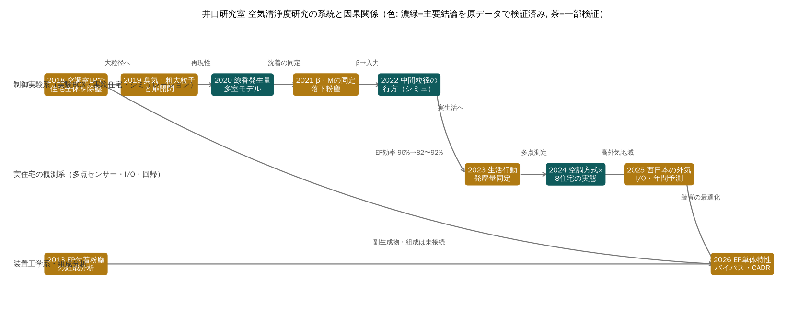

# 12. 研究全体の統合分析（12の問い）

各年度の検証（第9〜11章, verification/）と文献比較（docs/文献レビュー.md）を統合し、研究全体について12の問いに答える。区分は【確認事実】【計算結果】【分析】【仮説】。

## 1. 井口研究室の研究は何を解明してきたか
- 【確認事実】空調室（循環経路）の電気集塵機（EP）で住宅全体の微小粒子濃度が下がる。2018年度の線香実験（F-2018-01）に始まり、2024年度住宅GのEP停止で約10倍の上昇（F-V-10）、2025年度住宅Aの稼働時I/O 0.27（F-V-01）で実住宅でも確かめられた。
- 【計算結果】粗大粒子（30–45 μm）は発生室でほぼ沈着し、5–10 μm は循環で広がるが EP で3〜5割が捕集される（2022年度, 全20シートで検証, F-SIM-13）。
- 【計算結果】全館空調・EP付き住宅では室内の上昇イベントが少ない（F-V-17）。
- 【確認事実】EP 単体は風量が増えると効率が下がり（100→750 m³/h で ≥95%→82〜92%）、バイパスで CADR の最適点が生じ得る（F-2026-01/04）。

## 2. どの研究が後続研究の基礎になったか
- 2020年度の線香発生量の同定と実測（S-2020-04/06）は、2021年度の同定式、SHASE2021 その40、本アプリの多室モデル検証（F-SIM-01）の基礎になった。
- 2021年度の沈着係数の同定（F-2021-01）と2023年度のβ理論式（F-2023-07）は、2022年度のシミュレーション入力（S-2022-04）と多室モデルの沈着項の基礎。
- 2024年度のワイヤレスセンサー多点測定と校正（F-V-09）は、2025年度の西日本測定の方法をそのまま与えた。

## 3. 研究方法はどのように発展したか
【分析】制御実験系（実験BOX・実験住宅, 2018〜2022）→ 実住宅の観測系（2023〜2025, 多点センサー・I/O・回帰）→ 装置工学系（2026, JIS準拠の単体試験と並列流路モデル）へ移った（第1章の系統図）。測定器は粉塵計＋KC-52 から多点ワイヤレスセンサー、ダクト内 KC-52 へ変わった（F-X-02）。一方、制御実験系で得た回路網モデルと観測系の I/O・回帰は接続されないまま移行した（F-X-11）。

## 4. 繰り返し現れる問題は何か
【分析】(1) 指標の定義が年度で変わる（I/Oの分母・分子, F-X-18）、(2) 1日分・1住宅の値を代表値にする（F-V-14, F-2025-09）、(3) 条件区分と運転記録の不一致（F-2025-10, F-2025-19）、(4) 表の項目名と集計式の不一致（F-SIM-13/14）、(5) 単位（1/s と 1/h, mg/s と mg/m³）の混在（F-2021-04）、(6) センサー値の絶対値の過信（F-2025-23）。いずれも記録と定義の管理の問題で、第1冊 第5章に一覧化した。

## 5. 十分な証拠で支持される結論
- 空調室 EP の住宅全体の除塵効果（複数年度・原データで確認: F-V-01, F-V-10, F-SIM-05。住宅Aは外気濃度帯をそろえても頑健, F-2025-27）。ただし効果の大きさは住宅で大きく異なり、2025年度住宅Cでは統計的に確立していない（F-2025-28）。
- 粒径による沈着と拡散の違い（F-SIM-13, F-2021-05）。
- センサーとKC-52の換算の安定性（F-V-07/09）。
- 2025年度の年間予測の計算そのもの（原データで再現, F-2025-21）。

## 6. 再検証が必要な結論
- 2025年度 条件①の回帰係数0.14（住宅Dの原データ未取得, F-V-06, Q-12）。
- 2026年度の最適バイパス開口率（750 m³/h 超の外挿, F-2026-03。CADR最大値は記載のない除外条件に依存する可能性, F-2026-08）。
- 『全館空調は浮遊時間が短い』（F-V-18）、2024年度の E〜H の基準超過率（F-V-16）。
- 『C値とI/O比に相関なし』（F-LIT-02）。
- 年間予測の前提（k 一定・室内発生なし, F-2025-21, F-2024-09 訂正）。期間平均 I/O は外気濃度と交絡する（F-2025-28）。

## 7. 他年度と矛盾する結果
- EP 効率: 2018年度の96%は仕様図、2026年度実測は82〜92%（F-X-07, F-X-15）。
- 同じ実験住宅の循環風量: 2021年（その40）弱1205 m³/h、2022・2023年（その42）弱923 m³/h（F-2022-05, F-X-21）。
- I/O比の定義: 2024年度（気積加重・1日）と2025年度（1点・期間平均）で比較できない（F-X-18, F-V-14）。
- 線香の発生量: 0.00695（2020梗概）と0.00720 mg/s（その40）（F-X-12）。

## 8. 最も不足している測定
【分析】(1) EP の750 m³/h 超の効率・圧損（Q-01）、(2) 湿度を含むセンサーの並置校正（Q-02, F-LIT-03）、(3) 同一住宅での条件の交互切替（季節別, Q-03）、(4) 室内発生の量と行動の対応（Q-07, F-V-19）、(5) EP のオゾン等の副生成物（F-LIT-04）、(6) 室間風量の CO₂ トレーサ同定（F-X-22）。

## 9. 理論と実測の差
- 沈着: 粗大粒子の実測βは重力沈降理論の1/10〜1/100、サブミクロンでは理論の重力項より大きい（F-2023-08, F-X-09）。乱流・拡散沈着（Lai & Nazaroff 2000, F-X-20）が候補。
- 多室モデル: ファン強で実測より過大（NRMSE 0.56）、還気口のピーク時刻が遅れる（F-SIM-02/03）。2022年度の研究室自身のシミュレーションでも還気側ピークが実測より3〜6分遅く、背景濃度を初期条件に入れていない（F-2022-07/08）。完全混合の仮定の限界。
- EP の実効除去率: 文献の in-duct EAC（7.2 1/h）に対し研究室は約0.4 1/h の上乗せ（F-LIT-01）。

## 10. 国内外の研究と比べた新規性
【分析】床吹出型全館空調の空調室 EP を、実験住宅・実住宅・西日本の複数地域で継続的に評価し、年間予測まで行った点は、収集した文献の範囲では類例が少ない。ただし文献調査は Crossref・OpenAlex による限定的なもので（J-STAGE・CiNii の全文検索は未実施）、『国内初』『世界初』とは言えない。方法（I/O・侵入係数・CADR・物質収支）自体は既知である（docs/文献レビュー.md）。

## 11. 次年度に優先すべきこと
研究方針提案書の評価では T-01（EP 高風量域）、T-03（季節別 k と年間予測）、T-02（センサー校正）が上位である。T-02 は他の全ての測定の品質基盤のため、最初の1か月で並行して行う。

## 12. 優先順位の根拠
- T-01: 2026年度の結論（最適開口率）が実測範囲外の外挿に依存しており（F-2026-03）、検証しないと結論が反転し得る。既存装置で実施できる。
- T-03: 年間予測という研究室の主要な社会的成果が、秋季の k を通年に適用する仮定に依存する（F-2025-21, Riley et al. 2002）。
- T-02: センサーの公称精度（±10 μg/m³）と湿度の影響（F-2025-22/23, F-LIT-03）が、WHO 5 μg/m³ との比較の不確かさを決める。
- 評価の重みを変えると順位は入れ替わる（研究計画画面で確認可能）。設備・協力住宅の確認（方針提案書 第11章）次第で T-06（既存データで実施可）に切り替える。
