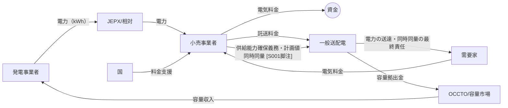
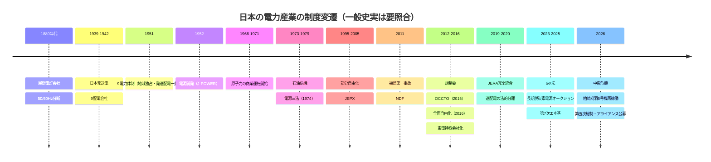
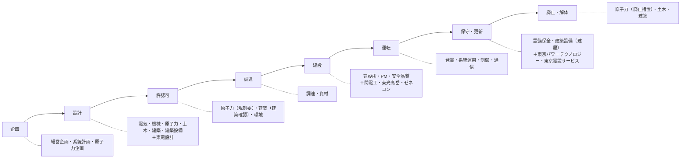

# 08 因果関係図・企業関係図（第1版）

- 図はMermaid記法で書く（GitHub上でそのまま描画される）。
- **凡例（関係の種類）**：`==>` 資本関係・支配、`-->` 資金・電力・指示の流れ、`-.->` 規制・監督・影響、`<-->` 競争または協調（ラベルで区別する）
- **凡例（根拠）**：ラベル末尾の `[S001]` などは資料番号（確認事実）。`[分]` は本研究の分析、`[仮]` は仮説。

---

## 図1 日本の電力産業全体の構造

```mermaid
flowchart LR
  subgraph 燃料・上流
    LNG[LNG輸入 約6,498万t/年 [S010]]
    COAL[石炭]
    U[ウラン・燃料サイクル<br/>日本原燃]
  end
  subgraph 発電
    JERA[JERA<br/>約1/3を供給 [S001]]
    NUC[原子力<br/>旧一電・日本原電]
    RE[再エネ<br/>各社RP・新規事業者]
    JP[J-POWER]
  end
  subgraph ネットワーク
    TSO[一般送配電10社<br/>レベニューキャップ]
    OCCTO[OCCTO<br/>需給・系統計画]
  end
  subgraph 市場
    JEPX[JEPX]
    CAP[容量市場・長期脱炭素電源オークション]
  end
  subgraph 小売・需要
    RET[小売事業者<br/>旧一電・ガス・新電力]
    DEM[需要家<br/>家庭・業務・産業・DC]
  end
  LNG --> JERA
  COAL --> JERA
  COAL --> JP
  U --> NUC
  JERA --> JEPX
  NUC --> JEPX
  RE --> JEPX
  JEPX --> RET
  RET --> DEM
  TSO --> DEM
  OCCTO -.需要想定・計画.-> TSO
  CAP -.固定費回収.-> NUC
  CAP -.固定費回収.-> JERA
```

## 図2 政府・規制機関・企業の関係

```mermaid
flowchart TB
  CAB[内閣・原子力関係閣僚会議]
  METI[経済産業省・資源エネルギー庁]
  NRA[原子力規制委員会]
  EGC[電力・ガス取引監視等委員会]
  MOF[財務省]
  NDF[NDF<br/>東電議決権の過半 [S001,S030]]
  PREF[立地道県・市町村]
  TEPCO[東京電力HD]
  OTH[他の大手電力]
  CAB -.エネ基の閣議決定 [S003].-> METI
  METI -.総特の認定 [S001].-> TEPCO
  METI -.電気事業法・審議会.-> OTH
  NRA -.審査・検査・処分.-> TEPCO
  NRA -.浜岡データ不正への対応（報道）.-> OTH
  EGC -.託送料金の審査.-> TEPCO
  MOF -->|交付国債| NDF
  NDF ==>|議決権の過半・事前承諾権 [S030]| TEPCO
  NDF -->|資金援助（月次）| TEPCO
  PREF -.事前了解（実質的な拒否権）[分].-> TEPCO
  TEPCO -->|地域貢献 1,000億円規模 [S001]| PREF
  MOF -->|料金支援（予備費）| METI
```

## 図3 発電から小売までの資金・電力・責任の流れ



## 図4 主要企業間の資本・競争・協力関係

```mermaid
flowchart LR
  NDF[NDF] ==>|50.08%（開示、要照合）| HD[東京電力HD]
  HD ==>|100%| PG[東電PG]
  HD ==>|100%| EP[東電EP]
  HD ==>|100%| RP[東電RP]
  HD ==>|100%| FP[東電FP]
  FP ==>|50%| JERA[JERA]
  CHUBU[中部電力] ==>|50%| JERA
  PG ==>|35.3%（売却後も33.4%以上）[S030,S027]| KDK[関電工]
  PG ==>|35.2% [S030]| TKT[東光高岳]
  PG ==>|33.3% [S030]| ATT[アット東京（DC）]
  HD ==>|18.1% [S030]| ENS[東京エネシス]
  HD ==>|100%| TDS[東電設計]
  HD ==>|100%| TPT[東京パワーテクノロジー]
  EP <-->|競合：首都圏の電力・ガス小売| TG[東京ガス]
  EP <-->|競合：越境小売| CHUBU
  PG <-->|協調：DC共同開発（2023年発表）| NTT[NTT系]
  HD <-->|協調：KS6（2025年11月解散）[S001]| TSB[東芝ES]
```

## 図5 電力産業の歴史的変遷



## 図6 東京電力グループの組織関係

```mermaid
flowchart TB
  BOD[取締役会（指名委員会等設置会社）<br/>会長：横尾敬介（2026.6〜、報道）]
  CEO[代表執行役社長：小早川智明]
  ALC[アライアンス検討委員会<br/>社外取締役中心 [S001]]
  BOD --> CEO
  BOD --> ALC
  CEO --> CORP[HDコーポレート<br/>CRO・CHRO・CIO・AEI室・原子力企画室 [S001]]
  CEO --> NUCD[原子力：柏崎刈羽・東通・福島第二]
  CEO --> FDEC[福島第一廃炉推進カンパニー]
  CORP -.モニタリング・資源配分.-> PG[東電PG]
  CORP -.-> EP[東電EP]
  CORP -.-> RP[東電RP]
  CORP -.-> FP[東電FP→JERA]
  FDEC -.権限移譲の方向 [S001].-> FDEC
```

## 図7 電力設備のライフサイクルと担当職種



## 図8 職種間の連携ネットワーク（建築設備の位置）

```mermaid
flowchart LR
  BS((建築設備))
  AR[建築] <--> BS
  EL[電気（受変電・非常用電源）] <--> BS
  NU[原子力・機械（安全系）] -->|要求仕様| BS
  IC[情報通信・制御] -->|室内環境の要求| BS
  SS[変電・系統運用] -->|機器室の可用性| BS
  EPS[EP設備サービス営業] -->|顧客提案| BS
  DC[DC誘致・系統接続] -->|冷却・受電の要件| BS
  PR[調達] <--> BS
  FN[財務・投資精査] -->|リスクベースの繰延 [S001]| BS
```
[分] 建築設備は入ってくる矢印（必要とされる関係）が多い一方、意思決定の主導権を持つ矢印は少ない。

## 図9 産業変化が企業組織・人事へ波及する因果関係

```mermaid
flowchart TB
  A[中東危機：JKM 11→31ドル [S010,S015]] --> B[燃料・卸電力の調達コスト上昇]
  B --> C[東電：2026年度第1四半期の経常利益 −88.7%・業績予想は未定 [S013]]
  D[DC・半導体需要：東京エリア +1.1%/年 [S012]] --> E[送配電のプッシュ型投資の要請 [S001]]
  C --> F[成長投資の実質凍結・件名の再精査 [S001]]
  E --> G{資金不足}
  F --> G
  G --> H[アライアンス・資産回転型・資産売却 [S001]]
  H --> I[共同事業体化・組織再編 [予]]
  F --> J[リスクベースの保全・建物管理費の抑制 [S001]]
  I --> K[職種の所属先の分断・処遇の多様化 [予]]
  J --> L[建築設備：一般建物は縮小、安全系・DC・需要側は拡大 [分]]
  M[年齢構成の歪み・大量退職 [S001]] --> N[中途採用・AIによる形式知化 [S001]]
  N --> K
```

## 図10 将来シナリオ別の変化比較表
→ `06_将来シナリオ分析/06_将来シナリオ分析.md` の §4 を正本とする（重複を避けるため、本図表集では参照のみとする）。
