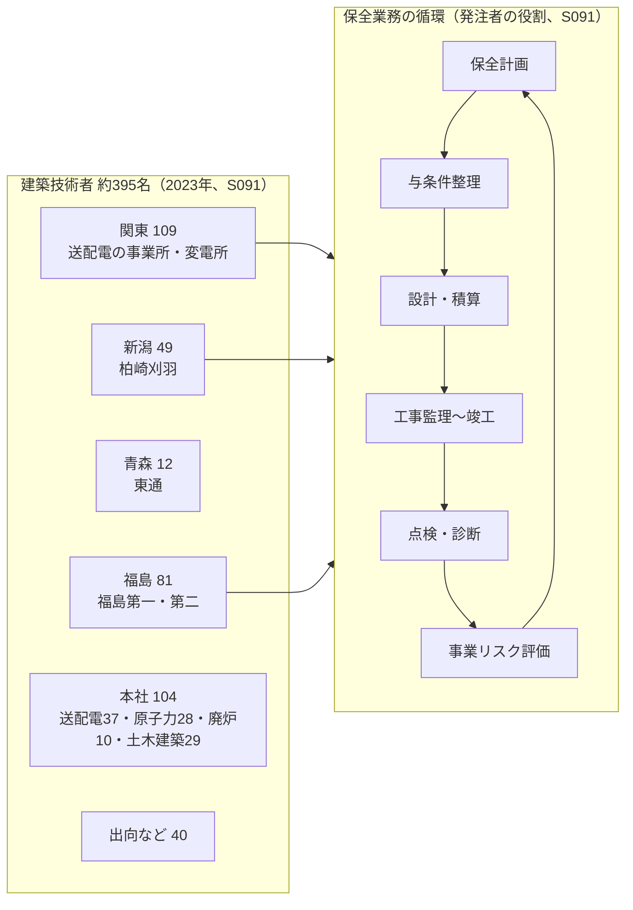

# 17 東京電力グループの人材需要の構造分析（最終統合版で新設）

- 情報基準日：2026年11月1日
- 位置づけ：第2章群。01〜16章の産業・企業研究の結果から、東電が将来どのような技術者を必要とするかを、**求人だけでなく**、事業の歴史、設備構成、経営計画、財務、人員構成、組織再編の可能性から推定する。
- 新たな一次資料：
  - S091：建築部門パンフレット（新卒向け、2024年3月作成、2023年時点の人数を含む）
  - S085：新卒の募集要項（2027年3月卒業者向け）
  - S089：マイナビ2027の東電の求人情報（企業が記載したもの）
  - これまでの資料：S001、S030、S032、S051〜S053

---

## 1. 因果の連鎖：産業構造から採用評価まで

```
産業構造の変化（12章）
  ├ 中東危機・燃料高（G1）  ├ DC需要（D1）  ├ 原子力の再評価（P3）  ├ 人口・年齢構成（O1）
        ↓
東電の経営判断（05章）
  福島最優先／資産回転型／アライアンス／件名単位の投資精査／ROIC管理（S001, S032）
        ↓
事業・設備投資
  廃炉（約5.4兆円の見込み）、柏崎刈羽の特重工事（2029〜2031年）、送配電のプッシュ型の設備形成、
  一般建物の維持管理の抑制、ZEB・設備の運用改善（S091）
        ↓
組織と業務の変化
  廃炉の遂行主体への権限移譲、柏崎市への本社機能の移転（約300名）、HDの横串機能（CRO・CHRO・AEI室）、
  部門横断のプロジェクト型業務、生成AIによる申請書の確認作業の削減（S001, S032）
        ↓
技術者の需要
  オーナー能力（戦略・設計・PM・協力企業との協働・現場安全）、リスクに基づく説明能力、
  DX・データ、原子力・廃炉の専門性、中堅層の補充（S001, S051）
        ↓
採用での能力評価（19章で検討）
```

---

## 2. 指令の10の問いへの回答

### Q1 東京電力はどのような人材を必要としているのか
| 層 | 必要とされる人材 | 根拠（証拠の水準） |
|---|---|---|
| 全社 | 電力コア人財（既存事業を支える）、非連続の改革を牽引する人財、稼ぐ事業を創造する人財 | S001 p.64【当事者の主張】 |
| 廃炉 | オーナーとして自らエンジニアリングを行う人財（戦略策定・設計・PM・協力企業との協働・現場安全） | S001 p.9【当事者の主張】 |
| 原子力 | 核物質防護・火災防護の専門人財、原子力運営の専門技術者 | S001【当事者の主張】、S051【確認事実：求人】 |
| DX | AIシフト（2030年代前半にすべての成長事業で達成）を担う人財 | S001【当事者の主張】 |
| 建築 | 発注者として建物のライフサイクル（保全計画→与条件整理→設計・積算→工事監理→点検・診断→事業リスク評価）を回す人財 | S091【確認事実：会社の説明】 |

### Q2 その人材を必要とする理由
- **事業上の理由**：廃炉は「前人未踏の領域」に入った。柏崎刈羽には特重施設の期限がある。DC需要の取り込みは戦略目標である（S001, S032）。
- **人口構成上の理由**：震災直後の採用凍結により中堅・若年層が不足し、大量採用世代の退職で人員が減る（S001）。建築部門でも30代が薄い（S053）。
- **財務上の理由**：件名単位の再精査で、投資・保全の必要性を「影響度×発生確率」で説明する能力が求められる（S001）。

### Q3 どの部門で人材不足が起きているのか
| 部門 | 証拠 | 確度 |
|---|---|---|
| 廃炉・原子力 | 中途求人96件のうち36件（S051） | 中（求人数は欠員・採用難を反映するもので、不足の大きさと比例するとは限らない。16章） |
| 建築（全部署） | 30代の層の薄さ（S053） | 中〜高（採用広報の概数） |
| 送配電の建築部門 | 50代以上が約36%（S053）。今後10年で退職の波 | 中 |
| 技術系全般 | 電力関係学科の学生の減少（S001） | 【当事者の主張】 |

### Q4 若手技術者に何を期待しているのか
- 建築部門の研修体系（S091）：入社時研修、課題研修（課題解決能力）、本社駐在研修（全社的な視野と経営的な視座。いずれも1〜5年目）。専門研修として、工事監理者養成、設計力向上（設備・構造・計画の各分野。設備・構造の社内研究会）、建築士取得支援。
- キャリア（S091）：入社3〜4年目から、「建築分野のスペシャリスト（耐震・省エネ）」「建築プロジェクトのリーダー」「経営・事業リーダー」から希望できる。
- 【分析】最初の数年で期待されているのは、**発注者としての基本業務（保全・工事監理）を回せるようになること**と、**一級建築士の取得**である。専門の深掘りは、その後の選択として位置づけられている。

### Q5 新卒と中途で期待される能力は異なるのか
| 項目 | 新卒（S085, S091） | 中途（S053） |
|---|---|---|
| 応募要件 | 建築系の専攻（「土木・建築部門はそれぞれ対象専攻の方のみ応募可」） | 建築工事監理・建築施工管理・建築設備施工管理の実務経験（求人ごとに異なる） |
| 期待 | 研修を通じて育成する前提。入社3〜4年目から専門を選ぶ | 即戦力として、発注者としてのプロジェクトの推進 |
| 処遇 | 学部卒の初任給は月額291,000円、修士は317,200円（東京圏、年俸制、2026年4月の見込み、S085） | 年俸制で想定520〜1,260万円 |
| 【分析】 | 新卒には**基礎力・学習可能性・職務への理解**が、中途には**実務経験**が求められる。新卒の選考で研究の専門性そのものが即戦力として求められているという証拠はない | |

### Q6 建築職は組織内で何を担っているのか
- 2023年時点の建築技術者は約395名（新潟49、青森12、福島81、関東の送配電109、本社104〔送配電37・原子力28・廃炉10・土木建築29〕、出向など40）（S091）。2026年の求人の部署人数（福島第一 約75、柏崎刈羽 約50、送配電 約110、原子力設備管理部 約30、S053）とも整合する。
- 基本業務は**保全業務**（建物と付帯設備の状態を把握し、管理・保守する。S091）。プロジェクトとして、構造・耐震（柏崎刈羽の安全対策：浸水・火災・竜巻の防護対策、緊急時対策所）、DX（福島第一の原子炉建屋の3Dスキャンや四足歩行ロボットによる調査）、カーボンニュートラル・ZEB（自社ビルの「ZEB Ready」取得、既存の蓄熱槽を使った二温度供給システム、運転実績に基づく設備のチューニング、顧客向けのZEBコンサルティング）、ファシリティマネジメント（賃貸事業化、建物のスリム化）、デザイン・ABW、防災・レジリエンス（耐震性評価、無線鉄塔の制振）がある（S091）。
- PGでは、建物の保全は「用地部FM推進センター」の施設管理グループが担う。事務所の空調設備の改修工事を、建築技術者が設計から監理まで担当している事例がある（S091のインタビュー）。

建築技術者の配置（2023年時点、S091）と、基本業務である保全業務の循環（S091）を図示する。



### Q7 建築設備の専門性はどの業務に結びつくのか
| 業務 | 結びつき | 出典 |
|---|---|---|
| 保全業務（建物と付帯設備） | 直接（付帯設備の状態の把握と保守） | S091 |
| 事務所の空調設備の改修 | 直接（内装・設備・電気・安全法令の知識） | S091 |
| ZEB・設備の運用改善（蓄熱槽、二温度供給、設備のチューニング） | 直接 | S091 |
| 設計力向上研修の「設備」分野、設備の社内研究会 | 直接（社内で設備の専門性が育成対象になっている） | S091 |
| 原子力の建物（浸水対策・緊急時対策所） | 部分的（建屋の設備） | S091, S053 |
| 発電所の建築設備の保全・点検に関する研究（原子力設備管理部の若手社員の業務） | 直接 | S091 |
| 原子力のプラント空調 | 隣接（機械の主管と推定） | 07章 |
| DCの冷却 | 隣接（研究開発） | S051 |

### Q8 研究能力と実務能力のどちらが、どの段階で重要になるか
| 段階 | 重要な能力 | 根拠 |
|---|---|---|
| 新卒の選考 | 専攻の基礎・研究を説明する力・職務の理解（推定） | 選考はES・適性検査・個別面接で、技術試験の記載はない（S089）【推論】 |
| 入社1〜5年 | 実務能力（保全・工事監理・調整） | 研修体系（S091） |
| 入社3〜4年目以降 | 専門（耐震・省エネ）または、PM・経営 | キャリアイメージ（S091） |
| 研究業務 | 研究能力（若手社員が保全・点検に関する研究・社外への委託発注を担当している） | S091のインタビュー |

### Q9 今後の組織再編は採用・配属にどう影響し得るか【予測】
- アライアンスで経済事業の共同事業体ができれば、建築部門の所属がHD（原子力・廃炉）と経済事業（PG・EP）に分かれる可能性がある。現行の新卒採用はHDが窓口で、HD・RP・PG・EPの各社が合同で行っている（S085）。この合同採用の方式が変わるかどうかが観測点になる。
- 廃炉組織への権限移譲（S001）は、福島の建築部門（約75〜81名）の独立性を高める可能性がある。
- 柏崎市への本社機能の移転（約300名、S001）は、新潟での勤務の比重を高める。2023年時点で新潟には49名がいた（S091）。

### Q10 企業が公表する人物像と、実際に必要とする能力には違いがあるか【分析】
| 公表された人物像 | 実際の業務から推定される必要能力 | 差異 |
|---|---|---|
| 「電力の安定供給によって当たり前のくらしと未来を支えたい」という思い（S023）、「大学での学問に自信がある人」（S089） | 発注者としての調整・折衝、安全・品質・工程・コストの管理、法令の理解（S091, S053） | 公表された人物像は**動機と学業**を強調する。一方、実務は**調整・管理・法令**の比重が大きい。面接で評価される能力が後者をどこまで含むかは不明 |
| 「ゼネラリストとして建築物を造る」（S091） | 地方勤務（新潟・福島・青森で約142名）を含む配属の受容 | 勤務地の柔軟性は公表されているが、選考上の重みは不明 |

---

## 3. 建築系の新卒の採用規模の推論（数値の取り扱い）
- 職種別の新卒採用人数は、公開資料で確認できなかった【不明】。全体では、2025年度入社の技術職は大学・大学院卒332人（検索要約経由、C10）、マイナビの募集人数は「301名～」（S089、事務系・技術系の区別は未確認）。
- 【推論、数値は仮定】建築技術者の総数を約395名とし、定常状態で約40年のキャリアを仮定すると、補充需要は年10名前後になる。ただし、①高校卒の採用がある（S091のインタビュー）、②年齢構成が歪んでいる、③中途採用で補充している、という三つの理由から、**大学・大学院卒の新卒の建築採用は年に一桁から十数名程度**と推定される。**この値は推論であり、合格率の計算には使わない**（21章）。
