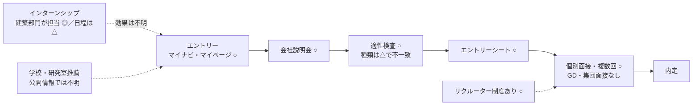

# 19 東京電力グループの新卒採用構造（最終統合版で新設）

- 情報基準日：2026年11月1日
- 位置づけ：第4章群。応募から内定までの選考の体系を、証拠の水準で分類して整理する。
- **年度の注意**：本章で引用する公式の募集要項は**2027年3月卒業・修了見込みの者**が対象である（S085、応募開始は2026年3月1日）。情報基準日時点で大学3年後期の学生（2028年3月卒業見込み）が対象とする**2028年卒の募集要項は、未公表**である。以下で2028年卒について述べることは、2027年卒の制度が継続するという**仮定**に基づく。

## 証拠の水準
| 記号 | 意味 |
|---|---|
| ◎確認事実 | 東電の公式の採用サイト・パンフレット（S085, S086, S091）で確認 |
| ○企業の説明 | 東電がナビサイトに記載した情報（S089：マイナビ2027） |
| △経験談 | 就職情報サイトの体験記・選考レポート（C31、C32）。**正式な採用基準の証拠としては使わない** |
| ◇研究上の仮説 | 本研究の推論 |

---

## 1. 選考体系の一覧

| 項目 | 内容 | 水準 |
|---|---|---|
| 応募資格（技術系） | 大学（学部）・大学院（修士・博士）の卒業・修了見込み。卒業後3年以内の既卒（正社員の就労経験がない者）を含む。年齢は不問 | ◎（2027年卒） |
| 対象学科 | 理系学科全般。**「土木・建築部門に関してはそれぞれ対象専攻の方のみ応募可」** | ◎ |
| 色覚 | 電気設備の安全確認の関係で、色の識別によっては希望する職種に就けない場合がある | ◎ |
| 採用の窓口・配属 | HDが窓口となり、HD・RP・PG・EPの合同で採用する（中途の求人票、検索経由 C10）。建築の配属先は、HD（原子力・廃炉）、PG、各社共通の部門 | ◎（配属の表）、○ |
| 応募開始 | 2026年3月1日（2027年卒） | ◎ |
| 選考の流れ | マイナビからエントリー → 会社説明会 → 適性検査 → エントリーシートの提出 → 面接（個別）。選考方法は「エントリーシート、適性検査、面接（複数回）」。**グループワーク・グループディスカッションなし、グループ面接なし**。リクルーター制度あり | ○（S089） |
| 面接の回数 | 2回（一次・最終）とする体験談が多い。「リクルーター面談（複数回）→ES→Webテスト→最終面接」とするものもある | △（C31） |
| 適性検査の種類 | SPIとするものと、玉手箱とするものがあり、一致しない | △ |
| インターンシップ | 2026年卒向けの建築職の夏期インターン（2024年8〜9月、東京、5日間、ESの締切は7月）の体験記がある。建築部門の人財開発センターが「インターン等の人財確保に関する業務」を担当している（S091） | △（日程）、◎（担当組織の存在） |
| 学校推薦・研究室推薦 | **公開情報では確認できない** | 不明 |
| 初任給 | 学部卒291,000円、修士317,200円（東京圏、2026年4月の見込み、年俸制） | ◎ |
| 勤務地 | 関東各都県、山梨、静岡、福島、長野、新潟、青森、宮城など。建築技術者は新潟49、福島81、青森12（2023年時点） | ◎（S085, S091） |
| 研修とキャリア | 入社時研修・課題研修・本社駐在研修（1〜5年目）、工事監理者養成・設計力向上研修、建築士取得支援。3〜4年目からキャリアを希望 | ◎（S091） |

### 選考の流れ（2027年卒の実績。2028年卒は未公表）

## 2. 職種の違い（建築・土木・機械・電気）
| 職種 | 主な対象 | 応募の要件 | 本研究との関係 |
|---|---|---|---|
| 建築 | 発電・送配電・業務の建物の計画・設計・工事・維持管理・有効活用（S085） | 建築系の専攻に限る | 本研究の対象 |
| 土木 | 水力・風力・電力流通・原子力・廃炉の土木構造物・設備 | 土木系の専攻に限る | — |
| 機械・電気・原子力（発電、廃炉、建設） | プラント設備（原子力の空調系を含むと推定、07章） | 理系全般 | 建築系の学生にとっての隣接領域。ただし、応募区分と専攻の対応は年度ごとに要確認 |
| EP（法人営業・サービス企画） | 空調・給湯などの電化設備のサービス（S051） | 一部は文理不問 | 建築設備の知識が活きる隣接領域（20章） |

## 3. 学部卒と大学院卒
| 項目 | 内容 | 水準 |
|---|---|---|
| 応募資格 | 両方とも応募できる | ◎ |
| 初任給の差 | 月額26,200円（東京圏） | ◎ |
| 選考の違い | 公開情報では確認できない | 不明 |
| 社員の学歴 | 建築部門の社員インタビュー4名のうち、高校卒2名、大学卒2名（S091）。修士卒の事例は、このパンフレットにはない | ◎（ただし4名は選ばれた例で、代表性はない） |

◇【仮説】建築部門では、**学部卒と高校卒が一定の比率を占め、修士であることが必須ではない**可能性が高い。大学院進学の価値は、選考上の有利さよりも、**専門性（設備設計の実務フローなどの大学院の科目、研究の深さ）と、就職活動の時期を2年後ろにずらす選択肢**にあると考えられる（21章で検討）。

## 4. 採用の規模
- 技術系全体の規模の参考値（検索経由 C10）：2025年度入社で、大学・大学院卒の技術職332人、高専・短大・専門・高校卒の技術職278人。マイナビの募集人数は「301名～」（S089）。
- 建築職の採用人数は公表されていない【不明】。17章 §3の推論（年に一桁〜十数名程度）は仮定で、倍率・合格率の計算には使わない。

## 5. 確認すべき事項（学生が自分で確認するべき一次情報）
1. 2028年卒の募集要項（応募の開始日、技術系の部門の一覧、建築の配属先）：東電の採用サイト（tepco-recruit.jp）とマイページ。
2. 建築部門のインターンシップの有無と時期：採用サイトとナビサイト。
3. 学校推薦・研究室推薦の有無：**学科の就職担当（または就職指導の教員）**。企業の説明会で質問してもよい。
4. 適性検査の種類：マイページの案内（体験談は一致していない）。
5. リクルーターとの接点の得方：説明会・インターンシップの参加後の案内（推定）。
