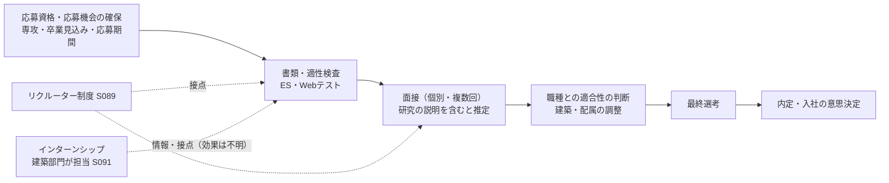

# 21 採用成功に影響する行動、選考の構造モデル、時間配分、競合仮説（最終統合版で新設）

- 情報基準日：2026年11月1日
- 位置づけ：第6〜9章群。
- **数値の方針**：東電の建築職の応募者数・採用人数・段階ごとの通過率は公開されていない（19章）。このため本章では、**合格率・倍率・行動ごとの効果量を数値で示さない**。比較は、条件付きの順位、定性的な評価、感度分析による。所要時間は一般的な目安で、本研究の**仮定**である。

---

## 1. 選考の構造モデル（第7章群）

| 段階 | 学生が変えられる要素 | 学生が変えられない要素 | 根拠 |
|---|---|---|---|
| S0 応募資格・機会 | 応募期間の把握、マイページへの登録、説明会への参加 | 専攻の要件（建築系のみ）、色覚の要件、募集の有無・時期 | ◎S085 |
| S1 書類・適性検査 | ESの内容、適性検査の得点（準備で改善できる） | 検査の種類、足切りの基準（非公開） | ○S089 |
| S2 面接 | 志望理由と研究の説明の論理性、業務の理解、受け答え | 面接官、評価基準（非公開） | ○S089 |
| S3 職種との適合 | 勤務地・配属への柔軟性の表明（本心の範囲で） | 部署ごとの採用枠、年度ごとの需要 | ◇推論 |
| S4 最終選考 | 一貫性（ES・面接・説明の整合） | 採用人数 | ◇ |
| S5 入社の意思決定 | 他社との比較、進路の選択 | — | — |

**行動の四つの機能の区別**（指令の要求）：
| 機能 | 例 |
|---|---|
| ①選考で有利になる可能性がある行動 | 応募機会の確保、適性検査の対策、ESと面接の準備、説明会・インターンシップでの情報収集 |
| ②実務能力を高める行動 | 研究（測定・解析・データ分析）、建築設備・法令の学習、資格の学習 |
| ③入社後の適性を高める行動 | 発注者の業務（保全・工事監理・調整）の理解、地方勤務を含むキャリアの理解 |
| ④採用担当者に能力を伝える行動 | 研究と業務の接続を説明する練習、ESの記述 |

②を高めても④がなければ選考では伝わらない。逆に、④だけを高めて②が伴わなければ、面接での深掘りに耐えない【推論】。

---

## 2. 行動の比較（第6章群）

評価：**関連性**（採用への関連）、**効果**（期待される効果の大きさ）、**根拠**（証拠の水準）。A＝高、B＝中、C＝低。所要時間は仮定。

| # | 行動 | 機能 | 関連性 | 効果 | 所要時間（仮定） | 費用 | 適期 | 前提・失敗リスク | 相乗効果 | 根拠 |
|---|---|---|---|---|---|---|---|---|---|---|
| 11 | 応募制度・推薦制度の確認 | ① | **A**（応募の機会そのもの） | A（見落とすと選考を受けられない） | 2〜5時間 | なし | **3年後期すぐ** | 推薦の有無は不明。学科の就職担当への確認が必要 | すべての前提 | ◎S085（応募期間）、不明（推薦） |
| 6 | 会社説明会への参加 | ①③ | A（選考の流れの第2段階、S089） | B | 数時間×数回 | 交通費（一部支給あり、S089） | 4年の春、または公表時 | — | 7・8・15 | ○S089 |
| 12 | 適性検査の対策 | ① | A（選考の段階として明記） | B（足切りの回避） | 20〜40時間（仮定） | 問題集の代金 | 3年の冬〜4年の春 | 種類が不明（SPIか玉手箱か） | 他社の選考にも効く | ○S089、△種類 |
| 13 | エントリーシートの作成 | ①④ | A | A | 10〜30時間（仮定） | なし | 4年の春（2027年卒は3月から） | 研究が初期段階 | 15 | ○S089 |
| 14 | 面接の練習 | ①④ | A（個別・複数回） | A | 10〜20時間 | なし（大学の就職支援を使う場合） | 4年の春 | — | 15・10 | ○S089 |
| 15 | 研究と業務を接続して説明する訓練 | ④ | A | A（強みの源泉を伝える唯一の経路） | 10〜20時間 | なし | 3年後期〜4年の春 | 研究の理解が浅いと逆効果 | 3・5・13・14 | ◇（S091とS082の対応、20章） |
| 7 | インターンシップへの応募・参加 | ①③ | B〜A（建築部門が担当している、S091） | 不明（選考との関係は非公開） | 1〜5日＋準備 | 交通費 | 夏・冬（2028年卒の日程は未公表） | 日程が研究・授業と重なる。選考がある | 6・8・15 | ◎担当組織、△日程 |
| 8 | リクルーターとの面談 | ①④ | B〜A（制度あり、S089） | 不明 | 数時間 | なし | 接点ができた時点 | 接点の得方が不明 | 15 | ○S089 |
| 10 | 指導教員からの助言 | ②③④ | B | B（業界の実務の理解） | 数時間 | なし | 3年後期〜 | 優遇を期待してはならない。助言の内容は教員の判断による | 15 | ◎S080（勤務歴） |
| 9 | OB・OG訪問 | ③④ | B | B | 数時間×数回 | 交通費 | 3年後期〜4年の春 | 東電のOB・OGに会えるかは不明。学科の懇談会の参加企業は不明 | 6・15 | ◎S093（懇談会） |
| 3 | 研究の質を高める実験・解析 | ② | B（学部卒の選考の時点では初期段階） | B（面接の深掘りへの耐性） | 研究の時間の大部分 | 研究室による | 3年後期〜卒業まで | 就職活動と時間が競合する | 4・15 | ◇ |
| 4 | プログラミング・数値解析・データ処理 | ② | B（DX・保全データの分析に対応、S091） | B | 50〜150時間（仮定） | なし〜少額 | 3年後期〜 | 研究テーマで使わないと身につきにくい | 3・15 | ◎業務の存在（S091）、◇評価 |
| 5 | 建築設備・電力システム・エネルギー政策の自主研究 | ②③④ | B | B（「なぜ電力か」「東電の課題」を説明する根拠） | 10〜30時間 | なし | 3年後期〜4年の春 | 知識の羅列に陥る | 13・14・15 | ◇（本研究の01〜17章がその素材） |
| 2 | 研究テーマの選定 | ②④ | B | B | — | — | 3年後期（配属時） | **採用担当に気に入られるための恣意的な変更は推奨しない**。研究室の方針と学生の関心による | 3・15 | ◇ |
| 1 | 専門科目の修得と成績の改善 | ②（①：卒業見込み） | B（卒業見込みは内定の前提） | B | 授業の時間 | 学費 | 常時 | 卒業できないと内定が無効になる | — | ◎卒業見込みが応募資格（S085） |
| 16 | 建築・設備の資格の学習 | ② | C（新卒の要件にはない。入社後に建築士取得支援がある、S091） | C（選考上） | 大（一級建築士は入社後） | 受験費用 | 入社後が主 | 学生のうちは受験資格の制約がある | — | ◎S091 |
| 17 | 大学院への進学 | ②（＋時期の移動） | B | 不明（選考上の有利さの証拠なし） | 2年 | 学費と機会費用 | 4年の夏の入試（学内推薦は7月） | 修士の就職活動は修士1年の春に重なる | 3・15 | ◎S093（入試）、◇効果 |
| 18 | 複数企業への並行応募 | ①（リスク分散） | A（内定獲得のリスク管理） | A（単一企業への依存を避ける） | 応募数に比例 | 交通費 | 4年の春 | 準備の分散 | 12・14は共通に効く | ◇ |

### 優先順位の結論（条件付き）
- **最優先（行わないと選考に乗れない、または失敗の確率が大きく上がる）**：11（制度・期限の確認）、1（卒業見込みの確保）、12・13・14（適性検査・ES・面接の基本準備）、18（並行応募によるリスク分散）。
- **差別化の源泉（井口研究室の学生に固有の強みを伝える経路）**：15（研究と業務の接続の説明）。これを支える5（電力・東電の理解）と3・4（研究の中身）。
- **効果が不明だが、低コストで情報価値が高いもの**：6（説明会）、7（インターンシップ）、8（リクルーター）、9（OB・OG訪問）、10（指導教員の助言）。選考上の効果は非公開だが、**19章 §5の確認事項（推薦・日程・検査の種類）を得る手段**としての価値が確実にある。
- **選考上の優先度が低いもの**：16（資格）。入社後に支援制度がある。

---

## 3. 時間配分と進路の組合せ（第8章群）

### 3.1 学生の時間の制約【仮定】
大学3年後期〜4年の時間は、授業（卒業要件の残り）、卒業研究、就職活動、アルバイト・生活に配分される。**就職活動の山場（4年の春）は、卒業研究の初期と重なる**。このため、研究を「選考の材料」として完成させてから就職活動を始めることは、学部卒では構造的に難しい。

### 3.2 進路の比較
| 経路 | 内定の可能性に効く要素 | 希望職務への配属 | 費用・時間 | 実行可能性 | 評価 |
|---|---|---|---|---|---|
| ① 学部卒で東電に直接応募 | 基本準備と、研究の説明（初期段階） | 建築部門（配属先はHD・PGなど） | 最小 | 高（応募資格を満たす） | **基本経路** |
| ② 大学院に進学して応募 | 研究の深さ、設備設計の実務フロー（大学院科目）、時期を2年延ばす | 同じ | 学費2年分と機会費用 | 高（学内推薦の入試あり） | 研究志向で、専門を深めたい場合に合理的。選考上の有利さは未確認 |
| ③ 東電の複数職種への応募 | 建築以外（EPなど）への併願 | 建築以外になる可能性 | 小 | **制度上の可否は要確認**（建築・土木は専攻要件） | 確認後に判断 |
| ④ グループ会社を経由 | グループ会社の採用 | 東電本体の建築職とは別の会社 | 小 | 各社の採用制度による | 本体への移籍の制度は未確認【不明】 |
| ⑤ 他の電力・エネルギー企業 | 各社の建築職（中部PGなど同型の職務、11章） | 他社の建築部門 | 小 | 高 | **並行応募の第一候補**（業務が同型のため、準備の多くが共通） |
| ⑥ 民間企業と公務員の並行 | 公務員試験は別の準備が必要 | 自治体・国の建築職 | 大（試験準備） | 中 | 準備の重複が少ないため、時間の負担が大きい |
| ⑦ 他社で経験を積み、東電の中途採用へ | 建築工事監理・施工管理・建築設備施工管理の経験（S053の要件） | 中途の求人（原子力・廃炉・送配電） | 数年 | 中途の求人が継続している（2026年時点で建築系5件） | **新卒で不合格の場合の現実的な代替経路**。設備施工管理の経験も要件に含まれる求人がある（S053） |

**動的な戦略【分析】**：①を基本とし、⑤で並行応募する。不合格の場合は、設備会社・ゼネコン・設計事務所で設備の施工管理や設計の経験を積み、⑦（中途）で再挑戦する、という段階的な経路が、一次資料（S053の中途の要件）と整合する。②は、研究を深めること自体が目的になる場合に選ぶ。

---

## 4. 競合仮説の検証（第9章群）

| 仮説 | 支持する資料 | 反証・弱める資料 | 適用条件 | 判定 |
|---|---|---|---|---|
| H1 研究実績の完成度を高める方が有利 | 面接で研究の説明を求められると推定される。若手社員が保全の研究を担当している（S091） | 学部卒は選考の時点で研究が初期段階。選考方法はES・適性検査・面接で、研究実績の提出は記載がない（S089）。社員の事例には高校卒もいる（S091） | 大学院卒、または研究が進んでいる場合 | **弱い**（学部卒では時期的に困難。完成度より説明の質） |
| H2 早期のインターンシップ・リクルーターとの接点が有利 | 建築部門がインターンを運営している（S091）。リクルーター制度がある（S089） | 選考との関係は非公開。体験談は効果を証明しない | インターンの選考を通過できる場合 | **不明**（情報価値は確実、選考上の効果は未検証） |
| H3 研究テーマを東電の建築設備業務に接続できることが重要 | 保全業務・ZEB・設備のチューニングが建築部門の業務（S091）。研究室の保全データの研究（S082） | 建築部門の業務の大部分は構造・工事監理・調整で、設備は一部（20章） | 説明が業務の理解に裏打ちされている場合 | **中程度に支持**（接続の「説明」が重要。テーマの一致は必須ではない） |
| H4 研究の専門性より、発注者としての総合的な技術理解が重要 | 建築部門は「ゼネラリスト」「発注者」を強調（S091）。研修は工事監理・設計力の全分野（S091）。中途の要件も工事監理・施工管理（S053） | 3〜4年目からスペシャリストの道もある（S091） | 新卒の選考 | **支持**（最も一次資料と整合する） |
| H5 学業成績・専門基礎力・卒業見込みの確実性が重要 | 卒業見込みは応募資格（S085）。「大学での学問に自信がある人」（S089） | 成績の選考上の扱いは非公開 | 全員 | **必要条件として支持**（十分条件ではない） |
| H6 学部卒と大学院卒では最適な戦略が異なる | 就職活動の時期が2年異なり、研究の段階が違う（S093の入試日程） | 選考方法は同じ（S089） | — | **支持**（時期と、説明の材料が異なる） |
| H7 特定の技術知識より、組織横断の課題解決能力が重要 | 社員は折衝・調整力を重視（S091）。課題研修（S091）。中途求人の「関係者との調整」（S053） | 専門の研修・社内研究会も存在（S091） | — | **支持**（ただし、技術の理解が前提） |
| **H8（新）** 応募機会と制度の情報を確実に得ることが、最大の分岐点 | 2028年卒の要項は未公表。推薦の有無は不明。応募期間は限られる（S085） | — | — | **支持**（情報の欠落による機会の損失が最も回復しにくい） |
| **H9（新）** 勤務地・配属の柔軟性の理解が、職種適合の判断で効く | 建築技術者の約36%が新潟・福島・青森（S091）。柏崎への本社機能の移転（S001） | 選考上の重みは非公開 | — | 仮説（検証できない） |
| **H10（新）** 不合格時の中途の経路が実在するため、新卒での応募は「一回限り」ではない | 建築系の中途求人5件（S051、S053）、建築設備施工管理の経験も要件の選択肢 | 中途の採用は時期により変動する | — | **支持**（進路戦略の前提を変える） |

## 5. 感度分析（戦略が前提に対してどれだけ頑健か）
| 前提の変化 | 影響を受ける行動 | 戦略の変更 |
|---|---|---|
| 2028年卒の応募開始が2027年3月より早まる | 11・12・13 | 準備の前倒し。11の確認がさらに重要になる |
| 建築職の採用枠が減る（アライアンス・財務の悪化、05章） | 18 | 並行応募の比重を上げる。⑦（中途）を準備する |
| インターンシップに参加できない | 7 | 6・8・9・10で情報を代替する（選考への影響は不明なので、不参加を致命的とみなす根拠はない） |
| 研究が遅れる | 15 | 研究の「目的・方法・現時点の結果・業務との関係」を説明する。成果の大きさより論理を示す |
| 卒業が遅れる見込み | 1 | 内定の前提が崩れる。最優先で卒業要件を確保する |
| 面接で不合格 | 18・⑦ | 他社の建築職・設備系の職への切り替え。中途での再挑戦 |
