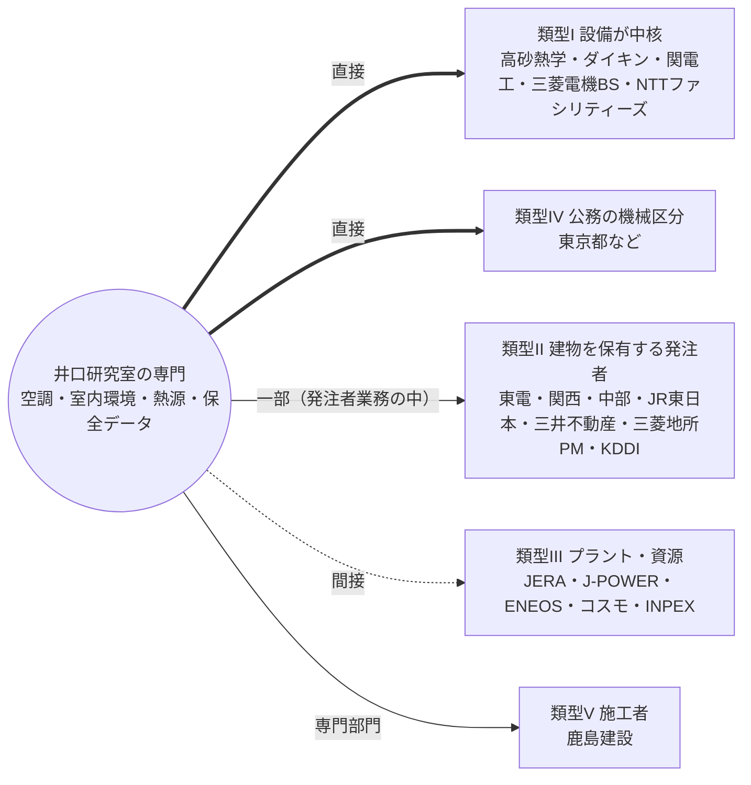

# 23 企業・組織別研究（東京電力と同じ枠組みによる横展開）

- 情報基準日：2026年11月1日（作業日 2026年11月2日）
- 位置づけ：01〜22章で東京電力について行った研究の型（産業内の位置→事業・財務・投資→組織・人員→建築・建築設備の役割→新卒採用の構造→井口研究室の学生との適合→行動戦略）を、他の企業・組織に一つずつ当てはめる。
- 対象の選定：利用者が指定した企業（JERA、J-POWER、関西電力、中部電力、ENEOS、コスモ石油、INPEX）と、利用者が提示した2点の資料に現れる組織（東京ガス、三菱電機、三菱電機ビルソリューションズ、ダイキン工業、NTTファシリティーズ、KDDI、NTT東日本、JR東日本、三井不動産、鹿島建設、高砂熱学工業、三菱地所プロパティマネジメント、電力系子会社、東京都、特別区、国土交通省）。
- **情報管理**：利用者が提示した2点の資料は「個人専用（非公開）」の文書である。本研究は公開リポジトリに保存されるため、それらから使ったのは**組織名の一覧だけ**である。資料に含まれる個人の選好・成功確率・行動計画・評価点は、転記も参照もしていない。各組織の分析は、公開されている一次資料（有価証券報告書、公式発表）だけで行った。

## 1. 方法と証拠の水準
| 観点 | 主な資料 | 水準 |
|---|---|---|
| ①産業内の位置・②事業・財務・投資 | 各社の有価証券報告書（EDINET DB経由。S040〜S049、S100〜S110）、決算資料 | B（法定開示） |
| ③組織・人員 | 有報の「従業員の状況」 | B |
| ④建築・建築設備の役割 | 有報の事業・設備の記述から推論。公式の職種説明がある場合はそれによる | 推論が中心 |
| ⑤新卒採用の構造 | 公式の採用情報（確認できた範囲）。体験談・転職サイトの求人は参考扱い | **多くの組織で未確認**（東電ほどの一次資料は得られていない） |
| ⑥適合・⑦戦略 | ①〜⑤と、18章（井口研究室）の照合 | 分析 |

**深さの違いの明示**：東電については、建築部門のパンフレット・求人の詳細・部署の人数まで一次資料で確認した（17〜19章）。他の組織では、⑤の新卒採用構造を一次資料で確認できたのは東京都（I類B新方式の区分・採用予定数・申込者数、S120）に限られる。そのため、各組織の⑤には「確認すべき項目」を明記した。**東電と同じ確度の結論ではない**。

自動抽出の誤りへの対処：有報テキストからの数値の自動抽出は誤りが多かった（例：関西の自己資本比率を3.3%と誤抽出）。このため、本章の数値はすべて、該当する文を目視で確認したものに限る。

## 2. 全社比較：建築設備の位置づけによる分類【分析】

最も重要な横断的な発見は、**組織によって、建築設備が「中核の事業」になるか「支援の機能」になるかが異なる**ことである。

| 類型 | 組織 | 建築設備の位置づけ | 井口研究室の専門との対応 |
|---|---|---|---|
| **I. 建築設備そのものが事業の中核** | 高砂熱学工業（空調設備工事）、ダイキン工業（空調機器）、関電工（内線・空調工事）、三菱電機・三菱電機ビルソリューションズ（空調・昇降機・ビル設備）、NTTファシリティーズ（通信建物・DCの設計・保守）、東京ガスのエンジニアリング子会社（エネルギーサービス） | 売上・技術の中心 | **直接**（空調・熱源・室内環境・エネルギー） |
| **II. 建物・施設を大量に保有・運営し、発注者として設備を管理** | 東京電力、関西電力、中部電力、JR東日本、三井不動産、三菱地所・三菱地所PM、KDDI（DC・局舎）、NTT東日本（局舎） | 支援（発注者としての保全・更新） | 間接〜直接（運用・保全・省エネ） |
| **III. プラント・資源の企業で、建築は付帯** | JERA、J-POWER、ENEOS、コスモ、INPEX | 支援（主役は機械・化工・電気・土木） | 間接 |
| **IV. 公共の施設管理者・発注者** | 東京都、特別区、国土交通省（官庁営繕） | 発注者として設計・工事・保全を管理。**東京都では「機械」の区分が設備を担う** | 直接（機械区分） |
| **V. 建設会社（施工者）** | 鹿島建設 | 建築事業の中で、設備は専門部門 | 直接（設備の施工・設計部門） |

**含意**：井口研究室の専門（空調・室内環境・熱源・保全データ）が「中核」として評価される可能性が構造的に高いのは類型I（と、類型IVの機械区分）である。東電を含む類型IIでは、建築職の発注者業務の一部として評価される（20章と同じ）。類型IIIでは、建築・建築設備の職域そのものが小さい。

## 3. 主要指標の比較表（目視で確認した値のみ）
| 組織 | 決算期 | 連結従業員 | 提出会社の従業員・平均年齢・勤続・給与 | 利益 | 設備投資 | 出典 |
|---|---|---:|---|---|---|---|
| 東京電力HD | 2026/3 | 38,341 | 7,157人・45.1歳・22.1年・883万円 | 経常4,173億円、純△4,543億円 | （05章） | S025, S030 |
| JERA | 2026/3 | 6,271 | 4,504人・43.4歳・16.4年・980万円 | 純1,935億円 | 6,064億円（燃料4,793） | S047 |
| J-POWER | 2026/3 | 7,202 | 1,994人・41.6歳・18.5年・1,188万円 | 経常1,585億円、純585億円 | 1,886億円 | S043 |
| 関西電力 | 2026/3 | 32,482 | 8,336人・42.4歳・19.4年・939万円 | 経常5,185億円、純3,800億円 | 5,807億円（2026年度は8,300億円の計画） | S040 |
| 中部電力 | 2026/3 | 22,700 | 3,367人・42.5歳・19.0年・945万円 | 経常約2,840億円 | 3,280億円 | S041 |
| 東京ガス | 2026/3 | 16,001 | 3,769人・43.3歳・19.5年・784万円 | 経常1,937億円 | 3,088億円 | S044 |
| ENEOS HD | 2026/3 | 34,099 | （HDとENEOSの合同組織） | — | 3,056億円 | S100 |
| コスモエネルギーHD | 2026/3 | 6,675 | — | 在庫影響を除く経常1,657億円 | 975億円（次年度計画1,940億円） | S101 |
| INPEX | 2025/12 | 3,720 | — | 純3,938億円 | 投資3,900億円 | S048 |
| 三菱電機 | 2026/3 | 150,386 | 29,949人・40.5歳・15.3年・913万円 | — | 3,107億円 | S102 |
| ダイキン工業 | 2026/3 | 104,095 | 8,212人・41.2歳・16.6年・896万円 | 経常4,082億円、純2,752億円 | 3,000億円 | S103 |
| KDDI | 2026/3 | 73,198 | — | — | 6,837億円（通信設備等） | S104 |
| JR東日本 | 2026/3 | 70,623 | 39,598人・39.8歳・17.1年・819万円 | — | 9,491億円 | S105 |
| 三井不動産 | 2026/3 | 27,704 | （約1,981人、二次情報） | 経常3,133億円、純2,786億円 | 2,463億円 | S106 |
| 三菱地所 | 2026/3 | 11,659 | — | 経常2,731億円 | 5,278億円 | S110 |
| 鹿島建設 | 2026/3 | 21,170 | — | 経常2,404億円、純1,773億円 | 610億円 | S107 |
| 高砂熱学工業 | 2026/3 | 7,287 | 2,469人・41.5歳・14.7年 | 経常506億円、純375億円 | 50億円 | S108 |
| 関電工 | 2026/3 | 10,850 | 8,110人・42.4歳・19.3年・1,012万円 | 2026年度目標：営業利益900億円 | 203億円 | S109 |
| 東京都（I類B新方式・第2回、2026年） | — | — | 建築：採用予定5人・申込58人／機械：28人・63人／電気：18人・46人 | — | — | S120 |

注：給与は各社の提出会社の平均で、職種・年齢構成が違うため単純に比較できない（16章の注意）。INPEXは12月決算。JERAはIFRS。

## 4. 横断的な戦略の示唆（詳細は各社の節と、23-3の最終節）
1. **「建築職」と「設備職」の区分は組織によって違う**。東電・電力会社・JR・デベロッパーでは「建築」の中に設備を含む。東京都では設備は「機械」「電気」の区分である。設備工事会社・メーカーでは設備そのものが職種になる。応募区分の確認が、全組織に共通する最優先の行動になる（22章の優先1と同じ）。
2. **井口研究室の専門の「直接性」は、類型I・IV（機械区分）で最大、類型IIで中、類型IIIで小**。ただし、直接性と採用での評価は別の問題である（20章の原則）。
3. 類型IIの組織（電力・鉄道・デベロッパー）の建築職は、どれも「発注者として建物のライフサイクルを管理する」という同型の職務である（11・17章）。準備の多くを共通化できる。
