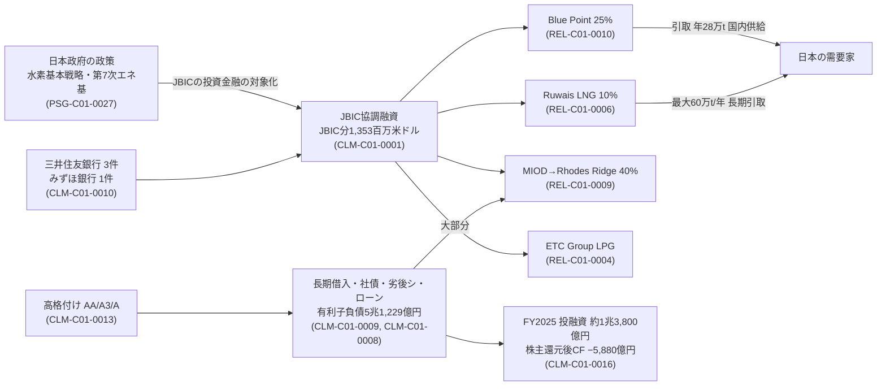

# 三井物産 / AXIS_13 銀行融資・政策金融・保険：社内独立軸レポート

> COMPANY_ID: `COMPANY_01` / AXIS: `AXIS_13` / 基準日: 2026-11-01（初期スナップショット `asof_2026-11-01`）
> 作成: 2026-11-09（記録時点）／使用資料はすべて基準日以前に公表されたもの
> 軸の状態: **IN_PROGRESS**（8テーマ中 PASS 1・IN_PROGRESS 5・NOT_STARTED 2）。状態は `research_gates.py` が機械判定する。

本レポートは三井物産の資料だけで成立する。他の7社の研究・出典IDは参照していない。表記：【確認事実】【当事者の主張】【分析】【仮説】【不明】。

## 0. 要約

**現時点で分かったこと**

1. 【確認事実】JBICは2025年度（2025年4月〜2026年3月）に、三井物産本体または三井物産の出資先が借り手となる貸付契約を4件のプレスリリース（5契約）で公表した。JBIC分の貸付限度額は合計1,353百万米ドル、協調融資の総額は2,187百万米ドルで、JBIC分の比率は61.9%（CLM-C01-0001、MDL-C01-0001）。
2. 【確認事実】4件はすべて資源・エネルギー案件である（低炭素アンモニア、LPG、LNG、鉄鉱石）。借り手は、三井物産本体が2件（Blue Point出資、Ruwais LNG）、出資先が1件（ETC Group）、100%連結子会社が1件（Mitsui Iron Ore Development）（CLM-C01-0002）。
3. 【確認事実】三井物産は有価証券報告書で、国際協力銀行などの政府系金融機関からの借入とプロジェクトファイナンスを、資金調達手段として自ら明記している（CLM-C01-0003）。NEXIも2026-03-31、三井物産の保証債務を対象に融資保険を引き受けたと公表した（CLM-C01-0004）。
4. 【分析】政策金融の規模は全体から見て小さい。Rhodes Ridge権益の取得では、JBIC＋みずほの協調融資（430百万米ドル）は取得支出7,238億円の約9%（為替±10%で8.1〜9.9%）にとどまる（CLM-C01-0014）。有報の注記で「政府出資銀行及び政府機関」と表示される担保付債務は578億円で、有利子負債の約1.1%にすぎない（CLM-C01-0005）。
5. 【確認事実＋分析】資金調達の中心は長期借入と社債である。FY2025末の有利子負債は5兆1,229億円で、前期比8,130億円増えた。この数値は注記（短期債務＋長期債務−リース負債）から1億円未満の差で再現でき、増加額も一致した（CLM-C01-0009）。長期債務には劣後特約付シンジケートローン4,200億円が含まれ、格付会社は半額の2,100億円を資本と同等に扱っている（CLM-C01-0008）。
6. 【確認事実】本体のコミットメントラインは103億米ドル相当（CLM-C01-0007）。格付けは2026年5月31日時点でR&I AA、Moody's A3、S&P A（いずれも見通し安定的）で、会社の記載による（CLM-C01-0013）。

**未確認の重要事項（BACKLOG／不明）**

- 【不明】JBIC融資の実行額・金利・期間・担保は公表されていない。そのため、FY2025の有利子負債増加（+8,130億円）のうち政策金融がいくらを占めたかは識別できない（CLM-C01-0006）。
- 【不明】メガバンク別の与信残高と、コミットメントラインの参加行は開示されていない（Q-C01-A13-T01-03）。
- 【不明】劣後シ・ローンの実行日は注記に記載がない。このため、大型投資の資金手当てとの時間的な対応は未確認（HYP-C01-0004）。
- 【不明】2024年度以前のJBIC案件は本文検索をしていない（Q-C01-A13-T03-06）。NEXIは一覧ページから取れた30件しか照合していない。
- 【不明】格付けの数値は格付会社の一次公表と照合していない。基準日（2026-11-01）時点の格付けも未確認。

**この軸が会社全体へ与える影響**

政策金融は「量」としては小さい。それでも、日本政府の重点政策（水素・LNG長期確保・鉄鉱石の安定供給）に沿った資源・エネルギー案件に集中して使われている。三井物産の資本配分のうち政策的な色彩が強い部分を、この軸から特定できる。一方、資金調達の大半は高格付けを前提にした長期借入・社債・ハイブリッドで賄われている。このため、AXIS_14（財務・資本配分）とAXIS_24（格付け・株主）では、格付けが維持されることが投資実行の制約条件として効いていると予想される（ただし未検証）。

## 1. テーマ別の状態

| topic_id | テーマ | 状態 | 主な主張 | 未了点 |
|---|---|---|---|---|
| AXIS_13_T01 | 邦銀メガバンク・海外銀行との取引 | IN_PROGRESS | CLM-C01-0010, CLM-C01-0011 | 行別残高・コミットメントライン参加行（Q-C01-A13-T01-03 OPEN） |
| AXIS_13_T02 | シンジケートローン・コミットメントライン | IN_PROGRESS | CLM-C01-0007, CLM-C01-0008, CLM-C01-0009, CLM-C01-0016 | 競合仮説がHYP-C01-0004の1本のみ／劣後ローン実行日 |
| AXIS_13_T03 | JBIC・NEXI等の公的金融・保険 | **PASS**（範囲：2025〜2026年度の公表案件） | CLM-C01-0001〜0004, CLM-C01-0014, CLM-C01-0015 | 2024年度以前（BACKLOG）、NEXI網羅性（PARTIAL） |
| AXIS_13_T04 | プロジェクトファイナンスとSPV | NOT_STARTED | – | 有報はPF活用を記載（PSG-C01-0003）するが案件別は未調査 |
| AXIS_13_T05 | 融資保証・担保・コベナンツ | IN_PROGRESS | CLM-C01-0012 | 会社記載のみ。NEXI案件（保証債務）とも接続要 |
| AXIS_13_T06 | 輸出信用・貿易金融・信用状 | NOT_STARTED | – | – |
| AXIS_13_T07 | 格付け・信用リスク・貸倒れ | IN_PROGRESS | CLM-C01-0013 | 格付会社一次資料と未照合 |
| AXIS_13_T08 | 公開融資案件と非公開審査の識別 | IN_PROGRESS | CLM-C01-0005, CLM-C01-0006 | 競合仮説未設定（識別問題のため） |

AXIS_13_T03のPASSは、このテーマについて「2025〜2026年度の公表案件の範囲で、原文位置まで追跡でき、2つ以上の独立起源（会社の有報とJBIC・NEXI）で裏付けられ、競合仮説と反証が記録されている」という意味にとどまる。三井物産の政策金融利用の全史が確定したわけではない。

## 2. 定義・制度

- **政策金融**：ここではJBIC（株式会社国際協力銀行、政府全額出資）による投資金融と、NEXI（株式会社日本貿易保険）による融資保険・貿易保険を指す。民間銀行との協調融資の形をとることが多い。
- **有報上の分類**：三井物産の金融債務注記（IFRS）は「担保付／無担保」×「銀行及び保険会社／政府出資銀行及び政府機関」で分類している。「政府出資銀行及び政府機関」の欄は担保付長期債務にしかない（PSG-C01-0017）。つまり、無担保の政策金融は注記上「銀行及びその他」に混ざる。これが、政策金融の残高を外部から識別できない構造的な理由である（CLM-C01-0005）。
- **限度額と実行額**：JBICが公表するのは「融資金額…を限度とする貸付契約」であり、実行額ではない（PSG-C01-0025）。

## 3. 主要主体と資金の流れ（案件別）

| 案件 | 借り手（三井物産との関係） | JBIC分 | 協調融資総額 | 協調行 | 三井物産の位置づけ | 根拠 |
|---|---|---|---|---|---|---|
| Blue Point低炭素アンモニア（米ルイジアナ） | 三井物産本体（出資資金） | 626 | 1,044 | 三井住友銀行 | 出資25%、CF Industries・JERAと共同FID、国の価格差支援の認定を取得、国内へ年28万t供給を計画 | PSG-C01-0025, PSG-C01-0026, PSG-C01-0022 |
| ETC Group LPG（サブサハラ4か国） | ETC Group（出資先、2018年から出資。比率・連結区分は未確認） | 14 | 24 | 三井住友銀行 | アフリカ流通網をプラットフォームとして活用 | PSG-C01-0028 |
| Ruwais LNG（UAE） | 三井物産本体（2契約） | 319＋94 | 532＋157 | 三井住友銀行 | 子会社経由で10%出資、年間最大60万tを長期引取 | PSG-C01-0029, PSG-C01-0030 |
| Rhodes Ridge鉄鉱山（西豪州） | Mitsui Iron Ore Development（議決権100%の連結子会社） | 300 | 430 | みずほ銀行 | 権益40%の取得資金の一部。持分生産を約6,200万t/年から1億t/年超へ増やす目標（JBIC記載） | PSG-C01-0031, PSG-C01-0032, PSG-C01-0033, PSG-C01-0021 |
| ACI Logistics（バングラデシュ） | アジア・大洋州三井物産が貸し手 | – | – | – | 三井物産の保証債務にNEXIの融資保険。株式転換権付き融資 | PSG-C01-0034, PSG-C01-0035 |

（単位：百万米ドル。限度額ベース。協調行の取り分は「総額−JBIC分」で算出した【分析】値：REL-C01-0002, REL-C01-0008, REL-C01-0012, REL-C01-0013）

**モノ・サービスの流れ**：Blue Pointのアンモニアは三井物産が一部を引き取って国内の電力・化学向けに供給する。Ruwais LNGは三井物産が長期で引き取る。Rhodes Ridgeの鉄鉱石は既存のRobe Riverのインフラとのシナジーを見込む（JBICの記載）。どの案件でも、政策金融は「日本向けの長期引取・権益」と結びついている（【分析】、根拠は各公表文）。

**決定権・責任**：JBIC融資の借り手が本体か子会社か出資先かで、返済責任の所在が変わる。本体借入の2件（Blue Point、Ruwais）は三井物産の信用で調達しており、プロジェクトファイナンスではない（公表文に「プロジェクトファイナンス」の記載はない）。ETC Groupへの融資は出資先の信用による。NEXI案件では三井物産が保証債務を負い、そのリスクをNEXIの保険が引き受ける構造である（【確認事実】PSG-C01-0034）。

## 4. データと観測（定量）

再現スクリプト：`models/MDL_C01_0001_debt_policy_finance.py`（MDL-C01-0001。入力は `ledger/observations.jsonl` だけ。ゲートが毎回再計算し、保存済み出力 `datasets/MDL-C01-0001_outputs.json` と一致するか検査する）

| 指標 | 値 | 計算式・出典 |
|---|---|---|
| 有利子負債（会社定義） | 51,229億円（再構成値51,228.76） | (短期債務166,249＋長期債務5,541,517−リース負債584,890)百万円。OBS-C01-0014, OBS-C01-0016, OBS-C01-0018 |
| 同 前期比 | +8,130億円（再構成値+8,129.99） | 前期 (163,909＋4,677,351−531,383) |
| 1年以内返済比率 | 10.88%（会社記載10.9%） | 5,572 / 51,229。OBS-C01-0005, OBS-C01-0011 |
| 5年超返済比率 | 33.93% | 17,381 / 51,229 |
| 劣後シ・ローン | 4,200億円（注記の2,050＋2,150と一致）、有利子負債の8.2% | OBS-C01-0024, OBS-C01-0025, OBS-C01-0003 |
| 担保付「政府出資銀行及び政府機関」 | 578億円（有利子負債の1.13%、前期比+144億円） | OBS-C01-0020, OBS-C01-0021 |
| JBIC 2025年度公表（限度額） | JBIC分1,353／総額2,187百万米ドル（61.9%） | OBS-C01-0038〜0047 |
| Rhodes Ridge協調融資 ÷ 取得支出 | 8.98%（8.08〜9.87%） | 430×151.09/100 ÷ 7,238。OBS-C01-0047, OBS-C01-0037, OBS-C01-0036 |
| 株主還元後CF | −5,880億円（概数。計算値と一致） | 9,790＋3,430−13,800−5,300。OBS-C01-0027〜0031 |
| ネット有利子負債の増加 | +8,089億円、ネットDER 0.44→0.47倍 | OBS-C01-0032〜0035 |

**統計上の注意**：JBIC案件は n=4（契約は5）にすぎず、母集団（三井物産の全借入）の標本としては公表された案件に偏っている（JBICが公表を選んだ案件だけ）。比率は記述統計にとどめ、推定・検定はしていない。確率の表示もしない。

**出典を除いたときの影響（STEP F）**：JBICの公表文をすべて除くと、CLM-C01-0001・0006・0010・0015が裏付けを失う（CLM-C01-0002は有報の子会社注記が残るため失わない）。有報（OG-C01-YUHO-107）を除くと、CLM-C01-0003・0005・0007・0008・0009・0011・0012・0013・0016が裏付けを失う。NEXIを除くとCLM-C01-0004が失われる。会社の開示と政策金融機関の開示は互いを代替できない。両方を組み合わせて初めて「政策金融の利用」と「その規模の小ささ」が同時に言える（各社の `COMPANY_RESEARCH_STATUS.json` の `source_ablation_claims_losing_all_support` で機械的に確認できる）。

## 5. 競合仮説と反証

観測された現象：三井物産は格付けA〜AA格で、社債・CP・長期借入に十分アクセスできる。それでも資源・エネルギー案件ではJBICとの協調融資（JBIC分が約6割）を使っている。

| 仮説 | 予測される観測 | 反証となる観測 | 現在の評価 |
|---|---|---|---|
| HYP-C01-0001 条件（期間・コスト）仮説 | 長寿命資産への集中、民間より長い期間 | 短期・低リスク案件での利用、条件が民間と同等 | **未決**。資産の性質は整合するが、JBICの投資金融の対象要件がそもそも資源・エネルギーを選ぶため識別力が低い。条件は非開示 |
| HYP-C01-0002 政治リスク緩和仮説 | 政治リスクの高い国への偏り | 低リスク国でも同程度に利用 | **弱化**。4件中2件は米国・豪州。単独の説明としては成立しにくい |
| HYP-C01-0003 政策供給主導仮説 | 政策文書の引用、重点分野との一致、補助金と政策金融の重なり | 重点外の案件にも同等に融資、政策策定前から同じパターン | **弱い支持**。Blue Pointでは国の価格差支援とJBIC融資が同じ案件に重なる（PSG-C01-0022, PSG-C01-0027）。ただし公表文は融資者自身による正当化であり、時系列の比較は未実施 |
| HYP-C01-0004 格付け維持・資本構成管理仮説 | 短期比率が低いまま、資本性のある劣後調達、格付けが安定 | CP依存の急増、格下げ、劣後ローンが投資と無関係 | **弱い支持**。予測とは整合するが、劣後ローンの実行日が不明 |

これらの仮説は互いに排他的ではない。現在のデータでは、H1（条件）とH3（政策）を識別できない。識別に必要なのは、(a) 2016〜2024年度のJBIC×三井物産案件の時系列と、各政策文書の公表日との比較（Q-C01-A13-T03-06）、(b) 国別のカントリーリスク区分との対応である。

## 6. 因果連鎖（会社固有）

エッジの種類：実線は確認事実・公表された資金の流れ。「大部分」（D→RR）は【分析】（CLM-C01-0014の補数）。政策→JBICのエッジは融資者が主張する関係であり、因果を検証したものではない（HYP-C01-0003）。

## 7. 将来の変化・更新トリガー

- **NEEDS_RECHECK**：格付け（CLM-C01-0013）、コミットメントライン額（CLM-C01-0007）。次の有報（2027年6月見込み）と格付会社の公表で再確認する。
- **後日更新版で扱う資料**：2027年3月期第2四半期の決算資料（会社IRライブラリで確認したが、基準日より後の公表と考えられるため初期スナップショットから除外した：SL-C01-0001）。
- **先行指標**：JBIC・NEXIの新規公表案件（月次の本文検索）、劣後シ・ローンの期限前弁済可能日（2028-08-15、2030-09-25）、Blue Pointの製造開始（2029年予定、PSG-C01-0022）。

## 8. 他軸との接続（三井物産の内部）

- AXIS_04（資源）・AXIS_05（エネルギー）・AXIS_30_T01/T02（案件ケース）：4案件の事業経済性。本軸では資金面だけを扱った。
- AXIS_14（財務・資本配分）：CLM-C01-0016の資金ギャップ、MDL-C01-0001の再構成値を入力として使う。
- AXIS_16（政策）：価格差支援（PSG-C01-0022）と政策金融が重なる構造。
- AXIS_20（所有ネットワーク）：REL-C01-0001〜0014（銀行・政府系機関・出資先とのエッジ。相手側の資料との突合は未実施＝CONFIRMED_ONE_SIDE）。
- AXIS_24（株主）：大量保有報告書に基づくNational Indemnity Company（9.82%、報告義務発生日2025-03-10。REL-C01-0014）。2026-03-31時点の実質所有は会社も確認できないと注記している。

## 9. 出典（この軸で使用）

SRC-C01-0001（第107期有価証券報告書、2026-06-12提出）、SRC-C01-0002〜SRC-C01-0005（JBICプレスリリース 2025-07-01／2025-08-21／2026-02-25／2026-03-10）、SRC-C01-0006（NEXIニュースリリース 2026-03-31）。ハッシュ・取得日時・ページ位置は `ledger/sources.jsonl`・`ledger/passages.jsonl` に記録した。検索・除外の記録は `ledger/search_log.jsonl`（SL-C01-0001〜0006）にある。
