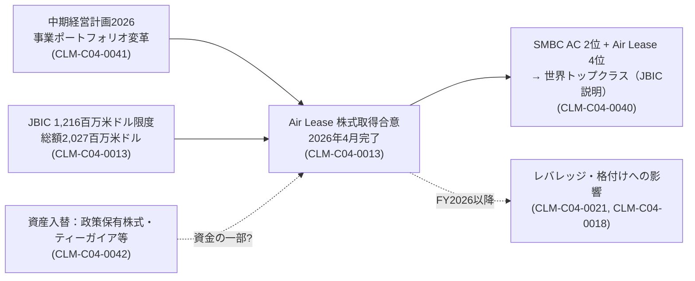

# 住友商事 / AXIS_30 事業別ケーススタディと因果検証：社内独立軸レポート

> COMPANY_ID: `COMPANY_04` / AXIS: `AXIS_30` / 基準日: 2026-11-01（`asof_2026-11-01`）/ 記録: 2026-11-09
> この軸の8テーマのうち、調査済みは AXIS_30_T06（M&A成功・失敗・撤退案件）の1件。ケースとして米国航空機リース会社 Air Lease の買収を取り上げた。他の7テーマは未着手。
> 本レポートは住友商事の資料（有価証券報告書）と、住友商事を借入人とするJBICの公表文だけを根拠にしている。他社の研究は参照していない。

## 0. 要約

**分かったこと**
1. 【確認事実】住友商事は米国の航空機リース会社 Air Lease の株式取得に合意し、買収は2026年4月に完了した。JBICは住友商事本体と、1,216百万米ドルを上限とする貸付契約を結んだ（協調融資の総額は2,027百万米ドルで、三菱UFJ銀行を含む民間金融機関と協調）。買収後の社名は Sumisho Air Lease（CLM-C04-0013）。
2. 【当事者の主張】融資者であるJBICによると、航空機リース会社は世界の民間航空機の約半数を保有し、経済安全保障上も重要な役割を担う。住友商事とSMFLが傘下に持つ SMBC Aviation Capital は機材数で世界第2位、Air Lease は第4位で、合算すると世界トップクラスになる（CLM-C04-0040）。住友商事自身は、この取得を中期経営計画2026の「事業ポートフォリオ変革」の中で「強みを更に強くする投資」と位置づけている。2026年度は、SCSKと米国航空機リース会社の利益貢献を含め、成長8分野で前年度比790億円の増益を計画している（CLM-C04-0041）。
3. 【確認事実】同じ2025年度に、政策保有株式・ティーガイア・マイダス・北米メロン事業・Sekal AS などを売却する資産入替を実施した（CLM-C04-0042）。一方で、ネット有利子負債は+4,747億円増え、ネットDERは0.57倍から0.68倍へ上昇した（主因はSCSK株式の追加取得。CLM-C04-0021）。
4. 【分析】JBIC分は協調融資総額の約60.0%にあたる。ただし買収対価と、住友商事・SMFL間の持分割合を取得していないため、政策金融が買収資金のどの程度を占めたかは計算できない（CLM-C04-0043）。

**未確認（BACKLOG）**
- 買収対価と、住友商事・SMFLの持分割合（Q-C04-A30-T06-03）。2025年の適時開示を取得する必要がある。
- 買収完了後の業績への寄与（Q-C04-A30-T06-04）。基準日より後の資料に当たるため、月次スナップショットで扱う。
- 機材数の順位はJBICと会社の説明によるもので、独立した業界データとは照合していない。

**会社全体への影響**
有報の資料（CLM-C04-0012、CLM-C04-0003）によると、輸送機・建機セグメントでは前年度に航空機リース事業の特殊利益があり、その反動でFY2025は減益になった。Air Lease の連結（2026年4月〜）は、このセグメントの利益水準とレバレッジを同時に押し上げる可能性が高い。そうなればAXIS_13（格付け、特にS&Pのネガティブ見通し：CLM-C04-0018）とAXIS_14（ネットDER）の再評価が必要になる。これは推論であり、月次更新で検証する対象とする。

## 1. 案件の構造（資金・モノ・権限）

| 項目 | 内容 | 根拠 |
|---|---|---|
| 取得主体 | 住友商事とSMFL（傘下のSMBC Aviation Capital等が実行主体） | CLM-C04-0013 |
| 取得対象 | Air Lease Corporation（米国、世界第4位のリース会社とJBICは説明） | CLM-C04-0040 |
| 完了時期 | 2026年4月（住友商事のFY2026に入る） | CLM-C04-0013 |
| 政策金融 | JBICから住友商事へ1,216百万米ドル限度（総額2,027百万米ドル）。SMFLには約266百万米ドル限度の別契約 | CLM-C04-0013 |
| 同時期の資産売却 | 政策保有株式、ティーガイア、マイダス、北米メロン、Sekal AS | CLM-C04-0042 |

**決定権・責任**：JBICの貸付契約の相手方は住友商事本体である。したがって返済責任は住友商事の信用に帰属し、プロジェクトファイナンスではない。航空機という資産の保有・運用はリース会社側が担う。

## 2. 競合仮説と反証

| 仮説 | 予測 | 反証となる観測 | 評価 |
|---|---|---|---|
| HYP-C04-0004 規模・競争地位 | 統合後の機材数順位が上がり、調達条件が改善する | 統合後も調達条件や収益性が改善しない | 弱い支持（順位はJBICと会社の説明のみ。統合効果はFY2026以降に検証） |
| HYP-C04-0005 資産入替による資金循環 | 売却収入と取得の時期が一致し、レバレッジは上がらない | ネット有利子負債が大きく増加する | **弱化**：FY2025はネット有利子負債+4,747億円・ネットDER上昇（SCSK追加取得による）。Air Leaseの対価支払はFY2026の財務に現れる見込み |
| HYP-C04-0006 政策（経済安全保障）支援 | JBICの説明が経済安全保障を明示し、同種案件で政策融資が繰り返し使われる | 経済安全保障への言及がない／政策金融なしで同条件の調達ができた | 未決（言及はあるが、融資判断の因果は識別できない） |

3つの仮説は互いに排他的ではない。現時点で最も検証しやすいのはH-Bで、FY2026半期報告書（基準日後）のネット有利子負債と投資CFを見ればよい。

## 3. 因果連鎖（会社固有）

実線は資料で確認できた関係、点線は推論（未検証）である。

## 4. この軸のテーマ状態

| topic_id | テーマ | 状態 |
|---|---|---|
| AXIS_30_T06 | M&A成功・失敗・撤退案件 | ゲート判定（Air Leaseケース、範囲：取得の構造・資金手当て・競合仮説） |
| AXIS_30_T01〜T05、T07、T08 | 資源・LNG・物流・不動産・消費財・協調融資・共同投資の各ケース | 未着手 |

## 5. 次の作業
1. 住友商事の2025年の適時開示（Air Lease買収の公表）を取得し、対価・持分・資金調達計画を記録する。
2. 基準日後の2026年度半期報告書を `monthly_2026-11` スナップショットとして取得し、H-Bを検証する。
3. AXIS_30_T02（海外発電）について、JBICのウズベキスタン案件とカタール案件（AXIS_13_T04の主張）をケース化する。
