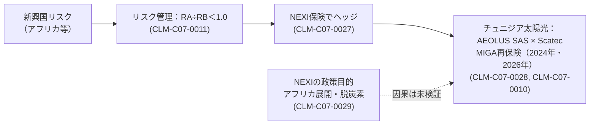

# 豊田通商 / AXIS_13 銀行融資・政策金融・保険：社内独立軸レポート

> COMPANY_ID: `COMPANY_07` / AXIS: `AXIS_13` / 基準日: 2026-11-01（`asof_2026-11-01`）/ 記録: 2026-11-09
> 8テーマのうち、深掘りしたのは AXIS_13_T03（JBIC・NEXI等の公的金融・保険）。T01（取引銀行・グループファイナンス）とT07（格付け）は初期調査のみで、他のテーマは未着手。
> 根拠は豊田通商の第105期有価証券報告書と、NEXIの公表文（2026-07-21）だけである。他社の研究は参照していない。

## 0. 要約

**分かったこと**
1. 【当事者の主張】豊田通商は有報で、カントリーリスクが相対的に高い新興国へのエクスポージャーについて、NEXIの保険等でリスクをヘッジすると記載している（CLM-C07-0027）。リスク管理の枠組みは「リスクアセット÷リスクバッファー＜1.0」で、政策保険はその枠内に投資を収める手段の一つとして位置づけられている（CLM-C07-0011）。
2. 【確認事実】NEXIは2026年7月、豊田通商のグループ会社 AEOLUS SAS がノルウェーの Scatec と共同で行うチュニジアの太陽光発電投資について、世界銀行グループのMIGAから再保険を引き受けた（CLM-C07-0010）。これは2024年の同種案件（AEOLUS SASの出資部分にMIGAから再保険）の後続である（CLM-C07-0028）。会社の方針（有報）と政策保険機関の公表という独立した2つの起源で、保険利用の事実と方針が整合している。
3. 【当事者の主張】NEXIは、この引受をチュニジアの再エネ比率35%（2030年）目標の後押しと、本邦企業のアフリカ展開・脱炭素化の支援と位置づけている（CLM-C07-0029）。
4. 【確認事実（関連）】JBICの2025〜2026年度の公表文263件には、豊田通商名義の融資は見当たらなかった（Q-C07-A13-T03-02、BACKLOG）。豊田通商の資金調達はグループファイナンスで親会社に一元化されている（CLM-C07-0019）。格付けはR&I AA-、S&P A、Moody's A3でいずれも安定的（CLM-C07-0020、会社記載）、ネットDERは0.3倍と低い（CLM-C07-0018）。

**未確認（BACKLOG）**
- 付保額・付保率・対象国の一覧（Q-C07-A13-T03-04）。公表資料に金額がない。
- 2024年8月のNEXIリリース本体は未取得（後続案件の記載から存在を確認したのみ）。
- JBIC公表文に豊田通商名義の案件がない理由（未利用か、非公表か）。

**会社全体への影響**
アフリカ本部は当期利益の約25%（940億円）を占める（CLM-C07-0006）。そのため政策保険は、豊田通商の最大の利益源で投資リスクを抑える手段として重要になり得る。ただし付保の規模が不明なので、保険が利益構造をどの程度支えているかは、現時点では定量化できない。

## 1. 制度と主体

- **NEXI（日本貿易保険）**：政府全額出資の貿易保険会社。本件は投資保険で、MIGA（世界銀行グループの多数国間投資保証機関）からの再保険を伴う。
- **AEOLUS SAS**：豊田通商のグループ会社（NEXIの記述）。連結区分と出資比率は本研究の資料では未確認。
- **Scatec**：ノルウェーの再エネ事業者で共同事業者。

## 2. 競合仮説と反証

| 仮説 | 予測 | 反証となる観測 | 評価 |
|---|---|---|---|
| HYP-C07-0003 政治リスク移転 | 付保がカントリーリスクの高い国に集中し、会社方針に明記されている | 主要なアフリカ投資の多くが無保険／低リスク国にも同様に付保 | 弱い支持（会社方針と2件の公表は整合。ただし付保の規模は不明） |
| HYP-C07-0004 政策供給（NEXI・MIGAの方針） | NEXIの公表文が政策目的を強調し、MIGA協調案件が複数企業で繰り返される | 豊田通商が政策目的と無関係に（民間保険等で）保険を調達している | 未決（NEXIの説明は政策保険機関自身の正当化で、因果は識別できない） |

2つの仮説は排他的ではない。識別には、NEXI・MIGA協調案件の会社横断の一覧（会社間レイヤーで扱う）と、豊田通商の付保額が必要である。

## 3. 因果連鎖

## 4. テーマ状態

| topic_id | テーマ | 状態 |
|---|---|---|
| AXIS_13_T03 | JBIC・NEXI等の公的金融・保険 | ゲート判定（範囲：NEXIの公表案件と会社方針。付保額はBACKLOG） |
| AXIS_13_T01 | 邦銀メガバンク・海外銀行との取引 | 初期調査（グループファイナンス方針のみ） |
| AXIS_13_T07 | 格付け・信用リスク | 初期調査（会社記載の格付け） |
| その他 | T02、T04、T05、T06、T08 | 未着手 |

## 5. 次の作業
1. NEXIの2024年8月リリースと、MIGAの案件公表（英文）を取得し、付保対象と金額の有無を確認する。
2. 有報の金融商品注記から、地域別エクスポージャーまたは保険によるヘッジ額を探す。
3. T01：主要取引銀行・コミットメントラインの規模を有報の注記から抽出する。
