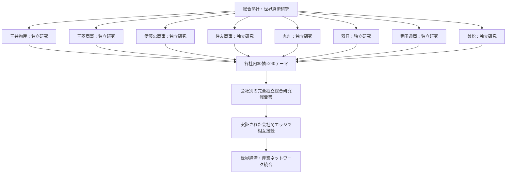

# COMPANY-FIRST：8社独立研究と相互接続の構造

**企業が研究の親であり、金融・政策・歴史・資源・人事などの研究軸はその企業の子である。**

上図の「各社内30軸」と「独立総合研究報告書」は表示を簡略化したもので、実際は各社ごとに**別々の30軸と報告書**を作る。1社だけでも完全に閲覧できる独立体系にする。

## 会社研究ごとの独立性テスト

1. 他の7社の研究フォルダを読み込み不能にしても、その会社の研究の根拠・数値・推論・図表・結論が再現できること。ただし一次資料の共通キャッシュは参照IDを通じて利用できる。
2. 他社の会社別結論をコピーして当該会社の検証済み結論としないこと。
3. 30軸の社内分析のうち、当該会社の主要事業・金融・国家・組織・国際情勢が実質的に調べられていること。
4. 分類上関連しない研究テーマは根拠とともに `NOT_APPLICABLE`、未確認は `UNKNOWN` と記録する。
5. 会社別の統計や因果推論は、当該会社の観測データと適切な比較対象の出典により検証可能であること。実測のない恣意的な確率は表示しない。
6. 他社との共同案件は、両社の出資比率・損益帰属・役割・期間が同じだと仮定せず、別々の会社資料を突き合わせる。
7. 毎月会社別報告を先に更新し、それから会社間リンク・世界統合モデルを更新する。

## 重要な出力

- **8冊の独立した企業総合研究書**（それぞれの会社の全産業・国家・銀行・経営・人事・技術・将来像）
- **各社の30軸×240テーマの個別原資料・研究・統計管理**（合計1,920の初期スロット）
- **会社間のエビデンス付き関係ネットワーク**（競争・協力・出資・融資・取引・政府関与）
- **世界全体の体系的な産業分析**（各社研究が根拠・入力として追跡可能）
- **8社トップのWebアプリ**と会社別履歴・月次再調査・差分再計算
