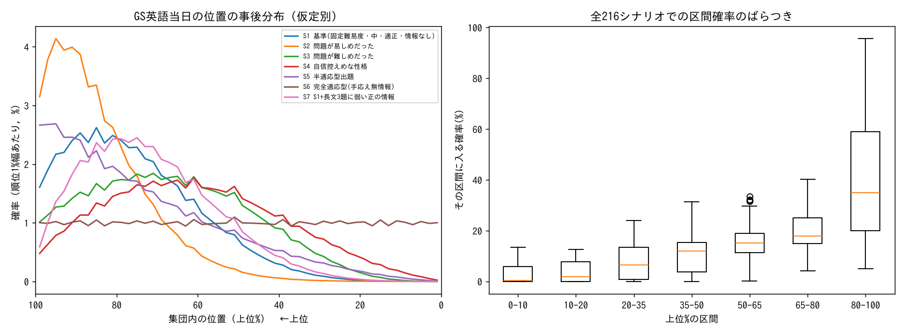
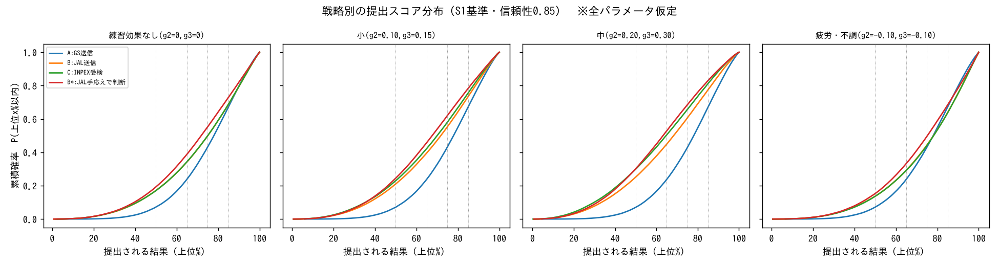

# SPI英語（11/7 GS受検）の順位推定と、INPEXへの提出戦略の定量分析

作成：2026-11-07　再現方法：`pip install numpy scipy matplotlib && python3 model.py`（乱数シード固定、約10秒）

> **最重要の注意**
> SPI英語の得点分布・標準化方法・項目の難易度・信頼性係数・「長文の題数と得点の関係」は、**どれも公開された実測データが見つからなかった**。
> 以下の数字はすべて**仮定つきモデルの計算結果**で、実測で検証された値ではない。
> 一つの数字を信じるのではなく、「仮定を変えると結論がどう動くか」を見るためのもの。

## 1. 結論の要約
- **順位：** 仮定の組み合わせ216通りの中央値で見ると、推定順位の中央値は**上位約69%**（平均よりやや下）。ただし、シナリオによって**上位40%〜上位96%**まで動く。どのシナリオでも、95%信用区間は60ポイント以上の幅がある。**順位はほとんど絞り込めていない。**
- **極端な低評価（下位5%）の確率：** 216通りの中央値で6.5%（範囲 0.6〜59%）。出題が適応型なら、手応えの情報は役に立たず、確率は5%（＝集団の比率そのまま）になる。
- **INPEX：** 公式FAQに「選考段階において、英語能力の有無は特に重視していません」とある。配点・足切りは非公開。
- **戦略：** 英語の得点が評価に**連続的に効く**場合、または足切りが**厳しめ（上位50〜65%）**の場合は、**B（再受検）とC（INPEXで受検）が多くのシナリオで有利**。足切りが**ゆるい（下位15%だけ落とす）**場合で、しかもGSの成績を**実力どおりの出来**とみなすと、**Aの方がやや有利**になる。B・Cは下振れのリスクが大きいため。
- **最終判断：B（明日JALで受検し、その手応えを見て11/10にINPEXで受けるかを決める）。確信度：低。** 差は小さく、どちらが有利かは仮定で入れ替わる。

## 2. SPI英語の得点分布に関する調査（実測データ）
| 項目 | 見つかったこと | 種別 |
|---|---|---|
| 測定内容 | 語彙・文法の理解力と読解力。形式は語彙・英文の穴埋め・長文読解の3種類。難易度は中学〜高校卒業レベル | リクナビの記事（リクルート系）[1] |
| 時間・問題数 | 約20分。問題数は人によって違う | 対策サイト [2][3] |
| 出題範囲 | テストセンターでよく出る：同意語・反意語・空欄補充・言葉の説明・訂正・長文。和文英訳は「出ることがある」程度 | 書籍（SPIノートの会の独自調査） |
| 適応型かどうか | 「回答状況で出題レベルが変わる」と書く対策サイトはあるが、**英語検査について公式の説明は見つからない** | 対策サイト |
| 得点分布・段階・標準化の方法 | **見つからない** | — |
| 長文が0〜4題出た人ごとの成績分布 | **見つからない**。「長文の題数＝高得点の目安」は言語分野の民間の経験則で、英語の話ではない | — |
| 前回結果送信 | 送れるのは最新の1回分だけ。検査ごとに選べる。送信後の取り消しは不可。有効期限は1年 | 公式FAQの内容を引用している二次情報 [4][5]（公式ページはこの環境から開けず） |

→ **「長文の題数と得点の関係」は、実測データがないため数理モデルにできない。** 以下では、その関係を仮定として置いた感度分析にとどめる。

## 3. 推定順位の確率分布（仮定つきモデル）
代表的なシナリオ（事前分布は集団 N(0,1)、識別力 a=0.8）：

| 上位の範囲 | S1 基準 | S2 問題が易しめ | S3 問題が難しめ | S4 自信控えめ | S5 半適応 | S6 完全適応 | S7 長文に弱い情報あり | 216通りの中央値［最小〜最大］ |
|---|---|---|---|---|---|---|---|---|
| 0–10% | 0.0% | 0.0% | 0.1% | 0.8% | 0.3% | 10% | 0.0% | 0.4% [0–13] |
| 10–20% | 0.1% | 0.0% | 0.7% | 2.8% | 1.1% | 10% | 0.2% | 1.8% [0–13] |
| 20–35% | 1.2% | 0.2% | 5.6% | 9.7% | 4.2% | 15% | 1.8% | 6.6% [0–24] |
| 35–50% | 5.7% | 1.3% | 15% | 18% | 8.7% | 15% | 8.1% | 12% [0–31] |
| 50–65% | 17% | 6.3% | 24% | 24% | 15% | 15% | 21% | 15% [0–33] |
| 65–80% | 31% | 23% | 27% | 24% | 23% | 15% | 34% | 18% [4–40] |
| 80–100% | 45% | 70% | 28% | 20% | 47% | 20% | 35% | 35% [5–96] |
| 平均以上 | 7% | 2% | 22% | 32% | 15% | 50% | 10% | 25% [0–62] |
| 下位30% | 68% | 88% | 46% | 36% | 64% | 30% | 59% | 49% [11–100] |
| 下位20% | 45% | 70% | 28% | 20% | 47% | 20% | 35% | 35% [5–96] |
| 下位10% | 21% | 38% | 12% | 8% | 26% | 10% | 13% | 15% [2–79] |
| 下位5% | 9% | 18% | 6% | 3% | 13% | 5% | 5% | 6.5% [1–59] |
| 中央値（上位%） | 78 | 87 | 68 | 62 | 79 | 50 | 74 | 69 [40–96] |
| 95%信用区間（上位%） | 40–98 | 55–99 | 27–98 | 17–96 | 25–99 | 3–98 | 37–97 | — |

**見方：** 推定は「語彙問題で確信が持てたのは4割以下」という自己申告に強く引っ張られている。この申告をどう解釈するかで結果が大きく動く。
- 確信が持てない回答がどれくらい正解しているか（S1とS4の差）
- 問題の難易度（S2とS3の差）
- 出題が適応型かどうか（S6）

## 4. モデル・数式・仮定
- **能力：** η = 受検当日の実力（受検者集団で標準化、N(0,1)）。η = θ + e。θ は本来の実力で Var(θ)=r、e は日ごとのブレで Var(e)=1−r。r は信頼性係数。
- **各問題の正答確率（3PL）：** P(正答|η) = c + (1−c)/(1+exp(−1.7a(η−b)))。当て推量の確率 c は5択なので0.2、整序だけ0.1とした。
- **適応型の度合い λ：** 出題される問題の難易度 b_eff = λη + (1−λ)b₀。λ=1（完全適応）のときは正答率が実力によらず一定になり、**手応えは実力について何も教えてくれない**。
- **手応えのモデル：** P(確信あり|正答)=s、P(確信あり|誤答)=f。確信ありの個数はポアソン二項分布に従うとした。
  - 適正 (s,f)=(0.8, 0.10)
  - 自信控えめ (0.6, 0.05)
  - 過信 (0.9, 0.30)
- **観測した事実：**
  - 語彙・文法18問（問題数は仮定）で、確信ありが7問以下
  - 長文9問（6問は b₀−0.5、3問は b₀+0.3）で、確信ありが4〜6問
  - 整序の1問目は誤答
- **「長文3題」の扱い：** ①情報なし（尤度を一定にする）、②弱い正の情報 P(3題|η)=logistic(0.6·1.7(η+1)) の2通り。②は**根拠のない仮定**で、影響の大きさを見るためだけに置いた。
- **シナリオの格子：** 事前分布2 × 適応度3 × 難易度3 × 識別力2 × 手応え3 × 長文2 ＝ **216通り**。
- **11/6の診断との関係：** 11/6の診断（実力正答42%）は難易度を較正していない問題なので、モデルには直接入れていない。かわりに事前分布「弱い悲観 N(−0.5,1)」として感度分析した。

## 5. INPEXでの英語の評価実態
| 仮説 | 支持する材料 | 反対する材料 | 評価 |
|---|---|---|---|
| A 参考程度 | 公式FAQ「選考段階において英語能力の有無は特に重視していません」[6] | 英語検査をわざわざ課している | **最も支持される**（ただし影響がゼロという意味ではない） |
| B 最低水準だけ確認（足切り） | 検査を課していること。FAQは「重視しない」であって「使わない」ではない | 足切りがあることを示す公式情報はない | 否定はできない。あるとしても、FAQと整合するのは**ゆるい**水準 |
| C 総合評価に入るが配点は低い | 一般論としてはあり得る | 公式情報なし | 判別できない |
| D 入社後の配属で重要 | FAQ「入社後は英語を使う業務が多い」、英語研修や自己啓発の補助 [6] | — | **支持される**（ただし採用時の配点とは別の話） |

体験談は数件しかなく、会員限定のものが多く、英語の得点と選考結果の対応は確認できない [7]。**INPEX固有の通過率や配点の推定は行っていない（データがない）。**

## 6. 足切りを仮定したシナリオ分析（仮想の足切りであり、INPEXの実際の基準ではない）
英語の結果ごとの懸念度（定性的な整理）：
- 上位20〜50%：どの仮説の下でも懸念はほぼない
- 上位65〜75%：Bの仮説で足切りが上位65%以内にある場合だけ懸念がある
- 上位85〜95%：足切りがゆるくても、あるなら当たる可能性がある

総合評価（仮説C）で英語の重みを w としたとき、提出スコアの変化 Δ が総合点に与える影響は w·Δ。シミュレーション上、BがAより平均で何ポイント順位を上げるかは**−3〜+14ポイント**（順位のポイント）。英語の重みが5〜10%なら、総合点への影響は**順位で1ポイント程度以下**になる。

## 7. 3つの受検戦略の比較（モンテカルロ法、20万回）
戦略：A=GSの結果を送る／B=JALの結果を送る／C=INPEXで受ける／B\*=JALの手応えが悪ければINPEXで受け直す

前提にした仮定：
- 練習効果 g（受検者集団のSD単位）を4通り：なし(0, 0)、小(0.10, 0.15)、中(0.20, 0.30)、疲労・不調(−0.10, −0.10)
- 参考にしたのは一般の認知能力検査の再受検効果 d≈0.26 [8]。ただしこれはSPI英語の値ではないので、**上限寄りの参考値**として扱った。
- 信頼性 r は0.75／0.85／0.90。

**モデルの分岐（重要）**
- **回帰あり（標準）：** θ の事前分布を集団 N(0,r) とする。当日の成績が低い分の一部は不運と考えるので、次回は平均に戻る。
- **回帰なし（保守的）：** GSの成績は実力どおりの出来だったとみなす（11/6の診断でも語彙は弱かったので、こちらにも根拠がある）。

真実はおそらくこの2つの中間にある。

**各戦略が勝つシナリオの割合**（仮定の格子のうちの割合で、確率ではない）：
| 比較 | 平均順位 | 上位50%以内 | 上位65%以内 | 上位75%以内 | 上位85%以内 | 下振れ（90パーセンタイル） |
|---|---|---|---|---|---|---|
| B が A に勝つ（回帰あり） | 85% | 90% | 88% | 79% | 71% | 54% |
| B が A に勝つ（回帰なし） | 78% | 97% | 75% | 50% | **19%** | **8%** |
| C が B に勝つ（回帰あり） | 85% | 79% | 71% | 79% | 77% | 75% |

S1基準・r=0.85・練習効果小での例：
| 戦略 | 平均（上位%） | P(上位65%以内) | P(上位85%以内) | 下振れ90%点 |
|---|---|---|---|---|
| A（GS送信） | 75.8 | 0.24 | 0.67 | 94.6 |
| B（回帰あり） | 68.4 | 0.39 | 0.73 | 93.9 |
| B（回帰なし） | 71.0 | 0.35 | 0.66 | 96.1 |
| C（回帰あり） | 67.0 | 0.42 | 0.76 | 93.3 |

**解釈：**
- B・Cは平均を押し上げるが、結果のばらつきも新しく加わる。
- 足切りがゆるい場合（「下位15%に入らない」が目的）で、GSが実力どおりの出来だったとすると、**Aが有利**になる。
- 足切りが厳しめ、または英語が総合点に連続的に効く場合は、**B・Cが有利**。
- B\*（手応えで決める）は数字の上では最も良い。ただしこれは「手応えが実際の得点をある程度予測できる」という仮定（ノイズSD 0.5）に依存している。

## 8. 不確実性と感度分析のまとめ
推定順位に最も効く仮定は、効く順に次のとおり。
1. 適応型かどうか（λ）
2. 手応えと正誤の関係（s, f）
3. 問題の難易度（b₀）

戦略比較に最も効く仮定は次の2つ。
1. 平均への回帰の有無
2. INPEXの評価方法（足切りの厳しさ、総合点に連続的に効くかどうか）

どれも外部のデータでは決められない。

## 9. 最終的な提出判断
**B：明日JALで受検する。** そのあと、JALの手応えが悪ければ11/10にINPEXで受け、良ければJALの結果を送る。**確信度：低。**
- 理由：英語が少しでも連続的に評価に効く場合（仮説C）や、足切りが上位50〜75%付近にある場合、B・Cは多くのシナリオで有利になる。Aが有利になるのは「足切りがゆるい」かつ「回帰なし」の組み合わせだけ。
- ただしFAQから最も考えやすい「ほぼ参考程度」の場合、どちらを選んでも差は小さい。
- **Aに変える条件：** INPEXは極端に低い場合だけを見ると考え、かつGSは実力どおりに出し切れたと感じている場合。あるいは明日の体調が悪い場合。
- 前回（定性的な分析）の確信度「中」は、定量分析の結果、仮定によって有利不利が入れ替わることが分かったので「低」に下げた。

## 10. 出典
1. リクナビ就活準備ガイド「SPI英語の出題例」 https://job.rikunabi.com/contents/test/3522/
2. reashu「テストセンター英語」 https://reashu.com/tesutosenter-eigo/
3. SPI攻略ナビ「整序問題」 https://spi.jo-katsu.com/eigo/sequencing-problem/
4. note「前回結果送信、選べるのは最新の1回だけ」 https://note.com/joyous_otter973/n/na9e56dad9dda
5. インターンシップガイド「テストセンターの使い回し」 https://internshipguide.jp/columns/view/testcenter-recycle
6. INPEX 新卒採用FAQ https://www.inpex-recruit.com/recruit/faq/ （検索結果に表示された本文で確認）
7. 外資就活ドットコム INPEX選考レポート https://gaishishukatsu.com/selection_reports/33052 ほか
8. Hausknecht, Halpert, Di Paolo & Moriarty Gerrard (2007), *J. Applied Psychology*, 92, 373–385（補正後の全体効果量 0.26、107サンプル、134,436人）
- 書籍：講談社『これが本当のSPI3テストセンターだ！2028年度版』英語の概要（pp.326–329）
