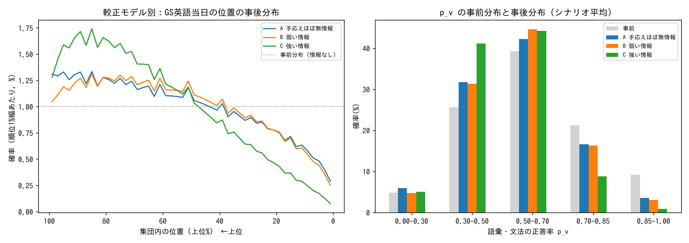

# 修正版：語彙・文法の手応えを「正答率が分からない」状態として扱った再分析（11/7）

再現方法：`python3 model2.py`（`model.py` の関数を使う。約1分）
**数字はすべて仮定つきモデルの計算結果。SPI英語の項目統計や、確信度と正誤の関係（較正）のデータは公開されていない。**

## 0. 前回モデルの欠陥
前回のモデルは「確信できたのは4割以下」を、P(確信あり|正答)=0.8、P(確信あり|誤答)=0.1 という**強い較正**で扱っていた。
これは「自信がない ≒ 不正解」に近い扱いで、推定順位を悲観的な側に寄せていた（216通りの中央値で上位69%）。

## 1. 確信度と正答の関係について、研究から言えること（定性的）
- 多肢選択式では、**最も自信がない回答でも、偶然よりは正答率が高い**（部分的な知識による）。一方で、自信がある回答にも誤りが混じる [1]。
- 多肢選択式では、当て推量のせいで「確信と正誤の相関（resolution）」が低く出る。**成績が低い人ほど、この相関は弱い** [2][3]。
- 第二言語の学習者が「勘」と申告した回答でも、偶然以上に正答することがある（暗黙の知識）。ただし、口頭での自己報告はあまり信頼できない [4]。
- **外的妥当性：** どの研究もSPI英語のデータではない。研究の係数を数値として流用はせず、「確信の弱さは正答率について**弱い情報しか持たない**ことが多い」という方向性だけを使う。

## 2. モデル
- p_v（語彙・文法の正答率）を未知数とする。p_v(η) = 3PL の期待正答率で、η は受検当日の実力。
- 難易度 b₀∈{−0.5, 0, 0.5}、適応度 λ∈{0, 0.5} はどちらも未知。事前分布は η〜N(0,1)。
- 較正：P(確信あり|正答)=s、P(確信あり|誤答)=f。resolution = s−f。

| モデル | (s, f) | resolution | 位置づけ |
|---|---|---|---|
| A 手応えはほぼ情報にならない | (0.35, 0.25) | 0.10 | 「確信できたかどうかは正誤とほぼ無関係」 |
| B 弱い情報 | (0.55, 0.20) | 0.35 | 研究から考えて最も妥当そうな範囲 |
| C 強い情報 | (0.80, 0.10) | 0.70 | 前回モデルと同じ。研究から見ると強すぎる側の上限 |

- s, f をまとめて0.75倍した「確信しにくい性格」の版も入れ、各モデルの中で平均した（重みは等しくした。この重みも仮定）。
- その他の観測：語彙18問中、確信ありが8問以下／長文9問中、確信ありが4〜6問／整序の1問目は誤答（本人が気づいた）／長文が3題出たこと（実測データがないので情報なしとして扱う）。

## 3. 結果：推定順位
| | A ほぼ無情報 | B 弱い情報 | C 強い情報 | 参考：完全適応型（手応えは無情報） |
|---|---|---|---|---|
| 平均順位（上位%） | 57.4 | 56.9 | 64.3 | 50.0 |
| 上位35%以内 | 24% | 24% | 14% | 35% |
| 平均以上 | 39% | 40% | 28% | 50% |
| 下位35% | 44% | 43% | 54% | 35% |
| 下位20% | 26% | 24% | 32% | 20% |
| 下位10% | 13% | 12% | 15% | 10% |
| 95%信用区間（上位%） | 6〜98 | 7〜98 | 13〜98 | 3〜98 |
| 難易度・適応度による平均順位の幅 | 54〜64 | 50〜68 | 50〜81 | — |

**語彙の手応えが推定をどれだけ動かすか**（語彙の手応えを外したモデルとの比較）：
- 平均順位への影響：A **+0.3ポイント**、B **+3.2ポイント**、C **+9.9ポイント**（いずれも下位の方向へ）
- 「平均以上」の確率への影響：A −0.5%、B −5.1%、C −15.7%
- → 研究から妥当そうなA〜Bの範囲では、語彙の手応えは**ほとんど情報を持たない**。前回の悲観的な推定は、主にCの仮定から来ていた。

**p_v の事後分布**（事前分布 → モデルB の事後分布）：
| 正答率 | 事前 | B の事後 |
|---|---|---|
| 0〜30% | 5% | 5% |
| 30〜50% | 26% | 31% |
| 50〜70% | 39% | 45% |
| 70〜85% | 21% | 16% |
| 85〜100% | 9% | 3% |

→ 「とても高い正答率」の確率がやや下がるだけ。低い正答率の確率はほとんど増えない。

## 4. 戦略比較（モンテカルロ法、15万回 × 較正3 × 回帰あり／なし × 信頼性3 × 練習効果4）
戦略：A=GSの結果を送る／B=JALの結果を送る／C=11/10にINPEXで受ける

各比較で後者が勝つシナリオの割合（仮定の格子のうちの割合で、確率ではない）：
| 較正・回帰 | B>A 平均順位 | B>A 下位15%回避 | B>A 下振れ | C>A 平均順位 | C>A 下位15%回避 | C>B 平均順位 |
|---|---|---|---|---|---|---|
| A・回帰あり | 75% | 75% | 75% | 75% | 75% | 67% |
| A・回帰なし | 75% | **25%** | **17%** | 75% | 42% | 75% |
| B・回帰あり | 75% | 50% | 50% | 75% | 50% | 83% |
| B・回帰なし | 75% | **17%** | **17%** | 75% | 42% | 58% |
| C・回帰あり | 83% | 75% | 50% | 83% | 75% | 83% |
| C・回帰なし | 75% | 33% | **8%** | 75% | 42% | 83% |

差の大きさ（全シナリオでの範囲）：
- 平均順位：B−A は **−2〜+10ポイント**、C−A は **−2〜+13ポイント**、C−B は **0〜+3ポイント**
- 下位15%を避けられる確率：B−A は **−9.5〜+7.4ポイント**、C−A は **−9.5〜+10ポイント**

注意：「B・Cが平均で勝つ」割合の多くは、練習効果を「なし・小・中・疲労」の4通りに置いたことから機械的に出ている（4通りのうち2通りがプラス）。**練習効果がSPI英語でどれくらいあるかは実測されていない。**

## 5. 結論
1. **最も重要な結論：数字は仮定によって大きく変わる。** 推定順位の95%区間は、どのモデルでも上位約6〜98%。戦略間の差は、平均順位で数ポイント、足切りを避けられる確率で±10ポイント以内。しかも、どちらが有利かは検証できない仮定（練習効果の符号、平均への回帰、INPEXの評価方法）で入れ替わる。
2. INPEXについては、公式FAQ「選考段階において英語能力の有無は特に重視していません」以外の実測データがない。仮想の足切りライン（下位15%、下位35%）は、**感度を見るための仮定であって、INPEXの基準ではない**。
3. 英語が総合評価に**連続的に効く**場合や、足切りが**厳しめ**の場合：C ≥ B > A が多数派。足切りが**ゆるい**場合で、GSが**実力どおり**だったとすると：A がやや有利（下振れが小さい）。
4. **推奨：C（11/10のINPEXで受検。11/8のJALは練習として受ける）。確信度：低。**
   - 理由：英語が少しでも評価に効く場合の期待値は C が最も高い。C と B の差は、学習期間が2日長いぶんの小さな差で、ほとんどのシナリオでマイナスにならない（ただし「C の練習効果 ≥ B の練習効果」という仮定による）。
   - **A を選ぶ方がよい条件：** INPEXは極端な低得点だけを見る、と考え、かつGSでは実力を出し切れたと判断する場合。A は下振れのリスクが最も小さい。
   - 戦略の違いがINPEXの選考結果に与える影響は、どの仮定でも小さい。11/8・11/10の受検の準備（語彙・訂正）や、ES・面接の準備に時間を回す方が効果的な可能性がある。

## 出典
1. Dissecting Knowledge, Guessing, and Blunder in Multiple Choice Assessments（McMaster, 2023） https://experts.mcmaster.ca/display/publication2922432
2. Vuorre & Metcalfe (2021) Measures of relative metacognitive accuracy are confounded with task performance in tasks that permit guessing, *Metacognition and Learning* https://psychology.columbia.edu/sites/default/files/content/Vuorre-Metcalfe2021guessing%20relative%20accuracy%20metacognition.pdf
3. *Metacognition and Learning*（2020）多肢選択式の数学テストにおける resolution と成績の相関は、人為的な要因による可能性が高い https://link.springer.com/article/10.1007/s11409-020-09257-1
4. 第二言語の暗黙知識と guessing criterion（Dienes 2008 を参照） https://pmc.ncbi.nlm.nih.gov/articles/PMC10201919
5. Holster & Lake (2022) vocabulary size, *Shiken* https://teval.jalt.org/sites/default/files/26_01_01_Holster_Lake_vocab_size_0.pdf
