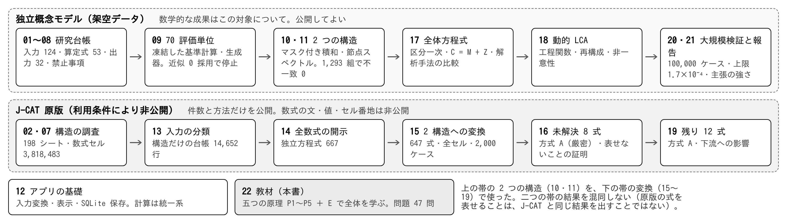

# 研究全体図

{width=135}

| 研究の章 | 何をしたか | 主な結果（強さ） | 教材の章 |
|---|---|---|---|
| 01〜08 | 研究台帳：禁止事項、資料、入力 124、算定式 53、出力 32、対応、監査、構築計画 | 要件の整理（記録） | 1、2、9 |
| 09 ＋ 保存資料 | 70 評価単位、凍結した基準計算、架空データの生成器、近似 32 候補 | 0 採用・16 不採用・16 保留。停止（測定） | 2.5、9.3、9.10 |
| 10・11 | 2 つの構造（マスク付き積和・節点スペクトル）の統一系 | 1,293 組で不一致 0（照合） | 3、4 |
| 12・13 | アプリの基礎、原版の入力の分類 | 試験 58 件通過、台帳 14,652 行 | 9.2 |
| 14〜16・19 | 原版の独立方程式 667 の開示と 2 構造への変換 | 647 ＋ 8 ＋ 12 で全式（照合）。べき・対数の不可能性（証明） | 9.5 |
| 17 | 建物全体の方程式と時間特性 | 区分一次、$C = M + Z$、解析手法の比較（証明・照合・測定） | 4、5、8 |
| 18 | 動的 LCA | 工程関数、再構成、非一意性、動的な特性化（証明・照合・仮定） | 6、7 |
| 20 | 大規模ランダム検証 | 100,000 ケースで不一致 0、上限 $1.7 \times 10^{-4}$（統計） | 9.6 |
| 21 | 最終報告 | 主張の強さの区別、終了条件 | 9.7、9.8 |

詳しい経過・修正・不採用の方法は別冊⑤（record/research_record.md）にある。
