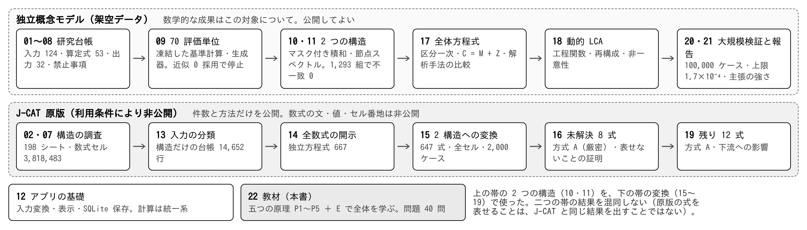

# 研究の全工程・発見・検証の記録

## 0. この記録について

この記録は、ホールライフカーボン研究（リポジトリの whole-life-carbon-jcat-study、第 1〜21 章と research_archive）を、教材の制作のために読み直してまとめたものである。読み直しは 9 つの独立した読み手（第 1〜8 章、第 9 章と保存資料、第 10 章の理論、第 10 章のコード、第 12〜16 章、第 17 章、第 18 章、第 19〜21 章、他のブランチと接続ストレージ）が並行して行い、教材の制作者がそれを照らし合わせて重複を除き、版の違いを確かめた。

- **対象の区別**：研究には二つの対象がある。**J-CAT 原版**（日本の建築物 LCA の計算ツール。利用条件により数式・値・セル番地は非公開）と、**独立概念モデル**（研究が独自に作った 70 評価単位。架空のデータ）である。数学的な成果（全体方程式・時間特性・動的 LCA・ランダム検証）は独立概念モデルについてのもので、J-CAT との互換性や同じ結果を主張するものではない。
- **主張の強さ**：〔証明〕〔照合〕（有理数・浮動小数での一致）〔測定〕〔統計〕〔仮定〕〔未解決〕〔一般〕を教材と同じ意味で使う。
- **公開の範囲**：原版の数式の文・係数・値・セル番地・シート名は、この記録にも載せない。件数（数式セル 3,818,483 個、独立方程式 667 個など）は既に公開されている研究の記録と同じものだけを使う。

## 1. 研究全体図

{width=170}

| 期 | 章 | 目的 | 主な結果 | 強さ |
|---|---|---|---|---|
| 1 研究台帳 | 01〜08 | 独立に作る WLC ツールの要件の整理。禁止事項の確定 | 入力 124 項目、独立の算定式 53、出力 32、入力→式→出力の対応、未解決 GAP-01〜10、構築計画 G0〜G8・受入試験 T01〜T12 | 記録 |
| 2 旧研究（近似） | 09 ＋ 保存資料 | 70 単位のモデルの式を近似・統合して簡単にする | 凍結した基準計算・架空データの生成器・厳密な統合モデル K1〜K7。近似 32 候補は 0 採用・16 不採用・16 保留。未完成のまま停止し、保存 | 照合（浮動小数）・測定 |
| 3 変換研究 | 10・11 | できるだけ少ない種類の数学的な変換で全体を計算する | 2 つの構造（マスク付き積和・節点スペクトル）で全 70 単位を計算する統一系。基準計算と 1,293 組で不一致 0 | 照合（浮動小数） |
| 4 アプリ基礎 | 12・13 | 入力・保存・表示の基礎と、原版の入力の分類 | アプリの 3 系統（入力変換・表示・SQLite 保存）、入力分類の台帳 14,652 行（構造だけ）、エンジンの 241 入力の対応 | 試験（58 件通過） |
| 5 原版の式 | 14〜16・19 | 原版の全数式の件数を確かめ、独立方程式を 2 構造に変換できるか調べる | 独立方程式 667 個。改良方式で 647 式、未解決 8 式を個別研究（方式 A で厳密）、残り 12 式も方式 A。$x^a$・$\log_{10}$ の厳密な表現の不可能性 | 照合・証明 |
| 6 統一理論 | 17〜21 | 70 単位の建物全体の時間特性、動的 LCA、大規模検証、最終報告 | 建物全体の方程式（区分一次）、$C = M + Z$、再構成と非一意性の定理、100,000 ケースで不一致 0（上限 $1.7 \times 10^{-4}$） | 証明・照合・統計 |
| 7 教材 | 22（本章） | 研究全体を最少の原理で学べる教材にする | 教材・原理シート・導出の図・問題 40 問・この記録・監査表 | 検算・独立の解答による監査 |

## 2. 第 1 期：研究台帳（第 1〜8 章）

**目的**：初学者も使える、公開できる独立の WLC 計算ツールを作るための要件の整理。J-CAT の複製や互換品ではない。原版は利用者が用意したもので、手元にだけ置き、リポジトリには入れない。

**決めたこと**
- 禁止事項（01）：原単位・マクロ・数式の無許諾の転用と公開、原版ファイルを GitHub に置くこと、「公式 J-CAT 完全互換」「同じ結果」と誤認させること、J-CAT を改変して頒布すること。
- 不明は 0 ではない（不変条件 R08）。モジュール D は A1〜C4 の合計に入れない。木材の炭素貯蔵は別の注記にする。
- 結果には必ず値・単位・年・仮定・方法・出典・版・「未確認」の印を付ける。

**作ったもの**：入力 124 項目（03）、段階ごとの独立の算定式 53（04。PRE、A1–A3 … C4、SUM、QA）、出力 32（05）、入力→式→出力の対応台帳（06）、読めた範囲と読めなかった範囲の監査と GAP-01〜10（07）、段階的な構築計画と受入試験（08）。検査用の script は読み取りだけで、「124 項目、53 式、32 出力、198 シート」の整合を確かめ、式に結び付いていない入力が 53 あることを未解決として表示する。

**限界（当時の記録のまま）**：原版との数値の一致は未確認、全数式の意味の分類と再計算は未実施、利用条件の確認は保留。

## 3. 第 2 期：旧研究（第 9 章）と停止・保存

**目的**：70 評価単位（既存の算定式 53 ＋ 追加の構造 17）の独立概念モデルについて、式をできるだけ簡単にまとめ、近似の可能性を測る。原版の数式には触れていない（原版のファイルは無く、データはすべて架空）。

**方法と結果**
- 行ごと・年ごと・事象ごとに素朴に計算する**基準計算**（refcalc）を作り、以後変更しないで凍結した。架空の建物の**生成器**（種から作る）を作った。
- 7 つの厳密な統合モデル K1〜K7 と導出 D1〜D8 を作った〔照合〕。
- 近似の候補 32 を測り、**0 採用、16 不採用、16 保留**（保留は実在の建物のばらつきに依存し、架空データでは決められないもの）〔測定〕。不採用の例：交換の回数を $T/c - 1/2$ などの滑らかな式で近似（大きな偏り）、$1 - (1 - r)^k \approx rk$（常に過大、平均 +28％）、小さな成分の省略（−20.2％ まで）。
- 2 回の独立の反証レビュー（1 回目 3 名、2 回目 5 つの観点で 59 件の指摘、うち確認 33・一部確認 8）を受けた。1 回目の指摘（記述子と年表の食い違い、統合モデルが基準の結果を保存して古い値を返す、B2 が範囲外のとき施設管理の分が消える、など）は修正して作り直した。

**停止**：2 回目の指摘の修正の途中で新しい指示（計算体系の再構成・数学的変換）を受け、2026-11-11 に未完成のまま停止した。途中の未検証の修正は作業ツリーから外し、パッチとして保存した（使ってはならない）。保存資料は 171 項目に分類し、引き継ぎの文書を作った。新しい研究は、公開済みの基準計算を変更しない物差しとして始めた。

## 4. 第 3 期：変換研究（第 10・11 章）

**目的**：同じ 70 単位のモデルを、できるだけ少ない種類の共通の数学的変換で計算する。

**経過**
1. 時間の核の実験（EXP-01、EXP-02）：振幅を基準計算から取り、時間の部分だけを確かめた。最大の相対差 $4.8 \times 10^{-13}$（2,720 組）、$4.3 \times 10^{-12}$（2,033 組）〔照合〕。
2. 不採用：交換の回数の連続のフーリエ級数（跳びの点で中点に収束し、周期が $T$ を割り切ると半回ずれる。合計の最大誤差 19.5％）、POD（標本の外で 32 モードでも 95％ 点 9.5〜22.8％）〔測定〕。反例として保存。
3. マスク付き積和のエンジン msp.py と、製造・運搬・施工の 18 単位をデータとして書いた仕様（159 万値で不一致 0、表せないもの 3、基準計算より遅い）。
4. 2026-11-13、**統一系**：共通の表、B1-04（冷媒の期末残存）の区間形、冷媒の 8 段の倍化、時間と集計のプログラムを加え、全 70 単位・公開の出力 190 キーを 2 構造だけで計算。
5. 全数の照合：10 の集合で 1,293 組、22,698,402 値、不一致 0（2 組は定義域外として除外）、負の対照 24/24 を検出、他のエンジン（mpmath・SymPy・SciPy・DuckDB・lca_ops）との照合〔照合〕。別の作業ツリーでの再実行で 14 の結果ファイルが（実行時間を除き）同一。

**見つかった問題と修正**：冷媒の期末残存を累積量（初期 − 漏洩の累積 ＋ 補充）で書く跳び形は、強く減る場合に桁落ちする（漏洩 35％・60 年で相対 $2.3 \times 10^{-5}$、極端な例で $6.1 \times 10^{21}$）→ 区間形を採用。面積の和は名前の順に足す（基準計算の足し算の順序に合わせる）。代表値の確認で運用の年ごとの値を基準計算から借りていた → 年表と単位の文字列の分解を積和の中で行うように直した。比較が一部の出力だけだった → 全 70 単位の全公開キーと比べる検査に直した。

**限界**：統一系の数値は実装者の確認だけ（独立の確認者なし）。経路 A・C、助言者の仕組みは未完了。架空データ。

## 5. 第 4 期：アプリの基礎と入力の分類（第 12・13 章）

- アプリの 5 系統のうち 3 つ（② 共通の入力データとエンジン入力への変換、④ 結果の表示、⑤ SQLite の保存）を作った。計算は変更しない統一系に任せる。試験 47 → 58 件通過。架空データ、互換性の主張なし。
- 利用者の入力分類の木（5 大分類）を受け取り、原版 6 ファイルの全入力項目・数値・設定を構造だけの台帳 14,652 行に分類した（値は持たない）。エンジンの 241 入力を分類に結び付けた。

## 6. 第 5 期：原版の式の開示と変換（第 14〜16・19 章）

- **第 14 章**：原版の数式の文を初めて全部読んだ（第 9 章は数式を読まず、シート名だけで単位に対応させていた）。数式セル 3,818,483 個、正規化したパターン 4,241 個、**独立方程式 667 個**。研究側の統一系の全方程式（マスク付き積和の式など）も書き出した。この時点では原版の式の変換は 0 件（第 15 章で置き換わる）。
- **第 15 章**：667 式を二つの独立した読み手の組で分類（実質的な算定規則 592、表示・転記・補助 75）し、2 構造に変換した（基本方式 619、改良方式 647）。全セル、境界条件、現実的な建物 2,000 ケース（LibreOffice で再計算して 3 者照合）、建物全体の連鎖で照合した（1,151 万条件）〔照合〕。反例：割り算の最後の桁が切り捨てや比較で増幅される（正しく丸めた割り算に変更）、文字の比較の順序（Shift_JIS の順で全一致）。変換器の誤り（表のキャッシュのキー、INDEX の判定順、範囲外の OFFSET）は修正後に数えた。
- **第 16 章**：未解決の 8 式を、厳密な方式 A と高精度の近似の方式 B で研究し、方式 A を採用した。**表せないことの証明**：2 構造の有限の組合せは区分的に有理関数なので、整数でない指数のべきと常用対数は実数の計算として厳密に表せない〔証明〕。ただし倍精度の入出力として正しく丸めた値を返すことはできる（有限の精度での実現）。反証レビューで、無限個の節点を許す議論は撤回し、有限性を前提に書き直した。
- **第 19 章**：残り 12 式（文字の連結・文字の IF・置換）も方式 A で厳密に変換した。全 2,247 セル、境界条件 6,800、LibreOffice の 670 ケース、合成 48,000 ケース（255 文字を超える定義域外の 107 件を除き不一致 0）〔照合〕。4 式だけが静的な参照で下流を持ち、置き換えても下流のセルは 8 ulp を超えて変わらなかった（基準の入力だけ）〔測定〕。8 式が「表示だけ」かどうかは、OFFSET やマクロを解析していないので証明ではない。

## 7. 第 6 期：統一理論（第 17〜21 章）

**第 17 章（建物全体の方程式と時間特性）**
- 建物全体（合計と 14 段階）は $T$ の区分一次関数で、節点は年の境目と事象の時刻。節点形で厳密に表せる〔証明〕。帯を除く範囲 $\mathcal{D}'$ で基準計算と 1,293 組が相対 $10^{-9}$ 以内（最大 $1.0 \times 10^{-13}$）〔照合〕。
- $C(T) = M([0, T]) + Z(T)$：$C$ は実際の排出の累積ではない。$Z'$ は 347 シナリオ中 319 で 0 でない。$C(0+) \ne 0$〔証明〕。
- 実時間の分解は一意でない（定数を $t = 0$ と $t = T$ のどちらに置くか、期末残存の読み替え）〔証明〕。単位ごとの負の原子・負の率は帳簿上の量で、段階ごとに集めると率は負にならない〔照合〕。
- ラプラス変換・有限区間のフーリエ変換は節点を指数とする閉じた式（数値との差 $1.4 \times 10^{-13}$、$7.8 \times 10^{-13}$）。フーリエの部分和は表現にならない（512 項でも最大誤差の中央値 2.8％、最悪 16％）〔測定〕。
- DMD の前提（時不変の線形の動き）は成り立たない。年増分の次数は 347 中 345 で一般の値 65〔照合〕。FRI は跳びだけの段階で $K \le 6$ のとき時刻を $10^{-13}$ 年以下で戻せる〔測定〕。
- **領域の穴**：整数の時刻の近くの交換の直後の細い帯 $(K, \mathrm{sw}(\tau))$ では、節点形も統一系も基準計算と食い違いうる（整数の時刻で 9 組中 2 組）。主張を $\mathcal{D}'$ に縮めた。整数に近い浮動小数の時刻は未検証〔未解決〕。
- 冷媒の期末残存は、浮動小数の係数では厳密な連続性と桁落ちの無さを両立できない〔未解決〕。節点形の最小性は未証明。長期の傾き $\beta$ は数値で求めていない。

**第 18 章（動的 LCA）**
- 17 の工程関数（工程の族）を定め、核の各項がちょうど一つの族に属するように割り当てた。**再構成の定理**：工程関数の実時間の積分と期末の項の和が $C_{70}(T)$ に戻る〔証明〕（79 シナリオ・4,248 期間で有理数で不一致 0〔照合〕）。
- 年の中の一様な配分は、年の重み $w_k(T)$ が一次式であることから強制される〔証明〕。施工・製造の時期、解体・処理の期間、季節は 70 単位から導けない（仮定 X1〜X4 として扱う）。
- **非一意性の定理**：工程ごとの合計を保つ時期の変更は $C_{70}$ を変えない（定理 1）。期末残存は「廃棄時の放出」とも「使用中の負と正の流れ」とも読める（定理 2）〔証明〕。
- 工程間の関係：時不変の畳み込みが厳密に成り立つのは比例（施設管理 ＝ 割合 × 買電）だけ。ゲート（更新の年の修繕の取り消し）と状態（冷媒）は書けず、冷媒は二時刻の核が要る〔導出〕。
- 動的な特性化（Joos ら 2013 の応答関数、$R(100) = 52.355$）は、時期の仮定で約 $10^{-3}$（終点が $T$ に近いと 1 の桁）変わるが、静的な合計は変わらない〔測定〕。CO2e を CO2 とみなした近似〔未解決〕。

**第 20 章（大規模ランダム検証）**：宣言した分布で 20,000 シナリオ × 5 期間 ＝ 100,000 ケース。定義域の 90,055 ケース（18,011 シナリオ）で不一致 0。正しい上限はシナリオ単位の $1 - 0.05^{1/N} = 1.7 \times 10^{-4}$（ケース単位の値は参考）〔統計〕。わざと壊した式は 7 つの型で検出（1 型は作り方から検出力が無い）。64 項のフーリエ部分和の誤差も確認（表現には使わない）。

**第 21 章（最終報告）**：主張を、証明・有理数の照合・浮動小数の一致・統計・データや仮定が要るもの・未解決に分けて列挙し、終了条件 A〜D をその範囲で達成と判定した。最終確認で、ケース単位の上限を主の値としていた記述、帯に確率が全く無いとした記述、節点形の最小性の主張などを訂正・撤回した。

## 8. 他のブランチと接続ストレージ

| 調べたもの | 結果 |
|---|---|
| 2026-11-11 の 2 つのブランチ（研究台帳・軽量アプリ） | 同じコミット。第 1〜8 章の古い版で、内容はすべて現在のブランチにある |
| 近似研究のブランチ | 第 1〜11 章と保存資料の古い版。現在のブランチに無い内容は無い（履歴だけの初版の報告と、未検証の修正のパッチ） |
| main と feature ブランチ | 研究とは別の数学の基盤（Math IR、LCA の 4 つの演算子 lca_ops.py）。研究は lca_ops.py を有理数の外部照合に使った |
| その他 15 ブランチ | 関連する語が 0 件。無関係 |
| Dropbox | 原版の配布ファイル（利用制限あり。開いていない）と CI の試験ファイルだけ。研究文書は無い |
| Box | 研究室内で共有された第三者の論文（閲覧のみ・著作権あり。開いていない）。研究文書は無い |

## 9. 見つかった問題と修正（主なもの）

| 章 | 問題 | 修正 |
|---|---|---|
| 09 | 統合モデルが基準の結果を保存し、基準が変わった後に古い値を返した | 保存をやめ、統合の数に入れない |
| 09 | B2 が範囲外のとき、施設管理の分を B6 から引いて消えた | B2 が範囲内のときだけ引く |
| 10 | 冷媒の期末残存の跳び形が桁落ち | 区間形を採用（跳び形は比較用） |
| 10 | 運用の年ごとの値を基準計算から借りていた | 年表と単位の分解を積和の中で行う |
| 14→15 | 第 14 章は原版の式の変換を 0 件と記録 | 第 15 章で 647 式を変換（第 14 章の記述は第 15 章で置き換わる） |
| 15 | 割り算 $a \cdot (1/b)$ の最後の桁の誤差が判定を反転（境界の反例 46） | 正しく丸めた割り算 |
| 16 | 不可能性の証明で無限個の節点を許していた | 撤回し、有限性を前提にして書き直し |
| 17 | 帯の食い違いを「丸めの範囲の位置の違い」と記述 | 実際の領域の穴として $\mathcal{D}'$ に主張を縮める |
| 17 | $C = M([0,T)) + Z$（半開区間）と記述 | $M([0, T])$ に訂正 |
| 17 | 冷媒の残存量が DMD の前提を満たすと記述 | 切り替わる非線形の写像なので前提は成り立たない、に訂正 |
| 18 | 年の帰属の違いを整数の時刻の事象だけと記述 | 年の終わりをまたぐすべての事象（整数に近い浮動小数を含む）に訂正 |
| 19 | 静的な閉包を 30 段で打ち切り | 上限なし（98 段）で再計算し、固定点まで再評価 |
| 20・21 | ケース単位の上限を主に示した。帯に確率が無いとした | シナリオ単位の上限が正しい値。帯は「ほとんど無いが 0 ではない」 |
| 21 | 節点形の最小性を主張 | 撤回（未証明） |

## 10. 採用しなかった方法と保留した方法

| 方法 | 理由 | 章 |
|---|---|---|
| 原版の約 380 万セルをそのまま再実行する | 要件で不可。式ごとに独立の関数として扱う | 01・08 |
| 近似の候補 32（0 採用） | 16 は誤差・偏り、16 は実データが無いので保留 | 09 |
| 交換の回数のフーリエ級数・滑らかな近似 | 跳びで誤差が残る、偏り | 09・10 |
| POD・SVD | 跳びの位置が建物ごとに違い、モードが多く要る | 10・17 |
| DMD・固有値分解・モデル縮約 | 時不変の線形の前提が無い。周期成分の固有値が単位円上 | 10・17 |
| 冷媒の期末残存の跳び形 | 桁落ち | 10・17 |
| 割り算の基本方式、近似のべき・対数（方式 B） | 最後の桁の誤差、正しく丸められない | 15・16 |
| ウェーブレット（Haar 等） | 有限の項で表せない、または係数が節点形の数十倍 | 17 |
| 全関係を畳み込みで統一 | 期末の項は畳み込みでない、冷媒は二時刻の核 | 17・18 |
| 年の中の不均一な配分 | 年の重みが一次式なので、年の途中の $T$ で $C_{70}$ が変わる | 18 |
| ガス別の動的な特性化 | ガス別の時間の目録が無い | 18 |

## 11. 版と重複の整理

- 第 9 章の報告は、初版（履歴だけ）・反証レビュー後の再生成版・停止の注記つきの現行版がある。数値は現行版を正とする。
- 第 14 章の「変換 0 件」は第 15 章で、第 15 章の未解決 8 式は第 16 章で、残り 12 式は第 19 章で置き換わる。
- 第 17 章の帯の記述、第 20・21 章の上限の記述は、レビュー後の版を正とする。
- 統一系の日付（2026-11-13）と外部実行の記録の時刻（11-12）に食い違いがある（理由は記録に無い）。

## 12. 調べられなかったもの

- 接続ストレージの原版の配布ファイルと第三者の論文（利用条件により開いていない）。
- 試験対策システムのテスト（利用者の指示書にある docs/code_dump/exam_system_code_dump.txt）と、そのリポジトリ（この作業環境から追加できなかった）。試験対策コードは、利用者が会話に貼り付けた第 3・4 部だけを読んだ。第 1・2 部（文章処理など）は読めなかったので、同じ働きの小さな関数を作り直した（教材のコードの textlib.py）。
- 研究の生の結果ファイルの一部（大きな JSON）は要約の JSON と文書で確かめ、全行は読んでいない。

## 13. 第 22 章（本教材）の制作工程

1. **再調査**：上の 9 つの読み手による読み直しと照合（研究全体図・この記録）。
2. **試験対策コードの応用**：利用者の試験対策システム（分類・手掛かり・論点・得点・問題・資料・組版・流れ）の考え方を、「試験に出るか」ではなく「何種類の問題を支えるか」の基準に置き換えて使った。組版（render.py）は品質検査の仕組みごと引き継ぎ、数式の組版（MathML の画像、数式用フォント）と、日本語フォントに無い文字の検出を加えた。問題の検算（questions.py の「解いて代入して確かめる」）は、SymPy が無い環境なので有理数の厳密な算術で行い、単位・定義域・独立な 2 通りの計算を加えた（code/verify.py、code/problems.py）。等級（S・A・B・C）による削除は行っていない。
3. **体系化と圧縮**：五つの原理 P1〜P5 と規律 E に絞り、章の順序を原理の依存の順にした（design/01_知識体系の設計.md）。
4. **執筆**：各章を「何を求めたいか → 簡単な例 → 式 → 記号 → 導出 → WLC への応用 → つながり → 初めての問題 → 誤解」の流れで書いた。図 8 枚は教材の例題と同じ式から描き、値を CSV に残した。
5. **問題と監査**：12 種類 × 3 水準 ＋ 未知問題 4 の 40 問。計算 30 問は有理数で検算（124 件すべて通過）。独立の解き手が教材だけで解けるかを判定し、不足を教材に加えた（監査表⑥）。
6. **品質検査**：PDF（埋め込み・空ページ・文字化け・ページ番号・期待語・どのフォントにも無い文字）と Word（画像の数・期待語）を自動で検査し、ページを画像にして目で確かめた。
