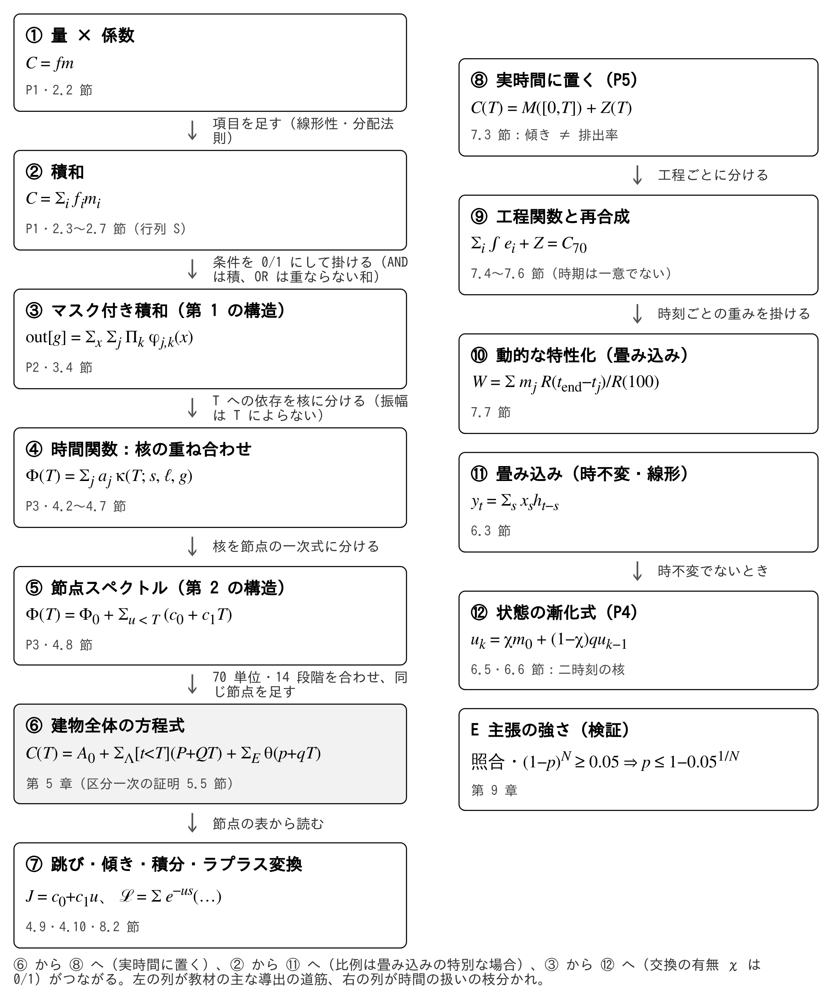

# 数式の導出とつながり

教材の式が、少数の基本の式からどの操作でつながるかを一枚の図と表にまとめる。各段の「操作」と「成り立つ条件」を言えれば、途中の式は覚えなくても導ける。

{width=165}

## 段ごとの操作と条件

| 段 | 式 | 前の段からの操作 | 成り立つ条件・崩れる場合 | 教材 |
|---|---|---|---|---|
| ① | $C = f m$ | （出発点） | 排出が活動量に比例する | 2.2 |
| ② | $C = \sum_i f_i m_i$ | 項目ごとの ① を足す | 重複・漏れが無い（分け方は自由） | 2.3〜2.5 |
| ③ | $\mathrm{out}[g] = \sum_x \sum_j \prod_k \varphi_{j,k}(x)$ | 条件を 0/1 にして積に入れる。if–else は重ならない項の和 | OR を単純な和にしない。不明を 0 にしない | 3.3〜3.5 |
| ④ | $\Phi(T) = \sum_j a_j\, \kappa(T; s_j, \ell_j, g_j)$ | ③ の結果を「$T$ によらない振幅 × 決まった形の核」に分ける | 量・係数が $T$ によらない（割引などで $T$ の非線形な関数になると崩れる） | 4.2〜4.7 |
| ⑤ | $\Phi(T) = \Phi_0 + \sum_{u < T} (c_0(u) + c_1(u)\,T)$ | 核を節点で始まる一次式に分け、同じ節点を足す | 核が区分一次（5 つの形はすべてそう） | 4.8 |
| ⑥ | $C(T) = A_0 + \sum_{\Lambda} [t<T](P_t + Q_t T) + \sum_{E} \theta_\varepsilon (p_g + q_g T)$ | 全単位・全段階の ⑤ を、符号と範囲の 0/1 を掛けて足す | 符号と範囲は係数に一度だけ入れる | 5.2〜5.5 |
| ⑦ | 跳び $c_0 + c_1 u$、傾き $\sum_{u<T} c_1$、$\mathcal{L}$ | ⑥ の節点の表から読む。変換は節点ごとに部分積分 | 跳びの点では普通の微分は無い（超関数として扱う） | 4.9、4.10、8.2 |
| ⑧ | $C(T) = M([0, T]) + Z(T)$ | ⑥ の各項を実時間 $t$ の上に置き、評価の終わりに置く項 $Z$ を分ける | 置き方は一意でない（単位の意味で決める）。$T$ ちょうどの事象は $M$ に入らない | 7.3 |
| ⑨ | $\sum_i \int_{[0,T]} e_i + Z = C_{70}$ | ⑧ を工程ごとに分ける（再合成） | 各項はちょうど一つの工程に属する | 7.4〜7.6 |
| ⑩ | $W = \sum_j m_j\, R(t_{\mathrm{end}} - t_j)/R(100)$ | ⑨ の時刻ごとの排出に応答の累積を掛ける（畳み込み） | 大気の応答が線形・時不変（小さな擾乱）。CO2e を CO2 とみなす近似 | 7.7 |
| ⑪ | $y_t = \sum_{s \le t} x_s h_{t-s}$ | 「ある時刻の出来事が後に効く」を経過時間で足す | 線形かつ時不変（比例は $h_0$ だけの特別な場合） | 6.3、6.4 |
| ⑫ | $u_k = \chi_{k-1} m_0 + (1 - \chi_{k-1}) q u_{k-1}$ | 状態を前の年の値から決める。交換の有無を 0/1（P2）で入れる | 応答が後の交換で切られる（時不変でない）ので ⑪ にならない | 6.5、6.6 |
| E | $(1 - p)^N \ge 0.05 \iff p \le 1 - 0.05^{1/N}$ | 独立な $N$ 回で失敗 0 の確率 | $N$ は独立な単位（建物）で数える。宣言した分布の外は何も言わない | 9.6 |

## 三つの例の流れ（教材の説明の順）

**例 1：量 × 係数からマスク付き積和へ**（第 2・3 章）

$$ C = f m \ \to\ C = \sum_i f_i m_i \ \to\ C_{\mathrm{A4}} = \mu\, f\, m \ \to\ \mathrm{out}[g] = \sum_x \sum_j \prod_k \varphi_{j,k}(x) $$

1 つの材料 → 材料の表 → 「範囲に含めるなら 1」の掛け算 → 条件が何個あっても同じ形。

**例 2：初期 ＋ 毎年から全体方程式へ**（第 4・5 章）

$$ C = a + bT \ \to\ C = a + bT + R\,N(T) \ \to\ C = a + bT + \sum_\tau R_\tau [\tau < T] \ \to\ \Phi = \sum_j a_j \kappa_j \ \to\ \text{(5.1)} $$

直線 → 交換で跳ぶ階段 → 一覧で与えた事象 → 年ごとの量（年セル）・事象の後だけの量（ゲート）を含む核の和 → 節点ごとに集めた全体方程式。どの段でも節点の間は一次式なので、最後まで区分一次。

**例 3：畳み込みと、その限界**（第 6 章）

$$ y_t = \sum_{s \le t} x_s h_{t-s} \quad \text{（応答が経過年数だけで決まる）} \qquad \text{対} \qquad u_k = \chi_{k-1} m_0 + (1-\chi_{k-1}) q u_{k-1} \quad \text{（交換で状態が戻る）} $$

設置した設備の排出は経過年数だけで決まるので畳み込み。冷媒の漏洩は残存量（状態）で決まり、交換が前の充填の効果を切るので、経過年数だけでは書けない（二時刻の核 $h(t, s)$）。

## 一般の形から特別な場合を取り出す

| 一般の形 | 特別な場合 |
|---|---|
| 核 $\kappa(T; s, \ell, g)$ | 定数 $(0, 0, -\infty)$、原子 $(\tau, 0, \tau)$、年セル $(k, 1, -\infty)$、ゲート付き年セル $(k, 1, \tau)$、密度 $(0, H, -\infty)$ |
| 全体方程式 (5.1) | 例題の $C = a + bT + R\,N(T)$（$A_0 = a$、節点 0 に $Q = b$、事象 $nL$ に $p = R$） |
| 畳み込み | 比例（$h_0 = \rho$、他は 0）、動的な特性化（$h = $ 応答の累積） |
| マスク付き積和 | 段階の範囲 $\iota_s$、符号 $\sigma$、OR・if–else・max・割り算の場合分け |
