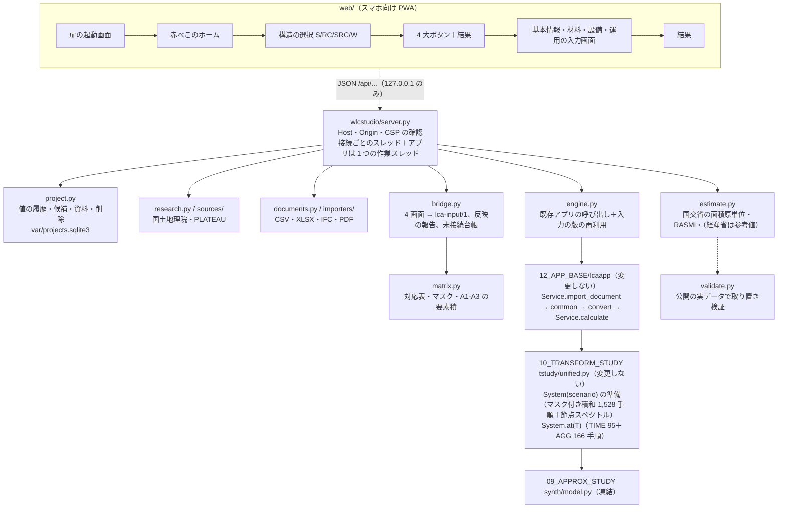

# 構成と依存関係、行列化した範囲

## 依存関係（外側の層だけを新しく作った）

- 70 評価単位の計算体系は作り直していない。`engine.py` は `lcaapp.service.Service` を呼ぶだけで、`enginepath.fingerprint()` が検証時のエンジンと一致することを結果の記録に出す（「エンジンの版の確認」）。
- 既存のアプリの保存（`var/engine.sqlite3`）には、変換した入力の版と計算の記録が入る。住所・建物名・資料の原本は渡さない。
- 評価期間 T だけを変えた再計算：同じ文書（SHA-256 が同じ）の入力の版を再利用するので、`Service` の中で準備済みの `System(scenario)` が見つかり、`System.at(T)` だけが動く（試験 `test_versioned_recalculation_reuses_prepared_system`；画面からの往復で約 130 ms、最初の計算は約 0.3 秒）。

## 7 つの状態をエンジンにどう渡すか

| 画面の状態 | エンジンへ | SYS-01 の状態 |
|---|---|---|
| 取得・確認済み | 値 | OBSERVED（値が 0 なら EXPLICIT_ZERO） |
| 図面から計算 | 値 | DERIVED |
| 統計推定 | 値（範囲は結果の「範囲」の計算に使う） | ESTIMATE |
| 仮定 | 値 | ESTIMATE |
| 未取得 | 渡さない（None＝欠損） | MISSING |
| 適用外 | 項目ごとに決めた意味：量が無い（0 を明示のゼロとして）／行が無い／渡さない | EXPLICIT_ZERO など |
| 計算不能 | 渡さない（None＝欠損） | MISSING |

- 評価範囲（含める段階）は必ず書く。書かないとエンジンはどの段階も合計せず 0（complete=True）を返すため（Phase 0 の監査で確認）。未設定なら計算しない。
- 評価範囲から外した段階の必須の年表（例：B7 を外したときの上水）だけは、0 を明示のゼロとして渡し、その理由を記録する（合計には入らない）。
- 各所有者（project・construction・operation・water_waste・end_of_life と材料・設備・冷媒の各行）に `provenance_id` と `states` の表を付け、SYS-01 が実際の状態を数えるようにした。

## 行列（ベクトル）にした範囲と、しなかった範囲

**行列にした（本当に線形なところだけ）** — `wlcstudio/matrix.py`

1. 入力欄 → エンジン入力の 0/1 の対応表 M（E×F）と、状態の 3 つのマスク（値あり・適用外・不明）。不明は「値あり」の 0 ではなく別のマスクで、届いた（M·値あり > 0）と、不明だけ（M·不明 > 0）を別に数える。
2. 材料の行の A1-A3：e = q ⊙ c ⊙ f（数量 × 単位の換算×1/(1−廃棄率)（設計数量のとき）× 原単位）、合計 1ᵀe。エンジンの A13-01 の行ごとの値と相対 1e-9 以内で一致することを試験した（`test_vectorised_a13_equals_engine`）。
3. その区間：c ≥ 0、f ≥ 0 なら合計は各 q について単調なので、端点だけで正確な範囲になる（標本は取らない）。
4. 統計推定の候補 q ≈ 延床面積 × 原単位（国交省・RASMI）は、延床面積に比例する線形の式。

**行列にしなかった（エンジンに任せる）** — 監査で確かめた非線形の部分

- 0/1 の門（許諾、ただ 1 つの段階、単位の換算可否、EPD の期限、比率の範囲、割合の合計）：P1 の 1,528 手順のうち 740 は判定だけの手順。
- 最初に一致したものを取る照合（原単位の id → 記録、換算の優先順位、EPD＞複合＞一般）：180 手順。
- 冷媒の状態の漸化式（漏えい率・補充・交換の型に非線形）、時間の節点（周期の繰り返し、年の区切りの ceil、ε の帯）、SUM-05 の 1/T、丸め・Neumaier の和。
- これらを無理に行列の積にすると結果が変わるので、そのままエンジンで計算する。

## 計算の速さ

| 場面 | 時間（この環境） |
|---|---|
| 最初の計算（取り込み＋System の準備＋at(T)） | 約 0.26〜0.40 秒 |
| 評価期間だけを変えた再計算 | 約 25〜40 ms（画面からの往復で約 130 ms、範囲の 2 回を含む） |
| 範囲（下端・上端）の追加計算 | 最初は各 0.3 秒、以後は再利用 |
